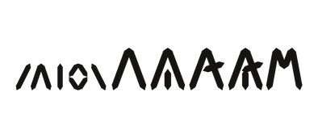
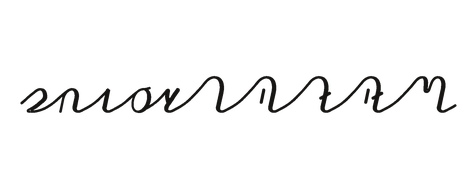
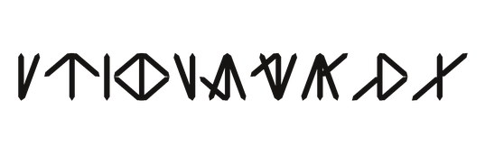
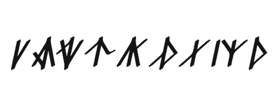
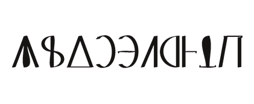
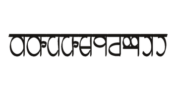
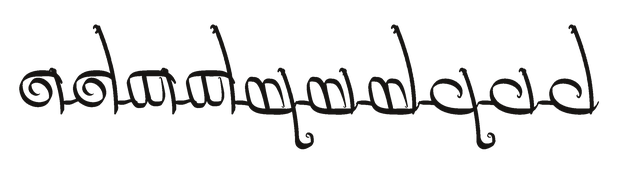
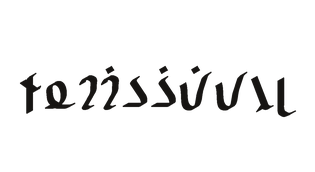
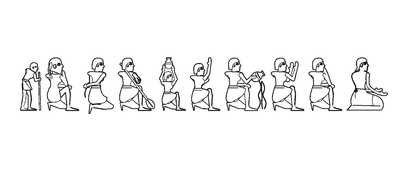
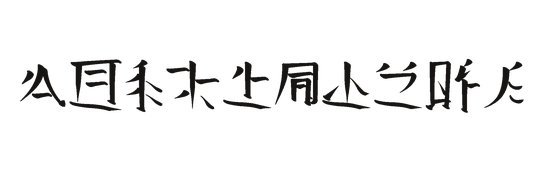

# Fantasy script fonts

Open-source fonts for invented writing systems, free to use in your own campaign, game, book or website. They were built for the [HeroicLands Thalorna](https://www.heroiclands.org/thalorna/) setting, and anyone may use them.

| Font                  | What it is                                                                                | Direction               | Sample                                                                  | Keyboard                                               |
| --------------------- | ----------------------------------------------------------------------------------------- | ----------------------- | ----------------------------------------------------------------------- | ------------------------------------------------------ |
| Pirzath Carved        | Khazari (dwarven) runic lapidary                                                          | Left to right           |                | [HL Pirzath](keyboards/pirzath.md)                     |
| Pirzath Hand          | Khazari (dwarven) common hand, the modern script                                          | Left to right           |                    | [HL Pirzath](keyboards/pirzath.md)                     |
| Thuravark Carved      | Proto-Pelwar (human) runic lapidary, derived from Pirzath, with the Tharavarkon recension | Left to right           |            | [HL Thuravark](keyboards/thuravark.md)                 |
| Semaron Kuriale       | Vylarian (human) chancery hand                                                            | Left to right           |              | [HL Semaron](keyboards/semaron.md)                     |
| Helonika Book         | Helonic (human) book hand, geometric capitals over a round minuscule                      | Left to right           |                  | [HL Helónika](keyboards/helonika.md)                   |
| Vedyakshara Classical | Vedyari (human) temple syllabary, hung from a headline                                    | Left to right           |  | [HL Vedyakshara](keyboards/vedyakshara.md)             |
| Veldikko              | Sinale (elvish) joined calligraphic hand                                                  | Right to left           |                            | [HL Veldikko](keyboards/veldikko.md)                   |
| Qalezu Hand           | Au'Khelathu merchants' script                                                             | Right to left           |                      | [HL Qalezu](keyboards/qalezu.md)                       |
| Khelathi Zethu Glyphs | Au'Khelathu temple hieroglyphs                                                            | Right to left           |  | none: [use the chart](charts/khelathi-zethu-glyphs.md) |
| Teng Chou             | Tantsou (human) logographic script                                                        | Vertical, top to bottom |                          | none: [use the chart](charts/teng-chou.md)             |

Each font draws only its own characters, on code points of its own, so ordinary English text typed in one shows empty boxes. You type in a script with its keyboard layout, or insert characters by code point from the font's chart.

## Download

Every font is a TrueType file (`.ttf`, for documents and desktop apps) and a WOFF2 file (`.woff2`, for websites). Download them from the [latest release](https://github.com/HeroicLands/fonts/releases/latest), which also holds `keyboards.zip` (the keyboard layouts for every platform and their cheatsheets) and `charts.zip` (the character charts). Unzip both into one folder so the cheatsheets find their charts. Programs can take everything from npm instead; see [For programs](#for-programs).

## Install a font

Install the `.ttf` file. Close and reopen a program that was running, so it sees the new font.

- **macOS.** Double-click the `.ttf`, then choose Install Font in the Font Book window.
- **Windows.** Right-click the `.ttf` and choose Install, or Install for all users.
- **Linux.** Copy the `.ttf` to `~/.local/share/fonts/`, then run `fc-cache -f`.

## Use a font in a document

Choose the font by its name, such as `Pirzath Carved`, in the font box of your word processor.

- **Microsoft Word, LibreOffice Writer and Apple Pages** use an installed font directly. Word, LibreOffice and Pages all shape OpenType text, which the joined scripts need: Veldikko's letters join along the line and its vowel marks stand over them only in an app that shapes text this way.
- **Web apps such as Google Docs cannot use a font installed on your computer.** Use a desktop app, or put the text in a picture.
- **Right-to-left scripts** (Veldikko, Qalezu Hand and Khelathi Zethu Glyphs) run right to left on their own, mixed with English, with no setting to change.
- **Veldikko** has tall risers and long tails. Set its paragraphs to a line height of about 2.4 times the font size so lines do not collide.
- **Pirzath Hand and Thuravark Carved** each have an optional form, the OpenType stylistic set `ss01`. Turned on, Pirzath Hand draws a joining line under its letters and Thuravark Carved binds common pairs of staves onto one stem. In LibreOffice, write the font name as `Pirzath Hand:ss01` or `Thuravark Carved:ss01`.
- **Teng Chou** is written in columns. Set it as ordinary text on a line, or use your app's vertical text direction for columns.

## Type in a script

Eight of the fonts have a keyboard layout that types by sound. You press the key for the sound, and the layout types the script's character for it: `t` types the script's t, Option+T types its th, and Shift makes a capital. Each layout is a standard US keyboard underneath, so the roman letters are the ones printed on the keys. **Option** is the Option key on a Mac and the **AltGr** key on Windows and Linux (the right Alt key; on a keyboard without one, hold Ctrl and Alt together).

Every layout has a printable cheatsheet with a picture of the keyboard and a table of every key:

| Layout         | Types                        | Cheatsheet                                           |
| -------------- | ---------------------------- | ---------------------------------------------------- |
| HL Pirzath     | Pirzath Carved, Pirzath Hand | [keyboards/pirzath.md](keyboards/pirzath.md)         |
| HL Thuravark   | Thuravark Carved             | [keyboards/thuravark.md](keyboards/thuravark.md)     |
| HL Semaron     | Semaron Kuriale              | [keyboards/semaron.md](keyboards/semaron.md)         |
| HL Helónika    | Helonika Book                | [keyboards/helonika.md](keyboards/helonika.md)       |
| HL Vedyakshara | Vedyakshara Classical        | [keyboards/vedyakshara.md](keyboards/vedyakshara.md) |
| HL Veldikko    | Veldikko                     | [keyboards/veldikko.md](keyboards/veldikko.md)       |
| HL Qalezu      | Qalezu Hand                  | [keyboards/qalezu.md](keyboards/qalezu.md)           |

[keyboards/index.md](keyboards/index.md) draws the keys they share. Install a layout, switch to it, and set the text's font to the matching font.

### Installing a keyboard layout

- **macOS.** Copy the `keyboards/macos/HeroicLands.bundle` folder to `~/Library/Keyboard Layouts/` (in Finder, choose Go, Go to Folder, and paste the path). Log out and back in. Open System Settings, Keyboard, Text Input, Input Sources, press the add button and look under English for the `HL` layouts. Switch layouts from the menu bar. Command and Control shortcuts keep working.
- **Windows.** Each layout is a source file, `keyboards/windows/<layout>.klc`, for Microsoft Keyboard Layout Creator, which builds the installer on Windows only. Install that free tool, open the `.klc` file in it, choose Project, then Build DLL and Setup Package, and run the `setup.exe` it writes. Then add the layout under Settings, Time & language, Language & region, English (United States), Keyboard. Switch layouts with Windows key+Space.
- **Linux.** Each layout is an XKB symbols file, `keyboards/linux/hl_<layout>`. Copy the files to `~/.config/xkb/symbols/`. Under X11 run `setxkbmap -I$HOME/.config/xkb -layout hl_pirzath` (substitute the layout); a desktop that reads `~/.config/xkb` lists them as custom layouts. `setxkbmap us` returns to the usual layout.
- **Emacs.** `keyboards/emacs/heroiclands-<layout>.el` is an input method. Put the folder on `load-path`, evaluate `(require 'heroiclands-pirzath)`, then run `M-x set-input-method` and name `heroiclands-pirzath`. Emacs has no Option key, so Option+T is typed as a backslash and then `t`.

A few sounds are written with more characters than a Windows key (four UTF-16 code units) or a Linux key (one character) can hold. Those keys type nothing on that platform, and each cheatsheet lists them. macOS and Emacs type everything.

### Fonts without a keyboard

Teng Chou writes one character for each word or syllable, and Khelathi Zethu Glyphs has hundreds of pictorial signs, far more than a keyboard has keys. Open the font's chart ([Teng Chou](charts/teng-chou.md), [Khelathi Zethu Glyphs](charts/khelathi-zethu-glyphs.md)), find the character, and insert it by its code point, such as `U+1EA41`:

- **Word on Windows, and LibreOffice:** type the hex digits (`1EA41`) with the cursor after them and press Alt+X. The digits become the character.
- **macOS:** choose Edit, Emoji & Symbols to open the Character Viewer, search for the code point, and double-click the character. The Unicode Hex Input source also types a code point with Option and four hex digits.
- **Linux:** press Ctrl+Shift+U, type the hex digits, and press Enter.
- **Emacs:** `M-x set-input-method` with `heroiclands-zethu` types a Khelathi Zethu sign from its sign id, such as `08-001`; see [keyboards/zethu.md](keyboards/zethu.md).

Set the character's font to the matching font, or it shows as an empty box. Each chart lists every character with its code point and name.

## For programs

The fonts are on npm as `@heroiclands/fonts`, with the font files, `fonts.css`, the `fonts.json` manifest, the keyboards and the charts:

```sh
npm install @heroiclands/fonts
```

On a web page, import the stylesheet and name a family:

```css
@import "@heroiclands/fonts/fonts.css";
```

```html
<link rel="stylesheet" href="https://cdn.jsdelivr.net/npm/@heroiclands/fonts@0/fonts.css" />
```

`@0` follows the newest 0.x release, and a full version pins one. A family is named by its font-family, such as `font-family: "Pirzath Carved"`, or by the `hl-<font>` class in `fonts.css`, which also turns on any OpenType feature the family needs and sets right-to-left families to run right to left.

For Foundry VTT, Typst and the manifest's contents, see [DEVELOPING.md](DEVELOPING.md).

## Licence

The fonts are licensed under the SIL Open Font License 1.1; see `LICENSE`. Under it they may be used, embedded in web pages, documents and books, and bundled with software, without that work taking on the font's licence.

## Developing

To build the fonts, run the checks or add a font, see [DEVELOPING.md](DEVELOPING.md).
