# Chalish Pilam Ceremonial

290 characters, U+F4001 to U+F4FF1, in the font `Chalish Pilam Ceremonial`.

## Code chart

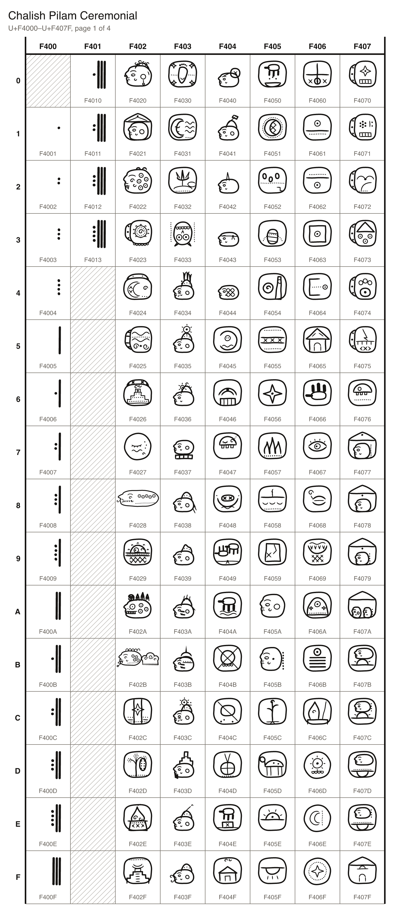
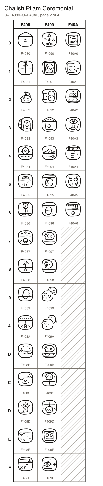
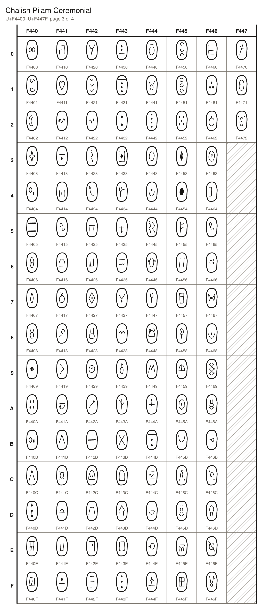
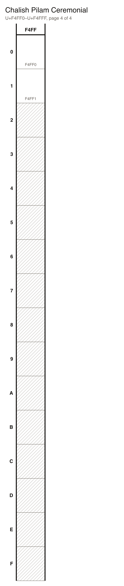

## Characters

### Digits

| Character Name | Code | Character | Code Point | Entity | Hex Entity |
| --- | --- | --- | --- | --- | --- |
| CHALISH CEREMONIAL NUMBER 1 | `n1` |  | U+F4001 | `&#999425;` | `&#xF4001;` |
| CHALISH CEREMONIAL NUMBER 2 | `n2` |  | U+F4002 | `&#999426;` | `&#xF4002;` |
| CHALISH CEREMONIAL NUMBER 3 | `n3` |  | U+F4003 | `&#999427;` | `&#xF4003;` |
| CHALISH CEREMONIAL NUMBER 4 | `n4` |  | U+F4004 | `&#999428;` | `&#xF4004;` |
| CHALISH CEREMONIAL NUMBER 5 | `n5` |  | U+F4005 | `&#999429;` | `&#xF4005;` |
| CHALISH CEREMONIAL NUMBER 6 | `n6` |  | U+F4006 | `&#999430;` | `&#xF4006;` |
| CHALISH CEREMONIAL NUMBER 7 | `n7` |  | U+F4007 | `&#999431;` | `&#xF4007;` |
| CHALISH CEREMONIAL NUMBER 8 | `n8` |  | U+F4008 | `&#999432;` | `&#xF4008;` |
| CHALISH CEREMONIAL NUMBER 9 | `n9` |  | U+F4009 | `&#999433;` | `&#xF4009;` |
| CHALISH CEREMONIAL NUMBER 10 | `n10` |  | U+F400A | `&#999434;` | `&#xF400A;` |
| CHALISH CEREMONIAL NUMBER 11 | `n11` |  | U+F400B | `&#999435;` | `&#xF400B;` |
| CHALISH CEREMONIAL NUMBER 12 | `n12` |  | U+F400C | `&#999436;` | `&#xF400C;` |
| CHALISH CEREMONIAL NUMBER 13 | `n13` |  | U+F400D | `&#999437;` | `&#xF400D;` |
| CHALISH CEREMONIAL NUMBER 14 | `n14` |  | U+F400E | `&#999438;` | `&#xF400E;` |
| CHALISH CEREMONIAL NUMBER 15 | `n15` |  | U+F400F | `&#999439;` | `&#xF400F;` |
| CHALISH CEREMONIAL NUMBER 16 | `n16` |  | U+F4010 | `&#999440;` | `&#xF4010;` |
| CHALISH CEREMONIAL NUMBER 17 | `n17` |  | U+F4011 | `&#999441;` | `&#xF4011;` |
| CHALISH CEREMONIAL NUMBER 18 | `n18` |  | U+F4012 | `&#999442;` | `&#xF4012;` |
| CHALISH CEREMONIAL NUMBER 19 | `n19` |  | U+F4013 | `&#999443;` | `&#xF4013;` |

### Characters

| Character Name | Code | Character | Code Point | Entity | Hex Entity |
| --- | --- | --- | --- | --- | --- |
| CHALISH CEREMONIAL GLYPH LORD | `LORD` |  | U+F4020 | `&#999456;` | `&#xF4020;` |
| CHALISH CEREMONIAL GLYPH PATRIARCH | `PATRIARCH` |  | U+F4021 | `&#999457;` | `&#xF4021;` |
| CHALISH CEREMONIAL GLYPH JAGUAR | `JAGUAR` |  | U+F4022 | `&#999458;` | `&#xF4022;` |
| CHALISH CEREMONIAL GLYPH SUN | `SUN` |  | U+F4023 | `&#999459;` | `&#xF4023;` |
| CHALISH CEREMONIAL GLYPH MOON | `MOON` |  | U+F4024 | `&#999460;` | `&#xF4024;` |
| CHALISH CEREMONIAL GLYPH WATER | `WATER` |  | U+F4025 | `&#999461;` | `&#xF4025;` |
| CHALISH CEREMONIAL GLYPH PEAK | `PEAK` |  | U+F4026 | `&#999462;` | `&#xF4026;` |
| CHALISH CEREMONIAL GLYPH TQAN | `TQAN` |  | U+F4027 | `&#999463;` | `&#xF4027;` |
| CHALISH CEREMONIAL GLYPH SERPENT | `SERPENT` | 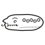 | U+F4028 | `&#999464;` | `&#xF4028;` |
| CHALISH CEREMONIAL GLYPH SUN AT THE EDGE | `SUN_AT_THE_EDGE` |  | U+F4029 | `&#999465;` | `&#xF4029;` |
| CHALISH CEREMONIAL GLYPH DEATH JAGUAR | `DEATH_JAGUAR` |  | U+F402A | `&#999466;` | `&#xF402A;` |
| CHALISH CEREMONIAL GLYPH STORM SERPENT | `STORM_SERPENT` |  | U+F402B | `&#999467;` | `&#xF402B;` |
| CHALISH CEREMONIAL GLYPH SACRED STAR | `SACRED_STAR` |  | U+F402C | `&#999468;` | `&#xF402C;` |
| CHALISH CEREMONIAL GLYPH GOLDEN GIVER | `GOLDEN_GIVER` |  | U+F402D | `&#999469;` | `&#xF402D;` |
| CHALISH CEREMONIAL GLYPH SACRED FLAME | `SACRED_FLAME` |  | U+F402E | `&#999470;` | `&#xF402E;` |
| CHALISH CEREMONIAL GLYPH PEAK BUILDER | `PEAK_BUILDER` |  | U+F402F | `&#999471;` | `&#xF402F;` |
| CHALISH CEREMONIAL GLYPH PATH WALKER | `PATH_WALKER` |  | U+F4030 | `&#999472;` | `&#xF4030;` |
| CHALISH CEREMONIAL GLYPH MOON DREAMER | `MOON_DREAMER` |  | U+F4031 | `&#999473;` | `&#xF4031;` |
| CHALISH CEREMONIAL GLYPH LIVING BLOSSOM | `LIVING_BLOSSOM` |  | U+F4032 | `&#999474;` | `&#xF4032;` |
| CHALISH CEREMONIAL GLYPH FALLEN OWL | `FALLEN_OWL` |  | U+F4033 | `&#999475;` | `&#xF4033;` |
| CHALISH CEREMONIAL GLYPH OVERLORD | `OVERLORD` |  | U+F4034 | `&#999476;` | `&#xF4034;` |
| CHALISH CEREMONIAL GLYPH KING | `KING` |  | U+F4035 | `&#999477;` | `&#xF4035;` |
| CHALISH CEREMONIAL GLYPH PRINCE | `PRINCE` |  | U+F4036 | `&#999478;` | `&#xF4036;` |
| CHALISH CEREMONIAL GLYPH SEATED LORD | `SEATED_LORD` |  | U+F4037 | `&#999479;` | `&#xF4037;` |
| CHALISH CEREMONIAL GLYPH LADY | `LADY` |  | U+F4038 | `&#999480;` | `&#xF4038;` |
| CHALISH CEREMONIAL GLYPH LANDHOLDER | `LANDHOLDER` |  | U+F4039 | `&#999481;` | `&#xF4039;` |
| CHALISH CEREMONIAL GLYPH KNIGHT | `KNIGHT` |  | U+F403A | `&#999482;` | `&#xF403A;` |
| CHALISH CEREMONIAL GLYPH WAR LEADER | `WAR_LEADER` |  | U+F403B | `&#999483;` | `&#xF403B;` |
| CHALISH CEREMONIAL GLYPH SUN PRIEST | `SUN_PRIEST` |  | U+F403C | `&#999484;` | `&#xF403C;` |
| CHALISH CEREMONIAL GLYPH PRIEST | `PRIEST` |  | U+F403D | `&#999485;` | `&#xF403D;` |
| CHALISH CEREMONIAL GLYPH SCRIBE | `SCRIBE` |  | U+F403E | `&#999486;` | `&#xF403E;` |
| CHALISH CEREMONIAL GLYPH HERALD | `HERALD` |  | U+F403F | `&#999487;` | `&#xF403F;` |
| CHALISH CEREMONIAL GLYPH MASTER MERCHANT | `MASTER_MERCHANT` |  | U+F4040 | `&#999488;` | `&#xF4040;` |
| CHALISH CEREMONIAL GLYPH GUILDSMAN | `GUILDSMAN` |  | U+F4041 | `&#999489;` | `&#xF4041;` |
| CHALISH CEREMONIAL GLYPH FREEMAN | `FREEMAN` |  | U+F4042 | `&#999490;` | `&#xF4042;` |
| CHALISH CEREMONIAL GLYPH SERF | `SERF` |  | U+F4043 | `&#999491;` | `&#xF4043;` |
| CHALISH CEREMONIAL GLYPH SLAVE | `SLAVE` |  | U+F4044 | `&#999492;` | `&#xF4044;` |
| CHALISH CEREMONIAL GLYPH BIRTH | `BIRTH` |  | U+F4045 | `&#999493;` | `&#xF4045;` |
| CHALISH CEREMONIAL GLYPH SEATING | `SEATING` |  | U+F4046 | `&#999494;` | `&#xF4046;` |
| CHALISH CEREMONIAL GLYPH DEATH | `DEATH` |  | U+F4047 | `&#999495;` | `&#xF4047;` |
| CHALISH CEREMONIAL GLYPH BURIAL | `BURIAL` |  | U+F4048 | `&#999496;` | `&#xF4048;` |
| CHALISH CEREMONIAL GLYPH MARRIAGE | `MARRIAGE` |  | U+F4049 | `&#999497;` | `&#xF4049;` |
| CHALISH CEREMONIAL GLYPH CAPTURE | `CAPTURE` |  | U+F404A | `&#999498;` | `&#xF404A;` |
| CHALISH CEREMONIAL GLYPH WAR | `WAR` |  | U+F404B | `&#999499;` | `&#xF404B;` |
| CHALISH CEREMONIAL GLYPH CONQUEST | `CONQUEST` |  | U+F404C | `&#999500;` | `&#xF404C;` |
| CHALISH CEREMONIAL GLYPH TRIBUTE | `TRIBUTE` |  | U+F404D | `&#999501;` | `&#xF404D;` |
| CHALISH CEREMONIAL GLYPH FOUNDATION | `FOUNDATION` |  | U+F404E | `&#999502;` | `&#xF404E;` |
| CHALISH CEREMONIAL GLYPH DEDICATION | `DEDICATION` |  | U+F404F | `&#999503;` | `&#xF404F;` |
| CHALISH CEREMONIAL GLYPH OFFERING | `OFFERING` |  | U+F4050 | `&#999504;` | `&#xF4050;` |
| CHALISH CEREMONIAL GLYPH ECLIPSE | `ECLIPSE` |  | U+F4051 | `&#999505;` | `&#xF4051;` |
| CHALISH CEREMONIAL GLYPH PILGRIMAGE | `PILGRIMAGE` |  | U+F4052 | `&#999506;` | `&#xF4052;` |
| CHALISH CEREMONIAL GLYPH ERAS END | `ERAS_END` |  | U+F4053 | `&#999507;` | `&#xF4053;` |
| CHALISH CEREMONIAL GLYPH BALL GAME | `BALL_GAME` |  | U+F4054 | `&#999508;` | `&#xF4054;` |
| CHALISH CEREMONIAL GLYPH SKY | `SKY` | 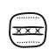 | U+F4055 | `&#999509;` | `&#xF4055;` |
| CHALISH CEREMONIAL GLYPH STAR | `STAR` |  | U+F4056 | `&#999510;` | `&#xF4056;` |
| CHALISH CEREMONIAL GLYPH FIRE | `FIRE` |  | U+F4057 | `&#999511;` | `&#xF4057;` |
| CHALISH CEREMONIAL GLYPH EARTH | `EARTH` | 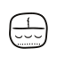 | U+F4058 | `&#999512;` | `&#xF4058;` |
| CHALISH CEREMONIAL GLYPH STONE | `STONE` |  | U+F4059 | `&#999513;` | `&#xF4059;` |
| CHALISH CEREMONIAL GLYPH MAN | `MAN` |  | U+F405A | `&#999514;` | `&#xF405A;` |
| CHALISH CEREMONIAL GLYPH WOMAN | `WOMAN` |  | U+F405B | `&#999515;` | `&#xF405B;` |
| CHALISH CEREMONIAL GLYPH PLANT | `PLANT` |  | U+F405C | `&#999516;` | `&#xF405C;` |
| CHALISH CEREMONIAL GLYPH BEAST | `BEAST` |  | U+F405D | `&#999517;` | `&#xF405D;` |
| CHALISH CEREMONIAL GLYPH EAST | `EAST` |  | U+F405E | `&#999518;` | `&#xF405E;` |
| CHALISH CEREMONIAL GLYPH WEST | `WEST` |  | U+F405F | `&#999519;` | `&#xF405F;` |
| CHALISH CEREMONIAL GLYPH SOUTH | `SOUTH` | 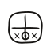 | U+F4060 | `&#999520;` | `&#xF4060;` |
| CHALISH CEREMONIAL GLYPH HIGH | `HIGH` |  | U+F4061 | `&#999521;` | `&#xF4061;` |
| CHALISH CEREMONIAL GLYPH LOW | `LOW` |  | U+F4062 | `&#999522;` | `&#xF4062;` |
| CHALISH CEREMONIAL GLYPH INSIDE | `INSIDE` |  | U+F4063 | `&#999523;` | `&#xF4063;` |
| CHALISH CEREMONIAL GLYPH OUTSIDE | `OUTSIDE` |  | U+F4064 | `&#999524;` | `&#xF4064;` |
| CHALISH CEREMONIAL GLYPH HOUSE | `HOUSE` |  | U+F4065 | `&#999525;` | `&#xF4065;` |
| CHALISH CEREMONIAL GLYPH HAND | `HAND` |  | U+F4066 | `&#999526;` | `&#xF4066;` |
| CHALISH CEREMONIAL GLYPH EYE | `EYE` |  | U+F4067 | `&#999527;` | `&#xF4067;` |
| CHALISH CEREMONIAL GLYPH MOUTH | `MOUTH` |  | U+F4068 | `&#999528;` | `&#xF4068;` |
| CHALISH CEREMONIAL GLYPH UNDERWORLD | `UNDERWORLD` |  | U+F4069 | `&#999529;` | `&#xF4069;` |
| CHALISH CEREMONIAL GLYPH HEAVEN | `HEAVEN` |  | U+F406A | `&#999530;` | `&#xF406A;` |
| CHALISH CEREMONIAL GLYPH FIFTH AGE | `FIFTH_AGE` |  | U+F406B | `&#999531;` | `&#xF406B;` |
| CHALISH CEREMONIAL GLYPH LIVING FLAME | `LIVING_FLAME` |  | U+F406C | `&#999532;` | `&#xF406C;` |
| CHALISH CEREMONIAL GLYPH SOLAR COUNT | `SOLAR_COUNT` |  | U+F406D | `&#999533;` | `&#xF406D;` |
| CHALISH CEREMONIAL GLYPH LUNAR COUNT | `LUNAR_COUNT` |  | U+F406E | `&#999534;` | `&#xF406E;` |
| CHALISH CEREMONIAL GLYPH STELLAR COUNT | `STELLAR_COUNT` |  | U+F406F | `&#999535;` | `&#xF406F;` |
| CHALISH CEREMONIAL GLYPH ISHILANKUL | `ISHILANKUL` |  | U+F4070 | `&#999536;` | `&#xF4070;` |
| CHALISH CEREMONIAL GLYPH KANKUL | `KANKUL` |  | U+F4071 | `&#999537;` | `&#xF4071;` |
| CHALISH CEREMONIAL GLYPH SHELEM | `SHELEM` |  | U+F4072 | `&#999538;` | `&#xF4072;` |
| CHALISH CEREMONIAL GLYPH ISHBAL TSAKU | `ISHBAL_TSAKU` |  | U+F4073 | `&#999539;` | `&#xF4073;` |
| CHALISH CEREMONIAL GLYPH KUSHI ISHBAL | `KUSHI_ISHBAL` |  | U+F4074 | `&#999540;` | `&#xF4074;` |
| CHALISH CEREMONIAL GLYPH QAPTEL TSAKUL | `QAPTEL_TSAKUL` |  | U+F4075 | `&#999541;` | `&#xF4075;` |
| CHALISH CEREMONIAL GLYPH SHELEM ISHBAL | `SHELEM_ISHBAL` |  | U+F4076 | `&#999542;` | `&#xF4076;` |
| CHALISH CEREMONIAL GLYPH MATRIARCH | `MATRIARCH` |  | U+F4077 | `&#999543;` | `&#xF4077;` |
| CHALISH CEREMONIAL GLYPH SON | `SON` |  | U+F4078 | `&#999544;` | `&#xF4078;` |
| CHALISH CEREMONIAL GLYPH DAUGHTER | `DAUGHTER` |  | U+F4079 | `&#999545;` | `&#xF4079;` |
| CHALISH CEREMONIAL GLYPH FAMILY | `FAMILY` |  | U+F407A | `&#999546;` | `&#xF407A;` |
| CHALISH CEREMONIAL GLYPH BIRTH OF A BOY | `BIRTH_OF_A_BOY` |  | U+F407B | `&#999547;` | `&#xF407B;` |
| CHALISH CEREMONIAL GLYPH BIRTH OF A GIRL | `BIRTH_OF_A_GIRL` |  | U+F407C | `&#999548;` | `&#xF407C;` |
| CHALISH CEREMONIAL GLYPH DEATH OF A MAN | `DEATH_OF_A_MAN` |  | U+F407D | `&#999549;` | `&#xF407D;` |
| CHALISH CEREMONIAL GLYPH DEATH OF A WOMAN | `DEATH_OF_A_WOMAN` |  | U+F407E | `&#999550;` | `&#xF407E;` |
| CHALISH CEREMONIAL GLYPH HOUSEHOLD FOUNDED | `HOUSEHOLD_FOUNDED` |  | U+F407F | `&#999551;` | `&#xF407F;` |
| CHALISH CEREMONIAL GLYPH HOUSEHOLD ENDED | `HOUSEHOLD_ENDED` |  | U+F4080 | `&#999552;` | `&#xF4080;` |
| CHALISH CEREMONIAL GLYPH NORTH | `NORTH` |  | U+F4081 | `&#999553;` | `&#xF4081;` |
| CHALISH CEREMONIAL GLYPH NOBLE LORD | `NOBLE_LORD` |  | U+F4082 | `&#999554;` | `&#xF4082;` |
| CHALISH CEREMONIAL GLYPH NEOK BAATE | `NEOK_BAATE` |  | U+F4083 | `&#999555;` | `&#xF4083;` |
| CHALISH CEREMONIAL GLYPH DAWN | `DAWN` |  | U+F4084 | `&#999556;` | `&#xF4084;` |
| CHALISH CEREMONIAL GLYPH SUNSET | `SUNSET` |  | U+F4085 | `&#999557;` | `&#xF4085;` |
| CHALISH CEREMONIAL GLYPH NOON | `NOON` |  | U+F4086 | `&#999558;` | `&#xF4086;` |
| CHALISH CEREMONIAL GLYPH MIDNIGHT | `MIDNIGHT` |  | U+F4087 | `&#999559;` | `&#xF4087;` |
| CHALISH CEREMONIAL GLYPH GERMINATION | `GERMINATION` |  | U+F4088 | `&#999560;` | `&#xF4088;` |
| CHALISH CEREMONIAL GLYPH HARVEST | `HARVEST` |  | U+F4089 | `&#999561;` | `&#xF4089;` |
| CHALISH CEREMONIAL GLYPH SEED SOWN | `SEED_SOWN` | 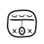 | U+F408A | `&#999562;` | `&#xF408A;` |
| CHALISH CEREMONIAL GLYPH LIFETIME | `LIFETIME` |  | U+F408B | `&#999563;` | `&#xF408B;` |
| CHALISH CEREMONIAL GLYPH REBIRTH | `REBIRTH` |  | U+F408C | `&#999564;` | `&#xF408C;` |
| CHALISH CEREMONIAL GLYPH ERA BEGINS | `ERA_BEGINS` |  | U+F408D | `&#999565;` | `&#xF408D;` |
| CHALISH CEREMONIAL GLYPH PASSAGE OF THE DEAD | `PASSAGE_OF_THE_DEAD` | 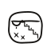 | U+F408E | `&#999566;` | `&#xF408E;` |
| CHALISH CEREMONIAL GLYPH OUT OF THE TRIALS | `OUT_OF_THE_TRIALS` | 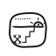 | U+F408F | `&#999567;` | `&#xF408F;` |
| CHALISH CEREMONIAL GLYPH WHOLE ROUND | `WHOLE_ROUND` |  | U+F4090 | `&#999568;` | `&#xF4090;` |
| CHALISH CEREMONIAL GLYPH KINSMAN | `KINSMAN` |  | U+F4091 | `&#999569;` | `&#xF4091;` |
| CHALISH CEREMONIAL GLYPH STRANGER | `STRANGER` |  | U+F4092 | `&#999570;` | `&#xF4092;` |
| CHALISH CEREMONIAL GLYPH HOME | `HOME` |  | U+F4093 | `&#999571;` | `&#xF4093;` |
| CHALISH CEREMONIAL GLYPH VILLAGE | `VILLAGE` |  | U+F4094 | `&#999572;` | `&#xF4094;` |
| CHALISH CEREMONIAL GLYPH BOY | `BOY` |  | U+F4095 | `&#999573;` | `&#xF4095;` |
| CHALISH CEREMONIAL GLYPH GIRL | `GIRL` |  | U+F4096 | `&#999574;` | `&#xF4096;` |
| CHALISH CEREMONIAL GLYPH ELDER | `ELDER` |  | U+F4097 | `&#999575;` | `&#xF4097;` |
| CHALISH CEREMONIAL GLYPH ELDER WOMAN | `ELDER_WOMAN` |  | U+F4098 | `&#999576;` | `&#xF4098;` |
| CHALISH CEREMONIAL GLYPH PEOPLE | `PEOPLE` |  | U+F4099 | `&#999577;` | `&#xF4099;` |
| CHALISH CEREMONIAL GLYPH WOMEN | `WOMEN` |  | U+F409A | `&#999578;` | `&#xF409A;` |
| CHALISH CEREMONIAL GLYPH GOD | `GOD` |  | U+F409B | `&#999579;` | `&#xF409B;` |
| CHALISH CEREMONIAL GLYPH EXALTED ANCESTOR | `EXALTED_ANCESTOR` |  | U+F409C | `&#999580;` | `&#xF409C;` |
| CHALISH CEREMONIAL GLYPH SOUL AMONG THE DEAD | `SOUL_AMONG_THE_DEAD` | 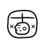 | U+F409D | `&#999581;` | `&#xF409D;` |
| CHALISH CEREMONIAL GLYPH MEMORY | `MEMORY` |  | U+F409E | `&#999582;` | `&#xF409E;` |
| CHALISH CEREMONIAL GLYPH OBSERVATION | `OBSERVATION` |  | U+F409F | `&#999583;` | `&#xF409F;` |
| CHALISH CEREMONIAL GLYPH SECRET | `SECRET` |  | U+F40A0 | `&#999584;` | `&#xF40A0;` |
| CHALISH CEREMONIAL GLYPH PROCLAMATION | `PROCLAMATION` |  | U+F40A1 | `&#999585;` | `&#xF40A1;` |
| CHALISH CEREMONIAL GLYPH THE UNKNOWN | `THE_UNKNOWN` |  | U+F40A2 | `&#999586;` | `&#xF40A2;` |
| CHALISH CEREMONIAL GLYPH WRITING | `WRITING` |  | U+F40A3 | `&#999587;` | `&#xF40A3;` |
| CHALISH CEREMONIAL GLYPH PRAYER | `PRAYER` | 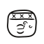 | U+F40A4 | `&#999588;` | `&#xF40A4;` |
| CHALISH CEREMONIAL GLYPH CENOTE | `CENOTE` |  | U+F40A5 | `&#999589;` | `&#xF40A5;` |
| CHALISH CEREMONIAL GLYPH CAUTION | `CAUTION` |  | U+F40A6 | `&#999590;` | `&#xF40A6;` |
| CHALISH CEREMONIAL GLYPH KANKUL SEAT | `KANKUL_SEAT` |  | U+F40A7 | `&#999591;` | `&#xF40A7;` |
| CHALISH CEREMONIAL GLYPH ISHKUL | `ISHKUL` |  | U+F40A8 | `&#999592;` | `&#xF40A8;` |
| CHALISH CEREMONIAL GLYPH CHAKUL | `CHAKUL` |  | U+F40A9 | `&#999593;` | `&#xF40A9;` |
| CHALISH CEREMONIAL GLYPH TSALAM | `TSALAM` |  | U+F40AA | `&#999594;` | `&#xF40AA;` |
| CHALISH CEREMONIAL GLYPH KUSHI | `KUSHI` | 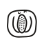 | U+F40AB | `&#999595;` | `&#xF40AB;` |
| CHALISH CEREMONIAL GLYPH TSUL | `TSUL` |  | U+F40AC | `&#999596;` | `&#xF40AC;` |
| CHALISH CEREMONIAL GLYPH CHALISH | `CHALISH` |  | U+F40AD | `&#999597;` | `&#xF40AD;` |
| CHALISH CEREMONIAL GLYPH QEMUL | `QEMUL` |  | U+F40AE | `&#999598;` | `&#xF40AE;` |
| CHALISH CEREMONIAL GLYPH PUQEM | `PUQEM` |  | U+F40AF | `&#999599;` | `&#xF40AF;` |
| CHALISH CEREMONIAL GLYPH NELUSH | `NELUSH` |  | U+F40B0 | `&#999600;` | `&#xF40B0;` |
| CHALISH CEREMONIAL GLYPH CHAKAL | `CHAKAL` |  | U+F40B1 | `&#999601;` | `&#xF40B1;` |
| CHALISH CEREMONIAL GLYPH TOSHEL | `TOSHEL` |  | U+F40B2 | `&#999602;` | `&#xF40B2;` |
| CHALISH CEREMONIAL GLYPH SHAKNAL | `SHAKNAL` |  | U+F40B3 | `&#999603;` | `&#xF40B3;` |
| CHALISH CEREMONIAL GLYPH TSULTEL | `TSULTEL` |  | U+F40B4 | `&#999604;` | `&#xF40B4;` |
| CHALISH CEREMONIAL GLYPH PENQAL | `PENQAL` |  | U+F40B5 | `&#999605;` | `&#xF40B5;` |
| CHALISH CEREMONIAL GLYPH SHELEM BIRD | `SHELEM_BIRD` |  | U+F40B6 | `&#999606;` | `&#xF40B6;` |
| CHALISH CEREMONIAL GLYPH ISHTEM | `ISHTEM` |  | U+F40B7 | `&#999607;` | `&#xF40B7;` |
| CHALISH CEREMONIAL GLYPH QAPTEL | `QAPTEL` |  | U+F40B8 | `&#999608;` | `&#xF40B8;` |
| CHALISH CEREMONIAL GLYPH NEOK | `NEOK` | 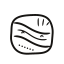 | U+F40B9 | `&#999609;` | `&#xF40B9;` |

### Syllables

| Character Name | Code | Character | Code Point | Entity | Hex Entity |
| --- | --- | --- | --- | --- | --- |
| CHALISH CEREMONIAL SYLLABLE A-1 | `a1` | 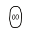 | U+F4400 | `&#1000448;` | `&#xF4400;` |
| CHALISH CEREMONIAL SYLLABLE A-2 | `a2` |  | U+F4401 | `&#1000449;` | `&#xF4401;` |
| CHALISH CEREMONIAL SYLLABLE I-1 | `i1` |  | U+F4402 | `&#1000450;` | `&#xF4402;` |
| CHALISH CEREMONIAL SYLLABLE I-2 | `i2` |  | U+F4403 | `&#1000451;` | `&#xF4403;` |
| CHALISH CEREMONIAL SYLLABLE I-3 | `i3` |  | U+F4404 | `&#1000452;` | `&#xF4404;` |
| CHALISH CEREMONIAL SYLLABLE O-1 | `o1` |  | U+F4405 | `&#1000453;` | `&#xF4405;` |
| CHALISH CEREMONIAL SYLLABLE U-1 | `u1` |  | U+F4406 | `&#1000454;` | `&#xF4406;` |
| CHALISH CEREMONIAL SYLLABLE KA-1 | `ka1` | 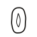 | U+F4407 | `&#1000455;` | `&#xF4407;` |
| CHALISH CEREMONIAL SYLLABLE KA-2 | `ka2` |  | U+F4408 | `&#1000456;` | `&#xF4408;` |
| CHALISH CEREMONIAL SYLLABLE KA-3 | `ka3` |  | U+F4409 | `&#1000457;` | `&#xF4409;` |
| CHALISH CEREMONIAL SYLLABLE KE-1 | `ke1` |  | U+F440A | `&#1000458;` | `&#xF440A;` |
| CHALISH CEREMONIAL SYLLABLE KE-2 | `ke2` | 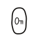 | U+F440B | `&#1000459;` | `&#xF440B;` |
| CHALISH CEREMONIAL SYLLABLE KI-1 | `ki1` |  | U+F440C | `&#1000460;` | `&#xF440C;` |
| CHALISH CEREMONIAL SYLLABLE KO-1 | `ko1` |  | U+F440D | `&#1000461;` | `&#xF440D;` |
| CHALISH CEREMONIAL SYLLABLE KO-2 | `ko2` | 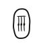 | U+F440E | `&#1000462;` | `&#xF440E;` |
| CHALISH CEREMONIAL SYLLABLE KU-1 | `ku1` |  | U+F440F | `&#1000463;` | `&#xF440F;` |
| CHALISH CEREMONIAL SYLLABLE KU-2 | `ku2` |  | U+F4410 | `&#1000464;` | `&#xF4410;` |
| CHALISH CEREMONIAL SYLLABLE KU-3 | `ku3` |  | U+F4411 | `&#1000465;` | `&#xF4411;` |
| CHALISH CEREMONIAL SYLLABLE CHA-1 | `cha1` |  | U+F4412 | `&#1000466;` | `&#xF4412;` |
| CHALISH CEREMONIAL SYLLABLE CHA-2 | `cha2` |  | U+F4413 | `&#1000467;` | `&#xF4413;` |
| CHALISH CEREMONIAL SYLLABLE CHE-1 | `che1` |  | U+F4414 | `&#1000468;` | `&#xF4414;` |
| CHALISH CEREMONIAL SYLLABLE CHE-2 | `che2` |  | U+F4415 | `&#1000469;` | `&#xF4415;` |
| CHALISH CEREMONIAL SYLLABLE CHI-1 | `chi1` |  | U+F4416 | `&#1000470;` | `&#xF4416;` |
| CHALISH CEREMONIAL SYLLABLE CHI-2 | `chi2` |  | U+F4417 | `&#1000471;` | `&#xF4417;` |
| CHALISH CEREMONIAL SYLLABLE CHU-1 | `chu1` | 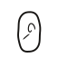 | U+F4418 | `&#1000472;` | `&#xF4418;` |
| CHALISH CEREMONIAL SYLLABLE CHU-2 | `chu2` |  | U+F4419 | `&#1000473;` | `&#xF4419;` |
| CHALISH CEREMONIAL SYLLABLE TSA-1 | `tsa1` |  | U+F441A | `&#1000474;` | `&#xF441A;` |
| CHALISH CEREMONIAL SYLLABLE TSA-2 | `tsa2` |  | U+F441B | `&#1000475;` | `&#xF441B;` |
| CHALISH CEREMONIAL SYLLABLE TSE-1 | `tse1` |  | U+F441C | `&#1000476;` | `&#xF441C;` |
| CHALISH CEREMONIAL SYLLABLE TSE-2 | `tse2` | 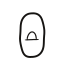 | U+F441D | `&#1000477;` | `&#xF441D;` |
| CHALISH CEREMONIAL SYLLABLE TSI-1 | `tsi1` |  | U+F441E | `&#1000478;` | `&#xF441E;` |
| CHALISH CEREMONIAL SYLLABLE TSI-2 | `tsi2` |  | U+F441F | `&#1000479;` | `&#xF441F;` |
| CHALISH CEREMONIAL SYLLABLE TSO-1 | `tso1` |  | U+F4420 | `&#1000480;` | `&#xF4420;` |
| CHALISH CEREMONIAL SYLLABLE TSO-2 | `tso2` |  | U+F4421 | `&#1000481;` | `&#xF4421;` |
| CHALISH CEREMONIAL SYLLABLE TSU-1 | `tsu1` |  | U+F4422 | `&#1000482;` | `&#xF4422;` |
| CHALISH CEREMONIAL SYLLABLE TSU-2 | `tsu2` | 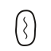 | U+F4423 | `&#1000483;` | `&#xF4423;` |
| CHALISH CEREMONIAL SYLLABLE PA-1 | `pa1` |  | U+F4424 | `&#1000484;` | `&#xF4424;` |
| CHALISH CEREMONIAL SYLLABLE PA-2 | `pa2` |  | U+F4425 | `&#1000485;` | `&#xF4425;` |
| CHALISH CEREMONIAL SYLLABLE PE-1 | `pe1` |  | U+F4426 | `&#1000486;` | `&#xF4426;` |
| CHALISH CEREMONIAL SYLLABLE PE-2 | `pe2` | 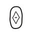 | U+F4427 | `&#1000487;` | `&#xF4427;` |
| CHALISH CEREMONIAL SYLLABLE PI-1 | `pi1` |  | U+F4428 | `&#1000488;` | `&#xF4428;` |
| CHALISH CEREMONIAL SYLLABLE PI-2 | `pi2` |  | U+F4429 | `&#1000489;` | `&#xF4429;` |
| CHALISH CEREMONIAL SYLLABLE PI-3 | `pi3` |  | U+F442A | `&#1000490;` | `&#xF442A;` |
| CHALISH CEREMONIAL SYLLABLE PO-1 | `po1` |  | U+F442B | `&#1000491;` | `&#xF442B;` |
| CHALISH CEREMONIAL SYLLABLE PU-1 | `pu1` |  | U+F442C | `&#1000492;` | `&#xF442C;` |
| CHALISH CEREMONIAL SYLLABLE PU-2 | `pu2` |  | U+F442D | `&#1000493;` | `&#xF442D;` |
| CHALISH CEREMONIAL SYLLABLE QA-1 | `qa1` |  | U+F442E | `&#1000494;` | `&#xF442E;` |
| CHALISH CEREMONIAL SYLLABLE QA-2 | `qa2` | 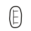 | U+F442F | `&#1000495;` | `&#xF442F;` |
| CHALISH CEREMONIAL SYLLABLE QE-1 | `qe1` |  | U+F4430 | `&#1000496;` | `&#xF4430;` |
| CHALISH CEREMONIAL SYLLABLE QI-1 | `qi1` |  | U+F4431 | `&#1000497;` | `&#xF4431;` |
| CHALISH CEREMONIAL SYLLABLE QO-1 | `qo1` |  | U+F4432 | `&#1000498;` | `&#xF4432;` |
| CHALISH CEREMONIAL SYLLABLE QU-1 | `qu1` |  | U+F4433 | `&#1000499;` | `&#xF4433;` |
| CHALISH CEREMONIAL SYLLABLE TI-1 | `ti1` |  | U+F4434 | `&#1000500;` | `&#xF4434;` |
| CHALISH CEREMONIAL SYLLABLE TO-1 | `to1` |  | U+F4435 | `&#1000501;` | `&#xF4435;` |
| CHALISH CEREMONIAL SYLLABLE SHA-1 | `sha1` |  | U+F4436 | `&#1000502;` | `&#xF4436;` |
| CHALISH CEREMONIAL SYLLABLE SHA-2 | `sha2` |  | U+F4437 | `&#1000503;` | `&#xF4437;` |
| CHALISH CEREMONIAL SYLLABLE SHE-1 | `she1` |  | U+F4438 | `&#1000504;` | `&#xF4438;` |
| CHALISH CEREMONIAL SYLLABLE SHI-1 | `shi1` |  | U+F4439 | `&#1000505;` | `&#xF4439;` |
| CHALISH CEREMONIAL SYLLABLE SHI-2 | `shi2` |  | U+F443A | `&#1000506;` | `&#xF443A;` |
| CHALISH CEREMONIAL SYLLABLE SHO-1 | `sho1` |  | U+F443B | `&#1000507;` | `&#xF443B;` |
| CHALISH CEREMONIAL SYLLABLE SHO-2 | `sho2` |  | U+F443C | `&#1000508;` | `&#xF443C;` |
| CHALISH CEREMONIAL SYLLABLE SHU-1 | `shu1` |  | U+F443D | `&#1000509;` | `&#xF443D;` |
| CHALISH CEREMONIAL SYLLABLE SHU-2 | `shu2` |  | U+F443E | `&#1000510;` | `&#xF443E;` |
| CHALISH CEREMONIAL SYLLABLE LI-1 | `li1` |  | U+F443F | `&#1000511;` | `&#xF443F;` |
| CHALISH CEREMONIAL SYLLABLE LU-1 | `lu1` |  | U+F4440 | `&#1000512;` | `&#xF4440;` |
| CHALISH CEREMONIAL SYLLABLE MA-1 | `ma1` |  | U+F4441 | `&#1000513;` | `&#xF4441;` |
| CHALISH CEREMONIAL SYLLABLE MU-1 | `mu1` |  | U+F4442 | `&#1000514;` | `&#xF4442;` |
| CHALISH CEREMONIAL SYLLABLE NA-1 | `na1` |  | U+F4443 | `&#1000515;` | `&#xF4443;` |
| CHALISH CEREMONIAL SYLLABLE NA-2 | `na2` |  | U+F4444 | `&#1000516;` | `&#xF4444;` |
| CHALISH CEREMONIAL SYLLABLE NE-1 | `ne1` | 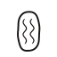 | U+F4445 | `&#1000517;` | `&#xF4445;` |
| CHALISH CEREMONIAL SYLLABLE NE-2 | `ne2` |  | U+F4446 | `&#1000518;` | `&#xF4446;` |
| CHALISH CEREMONIAL SYLLABLE NI-1 | `ni1` |  | U+F4447 | `&#1000519;` | `&#xF4447;` |
| CHALISH CEREMONIAL SYLLABLE NO-1 | `no1` |  | U+F4448 | `&#1000520;` | `&#xF4448;` |
| CHALISH CEREMONIAL SYLLABLE NO-2 | `no2` |  | U+F4449 | `&#1000521;` | `&#xF4449;` |
| CHALISH CEREMONIAL SYLLABLE NU-1 | `nu1` |  | U+F444A | `&#1000522;` | `&#xF444A;` |
| CHALISH CEREMONIAL SYLLABLE NU-2 | `nu2` |  | U+F444B | `&#1000523;` | `&#xF444B;` |
| CHALISH CEREMONIAL SYLLABLE HA-1 | `ha1` |  | U+F444C | `&#1000524;` | `&#xF444C;` |
| CHALISH CEREMONIAL SYLLABLE HA-2 | `ha2` |  | U+F444D | `&#1000525;` | `&#xF444D;` |
| CHALISH CEREMONIAL SYLLABLE HA-3 | `ha3` |  | U+F444E | `&#1000526;` | `&#xF444E;` |
| CHALISH CEREMONIAL SYLLABLE HU-1 | `hu1` |  | U+F444F | `&#1000527;` | `&#xF444F;` |
| CHALISH CEREMONIAL SYLLABLE HU-2 | `hu2` | 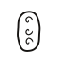 | U+F4450 | `&#1000528;` | `&#xF4450;` |
| CHALISH CEREMONIAL SYLLABLE LA-1 | `la1` |  | U+F4451 | `&#1000529;` | `&#xF4451;` |
| CHALISH CEREMONIAL SYLLABLE LA-2 | `la2` |  | U+F4452 | `&#1000530;` | `&#xF4452;` |
| CHALISH CEREMONIAL SYLLABLE BA-1 | `ba1` |  | U+F4453 | `&#1000531;` | `&#xF4453;` |
| CHALISH CEREMONIAL SYLLABLE BA-2 | `ba2` |  | U+F4454 | `&#1000532;` | `&#xF4454;` |
| CHALISH CEREMONIAL SYLLABLE TA-1 | `ta1` | 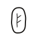 | U+F4455 | `&#1000533;` | `&#xF4455;` |
| CHALISH CEREMONIAL SYLLABLE TA-2 | `ta2` |  | U+F4456 | `&#1000534;` | `&#xF4456;` |
| CHALISH CEREMONIAL SYLLABLE LE-1 | `le1` |  | U+F4457 | `&#1000535;` | `&#xF4457;` |
| CHALISH CEREMONIAL SYLLABLE LE-2 | `le2` |  | U+F4458 | `&#1000536;` | `&#xF4458;` |
| CHALISH CEREMONIAL SYLLABLE ME-1 | `me1` |  | U+F4459 | `&#1000537;` | `&#xF4459;` |
| CHALISH CEREMONIAL SYLLABLE ME-2 | `me2` |  | U+F445A | `&#1000538;` | `&#xF445A;` |
| CHALISH CEREMONIAL SYLLABLE MI-1 | `mi1` |  | U+F445B | `&#1000539;` | `&#xF445B;` |
| CHALISH CEREMONIAL SYLLABLE MI-2 | `mi2` |  | U+F445C | `&#1000540;` | `&#xF445C;` |
| CHALISH CEREMONIAL SYLLABLE YI-1 | `yi1` |  | U+F445D | `&#1000541;` | `&#xF445D;` |
| CHALISH CEREMONIAL SYLLABLE YI-2 | `yi2` |  | U+F445E | `&#1000542;` | `&#xF445E;` |
| CHALISH CEREMONIAL SYLLABLE YU-1 | `yu1` |  | U+F445F | `&#1000543;` | `&#xF445F;` |
| CHALISH CEREMONIAL SYLLABLE YU-2 | `yu2` | 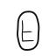 | U+F4460 | `&#1000544;` | `&#xF4460;` |
| CHALISH CEREMONIAL SYLLABLE TU-1 | `tu1` |  | U+F4461 | `&#1000545;` | `&#xF4461;` |
| CHALISH CEREMONIAL SYLLABLE TU-2 | `tu2` |  | U+F4462 | `&#1000546;` | `&#xF4462;` |
| CHALISH CEREMONIAL SYLLABLE TE-1 | `te1` |  | U+F4463 | `&#1000547;` | `&#xF4463;` |
| CHALISH CEREMONIAL SYLLABLE TE-2 | `te2` |  | U+F4464 | `&#1000548;` | `&#xF4464;` |
| CHALISH CEREMONIAL SYLLABLE YA-1 | `ya1` |  | U+F4465 | `&#1000549;` | `&#xF4465;` |
| CHALISH CEREMONIAL SYLLABLE YA-2 | `ya2` |  | U+F4466 | `&#1000550;` | `&#xF4466;` |
| CHALISH CEREMONIAL SYLLABLE YE-1 | `ye1` |  | U+F4467 | `&#1000551;` | `&#xF4467;` |
| CHALISH CEREMONIAL SYLLABLE YE-2 | `ye2` |  | U+F4468 | `&#1000552;` | `&#xF4468;` |
| CHALISH CEREMONIAL SYLLABLE BI-1 | `bi1` | 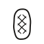 | U+F4469 | `&#1000553;` | `&#xF4469;` |
| CHALISH CEREMONIAL SYLLABLE BI-2 | `bi2` |  | U+F446A | `&#1000554;` | `&#xF446A;` |
| CHALISH CEREMONIAL SYLLABLE LO-1 | `lo1` |  | U+F446B | `&#1000555;` | `&#xF446B;` |
| CHALISH CEREMONIAL SYLLABLE LO-2 | `lo2` |  | U+F446C | `&#1000556;` | `&#xF446C;` |
| CHALISH CEREMONIAL SYLLABLE HI-1 | `hi1` |  | U+F446D | `&#1000557;` | `&#xF446D;` |
| CHALISH CEREMONIAL SYLLABLE HI-2 | `hi2` |  | U+F446E | `&#1000558;` | `&#xF446E;` |
| CHALISH CEREMONIAL SYLLABLE HE-1 | `he1` |  | U+F446F | `&#1000559;` | `&#xF446F;` |
| CHALISH CEREMONIAL SYLLABLE HE-2 | `he2` | 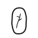 | U+F4470 | `&#1000560;` | `&#xF4470;` |
| CHALISH CEREMONIAL SYLLABLE BE-1 | `be1` |  | U+F4471 | `&#1000561;` | `&#xF4471;` |
| CHALISH CEREMONIAL SYLLABLE BE-2 | `be2` |  | U+F4472 | `&#1000562;` | `&#xF4472;` |

### Controls

| Character Name | Code | Character | Code Point | Entity | Hex Entity |
| --- | --- | --- | --- | --- | --- |
| CHALISH CEREMONIAL JOINER BESIDE | `JOINER_BESIDE` |  | U+F4FF0 | `&#1003504;` | `&#xF4FF0;` |
| CHALISH CEREMONIAL JOINER STACK | `JOINER_STACK` |  | U+F4FF1 | `&#1003505;` | `&#xF4FF1;` |
