# Chalish Pilam Common

95 characters, U+F3000 to U+F3066, in the font `Chalish Pilam Common`.

## Code chart

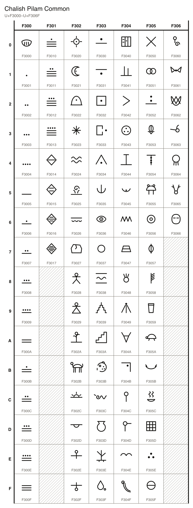

## Characters

### Digits

| Character Name | Character | Code Point | Entity | Hex Entity |
| --- | --- | --- | --- | --- |
| CHALISH NUMBER 0 |  | U+F3000 | `&#995328;` | `&#xF3000;` |
| CHALISH NUMBER 1 |  | U+F3001 | `&#995329;` | `&#xF3001;` |
| CHALISH NUMBER 2 |  | U+F3002 | `&#995330;` | `&#xF3002;` |
| CHALISH NUMBER 3 |  | U+F3003 | `&#995331;` | `&#xF3003;` |
| CHALISH NUMBER 4 |  | U+F3004 | `&#995332;` | `&#xF3004;` |
| CHALISH NUMBER 5 |  | U+F3005 | `&#995333;` | `&#xF3005;` |
| CHALISH NUMBER 6 |  | U+F3006 | `&#995334;` | `&#xF3006;` |
| CHALISH NUMBER 7 |  | U+F3007 | `&#995335;` | `&#xF3007;` |
| CHALISH NUMBER 8 |  | U+F3008 | `&#995336;` | `&#xF3008;` |
| CHALISH NUMBER 9 |  | U+F3009 | `&#995337;` | `&#xF3009;` |
| CHALISH NUMBER 10 | 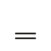 | U+F300A | `&#995338;` | `&#xF300A;` |
| CHALISH NUMBER 11 | 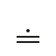 | U+F300B | `&#995339;` | `&#xF300B;` |
| CHALISH NUMBER 12 | 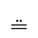 | U+F300C | `&#995340;` | `&#xF300C;` |
| CHALISH NUMBER 13 |  | U+F300D | `&#995341;` | `&#xF300D;` |
| CHALISH NUMBER 14 |  | U+F300E | `&#995342;` | `&#xF300E;` |
| CHALISH NUMBER 15 |  | U+F300F | `&#995343;` | `&#xF300F;` |
| CHALISH NUMBER 16 |  | U+F3010 | `&#995344;` | `&#xF3010;` |
| CHALISH NUMBER 17 |  | U+F3011 | `&#995345;` | `&#xF3011;` |
| CHALISH NUMBER 18 |  | U+F3012 | `&#995346;` | `&#xF3012;` |
| CHALISH NUMBER 19 |  | U+F3013 | `&#995347;` | `&#xF3013;` |
| CHALISH PLACE 20 |  | U+F3014 | `&#995348;` | `&#xF3014;` |
| CHALISH PLACE 400 | 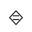 | U+F3015 | `&#995349;` | `&#xF3015;` |
| CHALISH PLACE 8000 |  | U+F3016 | `&#995350;` | `&#xF3016;` |
| CHALISH PLACE 160000 |  | U+F3017 | `&#995351;` | `&#xF3017;` |

### Characters

| Character Name | Character | Code Point | Entity | Hex Entity |
| --- | --- | --- | --- | --- |
| CHALISH GLYPH SUN |  | U+F3020 | `&#995360;` | `&#xF3020;` |
| CHALISH GLYPH MOON |  | U+F3021 | `&#995361;` | `&#xF3021;` |
| CHALISH GLYPH SKY |  | U+F3022 | `&#995362;` | `&#xF3022;` |
| CHALISH GLYPH STAR |  | U+F3023 | `&#995363;` | `&#xF3023;` |
| CHALISH GLYPH WATER |  | U+F3024 | `&#995364;` | `&#xF3024;` |
| CHALISH GLYPH FIRE |  | U+F3025 | `&#995365;` | `&#xF3025;` |
| CHALISH GLYPH EARTH | 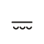 | U+F3026 | `&#995366;` | `&#xF3026;` |
| CHALISH GLYPH STONE |  | U+F3027 | `&#995367;` | `&#xF3027;` |
| CHALISH GLYPH MAN |  | U+F3028 | `&#995368;` | `&#xF3028;` |
| CHALISH GLYPH WOMAN |  | U+F3029 | `&#995369;` | `&#xF3029;` |
| CHALISH GLYPH PLANT |  | U+F302A | `&#995370;` | `&#xF302A;` |
| CHALISH GLYPH BEAST |  | U+F302B | `&#995371;` | `&#xF302B;` |
| CHALISH GLYPH EAST |  | U+F302C | `&#995372;` | `&#xF302C;` |
| CHALISH GLYPH WEST | 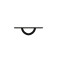 | U+F302D | `&#995373;` | `&#xF302D;` |
| CHALISH GLYPH NORTH | 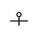 | U+F302E | `&#995374;` | `&#xF302E;` |
| CHALISH GLYPH SOUTH | 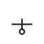 | U+F302F | `&#995375;` | `&#xF302F;` |
| CHALISH GLYPH HIGH |  | U+F3030 | `&#995376;` | `&#xF3030;` |
| CHALISH GLYPH LOW |  | U+F3031 | `&#995377;` | `&#xF3031;` |
| CHALISH GLYPH INSIDE |  | U+F3032 | `&#995378;` | `&#xF3032;` |
| CHALISH GLYPH OUTSIDE |  | U+F3033 | `&#995379;` | `&#xF3033;` |
| CHALISH GLYPH HOUSE |  | U+F3034 | `&#995380;` | `&#xF3034;` |
| CHALISH GLYPH HAND |  | U+F3035 | `&#995381;` | `&#xF3035;` |
| CHALISH GLYPH EYE |  | U+F3036 | `&#995382;` | `&#xF3036;` |
| CHALISH GLYPH MOUTH |  | U+F3037 | `&#995383;` | `&#xF3037;` |
| CHALISH GLYPH RIVER |  | U+F3038 | `&#995384;` | `&#xF3038;` |
| CHALISH GLYPH PEAK |  | U+F3039 | `&#995385;` | `&#xF3039;` |
| CHALISH GLYPH STEPS |  | U+F303A | `&#995386;` | `&#xF303A;` |
| CHALISH GLYPH JAGUAR |  | U+F303B | `&#995387;` | `&#xF303B;` |
| CHALISH GLYPH SERPENT | 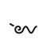 | U+F303C | `&#995388;` | `&#xF303C;` |
| CHALISH GLYPH POT |  | U+F303D | `&#995389;` | `&#xF303D;` |
| CHALISH GLYPH WOOD |  | U+F303E | `&#995390;` | `&#xF303E;` |
| CHALISH GLYPH BLOOD |  | U+F303F | `&#995391;` | `&#xF303F;` |
| CHALISH GLYPH GLYPH |  | U+F3040 | `&#995392;` | `&#xF3040;` |
| CHALISH GLYPH BESIDE | 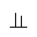 | U+F3041 | `&#995393;` | `&#xF3041;` |
| CHALISH GLYPH TOWARD |  | U+F3042 | `&#995394;` | `&#xF3042;` |
| CHALISH GLYPH ALL |  | U+F3043 | `&#995395;` | `&#xF3043;` |
| CHALISH GLYPH BEING | 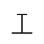 | U+F3044 | `&#995396;` | `&#xF3044;` |
| CHALISH GLYPH OK |  | U+F3045 | `&#995397;` | `&#xF3045;` |
| CHALISH GLYPH DANGER |  | U+F3046 | `&#995398;` | `&#xF3046;` |
| CHALISH GLYPH METAL |  | U+F3047 | `&#995399;` | `&#xF3047;` |
| CHALISH GLYPH LORD |  | U+F3048 | `&#995400;` | `&#xF3048;` |
| CHALISH GLYPH LIGHT |  | U+F3049 | `&#995401;` | `&#xF3049;` |
| CHALISH GLYPH COYOTE |  | U+F304A | `&#995402;` | `&#xF304A;` |
| CHALISH GLYPH EDGE |  | U+F304B | `&#995403;` | `&#xF304B;` |
| CHALISH GLYPH SELF |  | U+F304C | `&#995404;` | `&#xF304C;` |
| CHALISH GLYPH YOU | 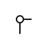 | U+F304D | `&#995405;` | `&#xF304D;` |
| CHALISH GLYPH BIRD |  | U+F304E | `&#995406;` | `&#xF304E;` |
| CHALISH GLYPH QUETZAL |  | U+F304F | `&#995407;` | `&#xF304F;` |
| CHALISH GLYPH WAR |  | U+F3050 | `&#995408;` | `&#xF3050;` |
| CHALISH GLYPH AFFECTION |  | U+F3051 | `&#995409;` | `&#xF3051;` |
| CHALISH GLYPH SUPREME |  | U+F3052 | `&#995410;` | `&#xF3052;` |
| CHALISH GLYPH MAIZE |  | U+F3053 | `&#995411;` | `&#xF3053;` |
| CHALISH GLYPH CORD | 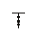 | U+F3054 | `&#995412;` | `&#xF3054;` |
| CHALISH GLYPH BEAR |  | U+F3055 | `&#995413;` | `&#xF3055;` |
| CHALISH GLYPH JADE |  | U+F3056 | `&#995414;` | `&#xF3056;` |
| CHALISH GLYPH OBSIDIAN |  | U+F3057 | `&#995415;` | `&#xF3057;` |
| CHALISH GLYPH FEATHER |  | U+F3058 | `&#995416;` | `&#xF3058;` |
| CHALISH GLYPH DRUM |  | U+F3059 | `&#995417;` | `&#xF3059;` |
| CHALISH GLYPH TURTLE |  | U+F305A | `&#995418;` | `&#xF305A;` |
| CHALISH GLYPH CANOE |  | U+F305B | `&#995419;` | `&#xF305B;` |
| CHALISH GLYPH INCENSE |  | U+F305C | `&#995420;` | `&#xF305C;` |
| CHALISH GLYPH MAT |  | U+F305D | `&#995421;` | `&#xF305D;` |
| CHALISH GLYPH SALT |  | U+F305E | `&#995422;` | `&#xF305E;` |
| CHALISH GLYPH BALL | 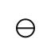 | U+F305F | `&#995423;` | `&#xF305F;` |
| CHALISH GLYPH MONKEY |  | U+F3060 | `&#995424;` | `&#xF3060;` |
| CHALISH GLYPH BAT |  | U+F3061 | `&#995425;` | `&#xF3061;` |
| CHALISH GLYPH NET |  | U+F3062 | `&#995426;` | `&#xF3062;` |
| CHALISH GLYPH HUMMINGBIRD |  | U+F3063 | `&#995427;` | `&#xF3063;` |
| CHALISH GLYPH SHIELD |  | U+F3064 | `&#995428;` | `&#xF3064;` |
| CHALISH GLYPH DEER |  | U+F3065 | `&#995429;` | `&#xF3065;` |
| CHALISH GLYPH MASK |  | U+F3066 | `&#995430;` | `&#xF3066;` |
