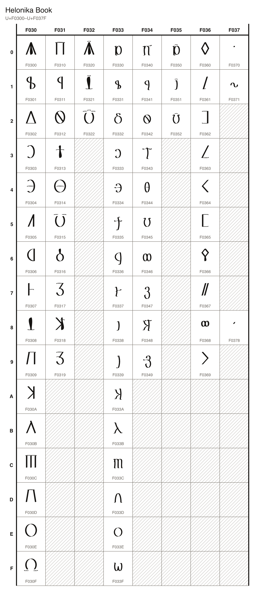

# Helonika Book

71 characters, U+F0300 to U+F0378, in the font `Helonika Book`.

## Code chart

## Characters

### Letters

| Character Name | Code | Character | Code Point | Entity | Hex Entity |
| --- | --- | --- | --- | --- | --- |
| HELONIKA CAPITAL LETTER A | `A_MAJ` |  | U+F0300 | `&#983808;` | `&#xF0300;` |
| HELONIKA CAPITAL LETTER B | `B_MAJ` |  | U+F0301 | `&#983809;` | `&#xF0301;` |
| HELONIKA CAPITAL LETTER D | `D_MAJ` |  | U+F0302 | `&#983810;` | `&#xF0302;` |
| HELONIKA CAPITAL LETTER E | `E_MAJ` |  | U+F0303 | `&#983811;` | `&#xF0303;` |
| HELONIKA CAPITAL LETTER LONG E | `LONG_E_MAJ` |  | U+F0304 | `&#983812;` | `&#xF0304;` |
| HELONIKA CAPITAL LETTER F | `F_MAJ` |  | U+F0305 | `&#983813;` | `&#xF0305;` |
| HELONIKA CAPITAL LETTER G | `G_MAJ` |  | U+F0306 | `&#983814;` | `&#xF0306;` |
| HELONIKA CAPITAL LETTER H | `H_MAJ` |  | U+F0307 | `&#983815;` | `&#xF0307;` |
| HELONIKA CAPITAL LETTER I | `I_MAJ` |  | U+F0308 | `&#983816;` | `&#xF0308;` |
| HELONIKA CAPITAL LETTER J | `J_MAJ` |  | U+F0309 | `&#983817;` | `&#xF0309;` |
| HELONIKA CAPITAL LETTER K | `K_MAJ` |  | U+F030A | `&#983818;` | `&#xF030A;` |
| HELONIKA CAPITAL LETTER L | `L_MAJ` |  | U+F030B | `&#983819;` | `&#xF030B;` |
| HELONIKA CAPITAL LETTER M | `M_MAJ` |  | U+F030C | `&#983820;` | `&#xF030C;` |
| HELONIKA CAPITAL LETTER N | `N_MAJ` |  | U+F030D | `&#983821;` | `&#xF030D;` |
| HELONIKA CAPITAL LETTER O | `O_MAJ` |  | U+F030E | `&#983822;` | `&#xF030E;` |
| HELONIKA CAPITAL LETTER LONG O | `LONG_O_MAJ` |  | U+F030F | `&#983823;` | `&#xF030F;` |
| HELONIKA CAPITAL LETTER P | `P_MAJ` |  | U+F0310 | `&#983824;` | `&#xF0310;` |
| HELONIKA CAPITAL LETTER R | `R_MAJ` |  | U+F0311 | `&#983825;` | `&#xF0311;` |
| HELONIKA CAPITAL LETTER S | `S_MAJ` |  | U+F0312 | `&#983826;` | `&#xF0312;` |
| HELONIKA CAPITAL LETTER T | `T_MAJ` |  | U+F0313 | `&#983827;` | `&#xF0313;` |
| HELONIKA CAPITAL LETTER TH | `TH_MAJ` |  | U+F0314 | `&#983828;` | `&#xF0314;` |
| HELONIKA CAPITAL LETTER U | `U_MAJ` |  | U+F0315 | `&#983829;` | `&#xF0315;` |
| HELONIKA CAPITAL LETTER V | `V_MAJ` |  | U+F0316 | `&#983830;` | `&#xF0316;` |
| HELONIKA CAPITAL LETTER Z | `Z_MAJ` |  | U+F0317 | `&#983831;` | `&#xF0317;` |
| HELONIKA CAPITAL LETTER KH | `KH_MAJ` |  | U+F0318 | `&#983832;` | `&#xF0318;` |
| HELONIKA CAPITAL LETTER ZH | `ZH_MAJ` |  | U+F0319 | `&#983833;` | `&#xF0319;` |
| HELONIKA CAPITAL LETTER A WITH LENGTH BAR | `LONG_A_MAJ` |  | U+F0320 | `&#983840;` | `&#xF0320;` |
| HELONIKA CAPITAL LETTER I WITH LENGTH BAR | `LONG_I_MAJ` |  | U+F0321 | `&#983841;` | `&#xF0321;` |
| HELONIKA CAPITAL LETTER U WITH LENGTH BAR | `LONG_U_MAJ` |  | U+F0322 | `&#983842;` | `&#xF0322;` |
| HELONIKA SMALL LETTER A | `A_MIN` |  | U+F0330 | `&#983856;` | `&#xF0330;` |
| HELONIKA SMALL LETTER B | `B_MIN` |  | U+F0331 | `&#983857;` | `&#xF0331;` |
| HELONIKA SMALL LETTER D | `D_MIN` |  | U+F0332 | `&#983858;` | `&#xF0332;` |
| HELONIKA SMALL LETTER E | `E_MIN` |  | U+F0333 | `&#983859;` | `&#xF0333;` |
| HELONIKA SMALL LETTER LONG E | `LONG_E_MIN` |  | U+F0334 | `&#983860;` | `&#xF0334;` |
| HELONIKA SMALL LETTER F | `F_MIN` |  | U+F0335 | `&#983861;` | `&#xF0335;` |
| HELONIKA SMALL LETTER G | `G_MIN` |  | U+F0336 | `&#983862;` | `&#xF0336;` |
| HELONIKA SMALL LETTER H | `H_MIN` |  | U+F0337 | `&#983863;` | `&#xF0337;` |
| HELONIKA SMALL LETTER I | `I_MIN` |  | U+F0338 | `&#983864;` | `&#xF0338;` |
| HELONIKA SMALL LETTER J | `J_MIN` |  | U+F0339 | `&#983865;` | `&#xF0339;` |
| HELONIKA SMALL LETTER K | `K_MIN` |  | U+F033A | `&#983866;` | `&#xF033A;` |
| HELONIKA SMALL LETTER L | `L_MIN` |  | U+F033B | `&#983867;` | `&#xF033B;` |
| HELONIKA SMALL LETTER M | `M_MIN` |  | U+F033C | `&#983868;` | `&#xF033C;` |
| HELONIKA SMALL LETTER N | `N_MIN` |  | U+F033D | `&#983869;` | `&#xF033D;` |
| HELONIKA SMALL LETTER O | `O_MIN` |  | U+F033E | `&#983870;` | `&#xF033E;` |
| HELONIKA SMALL LETTER LONG O | `LONG_O_MIN` |  | U+F033F | `&#983871;` | `&#xF033F;` |
| HELONIKA SMALL LETTER P | `P_MIN` |  | U+F0340 | `&#983872;` | `&#xF0340;` |
| HELONIKA SMALL LETTER R | `R_MIN` |  | U+F0341 | `&#983873;` | `&#xF0341;` |
| HELONIKA SMALL LETTER S | `S_MIN` |  | U+F0342 | `&#983874;` | `&#xF0342;` |
| HELONIKA SMALL LETTER T | `T_MIN` |  | U+F0343 | `&#983875;` | `&#xF0343;` |
| HELONIKA SMALL LETTER TH | `TH_MIN` |  | U+F0344 | `&#983876;` | `&#xF0344;` |
| HELONIKA SMALL LETTER U | `U_MIN` |  | U+F0345 | `&#983877;` | `&#xF0345;` |
| HELONIKA SMALL LETTER V | `V_MIN` |  | U+F0346 | `&#983878;` | `&#xF0346;` |
| HELONIKA SMALL LETTER Z | `Z_MIN` |  | U+F0347 | `&#983879;` | `&#xF0347;` |
| HELONIKA SMALL LETTER KH | `KH_MIN` |  | U+F0348 | `&#983880;` | `&#xF0348;` |
| HELONIKA SMALL LETTER ZH | `ZH_MIN` |  | U+F0349 | `&#983881;` | `&#xF0349;` |
| HELONIKA SMALL LETTER A WITH LENGTH BAR | `LONG_A_MIN` |  | U+F0350 | `&#983888;` | `&#xF0350;` |
| HELONIKA SMALL LETTER I WITH LENGTH BAR | `LONG_I_MIN` |  | U+F0351 | `&#983889;` | `&#xF0351;` |
| HELONIKA SMALL LETTER U WITH LENGTH BAR | `LONG_U_MIN` |  | U+F0352 | `&#983890;` | `&#xF0352;` |

### Digits

| Character Name | Code | Character | Code Point | Entity | Hex Entity |
| --- | --- | --- | --- | --- | --- |
| HELONIKA DIGIT ZERO | `DIGIT_ZERO` |  | U+F0360 | `&#983904;` | `&#xF0360;` |
| HELONIKA DIGIT ONE | `DIGIT_ONE` |  | U+F0361 | `&#983905;` | `&#xF0361;` |
| HELONIKA DIGIT TWO | `DIGIT_TWO` |  | U+F0362 | `&#983906;` | `&#xF0362;` |
| HELONIKA DIGIT THREE | `DIGIT_THREE` |  | U+F0363 | `&#983907;` | `&#xF0363;` |
| HELONIKA DIGIT FOUR | `DIGIT_FOUR` |  | U+F0364 | `&#983908;` | `&#xF0364;` |
| HELONIKA DIGIT FIVE | `DIGIT_FIVE` |  | U+F0365 | `&#983909;` | `&#xF0365;` |
| HELONIKA DIGIT SIX | `DIGIT_SIX` |  | U+F0366 | `&#983910;` | `&#xF0366;` |
| HELONIKA DIGIT SEVEN | `DIGIT_SEVEN` |  | U+F0367 | `&#983911;` | `&#xF0367;` |
| HELONIKA DIGIT EIGHT | `DIGIT_EIGHT` |  | U+F0368 | `&#983912;` | `&#xF0368;` |
| HELONIKA DIGIT NINE | `DIGIT_NINE` |  | U+F0369 | `&#983913;` | `&#xF0369;` |

### Punctuation

| Character Name | Code | Character | Code Point | Entity | Hex Entity |
| --- | --- | --- | --- | --- | --- |
| HELONIKA RAISED DOT | `STOP` |  | U+F0370 | `&#983920;` | `&#xF0370;` |
| HELONIKA REGISTER MARK | `REGISTER` |  | U+F0371 | `&#983921;` | `&#xF0371;` |

### Marks

| Character Name | Code | Character | Code Point | Entity | Hex Entity |
| --- | --- | --- | --- | --- | --- |
| HELONIKA COMBINING ACCENT | `ACCENT` |  | U+F0378 | `&#983928;` | `&#xF0378;` |
