# Khelathi Zethu Glyphs

304 characters, U+1EA41 to U+1EC1B, in the font `Khelathi Zethu Glyphs`.

## Code chart

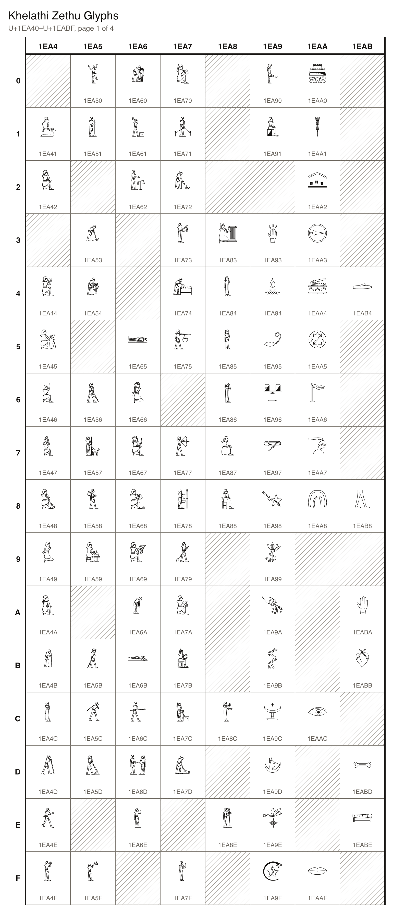
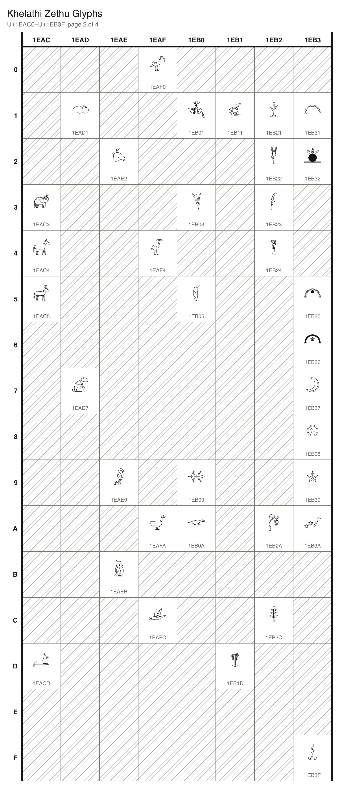
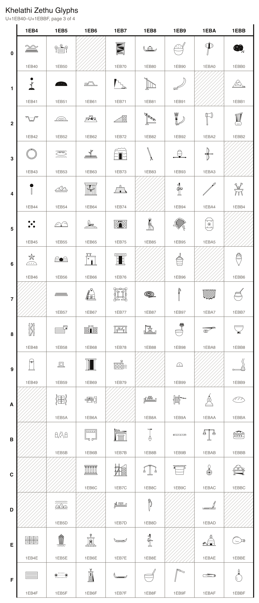
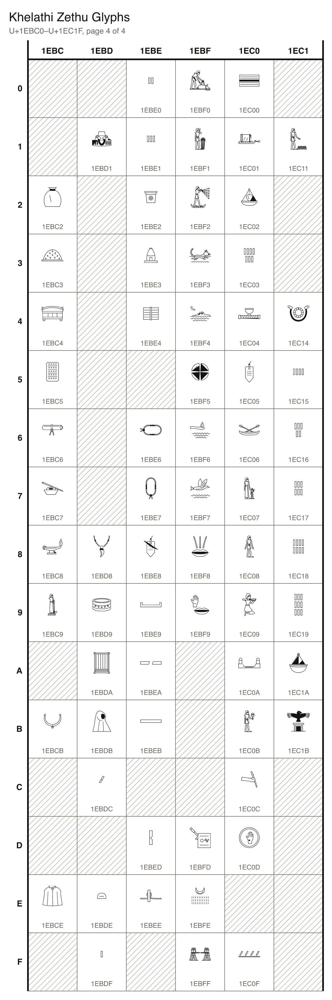

## Characters

### Signs

| Character Name | Character | Code Point | Entity | Hex Entity |
| --- | --- | --- | --- | --- |
| ZETHU CHARACTER 002 |  | U+1EA41 | `&#125505;` | `&#x1EA41;` |
| ZETHU CHARACTER 003 | 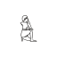 | U+1EA42 | `&#125506;` | `&#x1EA42;` |
| ZETHU CHARACTER 005 | 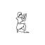 | U+1EA44 | `&#125508;` | `&#x1EA44;` |
| ZETHU CHARACTER 006 |  | U+1EA45 | `&#125509;` | `&#x1EA45;` |
| ZETHU CHARACTER 007 |  | U+1EA46 | `&#125510;` | `&#x1EA46;` |
| ZETHU CHARACTER 008 | 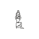 | U+1EA47 | `&#125511;` | `&#x1EA47;` |
| ZETHU CHARACTER 009 | 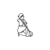 | U+1EA48 | `&#125512;` | `&#x1EA48;` |
| ZETHU CHARACTER 010 | 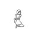 | U+1EA49 | `&#125513;` | `&#x1EA49;` |
| ZETHU CHARACTER 011 |  | U+1EA4A | `&#125514;` | `&#x1EA4A;` |
| ZETHU CHARACTER 012 |  | U+1EA4B | `&#125515;` | `&#x1EA4B;` |
| ZETHU CHARACTER 013 | 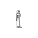 | U+1EA4C | `&#125516;` | `&#x1EA4C;` |
| ZETHU CHARACTER 014 | 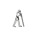 | U+1EA4D | `&#125517;` | `&#x1EA4D;` |
| ZETHU CHARACTER 015 | 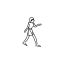 | U+1EA4E | `&#125518;` | `&#x1EA4E;` |
| ZETHU CHARACTER 016 | 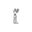 | U+1EA4F | `&#125519;` | `&#x1EA4F;` |
| ZETHU CHARACTER 017 |  | U+1EA50 | `&#125520;` | `&#x1EA50;` |
| ZETHU CHARACTER 018 | 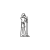 | U+1EA51 | `&#125521;` | `&#x1EA51;` |
| ZETHU CHARACTER 020 | 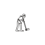 | U+1EA53 | `&#125523;` | `&#x1EA53;` |
| ZETHU CHARACTER 021 |  | U+1EA54 | `&#125524;` | `&#x1EA54;` |
| ZETHU CHARACTER 023 | 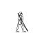 | U+1EA56 | `&#125526;` | `&#x1EA56;` |
| ZETHU CHARACTER 024 | 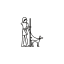 | U+1EA57 | `&#125527;` | `&#x1EA57;` |
| ZETHU CHARACTER 025 | 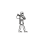 | U+1EA58 | `&#125528;` | `&#x1EA58;` |
| ZETHU CHARACTER 026 |  | U+1EA59 | `&#125529;` | `&#x1EA59;` |
| ZETHU CHARACTER 028 | 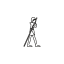 | U+1EA5B | `&#125531;` | `&#x1EA5B;` |
| ZETHU CHARACTER 029 | 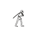 | U+1EA5C | `&#125532;` | `&#x1EA5C;` |
| ZETHU CHARACTER 030 | 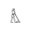 | U+1EA5D | `&#125533;` | `&#x1EA5D;` |
| ZETHU CHARACTER 032 |  | U+1EA5F | `&#125535;` | `&#x1EA5F;` |
| ZETHU CHARACTER 033 |  | U+1EA60 | `&#125536;` | `&#x1EA60;` |
| ZETHU CHARACTER 034 | 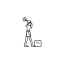 | U+1EA61 | `&#125537;` | `&#x1EA61;` |
| ZETHU CHARACTER 035 | 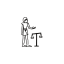 | U+1EA62 | `&#125538;` | `&#x1EA62;` |
| ZETHU CHARACTER 038 |  | U+1EA65 | `&#125541;` | `&#x1EA65;` |
| ZETHU CHARACTER 039 |  | U+1EA66 | `&#125542;` | `&#x1EA66;` |
| ZETHU CHARACTER 040 |  | U+1EA67 | `&#125543;` | `&#x1EA67;` |
| ZETHU CHARACTER 041 | 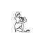 | U+1EA68 | `&#125544;` | `&#x1EA68;` |
| ZETHU CHARACTER 042 |  | U+1EA69 | `&#125545;` | `&#x1EA69;` |
| ZETHU CHARACTER 043 |  | U+1EA6A | `&#125546;` | `&#x1EA6A;` |
| ZETHU CHARACTER 044 | 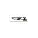 | U+1EA6B | `&#125547;` | `&#x1EA6B;` |
| ZETHU CHARACTER 045 | 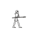 | U+1EA6C | `&#125548;` | `&#x1EA6C;` |
| ZETHU CHARACTER 046 |  | U+1EA6D | `&#125549;` | `&#x1EA6D;` |
| ZETHU CHARACTER 047 | 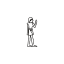 | U+1EA6E | `&#125550;` | `&#x1EA6E;` |
| ZETHU CHARACTER 049 | 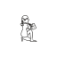 | U+1EA70 | `&#125552;` | `&#x1EA70;` |
| ZETHU CHARACTER 050 | 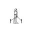 | U+1EA71 | `&#125553;` | `&#x1EA71;` |
| ZETHU CHARACTER 051 |  | U+1EA72 | `&#125554;` | `&#x1EA72;` |
| ZETHU CHARACTER 052 | 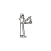 | U+1EA73 | `&#125555;` | `&#x1EA73;` |
| ZETHU CHARACTER 053 |  | U+1EA74 | `&#125556;` | `&#x1EA74;` |
| ZETHU CHARACTER 054 |  | U+1EA75 | `&#125557;` | `&#x1EA75;` |
| ZETHU CHARACTER 056 | 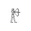 | U+1EA77 | `&#125559;` | `&#x1EA77;` |
| ZETHU CHARACTER 057 | 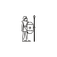 | U+1EA78 | `&#125560;` | `&#x1EA78;` |
| ZETHU CHARACTER 058 | 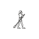 | U+1EA79 | `&#125561;` | `&#x1EA79;` |
| ZETHU CHARACTER 059 |  | U+1EA7A | `&#125562;` | `&#x1EA7A;` |
| ZETHU CHARACTER 060 |  | U+1EA7B | `&#125563;` | `&#x1EA7B;` |
| ZETHU CHARACTER 061 | 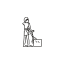 | U+1EA7C | `&#125564;` | `&#x1EA7C;` |
| ZETHU CHARACTER 062 | 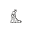 | U+1EA7D | `&#125565;` | `&#x1EA7D;` |
| ZETHU CHARACTER 064 | 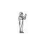 | U+1EA7F | `&#125567;` | `&#x1EA7F;` |
| ZETHU CHARACTER 068 |  | U+1EA83 | `&#125571;` | `&#x1EA83;` |
| ZETHU CHARACTER 069 | 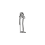 | U+1EA84 | `&#125572;` | `&#x1EA84;` |
| ZETHU CHARACTER 070 | 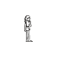 | U+1EA85 | `&#125573;` | `&#x1EA85;` |
| ZETHU CHARACTER 071 | 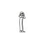 | U+1EA86 | `&#125574;` | `&#x1EA86;` |
| ZETHU CHARACTER 072 |  | U+1EA87 | `&#125575;` | `&#x1EA87;` |
| ZETHU CHARACTER 073 |  | U+1EA88 | `&#125576;` | `&#x1EA88;` |
| ZETHU CHARACTER 077 | 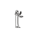 | U+1EA8C | `&#125580;` | `&#x1EA8C;` |
| ZETHU CHARACTER 079 | 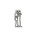 | U+1EA8E | `&#125582;` | `&#x1EA8E;` |
| ZETHU CHARACTER 081 | 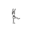 | U+1EA90 | `&#125584;` | `&#x1EA90;` |
| ZETHU CHARACTER 082 |  | U+1EA91 | `&#125585;` | `&#x1EA91;` |
| ZETHU CHARACTER 084 |  | U+1EA93 | `&#125587;` | `&#x1EA93;` |
| ZETHU CHARACTER 085 |  | U+1EA94 | `&#125588;` | `&#x1EA94;` |
| ZETHU CHARACTER 086 |  | U+1EA95 | `&#125589;` | `&#x1EA95;` |
| ZETHU CHARACTER 087 |  | U+1EA96 | `&#125590;` | `&#x1EA96;` |
| ZETHU CHARACTER 088 |  | U+1EA97 | `&#125591;` | `&#x1EA97;` |
| ZETHU CHARACTER 089 |  | U+1EA98 | `&#125592;` | `&#x1EA98;` |
| ZETHU CHARACTER 090 |  | U+1EA99 | `&#125593;` | `&#x1EA99;` |
| ZETHU CHARACTER 091 |  | U+1EA9A | `&#125594;` | `&#x1EA9A;` |
| ZETHU CHARACTER 092 | 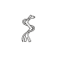 | U+1EA9B | `&#125595;` | `&#x1EA9B;` |
| ZETHU CHARACTER 093 |  | U+1EA9C | `&#125596;` | `&#x1EA9C;` |
| ZETHU CHARACTER 094 |  | U+1EA9D | `&#125597;` | `&#x1EA9D;` |
| ZETHU CHARACTER 095 |  | U+1EA9E | `&#125598;` | `&#x1EA9E;` |
| ZETHU CHARACTER 096 |  | U+1EA9F | `&#125599;` | `&#x1EA9F;` |
| ZETHU CHARACTER 097 |  | U+1EAA0 | `&#125600;` | `&#x1EAA0;` |
| ZETHU CHARACTER 098 | 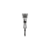 | U+1EAA1 | `&#125601;` | `&#x1EAA1;` |
| ZETHU CHARACTER 099 |  | U+1EAA2 | `&#125602;` | `&#x1EAA2;` |
| ZETHU CHARACTER 100 |  | U+1EAA3 | `&#125603;` | `&#x1EAA3;` |
| ZETHU CHARACTER 101 |  | U+1EAA4 | `&#125604;` | `&#x1EAA4;` |
| ZETHU CHARACTER 102 |  | U+1EAA5 | `&#125605;` | `&#x1EAA5;` |
| ZETHU CHARACTER 103 |  | U+1EAA6 | `&#125606;` | `&#x1EAA6;` |
| ZETHU CHARACTER 104 |  | U+1EAA7 | `&#125607;` | `&#x1EAA7;` |
| ZETHU CHARACTER 105 |  | U+1EAA8 | `&#125608;` | `&#x1EAA8;` |
| ZETHU CHARACTER 109 |  | U+1EAAC | `&#125612;` | `&#x1EAAC;` |
| ZETHU CHARACTER 112 |  | U+1EAAF | `&#125615;` | `&#x1EAAF;` |
| ZETHU CHARACTER 117 |  | U+1EAB4 | `&#125620;` | `&#x1EAB4;` |
| ZETHU CHARACTER 121 |  | U+1EAB8 | `&#125624;` | `&#x1EAB8;` |
| ZETHU CHARACTER 123 |  | U+1EABA | `&#125626;` | `&#x1EABA;` |
| ZETHU CHARACTER 124 |  | U+1EABB | `&#125627;` | `&#x1EABB;` |
| ZETHU CHARACTER 126 |  | U+1EABD | `&#125629;` | `&#x1EABD;` |
| ZETHU CHARACTER 127 |  | U+1EABE | `&#125630;` | `&#x1EABE;` |
| ZETHU CHARACTER 132 | 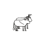 | U+1EAC3 | `&#125635;` | `&#x1EAC3;` |
| ZETHU CHARACTER 133 | 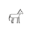 | U+1EAC4 | `&#125636;` | `&#x1EAC4;` |
| ZETHU CHARACTER 134 | 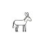 | U+1EAC5 | `&#125637;` | `&#x1EAC5;` |
| ZETHU CHARACTER 142 |  | U+1EACD | `&#125645;` | `&#x1EACD;` |
| ZETHU CHARACTER 146 |  | U+1EAD1 | `&#125649;` | `&#x1EAD1;` |
| ZETHU CHARACTER 152 |  | U+1EAD7 | `&#125655;` | `&#x1EAD7;` |
| ZETHU CHARACTER 163 |  | U+1EAE2 | `&#125666;` | `&#x1EAE2;` |
| ZETHU CHARACTER 170 |  | U+1EAE9 | `&#125673;` | `&#x1EAE9;` |
| ZETHU CHARACTER 172 |  | U+1EAEB | `&#125675;` | `&#x1EAEB;` |
| ZETHU CHARACTER 177 | 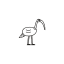 | U+1EAF0 | `&#125680;` | `&#x1EAF0;` |
| ZETHU CHARACTER 181 | 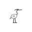 | U+1EAF4 | `&#125684;` | `&#x1EAF4;` |
| ZETHU CHARACTER 187 | 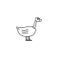 | U+1EAFA | `&#125690;` | `&#x1EAFA;` |
| ZETHU CHARACTER 189 |  | U+1EAFC | `&#125692;` | `&#x1EAFC;` |
| ZETHU CHARACTER 194 |  | U+1EB01 | `&#125697;` | `&#x1EB01;` |
| ZETHU CHARACTER 196 |  | U+1EB03 | `&#125699;` | `&#x1EB03;` |
| ZETHU CHARACTER 198 |  | U+1EB05 | `&#125701;` | `&#x1EB05;` |
| ZETHU CHARACTER 202 |  | U+1EB09 | `&#125705;` | `&#x1EB09;` |
| ZETHU CHARACTER 203 |  | U+1EB0A | `&#125706;` | `&#x1EB0A;` |
| ZETHU CHARACTER 210 |  | U+1EB11 | `&#125713;` | `&#x1EB11;` |
| ZETHU CHARACTER 222 |  | U+1EB1D | `&#125725;` | `&#x1EB1D;` |
| ZETHU CHARACTER 226 |  | U+1EB21 | `&#125729;` | `&#x1EB21;` |
| ZETHU CHARACTER 227 |  | U+1EB22 | `&#125730;` | `&#x1EB22;` |
| ZETHU CHARACTER 228 |  | U+1EB23 | `&#125731;` | `&#x1EB23;` |
| ZETHU CHARACTER 229 |  | U+1EB24 | `&#125732;` | `&#x1EB24;` |
| ZETHU CHARACTER 235 |  | U+1EB2A | `&#125738;` | `&#x1EB2A;` |
| ZETHU CHARACTER 237 |  | U+1EB2C | `&#125740;` | `&#x1EB2C;` |
| ZETHU CHARACTER 242 |  | U+1EB31 | `&#125745;` | `&#x1EB31;` |
| ZETHU CHARACTER 243 |  | U+1EB32 | `&#125746;` | `&#x1EB32;` |
| ZETHU CHARACTER 246 |  | U+1EB35 | `&#125749;` | `&#x1EB35;` |
| ZETHU CHARACTER 247 |  | U+1EB36 | `&#125750;` | `&#x1EB36;` |
| ZETHU CHARACTER 248 |  | U+1EB37 | `&#125751;` | `&#x1EB37;` |
| ZETHU CHARACTER 249 |  | U+1EB38 | `&#125752;` | `&#x1EB38;` |
| ZETHU CHARACTER 250 |  | U+1EB39 | `&#125753;` | `&#x1EB39;` |
| ZETHU CHARACTER 251 |  | U+1EB3A | `&#125754;` | `&#x1EB3A;` |
| ZETHU CHARACTER 256 |  | U+1EB3F | `&#125759;` | `&#x1EB3F;` |
| ZETHU CHARACTER 257 |  | U+1EB40 | `&#125760;` | `&#x1EB40;` |
| ZETHU CHARACTER 258 |  | U+1EB41 | `&#125761;` | `&#x1EB41;` |
| ZETHU CHARACTER 259 |  | U+1EB42 | `&#125762;` | `&#x1EB42;` |
| ZETHU CHARACTER 260 |  | U+1EB43 | `&#125763;` | `&#x1EB43;` |
| ZETHU CHARACTER 261 |  | U+1EB44 | `&#125764;` | `&#x1EB44;` |
| ZETHU CHARACTER 262 |  | U+1EB45 | `&#125765;` | `&#x1EB45;` |
| ZETHU CHARACTER 263 |  | U+1EB46 | `&#125766;` | `&#x1EB46;` |
| ZETHU CHARACTER 265 |  | U+1EB48 | `&#125768;` | `&#x1EB48;` |
| ZETHU CHARACTER 266 |  | U+1EB49 | `&#125769;` | `&#x1EB49;` |
| ZETHU CHARACTER 271 |  | U+1EB4E | `&#125774;` | `&#x1EB4E;` |
| ZETHU CHARACTER 272 |  | U+1EB4F | `&#125775;` | `&#x1EB4F;` |
| ZETHU CHARACTER 273 |  | U+1EB50 | `&#125776;` | `&#x1EB50;` |
| ZETHU CHARACTER 274 |  | U+1EB51 | `&#125777;` | `&#x1EB51;` |
| ZETHU CHARACTER 275 |  | U+1EB52 | `&#125778;` | `&#x1EB52;` |
| ZETHU CHARACTER 276 |  | U+1EB53 | `&#125779;` | `&#x1EB53;` |
| ZETHU CHARACTER 277 |  | U+1EB54 | `&#125780;` | `&#x1EB54;` |
| ZETHU CHARACTER 278 |  | U+1EB55 | `&#125781;` | `&#x1EB55;` |
| ZETHU CHARACTER 279 |  | U+1EB56 | `&#125782;` | `&#x1EB56;` |
| ZETHU CHARACTER 280 |  | U+1EB57 | `&#125783;` | `&#x1EB57;` |
| ZETHU CHARACTER 281 |  | U+1EB58 | `&#125784;` | `&#x1EB58;` |
| ZETHU CHARACTER 282 |  | U+1EB59 | `&#125785;` | `&#x1EB59;` |
| ZETHU CHARACTER 283 |  | U+1EB5A | `&#125786;` | `&#x1EB5A;` |
| ZETHU CHARACTER 284 |  | U+1EB5B | `&#125787;` | `&#x1EB5B;` |
| ZETHU CHARACTER 286 |  | U+1EB5D | `&#125789;` | `&#x1EB5D;` |
| ZETHU CHARACTER 287 |  | U+1EB5E | `&#125790;` | `&#x1EB5E;` |
| ZETHU CHARACTER 288 |  | U+1EB5F | `&#125791;` | `&#x1EB5F;` |
| ZETHU CHARACTER 290 |  | U+1EB61 | `&#125793;` | `&#x1EB61;` |
| ZETHU CHARACTER 291 |  | U+1EB62 | `&#125794;` | `&#x1EB62;` |
| ZETHU CHARACTER 292 |  | U+1EB63 | `&#125795;` | `&#x1EB63;` |
| ZETHU CHARACTER 293 |  | U+1EB64 | `&#125796;` | `&#x1EB64;` |
| ZETHU CHARACTER 294 |  | U+1EB65 | `&#125797;` | `&#x1EB65;` |
| ZETHU CHARACTER 295 |  | U+1EB66 | `&#125798;` | `&#x1EB66;` |
| ZETHU CHARACTER 296 |  | U+1EB67 | `&#125799;` | `&#x1EB67;` |
| ZETHU CHARACTER 297 |  | U+1EB68 | `&#125800;` | `&#x1EB68;` |
| ZETHU CHARACTER 298 |  | U+1EB69 | `&#125801;` | `&#x1EB69;` |
| ZETHU CHARACTER 299 |  | U+1EB6A | `&#125802;` | `&#x1EB6A;` |
| ZETHU CHARACTER 300 |  | U+1EB6B | `&#125803;` | `&#x1EB6B;` |
| ZETHU CHARACTER 301 |  | U+1EB6C | `&#125804;` | `&#x1EB6C;` |
| ZETHU CHARACTER 303 |  | U+1EB6E | `&#125806;` | `&#x1EB6E;` |
| ZETHU CHARACTER 304 |  | U+1EB6F | `&#125807;` | `&#x1EB6F;` |
| ZETHU CHARACTER 305 |  | U+1EB70 | `&#125808;` | `&#x1EB70;` |
| ZETHU CHARACTER 306 |  | U+1EB71 | `&#125809;` | `&#x1EB71;` |
| ZETHU CHARACTER 307 |  | U+1EB72 | `&#125810;` | `&#x1EB72;` |
| ZETHU CHARACTER 308 |  | U+1EB73 | `&#125811;` | `&#x1EB73;` |
| ZETHU CHARACTER 309 |  | U+1EB74 | `&#125812;` | `&#x1EB74;` |
| ZETHU CHARACTER 310 |  | U+1EB75 | `&#125813;` | `&#x1EB75;` |
| ZETHU CHARACTER 311 |  | U+1EB76 | `&#125814;` | `&#x1EB76;` |
| ZETHU CHARACTER 312 |  | U+1EB77 | `&#125815;` | `&#x1EB77;` |
| ZETHU CHARACTER 313 |  | U+1EB78 | `&#125816;` | `&#x1EB78;` |
| ZETHU CHARACTER 314 |  | U+1EB79 | `&#125817;` | `&#x1EB79;` |
| ZETHU CHARACTER 316 |  | U+1EB7B | `&#125819;` | `&#x1EB7B;` |
| ZETHU CHARACTER 317 |  | U+1EB7C | `&#125820;` | `&#x1EB7C;` |
| ZETHU CHARACTER 318 |  | U+1EB7D | `&#125821;` | `&#x1EB7D;` |
| ZETHU CHARACTER 319 |  | U+1EB7E | `&#125822;` | `&#x1EB7E;` |
| ZETHU CHARACTER 320 |  | U+1EB7F | `&#125823;` | `&#x1EB7F;` |
| ZETHU CHARACTER 321 |  | U+1EB80 | `&#125824;` | `&#x1EB80;` |
| ZETHU CHARACTER 322 |  | U+1EB81 | `&#125825;` | `&#x1EB81;` |
| ZETHU CHARACTER 323 |  | U+1EB82 | `&#125826;` | `&#x1EB82;` |
| ZETHU CHARACTER 324 |  | U+1EB83 | `&#125827;` | `&#x1EB83;` |
| ZETHU CHARACTER 326 |  | U+1EB85 | `&#125829;` | `&#x1EB85;` |
| ZETHU CHARACTER 328 |  | U+1EB87 | `&#125831;` | `&#x1EB87;` |
| ZETHU CHARACTER 329 |  | U+1EB88 | `&#125832;` | `&#x1EB88;` |
| ZETHU CHARACTER 331 |  | U+1EB8A | `&#125834;` | `&#x1EB8A;` |
| ZETHU CHARACTER 332 |  | U+1EB8B | `&#125835;` | `&#x1EB8B;` |
| ZETHU CHARACTER 333 |  | U+1EB8C | `&#125836;` | `&#x1EB8C;` |
| ZETHU CHARACTER 334 |  | U+1EB8D | `&#125837;` | `&#x1EB8D;` |
| ZETHU CHARACTER 335 |  | U+1EB8E | `&#125838;` | `&#x1EB8E;` |
| ZETHU CHARACTER 336 |  | U+1EB8F | `&#125839;` | `&#x1EB8F;` |
| ZETHU CHARACTER 337 |  | U+1EB90 | `&#125840;` | `&#x1EB90;` |
| ZETHU CHARACTER 338 |  | U+1EB91 | `&#125841;` | `&#x1EB91;` |
| ZETHU CHARACTER 339 |  | U+1EB92 | `&#125842;` | `&#x1EB92;` |
| ZETHU CHARACTER 340 |  | U+1EB93 | `&#125843;` | `&#x1EB93;` |
| ZETHU CHARACTER 341 |  | U+1EB94 | `&#125844;` | `&#x1EB94;` |
| ZETHU CHARACTER 342 |  | U+1EB95 | `&#125845;` | `&#x1EB95;` |
| ZETHU CHARACTER 343 |  | U+1EB96 | `&#125846;` | `&#x1EB96;` |
| ZETHU CHARACTER 344 |  | U+1EB97 | `&#125847;` | `&#x1EB97;` |
| ZETHU CHARACTER 345 |  | U+1EB98 | `&#125848;` | `&#x1EB98;` |
| ZETHU CHARACTER 346 |  | U+1EB99 | `&#125849;` | `&#x1EB99;` |
| ZETHU CHARACTER 347 |  | U+1EB9A | `&#125850;` | `&#x1EB9A;` |
| ZETHU CHARACTER 348 |  | U+1EB9B | `&#125851;` | `&#x1EB9B;` |
| ZETHU CHARACTER 349 |  | U+1EB9C | `&#125852;` | `&#x1EB9C;` |
| ZETHU CHARACTER 352 |  | U+1EB9F | `&#125855;` | `&#x1EB9F;` |
| ZETHU CHARACTER 353 |  | U+1EBA0 | `&#125856;` | `&#x1EBA0;` |
| ZETHU CHARACTER 355 |  | U+1EBA2 | `&#125858;` | `&#x1EBA2;` |
| ZETHU CHARACTER 356 |  | U+1EBA3 | `&#125859;` | `&#x1EBA3;` |
| ZETHU CHARACTER 357 |  | U+1EBA4 | `&#125860;` | `&#x1EBA4;` |
| ZETHU CHARACTER 358 |  | U+1EBA5 | `&#125861;` | `&#x1EBA5;` |
| ZETHU CHARACTER 360 |  | U+1EBA7 | `&#125863;` | `&#x1EBA7;` |
| ZETHU CHARACTER 361 |  | U+1EBA8 | `&#125864;` | `&#x1EBA8;` |
| ZETHU CHARACTER 363 |  | U+1EBAA | `&#125866;` | `&#x1EBAA;` |
| ZETHU CHARACTER 364 |  | U+1EBAB | `&#125867;` | `&#x1EBAB;` |
| ZETHU CHARACTER 365 |  | U+1EBAC | `&#125868;` | `&#x1EBAC;` |
| ZETHU CHARACTER 366 |  | U+1EBAD | `&#125869;` | `&#x1EBAD;` |
| ZETHU CHARACTER 367 |  | U+1EBAE | `&#125870;` | `&#x1EBAE;` |
| ZETHU CHARACTER 368 |  | U+1EBAF | `&#125871;` | `&#x1EBAF;` |
| ZETHU CHARACTER 369 |  | U+1EBB0 | `&#125872;` | `&#x1EBB0;` |
| ZETHU CHARACTER 370 |  | U+1EBB1 | `&#125873;` | `&#x1EBB1;` |
| ZETHU CHARACTER 371 |  | U+1EBB2 | `&#125874;` | `&#x1EBB2;` |
| ZETHU CHARACTER 373 |  | U+1EBB4 | `&#125876;` | `&#x1EBB4;` |
| ZETHU CHARACTER 375 |  | U+1EBB6 | `&#125878;` | `&#x1EBB6;` |
| ZETHU CHARACTER 376 |  | U+1EBB7 | `&#125879;` | `&#x1EBB7;` |
| ZETHU CHARACTER 377 |  | U+1EBB8 | `&#125880;` | `&#x1EBB8;` |
| ZETHU CHARACTER 378 |  | U+1EBB9 | `&#125881;` | `&#x1EBB9;` |
| ZETHU CHARACTER 379 |  | U+1EBBA | `&#125882;` | `&#x1EBBA;` |
| ZETHU CHARACTER 380 |  | U+1EBBB | `&#125883;` | `&#x1EBBB;` |
| ZETHU CHARACTER 381 |  | U+1EBBC | `&#125884;` | `&#x1EBBC;` |
| ZETHU CHARACTER 383 |  | U+1EBBE | `&#125886;` | `&#x1EBBE;` |
| ZETHU CHARACTER 384 |  | U+1EBBF | `&#125887;` | `&#x1EBBF;` |
| ZETHU CHARACTER 387 |  | U+1EBC2 | `&#125890;` | `&#x1EBC2;` |
| ZETHU CHARACTER 388 |  | U+1EBC3 | `&#125891;` | `&#x1EBC3;` |
| ZETHU CHARACTER 389 |  | U+1EBC4 | `&#125892;` | `&#x1EBC4;` |
| ZETHU CHARACTER 390 |  | U+1EBC5 | `&#125893;` | `&#x1EBC5;` |
| ZETHU CHARACTER 391 |  | U+1EBC6 | `&#125894;` | `&#x1EBC6;` |
| ZETHU CHARACTER 392 |  | U+1EBC7 | `&#125895;` | `&#x1EBC7;` |
| ZETHU CHARACTER 393 |  | U+1EBC8 | `&#125896;` | `&#x1EBC8;` |
| ZETHU CHARACTER 394 |  | U+1EBC9 | `&#125897;` | `&#x1EBC9;` |
| ZETHU CHARACTER 396 |  | U+1EBCB | `&#125899;` | `&#x1EBCB;` |
| ZETHU CHARACTER 399 |  | U+1EBCE | `&#125902;` | `&#x1EBCE;` |
| ZETHU CHARACTER 402 |  | U+1EBD1 | `&#125905;` | `&#x1EBD1;` |
| ZETHU CHARACTER 409 |  | U+1EBD8 | `&#125912;` | `&#x1EBD8;` |
| ZETHU CHARACTER 410 |  | U+1EBD9 | `&#125913;` | `&#x1EBD9;` |
| ZETHU CHARACTER 411 |  | U+1EBDA | `&#125914;` | `&#x1EBDA;` |
| ZETHU CHARACTER 412 |  | U+1EBDB | `&#125915;` | `&#x1EBDB;` |
| ZETHU CHARACTER 413 |  | U+1EBDC | `&#125916;` | `&#x1EBDC;` |
| ZETHU CHARACTER 415 |  | U+1EBDE | `&#125918;` | `&#x1EBDE;` |
| ZETHU CHARACTER 416 |  | U+1EBDF | `&#125919;` | `&#x1EBDF;` |
| ZETHU CHARACTER 417 |  | U+1EBE0 | `&#125920;` | `&#x1EBE0;` |
| ZETHU CHARACTER 418 |  | U+1EBE1 | `&#125921;` | `&#x1EBE1;` |
| ZETHU CHARACTER 419 |  | U+1EBE2 | `&#125922;` | `&#x1EBE2;` |
| ZETHU CHARACTER 420 |  | U+1EBE3 | `&#125923;` | `&#x1EBE3;` |
| ZETHU CHARACTER 421 |  | U+1EBE4 | `&#125924;` | `&#x1EBE4;` |
| ZETHU CHARACTER 423 |  | U+1EBE6 | `&#125926;` | `&#x1EBE6;` |
| ZETHU CHARACTER 424 |  | U+1EBE7 | `&#125927;` | `&#x1EBE7;` |
| ZETHU CHARACTER 425 |  | U+1EBE8 | `&#125928;` | `&#x1EBE8;` |
| ZETHU CHARACTER 426 |  | U+1EBE9 | `&#125929;` | `&#x1EBE9;` |
| ZETHU CHARACTER 427 |  | U+1EBEA | `&#125930;` | `&#x1EBEA;` |
| ZETHU CHARACTER 428 |  | U+1EBEB | `&#125931;` | `&#x1EBEB;` |
| ZETHU CHARACTER 430 |  | U+1EBED | `&#125933;` | `&#x1EBED;` |
| ZETHU CHARACTER 431 |  | U+1EBEE | `&#125934;` | `&#x1EBEE;` |
| ZETHU CHARACTER 433 |  | U+1EBF0 | `&#125936;` | `&#x1EBF0;` |
| ZETHU CHARACTER 434 |  | U+1EBF1 | `&#125937;` | `&#x1EBF1;` |
| ZETHU CHARACTER 435 |  | U+1EBF2 | `&#125938;` | `&#x1EBF2;` |
| ZETHU CHARACTER 436 |  | U+1EBF3 | `&#125939;` | `&#x1EBF3;` |
| ZETHU CHARACTER 437 |  | U+1EBF4 | `&#125940;` | `&#x1EBF4;` |
| ZETHU CHARACTER 438 |  | U+1EBF5 | `&#125941;` | `&#x1EBF5;` |
| ZETHU CHARACTER 439 |  | U+1EBF6 | `&#125942;` | `&#x1EBF6;` |
| ZETHU CHARACTER 440 |  | U+1EBF7 | `&#125943;` | `&#x1EBF7;` |
| ZETHU CHARACTER 441 |  | U+1EBF8 | `&#125944;` | `&#x1EBF8;` |
| ZETHU CHARACTER 442 |  | U+1EBF9 | `&#125945;` | `&#x1EBF9;` |
| ZETHU CHARACTER 446 |  | U+1EBFD | `&#125949;` | `&#x1EBFD;` |
| ZETHU CHARACTER 447 |  | U+1EBFE | `&#125950;` | `&#x1EBFE;` |
| ZETHU CHARACTER 448 |  | U+1EBFF | `&#125951;` | `&#x1EBFF;` |
| ZETHU CHARACTER 449 |  | U+1EC00 | `&#125952;` | `&#x1EC00;` |
| ZETHU CHARACTER 450 |  | U+1EC01 | `&#125953;` | `&#x1EC01;` |
| ZETHU CHARACTER 451 |  | U+1EC02 | `&#125954;` | `&#x1EC02;` |
| ZETHU CHARACTER 452 |  | U+1EC03 | `&#125955;` | `&#x1EC03;` |
| ZETHU CHARACTER 453 |  | U+1EC04 | `&#125956;` | `&#x1EC04;` |
| ZETHU CHARACTER 454 |  | U+1EC05 | `&#125957;` | `&#x1EC05;` |
| ZETHU CHARACTER 455 |  | U+1EC06 | `&#125958;` | `&#x1EC06;` |
| ZETHU CHARACTER 456 |  | U+1EC07 | `&#125959;` | `&#x1EC07;` |
| ZETHU CHARACTER 457 |  | U+1EC08 | `&#125960;` | `&#x1EC08;` |
| ZETHU CHARACTER 458 |  | U+1EC09 | `&#125961;` | `&#x1EC09;` |
| ZETHU CHARACTER 459 |  | U+1EC0A | `&#125962;` | `&#x1EC0A;` |
| ZETHU CHARACTER 460 |  | U+1EC0B | `&#125963;` | `&#x1EC0B;` |
| ZETHU CHARACTER 461 |  | U+1EC0C | `&#125964;` | `&#x1EC0C;` |
| ZETHU CHARACTER 462 |  | U+1EC0D | `&#125965;` | `&#x1EC0D;` |
| ZETHU CHARACTER 464 |  | U+1EC0F | `&#125967;` | `&#x1EC0F;` |
| ZETHU CHARACTER 466 |  | U+1EC11 | `&#125969;` | `&#x1EC11;` |
| ZETHU CHARACTER 469 |  | U+1EC14 | `&#125972;` | `&#x1EC14;` |
| ZETHU CHARACTER 470 |  | U+1EC15 | `&#125973;` | `&#x1EC15;` |
| ZETHU CHARACTER 471 |  | U+1EC16 | `&#125974;` | `&#x1EC16;` |
| ZETHU CHARACTER 472 |  | U+1EC17 | `&#125975;` | `&#x1EC17;` |
| ZETHU CHARACTER 473 |  | U+1EC18 | `&#125976;` | `&#x1EC18;` |
| ZETHU CHARACTER 474 |  | U+1EC19 | `&#125977;` | `&#x1EC19;` |
| ZETHU CHARACTER 475 |  | U+1EC1A | `&#125978;` | `&#x1EC1A;` |
| ZETHU CHARACTER 476 |  | U+1EC1B | `&#125979;` | `&#x1EC1B;` |
