# Khelathi Zethu Glyphs

519 characters, U+13430 to U+1EC6D, in the font `Khelathi Zethu Glyphs`.

## Code chart

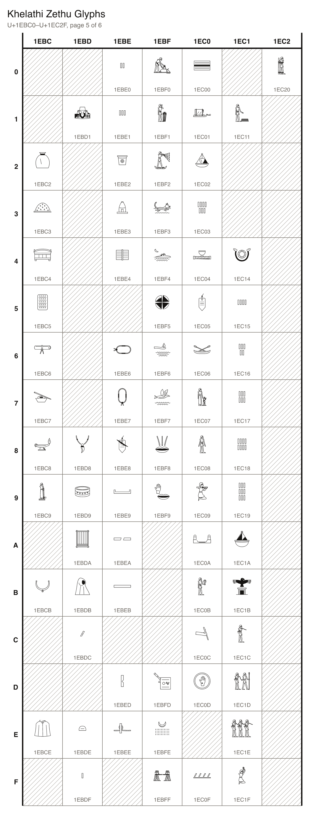

## Characters

### Controls

| Character Name | Code | Character | Code Point | Entity | Hex Entity |
| --- | --- | --- | --- | --- | --- |
| EGYPTIAN HIEROGLYPH VERTICAL JOINER | `EGYPTIAN_VERTICAL_JOINER` |  | U+13430 | `&#78896;` | `&#x13430;` |
| EGYPTIAN HIEROGLYPH HORIZONTAL JOINER | `EGYPTIAN_HORIZONTAL_JOINER` |  | U+13431 | `&#78897;` | `&#x13431;` |
| EGYPTIAN HIEROGLYPH INSERT AT TOP START | `EGYPTIAN_INSERT_TOP_START` |  | U+13432 | `&#78898;` | `&#x13432;` |
| EGYPTIAN HIEROGLYPH INSERT AT BOTTOM START | `EGYPTIAN_INSERT_BOTTOM_START` |  | U+13433 | `&#78899;` | `&#x13433;` |
| EGYPTIAN HIEROGLYPH INSERT AT TOP END | `EGYPTIAN_INSERT_TOP_END` |  | U+13434 | `&#78900;` | `&#x13434;` |
| EGYPTIAN HIEROGLYPH INSERT AT BOTTOM END | `EGYPTIAN_INSERT_BOTTOM_END` |  | U+13435 | `&#78901;` | `&#x13435;` |
| EGYPTIAN HIEROGLYPH BEGIN SEGMENT | `EGYPTIAN_BEGIN_SEGMENT` |  | U+13437 | `&#78903;` | `&#x13437;` |
| EGYPTIAN HIEROGLYPH END SEGMENT | `EGYPTIAN_END_SEGMENT` |  | U+13438 | `&#78904;` | `&#x13438;` |
| EGYPTIAN HIEROGLYPH BEGIN ENCLOSURE | `EGYPTIAN_BEGIN_ENCLOSURE` |  | U+1343C | `&#78908;` | `&#x1343C;` |
| EGYPTIAN HIEROGLYPH END ENCLOSURE | `EGYPTIAN_END_ENCLOSURE` |  | U+1343D | `&#78909;` | `&#x1343D;` |
| ZETHU VERTICAL JOINER | `VERTICAL_JOINER` |  | U+1EC60 | `&#126048;` | `&#x1EC60;` |
| ZETHU HORIZONTAL JOINER | `HORIZONTAL_JOINER` |  | U+1EC61 | `&#126049;` | `&#x1EC61;` |
| ZETHU INSERT AT TOP START | `INSERT_TOP_START` |  | U+1EC62 | `&#126050;` | `&#x1EC62;` |
| ZETHU INSERT AT BOTTOM START | `INSERT_BOTTOM_START` |  | U+1EC63 | `&#126051;` | `&#x1EC63;` |
| ZETHU INSERT AT TOP END | `INSERT_TOP_END` |  | U+1EC64 | `&#126052;` | `&#x1EC64;` |
| ZETHU INSERT AT BOTTOM END | `INSERT_BOTTOM_END` |  | U+1EC65 | `&#126053;` | `&#x1EC65;` |
| ZETHU BEGIN SEGMENT | `BEGIN_SEGMENT` |  | U+1EC67 | `&#126055;` | `&#x1EC67;` |
| ZETHU END SEGMENT | `END_SEGMENT` |  | U+1EC68 | `&#126056;` | `&#x1EC68;` |
| ZETHU BEGIN ENCLOSURE | `BEGIN_ENCLOSURE` |  | U+1EC6C | `&#126060;` | `&#x1EC6C;` |
| ZETHU END ENCLOSURE | `END_ENCLOSURE` |  | U+1EC6D | `&#126061;` | `&#x1EC6D;` |

### Signs

| Character Name | Code | Character | Code Point | Entity | Hex Entity |
| --- | --- | --- | --- | --- | --- |
| ZETHU CHARACTER 001 | `MAN` |  | U+1EA40 | `&#125504;` | `&#x1EA40;` |
| ZETHU CHARACTER 002 | `SERVANT` |  | U+1EA41 | `&#125505;` | `&#x1EA41;` |
| ZETHU CHARACTER 003 | `SPEAK` |  | U+1EA42 | `&#125506;` | `&#x1EA42;` |
| ZETHU CHARACTER 004 | `SIT` |  | U+1EA43 | `&#125507;` | `&#x1EA43;` |
| ZETHU CHARACTER 005 | `ENTREAT` |  | U+1EA44 | `&#125508;` | `&#x1EA44;` |
| ZETHU CHARACTER 006 | `PURE` |  | U+1EA45 | `&#125509;` | `&#x1EA45;` |
| ZETHU CHARACTER 007 | `JOY` |  | U+1EA46 | `&#125510;` | `&#x1EA46;` |
| ZETHU CHARACTER 008 | `CARRY` |  | U+1EA47 | `&#125511;` | `&#x1EA47;` |
| ZETHU CHARACTER 009 | `ROW` |  | U+1EA48 | `&#125512;` | `&#x1EA48;` |
| ZETHU CHARACTER 010 | `CAPTIVE` |  | U+1EA49 | `&#125513;` | `&#x1EA49;` |
| ZETHU CHARACTER 011 | `CHILD` |  | U+1EA4A | `&#125514;` | `&#x1EA4A;` |
| ZETHU CHARACTER 012 | `OLD_AGE` |  | U+1EA4B | `&#125515;` | `&#x1EA4B;` |
| ZETHU CHARACTER 013 | `NOBLE` |  | U+1EA4C | `&#125516;` | `&#x1EA4C;` |
| ZETHU CHARACTER 014 | `STRONG` |  | U+1EA4D | `&#125517;` | `&#x1EA4D;` |
| ZETHU CHARACTER 015 | `MESSENGER` |  | U+1EA4E | `&#125518;` | `&#x1EA4E;` |
| ZETHU CHARACTER 016 | `HAIL` |  | U+1EA4F | `&#125519;` | `&#x1EA4F;` |
| ZETHU CHARACTER 017 | `DANCE` |  | U+1EA50 | `&#125520;` | `&#x1EA50;` |
| ZETHU CHARACTER 018 | `POUND` |  | U+1EA51 | `&#125521;` | `&#x1EA51;` |
| ZETHU CHARACTER 019 | `BREWER` |  | U+1EA52 | `&#125522;` | `&#x1EA52;` |
| ZETHU CHARACTER 020 | `TILLER` |  | U+1EA53 | `&#125523;` | `&#x1EA53;` |
| ZETHU CHARACTER 021 | `REAP` |  | U+1EA54 | `&#125524;` | `&#x1EA54;` |
| ZETHU CHARACTER 022 | `FISHER` | 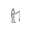 | U+1EA55 | `&#125525;` | `&#x1EA55;` |
| ZETHU CHARACTER 023 | `HARPOONER` |  | U+1EA56 | `&#125526;` | `&#x1EA56;` |
| ZETHU CHARACTER 024 | `HUNTER` |  | U+1EA57 | `&#125527;` | `&#x1EA57;` |
| ZETHU CHARACTER 025 | `HERDER` |  | U+1EA58 | `&#125528;` | `&#x1EA58;` |
| ZETHU CHARACTER 026 | `POTTER` |  | U+1EA59 | `&#125529;` | `&#x1EA59;` |
| ZETHU CHARACTER 027 | `GRIND_GRAIN` |  | U+1EA5A | `&#125530;` | `&#x1EA5A;` |
| ZETHU CHARACTER 028 | `BOATMAN` |  | U+1EA5B | `&#125531;` | `&#x1EA5B;` |
| ZETHU CHARACTER 029 | `HAUL` |  | U+1EA5C | `&#125532;` | `&#x1EA5C;` |
| ZETHU CHARACTER 030 | `THRESH` |  | U+1EA5D | `&#125533;` | `&#x1EA5D;` |
| ZETHU CHARACTER 031 | `SOW` | 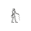 | U+1EA5E | `&#125534;` | `&#x1EA5E;` |
| ZETHU CHARACTER 032 | `WINNOW` |  | U+1EA5F | `&#125535;` | `&#x1EA5F;` |
| ZETHU CHARACTER 033 | `REED_CUTTER` |  | U+1EA60 | `&#125536;` | `&#x1EA60;` |
| ZETHU CHARACTER 034 | `QUARRYMAN` |  | U+1EA61 | `&#125537;` | `&#x1EA61;` |
| ZETHU CHARACTER 035 | `WEIGHER` |  | U+1EA62 | `&#125538;` | `&#x1EA62;` |
| ZETHU CHARACTER 036 | `SWIM` |  | U+1EA63 | `&#125539;` | `&#x1EA63;` |
| ZETHU CHARACTER 037 | `SLEEP` |  | U+1EA64 | `&#125540;` | `&#x1EA64;` |
| ZETHU CHARACTER 038 | `CORPSE` |  | U+1EA65 | `&#125541;` | `&#x1EA65;` |
| ZETHU CHARACTER 039 | `PRISONER` |  | U+1EA66 | `&#125542;` | `&#x1EA66;` |
| ZETHU CHARACTER 040 | `FOREIGNER` |  | U+1EA67 | `&#125543;` | `&#x1EA67;` |
| ZETHU CHARACTER 041 | `SCRIBE` |  | U+1EA68 | `&#125544;` | `&#x1EA68;` |
| ZETHU CHARACTER 042 | `MUSICIAN` |  | U+1EA69 | `&#125545;` | `&#x1EA69;` |
| ZETHU CHARACTER 043 | `GREET` |  | U+1EA6A | `&#125546;` | `&#x1EA6A;` |
| ZETHU CHARACTER 044 | `PROSTRATE` |  | U+1EA6B | `&#125547;` | `&#x1EA6B;` |
| ZETHU CHARACTER 045 | `SOLDIER` |  | U+1EA6C | `&#125548;` | `&#x1EA6C;` |
| ZETHU CHARACTER 046 | `BROTHER` |  | U+1EA6D | `&#125549;` | `&#x1EA6D;` |
| ZETHU CHARACTER 047 | `WITNESS` |  | U+1EA6E | `&#125550;` | `&#x1EA6E;` |
| ZETHU CHARACTER 048 | `TRAVELLER` | 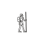 | U+1EA6F | `&#125551;` | `&#x1EA6F;` |
| ZETHU CHARACTER 049 | `PUPIL` |  | U+1EA70 | `&#125552;` | `&#x1EA70;` |
| ZETHU CHARACTER 050 | `SURVEYOR` |  | U+1EA71 | `&#125553;` | `&#x1EA71;` |
| ZETHU CHARACTER 051 | `MEASURE_KEEPER` |  | U+1EA72 | `&#125554;` | `&#x1EA72;` |
| ZETHU CHARACTER 052 | `TEMPLE_SERVANT` |  | U+1EA73 | `&#125555;` | `&#x1EA73;` |
| ZETHU CHARACTER 053 | `EMBALMER` |  | U+1EA74 | `&#125556;` | `&#x1EA74;` |
| ZETHU CHARACTER 054 | `PORTER` |  | U+1EA75 | `&#125557;` | `&#x1EA75;` |
| ZETHU CHARACTER 055 | `DRIVE_CATTLE` | 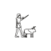 | U+1EA76 | `&#125558;` | `&#x1EA76;` |
| ZETHU CHARACTER 056 | `ARCHER` |  | U+1EA77 | `&#125559;` | `&#x1EA77;` |
| ZETHU CHARACTER 057 | `SHIELD_BEARER` |  | U+1EA78 | `&#125560;` | `&#x1EA78;` |
| ZETHU CHARACTER 058 | `STEERSMAN` |  | U+1EA79 | `&#125561;` | `&#x1EA79;` |
| ZETHU CHARACTER 059 | `GOVERNOR` |  | U+1EA7A | `&#125562;` | `&#x1EA7A;` |
| ZETHU CHARACTER 060 | `SOVEREIGN` |  | U+1EA7B | `&#125563;` | `&#x1EA7B;` |
| ZETHU CHARACTER 061 | `MASON` |  | U+1EA7C | `&#125564;` | `&#x1EA7C;` |
| ZETHU CHARACTER 062 | `HEW_TIMBER` |  | U+1EA7D | `&#125565;` | `&#x1EA7D;` |
| ZETHU CHARACTER 063 | `WOMAN` |  | U+1EA7E | `&#125566;` | `&#x1EA7E;` |
| ZETHU CHARACTER 064 | `VOUCH` |  | U+1EA7F | `&#125567;` | `&#x1EA7F;` |
| ZETHU CHARACTER 065 | `PREGNANCY` |  | U+1EA80 | `&#125568;` | `&#x1EA80;` |
| ZETHU CHARACTER 066 | `GIVE_BIRTH` |  | U+1EA81 | `&#125569;` | `&#x1EA81;` |
| ZETHU CHARACTER 067 | `NURSE` | 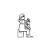 | U+1EA82 | `&#125570;` | `&#x1EA82;` |
| ZETHU CHARACTER 068 | `WEAVER` |  | U+1EA83 | `&#125571;` | `&#x1EA83;` |
| ZETHU CHARACTER 069 | `SINGER` |  | U+1EA84 | `&#125572;` | `&#x1EA84;` |
| ZETHU CHARACTER 070 | `GIRL` |  | U+1EA85 | `&#125573;` | `&#x1EA85;` |
| ZETHU CHARACTER 071 | `MOURN` |  | U+1EA86 | `&#125574;` | `&#x1EA86;` |
| ZETHU CHARACTER 072 | `GRIEVE` |  | U+1EA87 | `&#125575;` | `&#x1EA87;` |
| ZETHU CHARACTER 073 | `LADY` |  | U+1EA88 | `&#125576;` | `&#x1EA88;` |
| ZETHU CHARACTER 074 | `WOMAN_GRINDING` |  | U+1EA89 | `&#125577;` | `&#x1EA89;` |
| ZETHU CHARACTER 075 | `FETCH_WATER` | 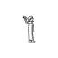 | U+1EA8A | `&#125578;` | `&#x1EA8A;` |
| ZETHU CHARACTER 076 | `BAKER` |  | U+1EA8B | `&#125579;` | `&#x1EA8B;` |
| ZETHU CHARACTER 077 | `HEALER` |  | U+1EA8C | `&#125580;` | `&#x1EA8C;` |
| ZETHU CHARACTER 078 | `PRIESTESS` | 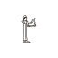 | U+1EA8D | `&#125581;` | `&#x1EA8D;` |
| ZETHU CHARACTER 079 | `BELOVED` |  | U+1EA8E | `&#125582;` | `&#x1EA8E;` |
| ZETHU CHARACTER 080 | `SPIN_THREAD` | 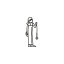 | U+1EA8F | `&#125583;` | `&#x1EA8F;` |
| ZETHU CHARACTER 081 | `DANCER` |  | U+1EA90 | `&#125584;` | `&#x1EA90;` |
| ZETHU CHARACTER 082 | `GOD` |  | U+1EA91 | `&#125585;` | `&#x1EA91;` |
| ZETHU CHARACTER 083 | `GODDESS` |  | U+1EA92 | `&#125586;` | `&#x1EA92;` |
| ZETHU CHARACTER 084 | `SACRED_POWER` |  | U+1EA93 | `&#125587;` | `&#x1EA93;` |
| ZETHU CHARACTER 085 | `SOUL` |  | U+1EA94 | `&#125588;` | `&#x1EA94;` |
| ZETHU CHARACTER 086 | `VITAL_SPIRIT` |  | U+1EA95 | `&#125589;` | `&#x1EA95;` |
| ZETHU CHARACTER 087 | `QEARET` |  | U+1EA96 | `&#125590;` | `&#x1EA96;` |
| ZETHU CHARACTER 088 | `RETHSAAR` |  | U+1EA97 | `&#125591;` | `&#x1EA97;` |
| ZETHU CHARACTER 089 | `SAQARU` |  | U+1EA98 | `&#125592;` | `&#x1EA98;` |
| ZETHU CHARACTER 090 | `UZNERA` |  | U+1EA99 | `&#125593;` | `&#x1EA99;` |
| ZETHU CHARACTER 091 | `THUBAI` |  | U+1EA9A | `&#125594;` | `&#x1EA9A;` |
| ZETHU CHARACTER 092 | `CHAQUR` |  | U+1EA9B | `&#125595;` | `&#x1EA9B;` |
| ZETHU CHARACTER 093 | `NEHLEAT` |  | U+1EA9C | `&#125596;` | `&#x1EA9C;` |
| ZETHU CHARACTER 094 | `HEZMUIRI` |  | U+1EA9D | `&#125597;` | `&#x1EA9D;` |
| ZETHU CHARACTER 095 | `GEWAATIS` |  | U+1EA9E | `&#125598;` | `&#x1EA9E;` |
| ZETHU CHARACTER 096 | `AZUATHIS` |  | U+1EA9F | `&#125599;` | `&#x1EA9F;` |
| ZETHU CHARACTER 097 | `QEZTU` |  | U+1EAA0 | `&#125600;` | `&#x1EAA0;` |
| ZETHU CHARACTER 098 | `PELGUN` |  | U+1EAA1 | `&#125601;` | `&#x1EAA1;` |
| ZETHU CHARACTER 099 | `LINHUR` |  | U+1EAA2 | `&#125602;` | `&#x1EAA2;` |
| ZETHU CHARACTER 100 | `LINKUR` |  | U+1EAA3 | `&#125603;` | `&#x1EAA3;` |
| ZETHU CHARACTER 101 | `IGELNARU` |  | U+1EAA4 | `&#125604;` | `&#x1EAA4;` |
| ZETHU CHARACTER 102 | `ALGIT` |  | U+1EAA5 | `&#125605;` | `&#x1EAA5;` |
| ZETHU CHARACTER 103 | `STANDARD` |  | U+1EAA6 | `&#125606;` | `&#x1EAA6;` |
| ZETHU CHARACTER 104 | `BLESS` |  | U+1EAA7 | `&#125607;` | `&#x1EAA7;` |
| ZETHU CHARACTER 105 | `OMEN` |  | U+1EAA8 | `&#125608;` | `&#x1EAA8;` |
| ZETHU CHARACTER 106 | `STAND` |  | U+1EAA9 | `&#125609;` | `&#x1EAA9;` |
| ZETHU CHARACTER 107 | `HEAD` |  | U+1EAAA | `&#125610;` | `&#x1EAAA;` |
| ZETHU CHARACTER 108 | `FACE` | 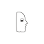 | U+1EAAB | `&#125611;` | `&#x1EAAB;` |
| ZETHU CHARACTER 109 | `SEE` |  | U+1EAAC | `&#125612;` | `&#x1EAAC;` |
| ZETHU CHARACTER 110 | `HEAR` |  | U+1EAAD | `&#125613;` | `&#x1EAAD;` |
| ZETHU CHARACTER 111 | `SMELL` |  | U+1EAAE | `&#125614;` | `&#x1EAAE;` |
| ZETHU CHARACTER 112 | `MOUTH` |  | U+1EAAF | `&#125615;` | `&#x1EAAF;` |
| ZETHU CHARACTER 113 | `TONGUE` |  | U+1EAB0 | `&#125616;` | `&#x1EAB0;` |
| ZETHU CHARACTER 114 | `BREAST` | 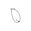 | U+1EAB1 | `&#125617;` | `&#x1EAB1;` |
| ZETHU CHARACTER 115 | `GIVE` |  | U+1EAB2 | `&#125618;` | `&#x1EAB2;` |
| ZETHU CHARACTER 116 | `EMBRACE` |  | U+1EAB3 | `&#125619;` | `&#x1EAB3;` |
| ZETHU CHARACTER 117 | `HAND` |  | U+1EAB4 | `&#125620;` | `&#x1EAB4;` |
| ZETHU CHARACTER 118 | `GRASP` |  | U+1EAB5 | `&#125621;` | `&#x1EAB5;` |
| ZETHU CHARACTER 119 | `FINGER` |  | U+1EAB6 | `&#125622;` | `&#x1EAB6;` |
| ZETHU CHARACTER 120 | `LEG` |  | U+1EAB7 | `&#125623;` | `&#x1EAB7;` |
| ZETHU CHARACTER 121 | `GO` |  | U+1EAB8 | `&#125624;` | `&#x1EAB8;` |
| ZETHU CHARACTER 122 | `FOOT` |  | U+1EAB9 | `&#125625;` | `&#x1EAB9;` |
| ZETHU CHARACTER 123 | `OATH` |  | U+1EABA | `&#125626;` | `&#x1EABA;` |
| ZETHU CHARACTER 124 | `HEART` |  | U+1EABB | `&#125627;` | `&#x1EABB;` |
| ZETHU CHARACTER 125 | `HAIR` |  | U+1EABC | `&#125628;` | `&#x1EABC;` |
| ZETHU CHARACTER 126 | `BONE` |  | U+1EABD | `&#125629;` | `&#x1EABD;` |
| ZETHU CHARACTER 127 | `EMBALMED_SOUL` |  | U+1EABE | `&#125630;` | `&#x1EABE;` |
| ZETHU CHARACTER 128 | `TRACE` |  | U+1EABF | `&#125631;` | `&#x1EABF;` |
| ZETHU CHARACTER 129 | `BULL` |  | U+1EAC0 | `&#125632;` | `&#x1EAC0;` |
| ZETHU CHARACTER 130 | `CALF` | 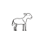 | U+1EAC1 | `&#125633;` | `&#x1EAC1;` |
| ZETHU CHARACTER 131 | `COW` |  | U+1EAC2 | `&#125634;` | `&#x1EAC2;` |
| ZETHU CHARACTER 132 | `YOKE` |  | U+1EAC3 | `&#125635;` | `&#x1EAC3;` |
| ZETHU CHARACTER 133 | `HORSE` |  | U+1EAC4 | `&#125636;` | `&#x1EAC4;` |
| ZETHU CHARACTER 134 | `DONKEY` |  | U+1EAC5 | `&#125637;` | `&#x1EAC5;` |
| ZETHU CHARACTER 135 | `GOAT` |  | U+1EAC6 | `&#125638;` | `&#x1EAC6;` |
| ZETHU CHARACTER 136 | `KID` |  | U+1EAC7 | `&#125639;` | `&#x1EAC7;` |
| ZETHU CHARACTER 137 | `RAM` | 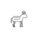 | U+1EAC8 | `&#125640;` | `&#x1EAC8;` |
| ZETHU CHARACTER 138 | `PIG` |  | U+1EAC9 | `&#125641;` | `&#x1EAC9;` |
| ZETHU CHARACTER 139 | `CAT` |  | U+1EACA | `&#125642;` | `&#x1EACA;` |
| ZETHU CHARACTER 140 | `HOUND` | 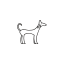 | U+1EACB | `&#125643;` | `&#x1EACB;` |
| ZETHU CHARACTER 141 | `JACKAL` | 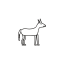 | U+1EACC | `&#125644;` | `&#x1EACC;` |
| ZETHU CHARACTER 142 | `DRYING_BEDS_JACKAL` |  | U+1EACD | `&#125645;` | `&#x1EACD;` |
| ZETHU CHARACTER 143 | `LION` |  | U+1EACE | `&#125646;` | `&#x1EACE;` |
| ZETHU CHARACTER 144 | `LION_LYING` |  | U+1EACF | `&#125647;` | `&#x1EACF;` |
| ZETHU CHARACTER 145 | `LEOPARD` |  | U+1EAD0 | `&#125648;` | `&#x1EAD0;` |
| ZETHU CHARACTER 146 | `HIPPOPOTAMUS` |  | U+1EAD1 | `&#125649;` | `&#x1EAD1;` |
| ZETHU CHARACTER 147 | `ELEPHANT` |  | U+1EAD2 | `&#125650;` | `&#x1EAD2;` |
| ZETHU CHARACTER 148 | `GIRAFFE` |  | U+1EAD3 | `&#125651;` | `&#x1EAD3;` |
| ZETHU CHARACTER 149 | `ORYX` | 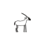 | U+1EAD4 | `&#125652;` | `&#x1EAD4;` |
| ZETHU CHARACTER 150 | `GAZELLE` | 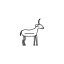 | U+1EAD5 | `&#125653;` | `&#x1EAD5;` |
| ZETHU CHARACTER 151 | `IBEX` |  | U+1EAD6 | `&#125654;` | `&#x1EAD6;` |
| ZETHU CHARACTER 152 | `BABOON` |  | U+1EAD7 | `&#125655;` | `&#x1EAD7;` |
| ZETHU CHARACTER 153 | `MONKEY` |  | U+1EAD8 | `&#125656;` | `&#x1EAD8;` |
| ZETHU CHARACTER 154 | `HARE` |  | U+1EAD9 | `&#125657;` | `&#x1EAD9;` |
| ZETHU CHARACTER 155 | `MOUSE` | 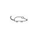 | U+1EADA | `&#125658;` | `&#x1EADA;` |
| ZETHU CHARACTER 156 | `RHINOCEROS` | 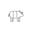 | U+1EADB | `&#125659;` | `&#x1EADB;` |
| ZETHU CHARACTER 157 | `HYENA` |  | U+1EADC | `&#125660;` | `&#x1EADC;` |
| ZETHU CHARACTER 158 | `CAMEL` |  | U+1EADD | `&#125661;` | `&#x1EADD;` |
| ZETHU CHARACTER 159 | `ANTELOPE` | 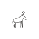 | U+1EADE | `&#125662;` | `&#x1EADE;` |
| ZETHU CHARACTER 160 | `BEE` |  | U+1EADF | `&#125663;` | `&#x1EADF;` |
| ZETHU CHARACTER 161 | `LOCUST` | 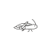 | U+1EAE0 | `&#125664;` | `&#x1EAE0;` |
| ZETHU CHARACTER 162 | `SCORPION` |  | U+1EAE1 | `&#125665;` | `&#x1EAE1;` |
| ZETHU CHARACTER 163 | `OX_HEAD` |  | U+1EAE2 | `&#125666;` | `&#x1EAE2;` |
| ZETHU CHARACTER 164 | `HORN` |  | U+1EAE3 | `&#125667;` | `&#x1EAE3;` |
| ZETHU CHARACTER 165 | `HIDE` |  | U+1EAE4 | `&#125668;` | `&#x1EAE4;` |
| ZETHU CHARACTER 166 | `TUSK` | 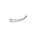 | U+1EAE5 | `&#125669;` | `&#x1EAE5;` |
| ZETHU CHARACTER 167 | `TAIL` |  | U+1EAE6 | `&#125670;` | `&#x1EAE6;` |
| ZETHU CHARACTER 168 | `VULTURE` | 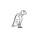 | U+1EAE7 | `&#125671;` | `&#x1EAE7;` |
| ZETHU CHARACTER 169 | `BUZZARD` |  | U+1EAE8 | `&#125672;` | `&#x1EAE8;` |
| ZETHU CHARACTER 170 | `FALCON` |  | U+1EAE9 | `&#125673;` | `&#x1EAE9;` |
| ZETHU CHARACTER 171 | `GRIFFON_VULTURE` |  | U+1EAEA | `&#125674;` | `&#x1EAEA;` |
| ZETHU CHARACTER 172 | `OWL` |  | U+1EAEB | `&#125675;` | `&#x1EAEB;` |
| ZETHU CHARACTER 173 | `GUINEA_FOWL` | 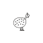 | U+1EAEC | `&#125676;` | `&#x1EAEC;` |
| ZETHU CHARACTER 174 | `HOOPOE` | 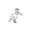 | U+1EAED | `&#125677;` | `&#x1EAED;` |
| ZETHU CHARACTER 175 | `LAPWING` |  | U+1EAEE | `&#125678;` | `&#x1EAEE;` |
| ZETHU CHARACTER 176 | `CRESTED_IBIS` |  | U+1EAEF | `&#125679;` | `&#x1EAEF;` |
| ZETHU CHARACTER 177 | `IBIS` |  | U+1EAF0 | `&#125680;` | `&#x1EAF0;` |
| ZETHU CHARACTER 178 | `FLAMINGO` |  | U+1EAF1 | `&#125681;` | `&#x1EAF1;` |
| ZETHU CHARACTER 179 | `BLACK_IBIS` |  | U+1EAF2 | `&#125682;` | `&#x1EAF2;` |
| ZETHU CHARACTER 180 | `STORK` | 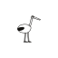 | U+1EAF3 | `&#125683;` | `&#x1EAF3;` |
| ZETHU CHARACTER 181 | `HERON` |  | U+1EAF4 | `&#125684;` | `&#x1EAF4;` |
| ZETHU CHARACTER 182 | `EGRET` | 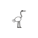 | U+1EAF5 | `&#125685;` | `&#x1EAF5;` |
| ZETHU CHARACTER 183 | `OSTRICH` |  | U+1EAF6 | `&#125686;` | `&#x1EAF6;` |
| ZETHU CHARACTER 184 | `CORMORANT` |  | U+1EAF7 | `&#125687;` | `&#x1EAF7;` |
| ZETHU CHARACTER 185 | `SWALLOW` |  | U+1EAF8 | `&#125688;` | `&#x1EAF8;` |
| ZETHU CHARACTER 186 | `SPARROW` |  | U+1EAF9 | `&#125689;` | `&#x1EAF9;` |
| ZETHU CHARACTER 187 | `GOOSE` |  | U+1EAFA | `&#125690;` | `&#x1EAFA;` |
| ZETHU CHARACTER 188 | `DUCK` | 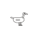 | U+1EAFB | `&#125691;` | `&#x1EAFB;` |
| ZETHU CHARACTER 189 | `FLY` |  | U+1EAFC | `&#125692;` | `&#x1EAFC;` |
| ZETHU CHARACTER 190 | `WIDGEON` | 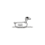 | U+1EAFD | `&#125693;` | `&#x1EAFD;` |
| ZETHU CHARACTER 191 | `QUAIL` |  | U+1EAFE | `&#125694;` | `&#x1EAFE;` |
| ZETHU CHARACTER 192 | `DUCKLING` |  | U+1EAFF | `&#125695;` | `&#x1EAFF;` |
| ZETHU CHARACTER 193 | `PLOVERS` |  | U+1EB00 | `&#125696;` | `&#x1EB00;` |
| ZETHU CHARACTER 194 | `BIRD_OFFERED` |  | U+1EB01 | `&#125697;` | `&#x1EB01;` |
| ZETHU CHARACTER 195 | `NEST` |  | U+1EB02 | `&#125698;` | `&#x1EB02;` |
| ZETHU CHARACTER 196 | `FISHER_BIRD` |  | U+1EB03 | `&#125699;` | `&#x1EB03;` |
| ZETHU CHARACTER 197 | `WING` |  | U+1EB04 | `&#125700;` | `&#x1EB04;` |
| ZETHU CHARACTER 198 | `FEATHER` |  | U+1EB05 | `&#125701;` | `&#x1EB05;` |
| ZETHU CHARACTER 199 | `EGG` |  | U+1EB06 | `&#125702;` | `&#x1EB06;` |
| ZETHU CHARACTER 200 | `CLAW` | 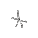 | U+1EB07 | `&#125703;` | `&#x1EB07;` |
| ZETHU CHARACTER 201 | `CRY` |  | U+1EB08 | `&#125704;` | `&#x1EB08;` |
| ZETHU CHARACTER 202 | `CROCODILE` |  | U+1EB09 | `&#125705;` | `&#x1EB09;` |
| ZETHU CHARACTER 203 | `BANK_CROCODILE` |  | U+1EB0A | `&#125706;` | `&#x1EB0A;` |
| ZETHU CHARACTER 204 | `BITE` |  | U+1EB0B | `&#125707;` | `&#x1EB0B;` |
| ZETHU CHARACTER 205 | `TURTLE` |  | U+1EB0C | `&#125708;` | `&#x1EB0C;` |
| ZETHU CHARACTER 206 | `FROG` |  | U+1EB0D | `&#125709;` | `&#x1EB0D;` |
| ZETHU CHARACTER 207 | `TADPOLE` |  | U+1EB0E | `&#125710;` | `&#x1EB0E;` |
| ZETHU CHARACTER 208 | `LIZARD` | 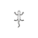 | U+1EB0F | `&#125711;` | `&#x1EB0F;` |
| ZETHU CHARACTER 209 | `HORNED_VIPER` | 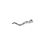 | U+1EB10 | `&#125712;` | `&#x1EB10;` |
| ZETHU CHARACTER 210 | `COBRA` |  | U+1EB11 | `&#125713;` | `&#x1EB11;` |
| ZETHU CHARACTER 211 | `SNAKE` |  | U+1EB12 | `&#125714;` | `&#x1EB12;` |
| ZETHU CHARACTER 212 | `FISH` |  | U+1EB13 | `&#125715;` | `&#x1EB13;` |
| ZETHU CHARACTER 213 | `BARBEL` |  | U+1EB14 | `&#125716;` | `&#x1EB14;` |
| ZETHU CHARACTER 214 | `MULLET` |  | U+1EB15 | `&#125717;` | `&#x1EB15;` |
| ZETHU CHARACTER 215 | `ELEPHANT_FISH` |  | U+1EB16 | `&#125718;` | `&#x1EB16;` |
| ZETHU CHARACTER 216 | `PUFFER` |  | U+1EB17 | `&#125719;` | `&#x1EB17;` |
| ZETHU CHARACTER 217 | `CATFISH` |  | U+1EB18 | `&#125720;` | `&#x1EB18;` |
| ZETHU CHARACTER 218 | `SCALE` |  | U+1EB19 | `&#125721;` | `&#x1EB19;` |
| ZETHU CHARACTER 219 | `SHELL` |  | U+1EB1A | `&#125722;` | `&#x1EB1A;` |
| ZETHU CHARACTER 220 | `DAYS_CATCH` |  | U+1EB1B | `&#125723;` | `&#x1EB1B;` |
| ZETHU CHARACTER 221 | `RIVER_HORSE` |  | U+1EB1C | `&#125724;` | `&#x1EB1C;` |
| ZETHU CHARACTER 222 | `PAPYRUS_FLOWER` |  | U+1EB1D | `&#125725;` | `&#x1EB1D;` |
| ZETHU CHARACTER 223 | `PAPYRUS` |  | U+1EB1E | `&#125726;` | `&#x1EB1E;` |
| ZETHU CHARACTER 224 | `REED` | 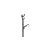 | U+1EB1F | `&#125727;` | `&#x1EB1F;` |
| ZETHU CHARACTER 225 | `REED_BUNDLE` |  | U+1EB20 | `&#125728;` | `&#x1EB20;` |
| ZETHU CHARACTER 226 | `LIFE` |  | U+1EB21 | `&#125729;` | `&#x1EB21;` |
| ZETHU CHARACTER 227 | `BARLEY` |  | U+1EB22 | `&#125730;` | `&#x1EB22;` |
| ZETHU CHARACTER 228 | `WHEAT` |  | U+1EB23 | `&#125731;` | `&#x1EB23;` |
| ZETHU CHARACTER 229 | `SHEAF` |  | U+1EB24 | `&#125732;` | `&#x1EB24;` |
| ZETHU CHARACTER 230 | `FLAX` |  | U+1EB25 | `&#125733;` | `&#x1EB25;` |
| ZETHU CHARACTER 231 | `DATE_PALM` |  | U+1EB26 | `&#125734;` | `&#x1EB26;` |
| ZETHU CHARACTER 232 | `SYCAMORE_FIG` |  | U+1EB27 | `&#125735;` | `&#x1EB27;` |
| ZETHU CHARACTER 233 | `TAMARISK` |  | U+1EB28 | `&#125736;` | `&#x1EB28;` |
| ZETHU CHARACTER 234 | `ACACIA` |  | U+1EB29 | `&#125737;` | `&#x1EB29;` |
| ZETHU CHARACTER 235 | `VINE` |  | U+1EB2A | `&#125738;` | `&#x1EB2A;` |
| ZETHU CHARACTER 236 | `LOTUS` |  | U+1EB2B | `&#125739;` | `&#x1EB2B;` |
| ZETHU CHARACTER 237 | `HERB` |  | U+1EB2C | `&#125740;` | `&#x1EB2C;` |
| ZETHU CHARACTER 238 | `GOURD` |  | U+1EB2D | `&#125741;` | `&#x1EB2D;` |
| ZETHU CHARACTER 239 | `BEAN` | 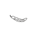 | U+1EB2E | `&#125742;` | `&#x1EB2E;` |
| ZETHU CHARACTER 240 | `ONION` |  | U+1EB2F | `&#125743;` | `&#x1EB2F;` |
| ZETHU CHARACTER 241 | `GRASS` |  | U+1EB30 | `&#125744;` | `&#x1EB30;` |
| ZETHU CHARACTER 242 | `SKY` |  | U+1EB31 | `&#125745;` | `&#x1EB31;` |
| ZETHU CHARACTER 243 | `UQAA` |  | U+1EB32 | `&#125746;` | `&#x1EB32;` |
| ZETHU CHARACTER 244 | `EAST` |  | U+1EB33 | `&#125747;` | `&#x1EB33;` |
| ZETHU CHARACTER 245 | `DUSK` |  | U+1EB34 | `&#125748;` | `&#x1EB34;` |
| ZETHU CHARACTER 246 | `NOON` |  | U+1EB35 | `&#125749;` | `&#x1EB35;` |
| ZETHU CHARACTER 247 | `NIGHT` |  | U+1EB36 | `&#125750;` | `&#x1EB36;` |
| ZETHU CHARACTER 248 | `MOON` |  | U+1EB37 | `&#125751;` | `&#x1EB37;` |
| ZETHU CHARACTER 249 | `FULL_MOON` |  | U+1EB38 | `&#125752;` | `&#x1EB38;` |
| ZETHU CHARACTER 250 | `STAR` |  | U+1EB39 | `&#125753;` | `&#x1EB39;` |
| ZETHU CHARACTER 251 | `CONSTELLATION` |  | U+1EB3A | `&#125754;` | `&#x1EB3A;` |
| ZETHU CHARACTER 252 | `STORM` |  | U+1EB3B | `&#125755;` | `&#x1EB3B;` |
| ZETHU CHARACTER 253 | `LIGHTNING` |  | U+1EB3C | `&#125756;` | `&#x1EB3C;` |
| ZETHU CHARACTER 254 | `WIND` |  | U+1EB3D | `&#125757;` | `&#x1EB3D;` |
| ZETHU CHARACTER 255 | `SACRED_FIRE` |  | U+1EB3E | `&#125758;` | `&#x1EB3E;` |
| ZETHU CHARACTER 256 | `SMOKE` |  | U+1EB3F | `&#125759;` | `&#x1EB3F;` |
| ZETHU CHARACTER 257 | `INUNDATION` |  | U+1EB40 | `&#125760;` | `&#x1EB40;` |
| ZETHU CHARACTER 258 | `EMERGENCE` |  | U+1EB41 | `&#125761;` | `&#x1EB41;` |
| ZETHU CHARACTER 259 | `LOW_WATER` |  | U+1EB42 | `&#125762;` | `&#x1EB42;` |
| ZETHU CHARACTER 260 | `COUNT_YEAR` |  | U+1EB43 | `&#125763;` | `&#x1EB43;` |
| ZETHU CHARACTER 261 | `DAY` |  | U+1EB44 | `&#125764;` | `&#x1EB44;` |
| ZETHU CHARACTER 262 | `FIVE_DAYS` |  | U+1EB45 | `&#125765;` | `&#x1EB45;` |
| ZETHU CHARACTER 263 | `FIRST_OCCASION` |  | U+1EB46 | `&#125766;` | `&#x1EB46;` |
| ZETHU CHARACTER 264 | `DUST_STORM` |  | U+1EB47 | `&#125767;` | `&#x1EB47;` |
| ZETHU CHARACTER 265 | `RIVER` |  | U+1EB48 | `&#125768;` | `&#x1EB48;` |
| ZETHU CHARACTER 266 | `ENDURING` |  | U+1EB49 | `&#125769;` | `&#x1EB49;` |
| ZETHU CHARACTER 267 | `WATER` |  | U+1EB4A | `&#125770;` | `&#x1EB4A;` |
| ZETHU CHARACTER 268 | `POOL` |  | U+1EB4B | `&#125771;` | `&#x1EB4B;` |
| ZETHU CHARACTER 269 | `CANAL` |  | U+1EB4C | `&#125772;` | `&#x1EB4C;` |
| ZETHU CHARACTER 270 | `DELTA` |  | U+1EB4D | `&#125773;` | `&#x1EB4D;` |
| ZETHU CHARACTER 271 | `FLOOD` |  | U+1EB4E | `&#125774;` | `&#x1EB4E;` |
| ZETHU CHARACTER 272 | `FIELD` |  | U+1EB4F | `&#125775;` | `&#x1EB4F;` |
| ZETHU CHARACTER 273 | `GARDEN` |  | U+1EB50 | `&#125776;` | `&#x1EB50;` |
| ZETHU CHARACTER 274 | `BLACK_SILT` |  | U+1EB51 | `&#125777;` | `&#x1EB51;` |
| ZETHU CHARACTER 275 | `MOUND` |  | U+1EB52 | `&#125778;` | `&#x1EB52;` |
| ZETHU CHARACTER 276 | `ISLAND` |  | U+1EB53 | `&#125779;` | `&#x1EB53;` |
| ZETHU CHARACTER 277 | `DESERT_LAND` |  | U+1EB54 | `&#125780;` | `&#x1EB54;` |
| ZETHU CHARACTER 278 | `WEST` |  | U+1EB55 | `&#125781;` | `&#x1EB55;` |
| ZETHU CHARACTER 279 | `HORIZON` |  | U+1EB56 | `&#125782;` | `&#x1EB56;` |
| ZETHU CHARACTER 280 | `LAND` |  | U+1EB57 | `&#125783;` | `&#x1EB57;` |
| ZETHU CHARACTER 281 | `ESTATE` |  | U+1EB58 | `&#125784;` | `&#x1EB58;` |
| ZETHU CHARACTER 282 | `PLACE` |  | U+1EB59 | `&#125785;` | `&#x1EB59;` |
| ZETHU CHARACTER 283 | `PROVINCE` |  | U+1EB5A | `&#125786;` | `&#x1EB5A;` |
| ZETHU CHARACTER 284 | `ROAD` |  | U+1EB5B | `&#125787;` | `&#x1EB5B;` |
| ZETHU CHARACTER 285 | `WELL` |  | U+1EB5C | `&#125788;` | `&#x1EB5C;` |
| ZETHU CHARACTER 286 | `CATARACT` |  | U+1EB5D | `&#125789;` | `&#x1EB5D;` |
| ZETHU CHARACTER 287 | `MARSH` |  | U+1EB5E | `&#125790;` | `&#x1EB5E;` |
| ZETHU CHARACTER 288 | `DESERT_ROAD` |  | U+1EB5F | `&#125791;` | `&#x1EB5F;` |
| ZETHU CHARACTER 289 | `BANK` |  | U+1EB60 | `&#125792;` | `&#x1EB60;` |
| ZETHU CHARACTER 290 | `DYKE` |  | U+1EB61 | `&#125793;` | `&#x1EB61;` |
| ZETHU CHARACTER 291 | `VILLAGE` |  | U+1EB62 | `&#125794;` | `&#x1EB62;` |
| ZETHU CHARACTER 292 | `CULTIVATED_LAND` |  | U+1EB63 | `&#125795;` | `&#x1EB63;` |
| ZETHU CHARACTER 293 | `HOUSE_OF` |  | U+1EB64 | `&#125796;` | `&#x1EB64;` |
| ZETHU CHARACTER 294 | `THRONE` |  | U+1EB65 | `&#125797;` | `&#x1EB65;` |
| ZETHU CHARACTER 295 | `HOUSE` |  | U+1EB66 | `&#125798;` | `&#x1EB66;` |
| ZETHU CHARACTER 296 | `GRANARY` |  | U+1EB67 | `&#125799;` | `&#x1EB67;` |
| ZETHU CHARACTER 297 | `WALL` |  | U+1EB68 | `&#125800;` | `&#x1EB68;` |
| ZETHU CHARACTER 298 | `GATE` |  | U+1EB69 | `&#125801;` | `&#x1EB69;` |
| ZETHU CHARACTER 299 | `LOCK` |  | U+1EB6A | `&#125802;` | `&#x1EB6A;` |
| ZETHU CHARACTER 300 | `COURT` |  | U+1EB6B | `&#125803;` | `&#x1EB6B;` |
| ZETHU CHARACTER 301 | `HALL` |  | U+1EB6C | `&#125804;` | `&#x1EB6C;` |
| ZETHU CHARACTER 302 | `SANCTUARY` |  | U+1EB6D | `&#125805;` | `&#x1EB6D;` |
| ZETHU CHARACTER 303 | `SHRINE` |  | U+1EB6E | `&#125806;` | `&#x1EB6E;` |
| ZETHU CHARACTER 304 | `OBSERVATORY` |  | U+1EB6F | `&#125807;` | `&#x1EB6F;` |
| ZETHU CHARACTER 305 | `ARCHIVE` |  | U+1EB70 | `&#125808;` | `&#x1EB70;` |
| ZETHU CHARACTER 306 | `MEASURE` |  | U+1EB71 | `&#125809;` | `&#x1EB71;` |
| ZETHU CHARACTER 307 | `RAMP` |  | U+1EB72 | `&#125810;` | `&#x1EB72;` |
| ZETHU CHARACTER 308 | `TOMB` |  | U+1EB73 | `&#125811;` | `&#x1EB73;` |
| ZETHU CHARACTER 309 | `NOBLE_TOMB` |  | U+1EB74 | `&#125812;` | `&#x1EB74;` |
| ZETHU CHARACTER 310 | `NICHE` |  | U+1EB75 | `&#125813;` | `&#x1EB75;` |
| ZETHU CHARACTER 311 | `TOMB_THRESHOLD` |  | U+1EB76 | `&#125814;` | `&#x1EB76;` |
| ZETHU CHARACTER 312 | `FORTRESS` |  | U+1EB77 | `&#125815;` | `&#x1EB77;` |
| ZETHU CHARACTER 313 | `SCHOOL` |  | U+1EB78 | `&#125816;` | `&#x1EB78;` |
| ZETHU CHARACTER 314 | `QUAY` |  | U+1EB79 | `&#125817;` | `&#x1EB79;` |
| ZETHU CHARACTER 315 | `TUNNEL_WELL` |  | U+1EB7A | `&#125818;` | `&#x1EB7A;` |
| ZETHU CHARACTER 316 | `TEMPLE` |  | U+1EB7B | `&#125819;` | `&#x1EB7B;` |
| ZETHU CHARACTER 317 | `BUILD` |  | U+1EB7C | `&#125820;` | `&#x1EB7C;` |
| ZETHU CHARACTER 318 | `BARGE` |  | U+1EB7D | `&#125821;` | `&#x1EB7D;` |
| ZETHU CHARACTER 319 | `REED_BOAT` |  | U+1EB7E | `&#125822;` | `&#x1EB7E;` |
| ZETHU CHARACTER 320 | `RAFT` |  | U+1EB7F | `&#125823;` | `&#x1EB7F;` |
| ZETHU CHARACTER 321 | `LADEN_RAFT` |  | U+1EB80 | `&#125824;` | `&#x1EB80;` |
| ZETHU CHARACTER 322 | `SAIL` |  | U+1EB81 | `&#125825;` | `&#x1EB81;` |
| ZETHU CHARACTER 323 | `FURL` |  | U+1EB82 | `&#125826;` | `&#x1EB82;` |
| ZETHU CHARACTER 324 | `POLE` |  | U+1EB83 | `&#125827;` | `&#x1EB83;` |
| ZETHU CHARACTER 325 | `STEER` | 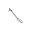 | U+1EB84 | `&#125828;` | `&#x1EB84;` |
| ZETHU CHARACTER 326 | `MOOR` |  | U+1EB85 | `&#125829;` | `&#x1EB85;` |
| ZETHU CHARACTER 327 | `ANCHOR` |  | U+1EB86 | `&#125830;` | `&#x1EB86;` |
| ZETHU CHARACTER 328 | `TOW` |  | U+1EB87 | `&#125831;` | `&#x1EB87;` |
| ZETHU CHARACTER 329 | `GODS_BARGE` |  | U+1EB88 | `&#125832;` | `&#x1EB88;` |
| ZETHU CHARACTER 330 | `FERRY` |  | U+1EB89 | `&#125833;` | `&#x1EB89;` |
| ZETHU CHARACTER 331 | `CARGO` |  | U+1EB8A | `&#125834;` | `&#x1EB8A;` |
| ZETHU CHARACTER 332 | `PLUMB` |  | U+1EB8B | `&#125835;` | `&#x1EB8B;` |
| ZETHU CHARACTER 333 | `WEIGH` |  | U+1EB8C | `&#125836;` | `&#x1EB8C;` |
| ZETHU CHARACTER 334 | `SURVEY` |  | U+1EB8D | `&#125837;` | `&#x1EB8D;` |
| ZETHU CHARACTER 335 | `GAUGE` |  | U+1EB8E | `&#125838;` | `&#x1EB8E;` |
| ZETHU CHARACTER 336 | `SCOOP` |  | U+1EB8F | `&#125839;` | `&#x1EB8F;` |
| ZETHU CHARACTER 337 | `HEAPED_MEASURE` |  | U+1EB90 | `&#125840;` | `&#x1EB90;` |
| ZETHU CHARACTER 338 | `SICKLE` |  | U+1EB91 | `&#125841;` | `&#x1EB91;` |
| ZETHU CHARACTER 339 | `SHEAF_CUT` |  | U+1EB92 | `&#125842;` | `&#x1EB92;` |
| ZETHU CHARACTER 340 | `FLOAT` |  | U+1EB93 | `&#125843;` | `&#x1EB93;` |
| ZETHU CHARACTER 341 | `READ_LEVEL` |  | U+1EB94 | `&#125844;` | `&#x1EB94;` |
| ZETHU CHARACTER 342 | `WINNOWING_FAN` |  | U+1EB95 | `&#125845;` | `&#x1EB95;` |
| ZETHU CHARACTER 343 | `DRAW_WATER` |  | U+1EB96 | `&#125846;` | `&#x1EB96;` |
| ZETHU CHARACTER 344 | `SPEAR_FISH` |  | U+1EB97 | `&#125847;` | `&#x1EB97;` |
| ZETHU CHARACTER 345 | `SCOOP_AND_STEM` |  | U+1EB98 | `&#125848;` | `&#x1EB98;` |
| ZETHU CHARACTER 346 | `QELU` |  | U+1EB99 | `&#125849;` | `&#x1EB99;` |
| ZETHU CHARACTER 347 | `CORD` |  | U+1EB9A | `&#125850;` | `&#x1EB9A;` |
| ZETHU CHARACTER 348 | `ROD` |  | U+1EB9B | `&#125851;` | `&#x1EB9B;` |
| ZETHU CHARACTER 349 | `GRAIN_MEASURE` |  | U+1EB9C | `&#125852;` | `&#x1EB9C;` |
| ZETHU CHARACTER 350 | `HOE` |  | U+1EB9D | `&#125853;` | `&#x1EB9D;` |
| ZETHU CHARACTER 351 | `PLOUGH` |  | U+1EB9E | `&#125854;` | `&#x1EB9E;` |
| ZETHU CHARACTER 352 | `ADZE` |  | U+1EB9F | `&#125855;` | `&#x1EB9F;` |
| ZETHU CHARACTER 353 | `MAUL` |  | U+1EBA0 | `&#125856;` | `&#x1EBA0;` |
| ZETHU CHARACTER 354 | `KNIFE` |  | U+1EBA1 | `&#125857;` | `&#x1EBA1;` |
| ZETHU CHARACTER 355 | `AXE` |  | U+1EBA2 | `&#125858;` | `&#x1EBA2;` |
| ZETHU CHARACTER 356 | `BOW` |  | U+1EBA3 | `&#125859;` | `&#x1EBA3;` |
| ZETHU CHARACTER 357 | `SPEAR` |  | U+1EBA4 | `&#125860;` | `&#x1EBA4;` |
| ZETHU CHARACTER 358 | `SHIELD` |  | U+1EBA5 | `&#125861;` | `&#x1EBA5;` |
| ZETHU CHARACTER 359 | `THROWING_STICK` |  | U+1EBA6 | `&#125862;` | `&#x1EBA6;` |
| ZETHU CHARACTER 360 | `NET` |  | U+1EBA7 | `&#125863;` | `&#x1EBA7;` |
| ZETHU CHARACTER 361 | `HARPOON` |  | U+1EBA8 | `&#125864;` | `&#x1EBA8;` |
| ZETHU CHARACTER 362 | `HOOK` |  | U+1EBA9 | `&#125865;` | `&#x1EBA9;` |
| ZETHU CHARACTER 363 | `SEAL` |  | U+1EBAA | `&#125866;` | `&#x1EBAA;` |
| ZETHU CHARACTER 364 | `WEIGHING` |  | U+1EBAB | `&#125867;` | `&#x1EBAB;` |
| ZETHU CHARACTER 365 | `LICENCE` |  | U+1EBAC | `&#125868;` | `&#x1EBAC;` |
| ZETHU CHARACTER 366 | `TAX` |  | U+1EBAD | `&#125869;` | `&#x1EBAD;` |
| ZETHU CHARACTER 367 | `FORGE` |  | U+1EBAE | `&#125870;` | `&#x1EBAE;` |
| ZETHU CHARACTER 368 | `TIMBER` |  | U+1EBAF | `&#125871;` | `&#x1EBAF;` |
| ZETHU CHARACTER 369 | `GOLD` |  | U+1EBB0 | `&#125872;` | `&#x1EBB0;` |
| ZETHU CHARACTER 370 | `WASHING_SALT` |  | U+1EBB1 | `&#125873;` | `&#x1EBB1;` |
| ZETHU CHARACTER 371 | `LYRE` |  | U+1EBB2 | `&#125874;` | `&#x1EBB2;` |
| ZETHU CHARACTER 372 | `SLING` |  | U+1EBB3 | `&#125875;` | `&#x1EBB3;` |
| ZETHU CHARACTER 373 | `OFFERING_BOWL` |  | U+1EBB4 | `&#125876;` | `&#x1EBB4;` |
| ZETHU CHARACTER 374 | `JAR` |  | U+1EBB5 | `&#125877;` | `&#x1EBB5;` |
| ZETHU CHARACTER 375 | `AMPHORA` |  | U+1EBB6 | `&#125878;` | `&#x1EBB6;` |
| ZETHU CHARACTER 376 | `BEER` |  | U+1EBB7 | `&#125879;` | `&#x1EBB7;` |
| ZETHU CHARACTER 377 | `CUP` |  | U+1EBB8 | `&#125880;` | `&#x1EBB8;` |
| ZETHU CHARACTER 378 | `CENSER` |  | U+1EBB9 | `&#125881;` | `&#x1EBB9;` |
| ZETHU CHARACTER 379 | `BREAD` |  | U+1EBBA | `&#125882;` | `&#x1EBBA;` |
| ZETHU CHARACTER 380 | `CAKE` |  | U+1EBBB | `&#125883;` | `&#x1EBBB;` |
| ZETHU CHARACTER 381 | `OFFERING` |  | U+1EBBC | `&#125884;` | `&#x1EBBC;` |
| ZETHU CHARACTER 382 | `FRUIT` |  | U+1EBBD | `&#125885;` | `&#x1EBBD;` |
| ZETHU CHARACTER 383 | `MEAT` |  | U+1EBBE | `&#125886;` | `&#x1EBBE;` |
| ZETHU CHARACTER 384 | `SWEET_OIL` |  | U+1EBBF | `&#125887;` | `&#x1EBBF;` |
| ZETHU CHARACTER 385 | `MILK` |  | U+1EBC0 | `&#125888;` | `&#x1EBC0;` |
| ZETHU CHARACTER 386 | `HONEY` |  | U+1EBC1 | `&#125889;` | `&#x1EBC1;` |
| ZETHU CHARACTER 387 | `SACK` |  | U+1EBC2 | `&#125890;` | `&#x1EBC2;` |
| ZETHU CHARACTER 388 | `HEAP` |  | U+1EBC3 | `&#125891;` | `&#x1EBC3;` |
| ZETHU CHARACTER 389 | `COFFIN` |  | U+1EBC4 | `&#125892;` | `&#x1EBC4;` |
| ZETHU CHARACTER 390 | `TABLET` |  | U+1EBC5 | `&#125893;` | `&#x1EBC5;` |
| ZETHU CHARACTER 391 | `ROLL` |  | U+1EBC6 | `&#125894;` | `&#x1EBC6;` |
| ZETHU CHARACTER 392 | `INK` |  | U+1EBC7 | `&#125895;` | `&#x1EBC7;` |
| ZETHU CHARACTER 393 | `LAMP` |  | U+1EBC8 | `&#125896;` | `&#x1EBC8;` |
| ZETHU CHARACTER 394 | `ANSWERER` |  | U+1EBC9 | `&#125897;` | `&#x1EBC9;` |
| ZETHU CHARACTER 395 | `INCENSE` |  | U+1EBCA | `&#125898;` | `&#x1EBCA;` |
| ZETHU CHARACTER 396 | `COLLAR` |  | U+1EBCB | `&#125899;` | `&#x1EBCB;` |
| ZETHU CHARACTER 397 | `CLOTH` |  | U+1EBCC | `&#125900;` | `&#x1EBCC;` |
| ZETHU CHARACTER 398 | `GARMENT` |  | U+1EBCD | `&#125901;` | `&#x1EBCD;` |
| ZETHU CHARACTER 399 | `CLOAK` |  | U+1EBCE | `&#125902;` | `&#x1EBCE;` |
| ZETHU CHARACTER 400 | `CAP` |  | U+1EBCF | `&#125903;` | `&#x1EBCF;` |
| ZETHU CHARACTER 401 | `FILLET` |  | U+1EBD0 | `&#125904;` | `&#x1EBD0;` |
| ZETHU CHARACTER 402 | `CROWN` |  | U+1EBD1 | `&#125905;` | `&#x1EBD1;` |
| ZETHU CHARACTER 403 | `SASH` |  | U+1EBD2 | `&#125906;` | `&#x1EBD2;` |
| ZETHU CHARACTER 404 | `SANDAL` |  | U+1EBD3 | `&#125907;` | `&#x1EBD3;` |
| ZETHU CHARACTER 405 | `SIGNET_RING` |  | U+1EBD4 | `&#125908;` | `&#x1EBD4;` |
| ZETHU CHARACTER 406 | `BRACELET` |  | U+1EBD5 | `&#125909;` | `&#x1EBD5;` |
| ZETHU CHARACTER 407 | `NECKLACE` |  | U+1EBD6 | `&#125910;` | `&#x1EBD6;` |
| ZETHU CHARACTER 408 | `PLAIT` | 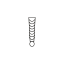 | U+1EBD7 | `&#125911;` | `&#x1EBD7;` |
| ZETHU CHARACTER 409 | `FANG_PENDANT` |  | U+1EBD8 | `&#125912;` | `&#x1EBD8;` |
| ZETHU CHARACTER 410 | `ARMBAND` |  | U+1EBD9 | `&#125913;` | `&#x1EBD9;` |
| ZETHU CHARACTER 411 | `LOOM` |  | U+1EBDA | `&#125914;` | `&#x1EBDA;` |
| ZETHU CHARACTER 412 | `MANTLE` |  | U+1EBDB | `&#125915;` | `&#x1EBDB;` |
| ZETHU CHARACTER 413 | `CATCH` |  | U+1EBDC | `&#125916;` | `&#x1EBDC;` |
| ZETHU CHARACTER 414 | `DOUBLED` |  | U+1EBDD | `&#125917;` | `&#x1EBDD;` |
| ZETHU CHARACTER 415 | `TEN` |  | U+1EBDE | `&#125918;` | `&#x1EBDE;` |
| ZETHU CHARACTER 416 | `ONE` |  | U+1EBDF | `&#125919;` | `&#x1EBDF;` |
| ZETHU CHARACTER 417 | `TWO` |  | U+1EBE0 | `&#125920;` | `&#x1EBE0;` |
| ZETHU CHARACTER 418 | `MANY` |  | U+1EBE1 | `&#125921;` | `&#x1EBE1;` |
| ZETHU CHARACTER 419 | `HUNDRED` |  | U+1EBE2 | `&#125922;` | `&#x1EBE2;` |
| ZETHU CHARACTER 420 | `THOUSAND` |  | U+1EBE3 | `&#125923;` | `&#x1EBE3;` |
| ZETHU CHARACTER 421 | `TEN_THOUSAND` |  | U+1EBE4 | `&#125924;` | `&#x1EBE4;` |
| ZETHU CHARACTER 422 | `HALF` |  | U+1EBE5 | `&#125925;` | `&#x1EBE5;` |
| ZETHU CHARACTER 423 | `ROYAL_NAME` |  | U+1EBE6 | `&#125926;` | `&#x1EBE6;` |
| ZETHU CHARACTER 424 | `ROYAL_NAME_COLUMN` |  | U+1EBE7 | `&#125927;` | `&#x1EBE7;` |
| ZETHU CHARACTER 425 | `NAME_STRUCK` |  | U+1EBE8 | `&#125928;` | `&#x1EBE8;` |
| ZETHU CHARACTER 426 | `TOTAL` |  | U+1EBE9 | `&#125929;` | `&#x1EBE9;` |
| ZETHU CHARACTER 427 | `OPEN` |  | U+1EBEA | `&#125930;` | `&#x1EBEA;` |
| ZETHU CHARACTER 428 | `CLOSED` |  | U+1EBEB | `&#125931;` | `&#x1EBEB;` |
| ZETHU CHARACTER 429 | `AGAIN` |  | U+1EBEC | `&#125932;` | `&#x1EBEC;` |
| ZETHU CHARACTER 430 | `HERE_ENDS` |  | U+1EBED | `&#125933;` | `&#x1EBED;` |
| ZETHU CHARACTER 431 | `SEALED` |  | U+1EBEE | `&#125934;` | `&#x1EBEE;` |
| ZETHU CHARACTER 432 | `ITSELF` |  | U+1EBEF | `&#125935;` | `&#x1EBEF;` |
| ZETHU CHARACTER 433 | `BUTCHER` |  | U+1EBF0 | `&#125936;` | `&#x1EBF0;` |
| ZETHU CHARACTER 434 | `SCOUT` |  | U+1EBF1 | `&#125937;` | `&#x1EBF1;` |
| ZETHU CHARACTER 435 | `NET_MASTER` |  | U+1EBF2 | `&#125938;` | `&#x1EBF2;` |
| ZETHU CHARACTER 436 | `RIVER_CAT` |  | U+1EBF3 | `&#125939;` | `&#x1EBF3;` |
| ZETHU CHARACTER 437 | `NIGHT_CROCODILE` |  | U+1EBF4 | `&#125940;` | `&#x1EBF4;` |
| ZETHU CHARACTER 438 | `SHARE` |  | U+1EBF5 | `&#125941;` | `&#x1EBF5;` |
| ZETHU CHARACTER 439 | `COMMEND` |  | U+1EBF6 | `&#125942;` | `&#x1EBF6;` |
| ZETHU CHARACTER 440 | `AUGURY` |  | U+1EBF7 | `&#125943;` | `&#x1EBF7;` |
| ZETHU CHARACTER 441 | `HYMN` |  | U+1EBF8 | `&#125944;` | `&#x1EBF8;` |
| ZETHU CHARACTER 442 | `SPOKEN_SPELL` |  | U+1EBF9 | `&#125945;` | `&#x1EBF9;` |
| ZETHU CHARACTER 443 | `READ_ALOUD` |  | U+1EBFA | `&#125946;` | `&#x1EBFA;` |
| ZETHU CHARACTER 444 | `LAMENT` |  | U+1EBFB | `&#125947;` | `&#x1EBFB;` |
| ZETHU CHARACTER 445 | `LAWSUIT` |  | U+1EBFC | `&#125948;` | `&#x1EBFC;` |
| ZETHU CHARACTER 446 | `INSCRIPTION` |  | U+1EBFD | `&#125949;` | `&#x1EBFD;` |
| ZETHU CHARACTER 447 | `MONTH` |  | U+1EBFE | `&#125950;` | `&#x1EBFE;` |
| ZETHU CHARACTER 448 | `BATTLE` |  | U+1EBFF | `&#125951;` | `&#x1EBFF;` |
| ZETHU CHARACTER 449 | `BLOOD_FIELD` |  | U+1EC00 | `&#125952;` | `&#x1EC00;` |
| ZETHU CHARACTER 450 | `SLEDGE` |  | U+1EC01 | `&#125953;` | `&#x1EC01;` |
| ZETHU CHARACTER 451 | `WEIGHED_HEART` |  | U+1EC02 | `&#125954;` | `&#x1EC02;` |
| ZETHU CHARACTER 452 | `SEVEN` |  | U+1EC03 | `&#125955;` | `&#x1EC03;` |
| ZETHU CHARACTER 453 | `FAIR` |  | U+1EC04 | `&#125956;` | `&#x1EC04;` |
| ZETHU CHARACTER 454 | `NAME` |  | U+1EC05 | `&#125957;` | `&#x1EC05;` |
| ZETHU CHARACTER 455 | `AT_PEACE` |  | U+1EC06 | `&#125958;` | `&#x1EC06;` |
| ZETHU CHARACTER 456 | `GREAT` |  | U+1EC07 | `&#125959;` | `&#x1EC07;` |
| ZETHU CHARACTER 457 | `COMMONER` |  | U+1EC08 | `&#125960;` | `&#x1EC08;` |
| ZETHU CHARACTER 458 | `BONDSMAN` |  | U+1EC09 | `&#125961;` | `&#x1EC09;` |
| ZETHU CHARACTER 459 | `OLD_WAY` |  | U+1EC0A | `&#125962;` | `&#x1EC0A;` |
| ZETHU CHARACTER 460 | `PERFORMANCE` |  | U+1EC0B | `&#125963;` | `&#x1EC0B;` |
| ZETHU CHARACTER 461 | `CRAFT` |  | U+1EC0C | `&#125964;` | `&#x1EC0C;` |
| ZETHU CHARACTER 462 | `ARCANE_ORDER` |  | U+1EC0D | `&#125965;` | `&#x1EC0D;` |
| ZETHU CHARACTER 463 | `HEREDITARY_STANDING` |  | U+1EC0E | `&#125966;` | `&#x1EC0E;` |
| ZETHU CHARACTER 464 | `EVERYDAY_ALPHABET` |  | U+1EC0F | `&#125967;` | `&#x1EC0F;` |
| ZETHU CHARACTER 465 | `SACRED_HAND` |  | U+1EC10 | `&#125968;` | `&#x1EC10;` |
| ZETHU CHARACTER 466 | `KHELATHI` |  | U+1EC11 | `&#125969;` | `&#x1EC11;` |
| ZETHU CHARACTER 467 | `THIN_BLOOD_FIELD` |  | U+1EC12 | `&#125970;` | `&#x1EC12;` |
| ZETHU CHARACTER 468 | `HIDDEN` |  | U+1EC13 | `&#125971;` | `&#x1EC13;` |
| ZETHU CHARACTER 469 | `REGNAL_YEAR` |  | U+1EC14 | `&#125972;` | `&#x1EC14;` |
| ZETHU CHARACTER 470 | `FOUR` |  | U+1EC15 | `&#125973;` | `&#x1EC15;` |
| ZETHU CHARACTER 471 | `FIVE` |  | U+1EC16 | `&#125974;` | `&#x1EC16;` |
| ZETHU CHARACTER 472 | `SIX` |  | U+1EC17 | `&#125975;` | `&#x1EC17;` |
| ZETHU CHARACTER 473 | `EIGHT` |  | U+1EC18 | `&#125976;` | `&#x1EC18;` |
| ZETHU CHARACTER 474 | `NINE` |  | U+1EC19 | `&#125977;` | `&#x1EC19;` |
| ZETHU CHARACTER 475 | `NOTHING_REMAINS` |  | U+1EC1A | `&#125978;` | `&#x1EC1A;` |
| ZETHU CHARACTER 476 | `WETHUR` |  | U+1EC1B | `&#125979;` | `&#x1EC1B;` |
| ZETHU CHARACTER 477 | `CAPTIVE_LED` |  | U+1EC1C | `&#125980;` | `&#x1EC1C;` |
| ZETHU CHARACTER 478 | `LEAD_CAPTIVE` |  | U+1EC1D | `&#125981;` | `&#x1EC1D;` |
| ZETHU CHARACTER 479 | `CAPTIVES` |  | U+1EC1E | `&#125982;` | `&#x1EC1E;` |
| ZETHU CHARACTER 480 | `DEFEATED` |  | U+1EC1F | `&#125983;` | `&#x1EC1F;` |
| ZETHU CHARACTER 481 | `HELD_BOUND` |  | U+1EC20 | `&#125984;` | `&#x1EC20;` |
| ZETHU CHARACTER 482 | `ENTRY_OPENED` |  | U+1EC21 | `&#125985;` | `&#x1EC21;` |
| ZETHU CHARACTER 483 | `ENTRY_CLOSED` |  | U+1EC22 | `&#125986;` | `&#x1EC22;` |
| ZETHU CHARACTER 484 | `ENTRY_SHORT` |  | U+1EC23 | `&#125987;` | `&#x1EC23;` |
| ZETHU CHARACTER 485 | `ENTRY_OPEN` |  | U+1EC24 | `&#125988;` | `&#x1EC24;` |
| ZETHU CHARACTER 486 | `GENZET_ENTRY` |  | U+1EC25 | `&#125989;` | `&#x1EC25;` |
| ZETHU CHARACTER 487 | `WEIGHING_ENTRY` |  | U+1EC26 | `&#125990;` | `&#x1EC26;` |
| ZETHU CHARACTER 488 | `LIKE` |  | U+1EC27 | `&#125991;` | `&#x1EC27;` |
| ZETHU CHARACTER 489 | `MAKE` |  | U+1EC28 | `&#125992;` | `&#x1EC28;` |
| ZETHU CHARACTER 490 | `TAKE` |  | U+1EC29 | `&#125993;` | `&#x1EC29;` |
| ZETHU CHARACTER 491 | `PRIEST` |  | U+1EC2A | `&#125994;` | `&#x1EC2A;` |
| ZETHU CHARACTER 492 | `FOREIGN_CHIEF` |  | U+1EC2B | `&#125995;` | `&#x1EC2B;` |
| ZETHU CHARACTER 493 | `COME_DOWN` |  | U+1EC2C | `&#125996;` | `&#x1EC2C;` |
| ZETHU CHARACTER 494 | `NORTH` |  | U+1EC2D | `&#125997;` | `&#x1EC2D;` |
| ZETHU CHARACTER 495 | `SEA` |  | U+1EC2E | `&#125998;` | `&#x1EC2E;` |
| ZETHU CHARACTER 496 | `SAND_SEAS` |  | U+1EC2F | `&#125999;` | `&#x1EC2F;` |
| ZETHU CHARACTER 497 | `ENVOY` |  | U+1EC30 | `&#126000;` | `&#x1EC30;` |
| ZETHU CHARACTER 498 | `ORDINAL_MARKER` |  | U+1EC31 | `&#126001;` | `&#x1EC31;` |
| ZETHU CHARACTER 499 | `CROWNING` |  | U+1EC32 | `&#126002;` | `&#x1EC32;` |
