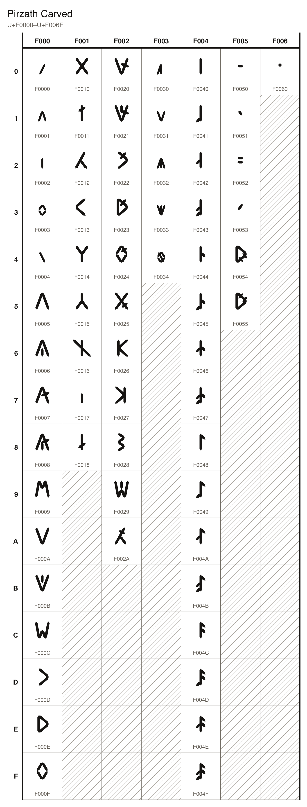
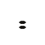

# Pirzath Carved

64 characters, U+F0000 to U+F0060, in the font `Pirzath Carved`.

## Code chart

## Characters

### Letters

| Character Name | Code | Character | Code Point | Entity | Hex Entity |
| --- | --- | --- | --- | --- | --- |
| PIRZATH LETTER A | `A` |  | U+F0000 | `&#983040;` | `&#xF0000;` |
| PIRZATH LETTER E | `E` |  | U+F0001 | `&#983041;` | `&#xF0001;` |
| PIRZATH LETTER I | `I` |  | U+F0002 | `&#983042;` | `&#xF0002;` |
| PIRZATH LETTER O | `O` |  | U+F0003 | `&#983043;` | `&#xF0003;` |
| PIRZATH LETTER U | `U` |  | U+F0004 | `&#983044;` | `&#xF0004;` |
| PIRZATH LETTER PARGH | `PARGH` |  | U+F0005 | `&#983045;` | `&#xF0005;` |
| PIRZATH LETTER BALG | `BALG` |  | U+F0006 | `&#983046;` | `&#xF0006;` |
| PIRZATH LETTER FARZ | `FARZ` |  | U+F0007 | `&#983047;` | `&#xF0007;` |
| PIRZATH LETTER VAZAL | `VAZAL` |  | U+F0008 | `&#983048;` | `&#xF0008;` |
| PIRZATH LETTER MARP | `MARP` |  | U+F0009 | `&#983049;` | `&#xF0009;` |
| PIRZATH LETTER TAMB | `TAMB` |  | U+F000A | `&#983050;` | `&#xF000A;` |
| PIRZATH LETTER DALK | `DALK` |  | U+F000B | `&#983051;` | `&#xF000B;` |
| PIRZATH LETTER NAZAF | `NAZAF` |  | U+F000C | `&#983052;` | `&#xF000C;` |
| PIRZATH LETTER KAMV | `KAMV` |  | U+F000D | `&#983053;` | `&#xF000D;` |
| PIRZATH LETTER GAMTH | `GAMTH` |  | U+F000E | `&#983054;` | `&#xF000E;` |
| PIRZATH LETTER SAKAR | `SAKAR` |  | U+F000F | `&#983055;` | `&#xF000F;` |
| PIRZATH LETTER ZALD | `ZALD` |  | U+F0010 | `&#983056;` | `&#xF0010;` |
| PIRZATH LETTER HALB | `HALB` |  | U+F0011 | `&#983057;` | `&#xF0011;` |
| PIRZATH LETTER LADHAV | `LADHAV` |  | U+F0012 | `&#983058;` | `&#xF0012;` |
| PIRZATH LETTER RAGHAV | `RAGHAV` |  | U+F0013 | `&#983059;` | `&#xF0013;` |
| PIRZATH LETTER JA | `JA` |  | U+F0014 | `&#983060;` | `&#xF0014;` |
| PIRZATH LETTER QA | `QA` |  | U+F0015 | `&#983061;` | `&#xF0015;` |
| PIRZATH LETTER WA | `WA` |  | U+F0016 | `&#983062;` | `&#xF0016;` |
| PIRZATH LETTER YA | `YA` |  | U+F0017 | `&#983063;` | `&#xF0017;` |
| PIRZATH LETTER CATCH | `CATCH` |  | U+F0018 | `&#983064;` | `&#xF0018;` |

### Digraphs

| Character Name | Code | Character | Code Point | Entity | Hex Entity |
| --- | --- | --- | --- | --- | --- |
| PIRZATH LETTER THARZ | `THARZ` |  | U+F0020 | `&#983072;` | `&#xF0020;` |
| PIRZATH LETTER DHALZ | `DHALZ` |  | U+F0021 | `&#983073;` | `&#xF0021;` |
| PIRZATH LETTER KHABAR | `KHABAR` |  | U+F0022 | `&#983074;` | `&#xF0022;` |
| PIRZATH LETTER GHARM | `GHARM` |  | U+F0023 | `&#983075;` | `&#xF0023;` |
| PIRZATH LETTER SHA | `SHA` |  | U+F0024 | `&#983076;` | `&#xF0024;` |
| PIRZATH LETTER ZHA | `ZHA` |  | U+F0025 | `&#983077;` | `&#xF0025;` |
| PIRZATH LETTER TSA | `TSA` |  | U+F0026 | `&#983078;` | `&#xF0026;` |
| PIRZATH LETTER CHA | `CHA` |  | U+F0027 | `&#983079;` | `&#xF0027;` |
| PIRZATH LETTER NGA | `NGA` |  | U+F0028 | `&#983080;` | `&#xF0028;` |
| PIRZATH LETTER NYA | `NYA` |  | U+F0029 | `&#983081;` | `&#xF0029;` |
| PIRZATH LETTER HLA | `HLA` |  | U+F002A | `&#983082;` | `&#xF002A;` |

### Diphthongs

| Character Name | Code | Character | Code Point | Entity | Hex Entity |
| --- | --- | --- | --- | --- | --- |
| PIRZATH LETTER AI | `AI` |  | U+F0030 | `&#983088;` | `&#xF0030;` |
| PIRZATH LETTER AU | `AU` |  | U+F0031 | `&#983089;` | `&#xF0031;` |
| PIRZATH LETTER EI | `EI` |  | U+F0032 | `&#983090;` | `&#xF0032;` |
| PIRZATH LETTER OI | `OI` |  | U+F0033 | `&#983091;` | `&#xF0033;` |
| PIRZATH LETTER OU | `OU` |  | U+F0034 | `&#983092;` | `&#xF0034;` |

### Digits

| Character Name | Code | Character | Code Point | Entity | Hex Entity |
| --- | --- | --- | --- | --- | --- |
| PIRZATH DIGIT ZERO | `DIGIT_ZERO` |  | U+F0040 | `&#983104;` | `&#xF0040;` |
| PIRZATH DIGIT ONE | `DIGIT_ONE` |  | U+F0041 | `&#983105;` | `&#xF0041;` |
| PIRZATH DIGIT TWO | `DIGIT_TWO` |  | U+F0042 | `&#983106;` | `&#xF0042;` |
| PIRZATH DIGIT THREE | `DIGIT_THREE` |  | U+F0043 | `&#983107;` | `&#xF0043;` |
| PIRZATH DIGIT FOUR | `DIGIT_FOUR` |  | U+F0044 | `&#983108;` | `&#xF0044;` |
| PIRZATH DIGIT FIVE | `DIGIT_FIVE` |  | U+F0045 | `&#983109;` | `&#xF0045;` |
| PIRZATH DIGIT SIX | `DIGIT_SIX` |  | U+F0046 | `&#983110;` | `&#xF0046;` |
| PIRZATH DIGIT SEVEN | `DIGIT_SEVEN` |  | U+F0047 | `&#983111;` | `&#xF0047;` |
| PIRZATH DIGIT EIGHT | `DIGIT_EIGHT` |  | U+F0048 | `&#983112;` | `&#xF0048;` |
| PIRZATH DIGIT NINE | `DIGIT_NINE` |  | U+F0049 | `&#983113;` | `&#xF0049;` |
| PIRZATH DIGIT TEN | `DIGIT_TEN` |  | U+F004A | `&#983114;` | `&#xF004A;` |
| PIRZATH DIGIT ELEVEN | `DIGIT_ELEVEN` |  | U+F004B | `&#983115;` | `&#xF004B;` |
| PIRZATH DIGIT TWELVE | `DIGIT_TWELVE` |  | U+F004C | `&#983116;` | `&#xF004C;` |
| PIRZATH DIGIT THIRTEEN | `DIGIT_THIRTEEN` |  | U+F004D | `&#983117;` | `&#xF004D;` |
| PIRZATH DIGIT FOURTEEN | `DIGIT_FOURTEEN` |  | U+F004E | `&#983118;` | `&#xF004E;` |
| PIRZATH DIGIT FIFTEEN | `DIGIT_FIFTEEN` |  | U+F004F | `&#983119;` | `&#xF004F;` |

### Punctuation

| Character Name | Code | Character | Code Point | Entity | Hex Entity |
| --- | --- | --- | --- | --- | --- |
| PIRZATH SENTENCE END | `STOP` |  | U+F0050 | `&#983120;` | `&#xF0050;` |
| PIRZATH PAUSE | `PAUSE` |  | U+F0051 | `&#983121;` | `&#xF0051;` |
| PIRZATH IMPERATIVE MARK | `IMPERATIVE` |  | U+F0052 | `&#983122;` | `&#xF0052;` |
| PIRZATH NAME DASH | `NAME_DASH` |  | U+F0053 | `&#983123;` | `&#xF0053;` |
| PIRZATH OPENING QUOTATION MARK | `OPEN_QUOTE` |  | U+F0054 | `&#983124;` | `&#xF0054;` |
| PIRZATH CLOSING QUOTATION MARK | `CLOSE_QUOTE` |  | U+F0055 | `&#983125;` | `&#xF0055;` |

### Marks

| Character Name | Code | Character | Code Point | Entity | Hex Entity |
| --- | --- | --- | --- | --- | --- |
| PIRZATH LENGTH MARK | `LONG` |  | U+F0060 | `&#983136;` | `&#xF0060;` |
