# Qalezu Hand

101 characters, U+1EA00 to U+1ECEB, in the font `Qalezu Hand`.

## Code chart

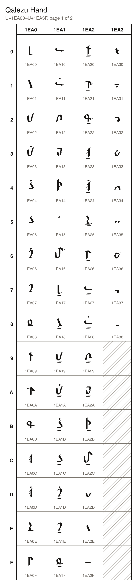
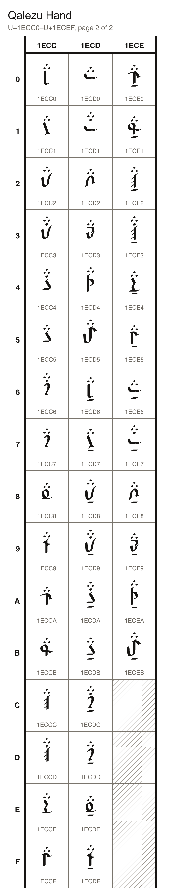

## Characters

### Letters

| Character Name | Character | Code Point | Entity | Hex Entity |
| --- | --- | --- | --- | --- |
| QALEZU LETTER LAGUN |  | U+1EA00 | `&#125440;` | `&#x1EA00;` |
| QALEZU LETTER RETHU |  | U+1EA01 | `&#125441;` | `&#x1EA01;` |
| QALEZU LETTER TULAZ |  | U+1EA02 | `&#125442;` | `&#x1EA02;` |
| QALEZU LETTER DURAS |  | U+1EA03 | `&#125443;` | `&#x1EA03;` |
| QALEZU LETTER ZAGUL |  | U+1EA04 | `&#125444;` | `&#x1EA04;` |
| QALEZU LETTER SELQUR |  | U+1EA05 | `&#125445;` | `&#x1EA05;` |
| QALEZU LETTER GITHAR |  | U+1EA06 | `&#125446;` | `&#x1EA06;` |
| QALEZU LETTER KA |  | U+1EA07 | `&#125447;` | `&#x1EA07;` |
| QALEZU LETTER NELGIR |  | U+1EA08 | `&#125448;` | `&#x1EA08;` |
| QALEZU LETTER THELQEN |  | U+1EA09 | `&#125449;` | `&#x1EA09;` |
| QALEZU LETTER MELNU |  | U+1EA0A | `&#125450;` | `&#x1EA0A;` |
| QALEZU LETTER QENUWA |  | U+1EA0B | `&#125451;` | `&#x1EA0B;` |
| QALEZU LETTER KHA |  | U+1EA0C | `&#125452;` | `&#x1EA0C;` |
| QALEZU LETTER GHA |  | U+1EA0D | `&#125453;` | `&#x1EA0D;` |
| QALEZU LETTER HALZI |  | U+1EA0E | `&#125454;` | `&#x1EA0E;` |
| QALEZU LETTER SHENULET |  | U+1EA0F | `&#125455;` | `&#x1EA0F;` |
| QALEZU LETTER PA |  | U+1EA10 | `&#125456;` | `&#x1EA10;` |
| QALEZU LETTER BA |  | U+1EA11 | `&#125457;` | `&#x1EA11;` |
| QALEZU LETTER FA |  | U+1EA12 | `&#125458;` | `&#x1EA12;` |
| QALEZU LETTER WALIR |  | U+1EA13 | `&#125459;` | `&#x1EA13;` |
| QALEZU LETTER YA |  | U+1EA14 | `&#125460;` | `&#x1EA14;` |
| QALEZU LETTER CATCH |  | U+1EA15 | `&#125461;` | `&#x1EA15;` |
| QALEZU LETTER TJA |  | U+1EA16 | `&#125462;` | `&#x1EA16;` |

### Doubled letters

| Character Name | Character | Code Point | Entity | Hex Entity |
| --- | --- | --- | --- | --- |
| QALEZU LETTER LAGUN DOUBLED | 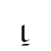 | U+1EA17 | `&#125463;` | `&#x1EA17;` |
| QALEZU LETTER RETHU DOUBLED | 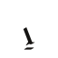 | U+1EA18 | `&#125464;` | `&#x1EA18;` |
| QALEZU LETTER TULAZ DOUBLED | 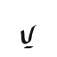 | U+1EA19 | `&#125465;` | `&#x1EA19;` |
| QALEZU LETTER DURAS DOUBLED | 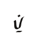 | U+1EA1A | `&#125466;` | `&#x1EA1A;` |
| QALEZU LETTER ZAGUL DOUBLED | 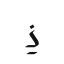 | U+1EA1B | `&#125467;` | `&#x1EA1B;` |
| QALEZU LETTER SELQUR DOUBLED | 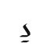 | U+1EA1C | `&#125468;` | `&#x1EA1C;` |
| QALEZU LETTER GITHAR DOUBLED | 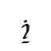 | U+1EA1D | `&#125469;` | `&#x1EA1D;` |
| QALEZU LETTER KA DOUBLED | 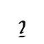 | U+1EA1E | `&#125470;` | `&#x1EA1E;` |
| QALEZU LETTER NELGIR DOUBLED | 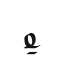 | U+1EA1F | `&#125471;` | `&#x1EA1F;` |
| QALEZU LETTER THELQEN DOUBLED |  | U+1EA20 | `&#125472;` | `&#x1EA20;` |
| QALEZU LETTER MELNU DOUBLED |  | U+1EA21 | `&#125473;` | `&#x1EA21;` |
| QALEZU LETTER QENUWA DOUBLED |  | U+1EA22 | `&#125474;` | `&#x1EA22;` |
| QALEZU LETTER KHA DOUBLED |  | U+1EA23 | `&#125475;` | `&#x1EA23;` |
| QALEZU LETTER GHA DOUBLED | 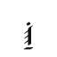 | U+1EA24 | `&#125476;` | `&#x1EA24;` |
| QALEZU LETTER HALZI DOUBLED | 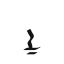 | U+1EA25 | `&#125477;` | `&#x1EA25;` |
| QALEZU LETTER SHENULET DOUBLED | 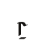 | U+1EA26 | `&#125478;` | `&#x1EA26;` |
| QALEZU LETTER PA DOUBLED | 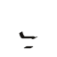 | U+1EA27 | `&#125479;` | `&#x1EA27;` |
| QALEZU LETTER BA DOUBLED | 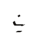 | U+1EA28 | `&#125480;` | `&#x1EA28;` |
| QALEZU LETTER FA DOUBLED | 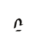 | U+1EA29 | `&#125481;` | `&#x1EA29;` |
| QALEZU LETTER WALIR DOUBLED | 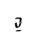 | U+1EA2A | `&#125482;` | `&#x1EA2A;` |
| QALEZU LETTER YA DOUBLED | 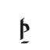 | U+1EA2B | `&#125483;` | `&#x1EA2B;` |
| QALEZU LETTER TJA DOUBLED | 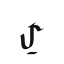 | U+1EA2C | `&#125484;` | `&#x1EA2C;` |

### Digits

| Character Name | Character | Code Point | Entity | Hex Entity |
| --- | --- | --- | --- | --- |
| QALEZU DIGIT ZERO |  | U+1EA2D | `&#125485;` | `&#x1EA2D;` |
| QALEZU DIGIT ONE |  | U+1EA2E | `&#125486;` | `&#x1EA2E;` |
| QALEZU DIGIT TWO |  | U+1EA2F | `&#125487;` | `&#x1EA2F;` |
| QALEZU DIGIT THREE |  | U+1EA30 | `&#125488;` | `&#x1EA30;` |
| QALEZU DIGIT FOUR |  | U+1EA31 | `&#125489;` | `&#x1EA31;` |
| QALEZU DIGIT FIVE |  | U+1EA32 | `&#125490;` | `&#x1EA32;` |
| QALEZU DIGIT SIX |  | U+1EA33 | `&#125491;` | `&#x1EA33;` |
| QALEZU DIGIT SEVEN |  | U+1EA34 | `&#125492;` | `&#x1EA34;` |
| QALEZU DIGIT EIGHT |  | U+1EA35 | `&#125493;` | `&#x1EA35;` |
| QALEZU DIGIT NINE |  | U+1EA36 | `&#125494;` | `&#x1EA36;` |

### Punctuation

| Character Name | Character | Code Point | Entity | Hex Entity |
| --- | --- | --- | --- | --- |
| QALEZU SENTENCE END |  | U+1EA37 | `&#125495;` | `&#x1EA37;` |
| QALEZU PAUSE |  | U+1EA38 | `&#125496;` | `&#x1EA38;` |

### Letters after a catch

| Character Name | Character | Code Point | Entity | Hex Entity |
| --- | --- | --- | --- | --- |
| QALEZU LETTER LAGUN WITH CATCH | 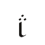 | U+1ECC0 | `&#126144;` | `&#x1ECC0;` |
| QALEZU LETTER RETHU WITH CATCH | 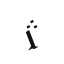 | U+1ECC1 | `&#126145;` | `&#x1ECC1;` |
| QALEZU LETTER TULAZ WITH CATCH | 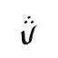 | U+1ECC2 | `&#126146;` | `&#x1ECC2;` |
| QALEZU LETTER DURAS WITH CATCH | 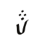 | U+1ECC3 | `&#126147;` | `&#x1ECC3;` |
| QALEZU LETTER ZAGUL WITH CATCH | 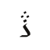 | U+1ECC4 | `&#126148;` | `&#x1ECC4;` |
| QALEZU LETTER SELQUR WITH CATCH | 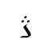 | U+1ECC5 | `&#126149;` | `&#x1ECC5;` |
| QALEZU LETTER GITHAR WITH CATCH | 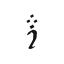 | U+1ECC6 | `&#126150;` | `&#x1ECC6;` |
| QALEZU LETTER KA WITH CATCH | 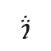 | U+1ECC7 | `&#126151;` | `&#x1ECC7;` |
| QALEZU LETTER NELGIR WITH CATCH | 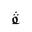 | U+1ECC8 | `&#126152;` | `&#x1ECC8;` |
| QALEZU LETTER THELQEN WITH CATCH |  | U+1ECC9 | `&#126153;` | `&#x1ECC9;` |
| QALEZU LETTER MELNU WITH CATCH |  | U+1ECCA | `&#126154;` | `&#x1ECCA;` |
| QALEZU LETTER QENUWA WITH CATCH | 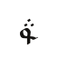 | U+1ECCB | `&#126155;` | `&#x1ECCB;` |
| QALEZU LETTER KHA WITH CATCH | 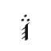 | U+1ECCC | `&#126156;` | `&#x1ECCC;` |
| QALEZU LETTER GHA WITH CATCH |  | U+1ECCD | `&#126157;` | `&#x1ECCD;` |
| QALEZU LETTER HALZI WITH CATCH | 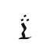 | U+1ECCE | `&#126158;` | `&#x1ECCE;` |
| QALEZU LETTER SHENULET WITH CATCH | 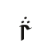 | U+1ECCF | `&#126159;` | `&#x1ECCF;` |
| QALEZU LETTER PA WITH CATCH | 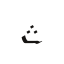 | U+1ECD0 | `&#126160;` | `&#x1ECD0;` |
| QALEZU LETTER BA WITH CATCH |  | U+1ECD1 | `&#126161;` | `&#x1ECD1;` |
| QALEZU LETTER FA WITH CATCH | 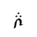 | U+1ECD2 | `&#126162;` | `&#x1ECD2;` |
| QALEZU LETTER WALIR WITH CATCH | 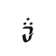 | U+1ECD3 | `&#126163;` | `&#x1ECD3;` |
| QALEZU LETTER YA WITH CATCH | 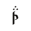 | U+1ECD4 | `&#126164;` | `&#x1ECD4;` |
| QALEZU LETTER TJA WITH CATCH | 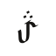 | U+1ECD5 | `&#126165;` | `&#x1ECD5;` |
| QALEZU LETTER LAGUN DOUBLED WITH CATCH | 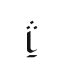 | U+1ECD6 | `&#126166;` | `&#x1ECD6;` |
| QALEZU LETTER RETHU DOUBLED WITH CATCH | 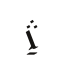 | U+1ECD7 | `&#126167;` | `&#x1ECD7;` |
| QALEZU LETTER TULAZ DOUBLED WITH CATCH | 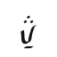 | U+1ECD8 | `&#126168;` | `&#x1ECD8;` |
| QALEZU LETTER DURAS DOUBLED WITH CATCH |  | U+1ECD9 | `&#126169;` | `&#x1ECD9;` |
| QALEZU LETTER ZAGUL DOUBLED WITH CATCH | 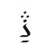 | U+1ECDA | `&#126170;` | `&#x1ECDA;` |
| QALEZU LETTER SELQUR DOUBLED WITH CATCH | 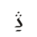 | U+1ECDB | `&#126171;` | `&#x1ECDB;` |
| QALEZU LETTER GITHAR DOUBLED WITH CATCH | 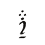 | U+1ECDC | `&#126172;` | `&#x1ECDC;` |
| QALEZU LETTER KA DOUBLED WITH CATCH | 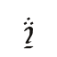 | U+1ECDD | `&#126173;` | `&#x1ECDD;` |
| QALEZU LETTER NELGIR DOUBLED WITH CATCH | 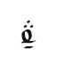 | U+1ECDE | `&#126174;` | `&#x1ECDE;` |
| QALEZU LETTER THELQEN DOUBLED WITH CATCH |  | U+1ECDF | `&#126175;` | `&#x1ECDF;` |
| QALEZU LETTER MELNU DOUBLED WITH CATCH |  | U+1ECE0 | `&#126176;` | `&#x1ECE0;` |
| QALEZU LETTER QENUWA DOUBLED WITH CATCH | 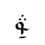 | U+1ECE1 | `&#126177;` | `&#x1ECE1;` |
| QALEZU LETTER KHA DOUBLED WITH CATCH |  | U+1ECE2 | `&#126178;` | `&#x1ECE2;` |
| QALEZU LETTER GHA DOUBLED WITH CATCH | 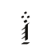 | U+1ECE3 | `&#126179;` | `&#x1ECE3;` |
| QALEZU LETTER HALZI DOUBLED WITH CATCH |  | U+1ECE4 | `&#126180;` | `&#x1ECE4;` |
| QALEZU LETTER SHENULET DOUBLED WITH CATCH | 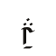 | U+1ECE5 | `&#126181;` | `&#x1ECE5;` |
| QALEZU LETTER PA DOUBLED WITH CATCH | 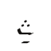 | U+1ECE6 | `&#126182;` | `&#x1ECE6;` |
| QALEZU LETTER BA DOUBLED WITH CATCH |  | U+1ECE7 | `&#126183;` | `&#x1ECE7;` |
| QALEZU LETTER FA DOUBLED WITH CATCH |  | U+1ECE8 | `&#126184;` | `&#x1ECE8;` |
| QALEZU LETTER WALIR DOUBLED WITH CATCH |  | U+1ECE9 | `&#126185;` | `&#x1ECE9;` |
| QALEZU LETTER YA DOUBLED WITH CATCH |  | U+1ECEA | `&#126186;` | `&#x1ECEA;` |
| QALEZU LETTER TJA DOUBLED WITH CATCH |  | U+1ECEB | `&#126187;` | `&#x1ECEB;` |
