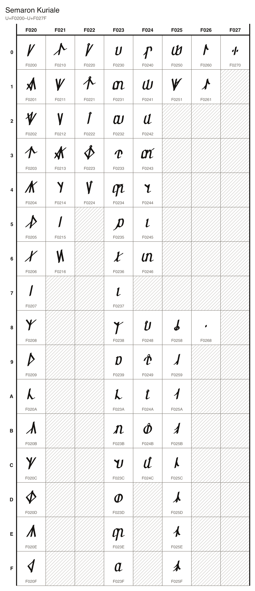
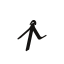
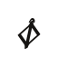
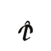
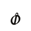

# Semaron Kuriale

70 characters, U+F0200 to U+F0270, in the font `Semaron Kuriale`.

## Code chart

## Characters

### Letters

| Character Name | Character | Code Point | Entity | Hex Entity |
| --- | --- | --- | --- | --- |
| SEMARON CAPITAL LETTER ANKRON |  | U+F0200 | `&#983552;` | `&#xF0200;` |
| SEMARON CAPITAL LETTER BRUTHEKA |  | U+F0201 | `&#983553;` | `&#xF0201;` |
| SEMARON CAPITAL LETTER DEKAZU |  | U+F0202 | `&#983554;` | `&#xF0202;` |
| SEMARON CAPITAL LETTER ELZA |  | U+F0203 | `&#983555;` | `&#xF0203;` |
| SEMARON CAPITAL LETTER FUNELA |  | U+F0204 | `&#983556;` | `&#xF0204;` |
| SEMARON CAPITAL LETTER GULMOS |  | U+F0205 | `&#983557;` | `&#xF0205;` |
| SEMARON CAPITAL LETTER HARLEN |  | U+F0206 | `&#983558;` | `&#xF0206;` |
| SEMARON CAPITAL LETTER ILTHERA |  | U+F0207 | `&#983559;` | `&#xF0207;` |
| SEMARON CAPITAL LETTER JA |  | U+F0208 | `&#983560;` | `&#xF0208;` |
| SEMARON CAPITAL LETTER KALPEZA |  | U+F0209 | `&#983561;` | `&#xF0209;` |
| SEMARON CAPITAL LETTER LIZELA |  | U+F020A | `&#983562;` | `&#xF020A;` |
| SEMARON CAPITAL LETTER MEZARA |  | U+F020B | `&#983563;` | `&#xF020B;` |
| SEMARON CAPITAL LETTER NELAMIS |  | U+F020C | `&#983564;` | `&#xF020C;` |
| SEMARON CAPITAL LETTER ORNETHE |  | U+F020D | `&#983565;` | `&#xF020D;` |
| SEMARON CAPITAL LETTER POZERA |  | U+F020E | `&#983566;` | `&#xF020E;` |
| SEMARON CAPITAL LETTER RONETHOS |  | U+F020F | `&#983567;` | `&#xF020F;` |
| SEMARON CAPITAL LETTER SIRETHA |  | U+F0210 | `&#983568;` | `&#xF0210;` |
| SEMARON CAPITAL LETTER TALOTHOS |  | U+F0211 | `&#983569;` | `&#xF0211;` |
| SEMARON CAPITAL LETTER ULMERA |  | U+F0212 | `&#983570;` | `&#xF0212;` |
| SEMARON CAPITAL LETTER VARTHOS |  | U+F0213 | `&#983571;` | `&#xF0213;` |
| SEMARON CAPITAL LETTER WA |  | U+F0214 | `&#983572;` | `&#xF0214;` |
| SEMARON CAPITAL LETTER YALZEMIS |  | U+F0215 | `&#983573;` | `&#xF0215;` |
| SEMARON CAPITAL LETTER ZARGON |  | U+F0216 | `&#983574;` | `&#xF0216;` |
| SEMARON CAPITAL LETTER LONG ANKRON |  | U+F0220 | `&#983584;` | `&#xF0220;` |
| SEMARON CAPITAL LETTER LONG ELZA |  | U+F0221 | `&#983585;` | `&#xF0221;` |
| SEMARON CAPITAL LETTER LONG ILTHERA |  | U+F0222 | `&#983586;` | `&#xF0222;` |
| SEMARON CAPITAL LETTER LONG ORNETHE |  | U+F0223 | `&#983587;` | `&#xF0223;` |
| SEMARON CAPITAL LETTER LONG ULMERA |  | U+F0224 | `&#983588;` | `&#xF0224;` |
| SEMARON SMALL LETTER ANKRON |  | U+F0230 | `&#983600;` | `&#xF0230;` |
| SEMARON SMALL LETTER BRUTHEKA |  | U+F0231 | `&#983601;` | `&#xF0231;` |
| SEMARON SMALL LETTER DEKAZU |  | U+F0232 | `&#983602;` | `&#xF0232;` |
| SEMARON SMALL LETTER ELZA |  | U+F0233 | `&#983603;` | `&#xF0233;` |
| SEMARON SMALL LETTER FUNELA |  | U+F0234 | `&#983604;` | `&#xF0234;` |
| SEMARON SMALL LETTER GULMOS |  | U+F0235 | `&#983605;` | `&#xF0235;` |
| SEMARON SMALL LETTER HARLEN |  | U+F0236 | `&#983606;` | `&#xF0236;` |
| SEMARON SMALL LETTER ILTHERA |  | U+F0237 | `&#983607;` | `&#xF0237;` |
| SEMARON SMALL LETTER JA |  | U+F0238 | `&#983608;` | `&#xF0238;` |
| SEMARON SMALL LETTER KALPEZA |  | U+F0239 | `&#983609;` | `&#xF0239;` |
| SEMARON SMALL LETTER LIZELA |  | U+F023A | `&#983610;` | `&#xF023A;` |
| SEMARON SMALL LETTER MEZARA |  | U+F023B | `&#983611;` | `&#xF023B;` |
| SEMARON SMALL LETTER NELAMIS |  | U+F023C | `&#983612;` | `&#xF023C;` |
| SEMARON SMALL LETTER ORNETHE |  | U+F023D | `&#983613;` | `&#xF023D;` |
| SEMARON SMALL LETTER POZERA |  | U+F023E | `&#983614;` | `&#xF023E;` |
| SEMARON SMALL LETTER RONETHOS |  | U+F023F | `&#983615;` | `&#xF023F;` |
| SEMARON SMALL LETTER SIRETHA |  | U+F0240 | `&#983616;` | `&#xF0240;` |
| SEMARON SMALL LETTER TALOTHOS |  | U+F0241 | `&#983617;` | `&#xF0241;` |
| SEMARON SMALL LETTER ULMERA |  | U+F0242 | `&#983618;` | `&#xF0242;` |
| SEMARON SMALL LETTER VARTHOS |  | U+F0243 | `&#983619;` | `&#xF0243;` |
| SEMARON SMALL LETTER WA |  | U+F0244 | `&#983620;` | `&#xF0244;` |
| SEMARON SMALL LETTER YALZEMIS |  | U+F0245 | `&#983621;` | `&#xF0245;` |
| SEMARON SMALL LETTER ZARGON |  | U+F0246 | `&#983622;` | `&#xF0246;` |
| SEMARON SMALL LETTER LONG ANKRON |  | U+F0248 | `&#983624;` | `&#xF0248;` |
| SEMARON SMALL LETTER LONG ELZA |  | U+F0249 | `&#983625;` | `&#xF0249;` |
| SEMARON SMALL LETTER LONG ILTHERA |  | U+F024A | `&#983626;` | `&#xF024A;` |
| SEMARON SMALL LETTER LONG ORNETHE |  | U+F024B | `&#983627;` | `&#xF024B;` |
| SEMARON SMALL LETTER LONG ULMERA |  | U+F024C | `&#983628;` | `&#xF024C;` |

### Digraphs

| Character Name | Character | Code Point | Entity | Hex Entity |
| --- | --- | --- | --- | --- |
| SEMARON SMALL LETTER THOLERA |  | U+F0250 | `&#983632;` | `&#xF0250;` |
| SEMARON CAPITAL LETTER THOLERA |  | U+F0251 | `&#983633;` | `&#xF0251;` |

### Digits

| Character Name | Character | Code Point | Entity | Hex Entity |
| --- | --- | --- | --- | --- |
| SEMARON DIGIT ZERO |  | U+F0258 | `&#983640;` | `&#xF0258;` |
| SEMARON DIGIT ONE |  | U+F0259 | `&#983641;` | `&#xF0259;` |
| SEMARON DIGIT TWO |  | U+F025A | `&#983642;` | `&#xF025A;` |
| SEMARON DIGIT THREE |  | U+F025B | `&#983643;` | `&#xF025B;` |
| SEMARON DIGIT FOUR |  | U+F025C | `&#983644;` | `&#xF025C;` |
| SEMARON DIGIT FIVE |  | U+F025D | `&#983645;` | `&#xF025D;` |
| SEMARON DIGIT SIX |  | U+F025E | `&#983646;` | `&#xF025E;` |
| SEMARON DIGIT SEVEN |  | U+F025F | `&#983647;` | `&#xF025F;` |
| SEMARON DIGIT EIGHT |  | U+F0260 | `&#983648;` | `&#xF0260;` |
| SEMARON DIGIT NINE |  | U+F0261 | `&#983649;` | `&#xF0261;` |

### Punctuation

| Character Name | Character | Code Point | Entity | Hex Entity |
| --- | --- | --- | --- | --- |
| SEMARON POINT |  | U+F0268 | `&#983656;` | `&#xF0268;` |

### Marks

| Character Name | Character | Code Point | Entity | Hex Entity |
| --- | --- | --- | --- | --- |
| SEMARON CATCH |  | U+F0270 | `&#983664;` | `&#xF0270;` |
