# Teng Chou

305 characters, U+F1000 to U+F2056, in the font `Teng Chou`.

## Code chart

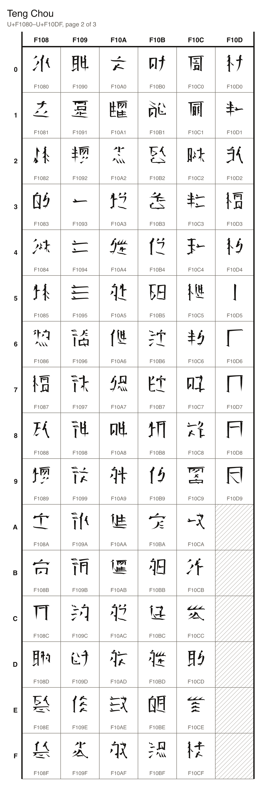
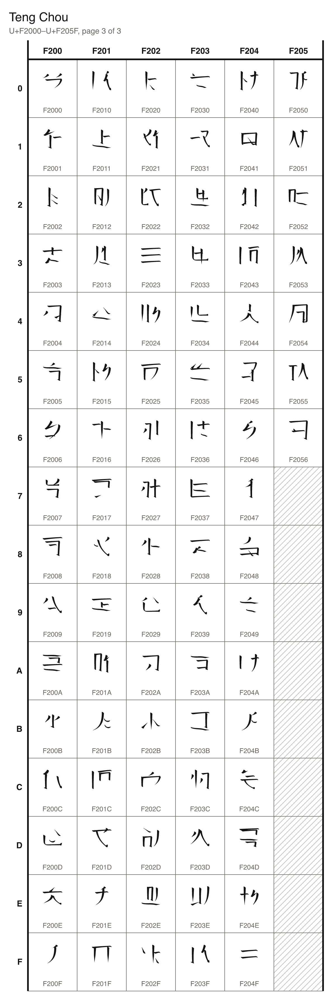

## Characters

### Characters

| Character Name | Character | Code Point | Entity | Hex Entity |
| --- | --- | --- | --- | --- |
| TENG CHOU CHARACTER HO | 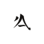 | U+F1000 | `&#987136;` | `&#xF1000;` |
| TENG CHOU CHARACTER JING | 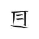 | U+F1001 | `&#987137;` | `&#xF1001;` |
| TENG CHOU CHARACTER MOU | 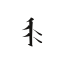 | U+F1002 | `&#987138;` | `&#xF1002;` |
| TENG CHOU CHARACTER SHOU | 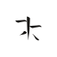 | U+F1003 | `&#987139;` | `&#xF1003;` |
| TENG CHOU CHARACTER TOU | 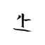 | U+F1004 | `&#987140;` | `&#xF1004;` |
| TENG CHOU CHARACTER WENG |  | U+F1005 | `&#987141;` | `&#xF1005;` |
| TENG CHOU CHARACTER CHAI | 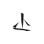 | U+F1006 | `&#987142;` | `&#xF1006;` |
| TENG CHOU CHARACTER YAN | 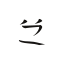 | U+F1007 | `&#987143;` | `&#xF1007;` |
| TENG CHOU CHARACTER ZHI | 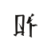 | U+F1008 | `&#987144;` | `&#xF1008;` |
| TENG CHOU CHARACTER YOU | 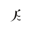 | U+F1009 | `&#987145;` | `&#xF1009;` |
| TENG CHOU CHARACTER LUO | 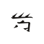 | U+F100A | `&#987146;` | `&#xF100A;` |
| TENG CHOU CHARACTER NOU |  | U+F100B | `&#987147;` | `&#xF100B;` |
| TENG CHOU CHARACTER WONG | 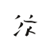 | U+F100C | `&#987148;` | `&#xF100C;` |
| TENG CHOU CHARACTER ZHEN |  | U+F100D | `&#987149;` | `&#xF100D;` |
| TENG CHOU CHARACTER CHUEN | 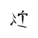 | U+F100E | `&#987150;` | `&#xF100E;` |
| TENG CHOU CHARACTER RAO | 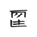 | U+F100F | `&#987151;` | `&#xF100F;` |
| TENG CHOU CHARACTER LA | 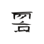 | U+F1010 | `&#987152;` | `&#xF1010;` |
| TENG CHOU CHARACTER TUI | 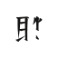 | U+F1011 | `&#987153;` | `&#xF1011;` |
| TENG CHOU CHARACTER WEI | 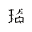 | U+F1012 | `&#987154;` | `&#xF1012;` |
| TENG CHOU CHARACTER TENG | 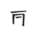 | U+F1013 | `&#987155;` | `&#xF1013;` |
| TENG CHOU CHARACTER TAN |  | U+F1014 | `&#987156;` | `&#xF1014;` |
| TENG CHOU CHARACTER MUO | 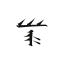 | U+F1015 | `&#987157;` | `&#xF1015;` |
| TENG CHOU CHARACTER ZHOU | 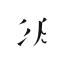 | U+F1016 | `&#987158;` | `&#xF1016;` |
| TENG CHOU CHARACTER RIN |  | U+F1017 | `&#987159;` | `&#xF1017;` |
| TENG CHOU CHARACTER BUI | 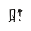 | U+F1018 | `&#987160;` | `&#xF1018;` |
| TENG CHOU CHARACTER HA | 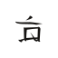 | U+F1019 | `&#987161;` | `&#xF1019;` |
| TENG CHOU CHARACTER LENG | 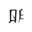 | U+F101A | `&#987162;` | `&#xF101A;` |
| TENG CHOU CHARACTER JEN |  | U+F101B | `&#987163;` | `&#xF101B;` |
| TENG CHOU CHARACTER WUEN | 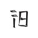 | U+F101C | `&#987164;` | `&#xF101C;` |
| TENG CHOU CHARACTER WAI |  | U+F101D | `&#987165;` | `&#xF101D;` |
| TENG CHOU CHARACTER RONG | 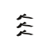 | U+F101E | `&#987166;` | `&#xF101E;` |
| TENG CHOU CHARACTER CHEN |  | U+F101F | `&#987167;` | `&#xF101F;` |
| TENG CHOU CHARACTER ZHUO | 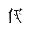 | U+F1020 | `&#987168;` | `&#xF1020;` |
| TENG CHOU CHARACTER NEI | 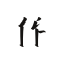 | U+F1021 | `&#987169;` | `&#xF1021;` |
| TENG CHOU CHARACTER GUI | 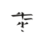 | U+F1022 | `&#987170;` | `&#xF1022;` |
| TENG CHOU CHARACTER GEN | 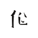 | U+F1023 | `&#987171;` | `&#xF1023;` |
| TENG CHOU CHARACTER WUO | 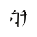 | U+F1024 | `&#987172;` | `&#xF1024;` |
| TENG CHOU CHARACTER CHEI | 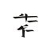 | U+F1025 | `&#987173;` | `&#xF1025;` |
| TENG CHOU CHARACTER YAI | 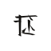 | U+F1026 | `&#987174;` | `&#xF1026;` |
| TENG CHOU CHARACTER ZHEI |  | U+F1027 | `&#987175;` | `&#xF1027;` |
| TENG CHOU CHARACTER NONG | 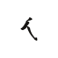 | U+F1028 | `&#987176;` | `&#xF1028;` |
| TENG CHOU CHARACTER NUI | 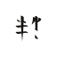 | U+F1029 | `&#987177;` | `&#xF1029;` |
| TENG CHOU CHARACTER TSOU | 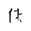 | U+F102A | `&#987178;` | `&#xF102A;` |
| TENG CHOU CHARACTER ZHAO |  | U+F102B | `&#987179;` | `&#xF102B;` |
| TENG CHOU CHARACTER KEN |  | U+F102C | `&#987180;` | `&#xF102C;` |
| TENG CHOU CHARACTER SHUO | 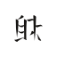 | U+F102D | `&#987181;` | `&#xF102D;` |
| TENG CHOU CHARACTER JA |  | U+F102E | `&#987182;` | `&#xF102E;` |
| TENG CHOU CHARACTER HUO | 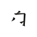 | U+F102F | `&#987183;` | `&#xF102F;` |
| TENG CHOU CHARACTER WEN |  | U+F1030 | `&#987184;` | `&#xF1030;` |
| TENG CHOU CHARACTER WOU | 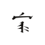 | U+F1031 | `&#987185;` | `&#xF1031;` |
| TENG CHOU CHARACTER WO | 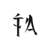 | U+F1032 | `&#987186;` | `&#xF1032;` |
| TENG CHOU CHARACTER LEI | 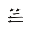 | U+F1033 | `&#987187;` | `&#xF1033;` |
| TENG CHOU CHARACTER SEI | 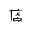 | U+F1034 | `&#987188;` | `&#xF1034;` |
| TENG CHOU CHARACTER LOU |  | U+F1035 | `&#987189;` | `&#xF1035;` |
| TENG CHOU CHARACTER DOU |  | U+F1036 | `&#987190;` | `&#xF1036;` |
| TENG CHOU CHARACTER HOU | 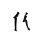 | U+F1037 | `&#987191;` | `&#xF1037;` |
| TENG CHOU CHARACTER TSAI | 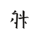 | U+F1038 | `&#987192;` | `&#xF1038;` |
| TENG CHOU CHARACTER HUEN | 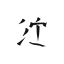 | U+F1039 | `&#987193;` | `&#xF1039;` |
| TENG CHOU CHARACTER SING | 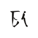 | U+F103A | `&#987194;` | `&#xF103A;` |
| TENG CHOU CHARACTER ZHA | 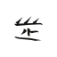 | U+F103B | `&#987195;` | `&#xF103B;` |
| TENG CHOU CHARACTER NUO | 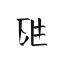 | U+F103C | `&#987196;` | `&#xF103C;` |
| TENG CHOU CHARACTER FA | 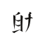 | U+F103D | `&#987197;` | `&#xF103D;` |
| TENG CHOU CHARACTER CHOU | 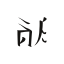 | U+F103E | `&#987198;` | `&#xF103E;` |
| TENG CHOU CHARACTER DUO |  | U+F103F | `&#987199;` | `&#xF103F;` |
| TENG CHOU CHARACTER RUI |  | U+F1040 | `&#987200;` | `&#xF1040;` |
| TENG CHOU CHARACTER JUI |  | U+F1041 | `&#987201;` | `&#xF1041;` |
| TENG CHOU CHARACTER TSEI |  | U+F1042 | `&#987202;` | `&#xF1042;` |
| TENG CHOU CHARACTER WAN |  | U+F1043 | `&#987203;` | `&#xF1043;` |
| TENG CHOU CHARACTER NIE |  | U+F1044 | `&#987204;` | `&#xF1044;` |
| TENG CHOU CHARACTER MEI |  | U+F1045 | `&#987205;` | `&#xF1045;` |
| TENG CHOU CHARACTER ZHO |  | U+F1046 | `&#987206;` | `&#xF1046;` |
| TENG CHOU CHARACTER HEN |  | U+F1047 | `&#987207;` | `&#xF1047;` |
| TENG CHOU CHARACTER ZHAI |  | U+F1048 | `&#987208;` | `&#xF1048;` |
| TENG CHOU CHARACTER GWO |  | U+F1049 | `&#987209;` | `&#xF1049;` |
| TENG CHOU CHARACTER SOU |  | U+F104A | `&#987210;` | `&#xF104A;` |
| TENG CHOU CHARACTER MAI |  | U+F104B | `&#987211;` | `&#xF104B;` |
| TENG CHOU CHARACTER BEI |  | U+F104C | `&#987212;` | `&#xF104C;` |
| TENG CHOU CHARACTER ZHIN |  | U+F104D | `&#987213;` | `&#xF104D;` |
| TENG CHOU CHARACTER YO |  | U+F104E | `&#987214;` | `&#xF104E;` |
| TENG CHOU CHARACTER JEI |  | U+F104F | `&#987215;` | `&#xF104F;` |
| TENG CHOU CHARACTER CHENG |  | U+F1050 | `&#987216;` | `&#xF1050;` |
| TENG CHOU CHARACTER JONG |  | U+F1051 | `&#987217;` | `&#xF1051;` |
| TENG CHOU CHARACTER CHIAO |  | U+F1052 | `&#987218;` | `&#xF1052;` |
| TENG CHOU CHARACTER WA |  | U+F1053 | `&#987219;` | `&#xF1053;` |
| TENG CHOU CHARACTER DAO |  | U+F1054 | `&#987220;` | `&#xF1054;` |
| TENG CHOU CHARACTER KUO |  | U+F1055 | `&#987221;` | `&#xF1055;` |
| TENG CHOU CHARACTER SHUI |  | U+F1056 | `&#987222;` | `&#xF1056;` |
| TENG CHOU CHARACTER HING |  | U+F1057 | `&#987223;` | `&#xF1057;` |
| TENG CHOU CHARACTER JIE |  | U+F1058 | `&#987224;` | `&#xF1058;` |
| TENG CHOU CHARACTER TEN |  | U+F1059 | `&#987225;` | `&#xF1059;` |
| TENG CHOU CHARACTER YONG |  | U+F105A | `&#987226;` | `&#xF105A;` |
| TENG CHOU CHARACTER SIN |  | U+F105B | `&#987227;` | `&#xF105B;` |
| TENG CHOU CHARACTER FAI |  | U+F105C | `&#987228;` | `&#xF105C;` |
| TENG CHOU CHARACTER TSIE |  | U+F105D | `&#987229;` | `&#xF105D;` |
| TENG CHOU CHARACTER RUO |  | U+F105E | `&#987230;` | `&#xF105E;` |
| TENG CHOU CHARACTER GAI |  | U+F105F | `&#987231;` | `&#xF105F;` |
| TENG CHOU CHARACTER TSEN |  | U+F1060 | `&#987232;` | `&#xF1060;` |
| TENG CHOU CHARACTER HIN |  | U+F1061 | `&#987233;` | `&#xF1061;` |
| TENG CHOU CHARACTER YEI |  | U+F1062 | `&#987234;` | `&#xF1062;` |
| TENG CHOU CHARACTER HAO |  | U+F1063 | `&#987235;` | `&#xF1063;` |
| TENG CHOU CHARACTER SAO |  | U+F1064 | `&#987236;` | `&#xF1064;` |
| TENG CHOU CHARACTER LAN |  | U+F1065 | `&#987237;` | `&#xF1065;` |
| TENG CHOU CHARACTER CHING |  | U+F1066 | `&#987238;` | `&#xF1066;` |
| TENG CHOU CHARACTER LUI |  | U+F1067 | `&#987239;` | `&#xF1067;` |
| TENG CHOU CHARACTER FONG |  | U+F1068 | `&#987240;` | `&#xF1068;` |
| TENG CHOU CHARACTER TSONG |  | U+F1069 | `&#987241;` | `&#xF1069;` |
| TENG CHOU CHARACTER GA |  | U+F106A | `&#987242;` | `&#xF106A;` |
| TENG CHOU CHARACTER LIE |  | U+F106B | `&#987243;` | `&#xF106B;` |
| TENG CHOU CHARACTER BENG |  | U+F106C | `&#987244;` | `&#xF106C;` |
| TENG CHOU CHARACTER KONG |  | U+F106D | `&#987245;` | `&#xF106D;` |
| TENG CHOU CHARACTER BIN |  | U+F106E | `&#987246;` | `&#xF106E;` |
| TENG CHOU CHARACTER JENG |  | U+F106F | `&#987247;` | `&#xF106F;` |
| TENG CHOU CHARACTER TING |  | U+F1070 | `&#987248;` | `&#xF1070;` |
| TENG CHOU CHARACTER HONG |  | U+F1071 | `&#987249;` | `&#xF1071;` |
| TENG CHOU CHARACTER NEN |  | U+F1072 | `&#987250;` | `&#xF1072;` |
| TENG CHOU CHARACTER TUO |  | U+F1073 | `&#987251;` | `&#xF1073;` |
| TENG CHOU CHARACTER SHAI |  | U+F1074 | `&#987252;` | `&#xF1074;` |
| TENG CHOU CHARACTER KUEN |  | U+F1075 | `&#987253;` | `&#xF1075;` |
| TENG CHOU CHARACTER JO |  | U+F1076 | `&#987254;` | `&#xF1076;` |
| TENG CHOU CHARACTER DAI |  | U+F1077 | `&#987255;` | `&#xF1077;` |
| TENG CHOU CHARACTER LO |  | U+F1078 | `&#987256;` | `&#xF1078;` |
| TENG CHOU CHARACTER KO |  | U+F1079 | `&#987257;` | `&#xF1079;` |
| TENG CHOU CHARACTER CHUI |  | U+F107A | `&#987258;` | `&#xF107A;` |
| TENG CHOU CHARACTER MUEN |  | U+F107B | `&#987259;` | `&#xF107B;` |
| TENG CHOU CHARACTER MI |  | U+F107C | `&#987260;` | `&#xF107C;` |
| TENG CHOU CHARACTER CHAN |  | U+F107D | `&#987261;` | `&#xF107D;` |
| TENG CHOU CHARACTER SHO |  | U+F107E | `&#987262;` | `&#xF107E;` |
| TENG CHOU CHARACTER TA |  | U+F107F | `&#987263;` | `&#xF107F;` |
| TENG CHOU CHARACTER HUI |  | U+F1080 | `&#987264;` | `&#xF1080;` |
| TENG CHOU CHARACTER SA |  | U+F1081 | `&#987265;` | `&#xF1081;` |
| TENG CHOU CHARACTER FOU |  | U+F1082 | `&#987266;` | `&#xF1082;` |
| TENG CHOU CHARACTER MIN |  | U+F1083 | `&#987267;` | `&#xF1083;` |
| TENG CHOU CHARACTER LIAO |  | U+F1084 | `&#987268;` | `&#xF1084;` |
| TENG CHOU CHARACTER BOU |  | U+F1085 | `&#987269;` | `&#xF1085;` |
| TENG CHOU CHARACTER JIN |  | U+F1086 | `&#987270;` | `&#xF1086;` |
| TENG CHOU CHARACTER GAN |  | U+F1087 | `&#987271;` | `&#xF1087;` |
| TENG CHOU CHARACTER TONG |  | U+F1088 | `&#987272;` | `&#xF1088;` |
| TENG CHOU CHARACTER ZHENG |  | U+F1089 | `&#987273;` | `&#xF1089;` |
| TENG CHOU CHARACTER ZHUEN |  | U+F108A | `&#987274;` | `&#xF108A;` |
| TENG CHOU CHARACTER ZHONG |  | U+F108B | `&#987275;` | `&#xF108B;` |
| TENG CHOU CHARACTER SEN |  | U+F108C | `&#987276;` | `&#xF108C;` |
| TENG CHOU CHARACTER KIN |  | U+F108D | `&#987277;` | `&#xF108D;` |
| TENG CHOU CHARACTER LING |  | U+F108E | `&#987278;` | `&#xF108E;` |
| TENG CHOU CHARACTER GWOU |  | U+F108F | `&#987279;` | `&#xF108F;` |
| TENG CHOU CHARACTER RAI |  | U+F1090 | `&#987280;` | `&#xF1090;` |
| TENG CHOU CHARACTER BAN |  | U+F1091 | `&#987281;` | `&#xF1091;` |
| TENG CHOU CHARACTER SHEN |  | U+F1092 | `&#987282;` | `&#xF1092;` |
| TENG CHOU CHARACTER TSI |  | U+F1093 | `&#987283;` | `&#xF1093;` |
| TENG CHOU CHARACTER LEN |  | U+F1094 | `&#987284;` | `&#xF1094;` |
| TENG CHOU CHARACTER TAO |  | U+F1095 | `&#987285;` | `&#xF1095;` |
| TENG CHOU CHARACTER FEI |  | U+F1096 | `&#987286;` | `&#xF1096;` |
| TENG CHOU CHARACTER JOU |  | U+F1097 | `&#987287;` | `&#xF1097;` |
| TENG CHOU CHARACTER TAI |  | U+F1098 | `&#987288;` | `&#xF1098;` |
| TENG CHOU CHARACTER MO |  | U+F1099 | `&#987289;` | `&#xF1099;` |
| TENG CHOU CHARACTER GOU |  | U+F109A | `&#987290;` | `&#xF109A;` |
| TENG CHOU CHARACTER KENG |  | U+F109B | `&#987291;` | `&#xF109B;` |
| TENG CHOU CHARACTER CHUO |  | U+F109C | `&#987292;` | `&#xF109C;` |
| TENG CHOU CHARACTER TSAN |  | U+F109D | `&#987293;` | `&#xF109D;` |
| TENG CHOU CHARACTER CHONG |  | U+F109E | `&#987294;` | `&#xF109E;` |
| TENG CHOU CHARACTER BO |  | U+F109F | `&#987295;` | `&#xF109F;` |
| TENG CHOU CHARACTER MONG |  | U+F10A0 | `&#987296;` | `&#xF10A0;` |
| TENG CHOU CHARACTER JAO |  | U+F10A1 | `&#987297;` | `&#xF10A1;` |
| TENG CHOU CHARACTER KUI |  | U+F10A2 | `&#987298;` | `&#xF10A2;` |
| TENG CHOU CHARACTER JAN |  | U+F10A3 | `&#987299;` | `&#xF10A3;` |
| TENG CHOU CHARACTER NA |  | U+F10A4 | `&#987300;` | `&#xF10A4;` |
| TENG CHOU CHARACTER TO |  | U+F10A5 | `&#987301;` | `&#xF10A5;` |
| TENG CHOU CHARACTER DONG |  | U+F10A6 | `&#987302;` | `&#xF10A6;` |
| TENG CHOU CHARACTER NIN |  | U+F10A7 | `&#987303;` | `&#xF10A7;` |
| TENG CHOU CHARACTER DEI |  | U+F10A8 | `&#987304;` | `&#xF10A8;` |
| TENG CHOU CHARACTER KAI |  | U+F10A9 | `&#987305;` | `&#xF10A9;` |
| TENG CHOU CHARACTER ROU |  | U+F10AA | `&#987306;` | `&#xF10AA;` |
| TENG CHOU CHARACTER NAO |  | U+F10AB | `&#987307;` | `&#xF10AB;` |
| TENG CHOU CHARACTER ZHAN |  | U+F10AC | `&#987308;` | `&#xF10AC;` |
| TENG CHOU CHARACTER DUI |  | U+F10AD | `&#987309;` | `&#xF10AD;` |
| TENG CHOU CHARACTER SHAO |  | U+F10AE | `&#987310;` | `&#xF10AE;` |
| TENG CHOU CHARACTER TSIAO |  | U+F10AF | `&#987311;` | `&#xF10AF;` |
| TENG CHOU CHARACTER YA |  | U+F10B0 | `&#987312;` | `&#xF10B0;` |
| TENG CHOU CHARACTER TSUEN |  | U+F10B1 | `&#987313;` | `&#xF10B1;` |
| TENG CHOU CHARACTER TSING |  | U+F10B2 | `&#987314;` | `&#xF10B2;` |
| TENG CHOU CHARACTER SAI |  | U+F10B3 | `&#987315;` | `&#xF10B3;` |
| TENG CHOU CHARACTER SHAN |  | U+F10B4 | `&#987316;` | `&#xF10B4;` |
| TENG CHOU CHARACTER FEN |  | U+F10B5 | `&#987317;` | `&#xF10B5;` |
| TENG CHOU CHARACTER TUEN |  | U+F10B6 | `&#987318;` | `&#xF10B6;` |
| TENG CHOU CHARACTER RUEN |  | U+F10B7 | `&#987319;` | `&#xF10B7;` |
| TENG CHOU CHARACTER DEN |  | U+F10B8 | `&#987320;` | `&#xF10B8;` |
| TENG CHOU CHARACTER KI |  | U+F10B9 | `&#987321;` | `&#xF10B9;` |
| TENG CHOU CHARACTER YUEN |  | U+F10BA | `&#987322;` | `&#xF10BA;` |
| TENG CHOU CHARACTER GWEN |  | U+F10BB | `&#987323;` | `&#xF10BB;` |
| TENG CHOU CHARACTER HAI |  | U+F10BC | `&#987324;` | `&#xF10BC;` |
| TENG CHOU CHARACTER RA |  | U+F10BD | `&#987325;` | `&#xF10BD;` |
| TENG CHOU CHARACTER ZHING |  | U+F10BE | `&#987326;` | `&#xF10BE;` |
| TENG CHOU CHARACTER SHIN |  | U+F10BF | `&#987327;` | `&#xF10BF;` |
| TENG CHOU CHARACTER KA |  | U+F10C0 | `&#987328;` | `&#xF10C0;` |
| TENG CHOU CHARACTER SENG |  | U+F10C1 | `&#987329;` | `&#xF10C1;` |
| TENG CHOU CHARACTER CHAO |  | U+F10C2 | `&#987330;` | `&#xF10C2;` |
| TENG CHOU CHARACTER LUEN |  | U+F10C3 | `&#987331;` | `&#xF10C3;` |
| TENG CHOU CHARACTER SI |  | U+F10C4 | `&#987332;` | `&#xF10C4;` |
| TENG CHOU CHARACTER DO |  | U+F10C5 | `&#987333;` | `&#xF10C5;` |
| TENG CHOU CHARACTER RI |  | U+F10C6 | `&#987334;` | `&#xF10C6;` |
| TENG CHOU CHARACTER MA |  | U+F10C7 | `&#987335;` | `&#xF10C7;` |
| TENG CHOU CHARACTER DA |  | U+F10C8 | `&#987336;` | `&#xF10C8;` |
| TENG CHOU CHARACTER REI |  | U+F10C9 | `&#987337;` | `&#xF10C9;` |
| TENG CHOU CHARACTER DI |  | U+F10CA | `&#987338;` | `&#xF10CA;` |
| TENG CHOU CHARACTER TEI |  | U+F10CB | `&#987339;` | `&#xF10CB;` |
| TENG CHOU CHARACTER GO |  | U+F10CC | `&#987340;` | `&#xF10CC;` |
| TENG CHOU CHARACTER TI |  | U+F10CD | `&#987341;` | `&#xF10CD;` |
| TENG CHOU CHARACTER RO |  | U+F10CE | `&#987342;` | `&#xF10CE;` |
| TENG CHOU CHARACTER NI |  | U+F10CF | `&#987343;` | `&#xF10CF;` |
| TENG CHOU CHARACTER BA |  | U+F10D0 | `&#987344;` | `&#xF10D0;` |
| TENG CHOU CHARACTER LI |  | U+F10D1 | `&#987345;` | `&#xF10D1;` |
| TENG CHOU CHARACTER NO |  | U+F10D2 | `&#987346;` | `&#xF10D2;` |
| TENG CHOU CHARACTER RAN |  | U+F10D3 | `&#987347;` | `&#xF10D3;` |
| TENG CHOU CHARACTER SHI |  | U+F10D4 | `&#987348;` | `&#xF10D4;` |
| TENG CHOU TALLY ONE |  | U+F10D5 | `&#987349;` | `&#xF10D5;` |
| TENG CHOU TALLY TWO |  | U+F10D6 | `&#987350;` | `&#xF10D6;` |
| TENG CHOU TALLY THREE |  | U+F10D7 | `&#987351;` | `&#xF10D7;` |
| TENG CHOU TALLY FOUR |  | U+F10D8 | `&#987352;` | `&#xF10D8;` |
| TENG CHOU TALLY FIVE |  | U+F10D9 | `&#987353;` | `&#xF10D9;` |

### Syllables

| Character Name | Character | Code Point | Entity | Hex Entity |
| --- | --- | --- | --- | --- |
| TENG CHOU SYLLABLE A |  | U+F2000 | `&#991232;` | `&#xF2000;` |
| TENG CHOU SYLLABLE I |  | U+F2001 | `&#991233;` | `&#xF2001;` |
| TENG CHOU SYLLABLE U |  | U+F2002 | `&#991234;` | `&#xF2002;` |
| TENG CHOU SYLLABLE E |  | U+F2003 | `&#991235;` | `&#xF2003;` |
| TENG CHOU SYLLABLE O |  | U+F2004 | `&#991236;` | `&#xF2004;` |
| TENG CHOU SYLLABLE KA |  | U+F2005 | `&#991237;` | `&#xF2005;` |
| TENG CHOU SYLLABLE KI |  | U+F2006 | `&#991238;` | `&#xF2006;` |
| TENG CHOU SYLLABLE KU |  | U+F2007 | `&#991239;` | `&#xF2007;` |
| TENG CHOU SYLLABLE KE |  | U+F2008 | `&#991240;` | `&#xF2008;` |
| TENG CHOU SYLLABLE KO |  | U+F2009 | `&#991241;` | `&#xF2009;` |
| TENG CHOU SYLLABLE GA |  | U+F200A | `&#991242;` | `&#xF200A;` |
| TENG CHOU SYLLABLE GI |  | U+F200B | `&#991243;` | `&#xF200B;` |
| TENG CHOU SYLLABLE GU |  | U+F200C | `&#991244;` | `&#xF200C;` |
| TENG CHOU SYLLABLE GE |  | U+F200D | `&#991245;` | `&#xF200D;` |
| TENG CHOU SYLLABLE GO |  | U+F200E | `&#991246;` | `&#xF200E;` |
| TENG CHOU SYLLABLE SA |  | U+F200F | `&#991247;` | `&#xF200F;` |
| TENG CHOU SYLLABLE SI |  | U+F2010 | `&#991248;` | `&#xF2010;` |
| TENG CHOU SYLLABLE SU |  | U+F2011 | `&#991249;` | `&#xF2011;` |
| TENG CHOU SYLLABLE SE |  | U+F2012 | `&#991250;` | `&#xF2012;` |
| TENG CHOU SYLLABLE SO |  | U+F2013 | `&#991251;` | `&#xF2013;` |
| TENG CHOU SYLLABLE SHA |  | U+F2014 | `&#991252;` | `&#xF2014;` |
| TENG CHOU SYLLABLE SHI |  | U+F2015 | `&#991253;` | `&#xF2015;` |
| TENG CHOU SYLLABLE SHU |  | U+F2016 | `&#991254;` | `&#xF2016;` |
| TENG CHOU SYLLABLE SHE |  | U+F2017 | `&#991255;` | `&#xF2017;` |
| TENG CHOU SYLLABLE SHO |  | U+F2018 | `&#991256;` | `&#xF2018;` |
| TENG CHOU SYLLABLE ZA |  | U+F2019 | `&#991257;` | `&#xF2019;` |
| TENG CHOU SYLLABLE ZI |  | U+F201A | `&#991258;` | `&#xF201A;` |
| TENG CHOU SYLLABLE ZU |  | U+F201B | `&#991259;` | `&#xF201B;` |
| TENG CHOU SYLLABLE ZE |  | U+F201C | `&#991260;` | `&#xF201C;` |
| TENG CHOU SYLLABLE ZO |  | U+F201D | `&#991261;` | `&#xF201D;` |
| TENG CHOU SYLLABLE JA |  | U+F201E | `&#991262;` | `&#xF201E;` |
| TENG CHOU SYLLABLE JI |  | U+F201F | `&#991263;` | `&#xF201F;` |
| TENG CHOU SYLLABLE JU |  | U+F2020 | `&#991264;` | `&#xF2020;` |
| TENG CHOU SYLLABLE JE |  | U+F2021 | `&#991265;` | `&#xF2021;` |
| TENG CHOU SYLLABLE JO |  | U+F2022 | `&#991266;` | `&#xF2022;` |
| TENG CHOU SYLLABLE TA |  | U+F2023 | `&#991267;` | `&#xF2023;` |
| TENG CHOU SYLLABLE TI |  | U+F2024 | `&#991268;` | `&#xF2024;` |
| TENG CHOU SYLLABLE TE |  | U+F2025 | `&#991269;` | `&#xF2025;` |
| TENG CHOU SYLLABLE TO |  | U+F2026 | `&#991270;` | `&#xF2026;` |
| TENG CHOU SYLLABLE TSA |  | U+F2027 | `&#991271;` | `&#xF2027;` |
| TENG CHOU SYLLABLE TSU |  | U+F2028 | `&#991272;` | `&#xF2028;` |
| TENG CHOU SYLLABLE TSE |  | U+F2029 | `&#991273;` | `&#xF2029;` |
| TENG CHOU SYLLABLE TSO |  | U+F202A | `&#991274;` | `&#xF202A;` |
| TENG CHOU SYLLABLE CHA |  | U+F202B | `&#991275;` | `&#xF202B;` |
| TENG CHOU SYLLABLE CHI |  | U+F202C | `&#991276;` | `&#xF202C;` |
| TENG CHOU SYLLABLE CHU |  | U+F202D | `&#991277;` | `&#xF202D;` |
| TENG CHOU SYLLABLE CHE |  | U+F202E | `&#991278;` | `&#xF202E;` |
| TENG CHOU SYLLABLE CHO |  | U+F202F | `&#991279;` | `&#xF202F;` |
| TENG CHOU SYLLABLE DA |  | U+F2030 | `&#991280;` | `&#xF2030;` |
| TENG CHOU SYLLABLE DI |  | U+F2031 | `&#991281;` | `&#xF2031;` |
| TENG CHOU SYLLABLE DU |  | U+F2032 | `&#991282;` | `&#xF2032;` |
| TENG CHOU SYLLABLE DE |  | U+F2033 | `&#991283;` | `&#xF2033;` |
| TENG CHOU SYLLABLE DO |  | U+F2034 | `&#991284;` | `&#xF2034;` |
| TENG CHOU SYLLABLE NA |  | U+F2035 | `&#991285;` | `&#xF2035;` |
| TENG CHOU SYLLABLE NI |  | U+F2036 | `&#991286;` | `&#xF2036;` |
| TENG CHOU SYLLABLE NU |  | U+F2037 | `&#991287;` | `&#xF2037;` |
| TENG CHOU SYLLABLE NE |  | U+F2038 | `&#991288;` | `&#xF2038;` |
| TENG CHOU SYLLABLE NO |  | U+F2039 | `&#991289;` | `&#xF2039;` |
| TENG CHOU SYLLABLE HA |  | U+F203A | `&#991290;` | `&#xF203A;` |
| TENG CHOU SYLLABLE HI |  | U+F203B | `&#991291;` | `&#xF203B;` |
| TENG CHOU SYLLABLE HE |  | U+F203C | `&#991292;` | `&#xF203C;` |
| TENG CHOU SYLLABLE HO |  | U+F203D | `&#991293;` | `&#xF203D;` |
| TENG CHOU SYLLABLE FA |  | U+F203E | `&#991294;` | `&#xF203E;` |
| TENG CHOU SYLLABLE FU |  | U+F203F | `&#991295;` | `&#xF203F;` |
| TENG CHOU SYLLABLE BA |  | U+F2040 | `&#991296;` | `&#xF2040;` |
| TENG CHOU SYLLABLE BI |  | U+F2041 | `&#991297;` | `&#xF2041;` |
| TENG CHOU SYLLABLE BU |  | U+F2042 | `&#991298;` | `&#xF2042;` |
| TENG CHOU SYLLABLE BE |  | U+F2043 | `&#991299;` | `&#xF2043;` |
| TENG CHOU SYLLABLE BO |  | U+F2044 | `&#991300;` | `&#xF2044;` |
| TENG CHOU SYLLABLE MA |  | U+F2045 | `&#991301;` | `&#xF2045;` |
| TENG CHOU SYLLABLE MI |  | U+F2046 | `&#991302;` | `&#xF2046;` |
| TENG CHOU SYLLABLE MU |  | U+F2047 | `&#991303;` | `&#xF2047;` |
| TENG CHOU SYLLABLE ME |  | U+F2048 | `&#991304;` | `&#xF2048;` |
| TENG CHOU SYLLABLE MO |  | U+F2049 | `&#991305;` | `&#xF2049;` |
| TENG CHOU SYLLABLE YA |  | U+F204A | `&#991306;` | `&#xF204A;` |
| TENG CHOU SYLLABLE YU |  | U+F204B | `&#991307;` | `&#xF204B;` |
| TENG CHOU SYLLABLE YO |  | U+F204C | `&#991308;` | `&#xF204C;` |
| TENG CHOU SYLLABLE RA |  | U+F204D | `&#991309;` | `&#xF204D;` |
| TENG CHOU SYLLABLE RI |  | U+F204E | `&#991310;` | `&#xF204E;` |
| TENG CHOU SYLLABLE RU |  | U+F204F | `&#991311;` | `&#xF204F;` |
| TENG CHOU SYLLABLE RE |  | U+F2050 | `&#991312;` | `&#xF2050;` |
| TENG CHOU SYLLABLE RO |  | U+F2051 | `&#991313;` | `&#xF2051;` |
| TENG CHOU SYLLABLE WA |  | U+F2052 | `&#991314;` | `&#xF2052;` |
| TENG CHOU SYLLABLE WU |  | U+F2053 | `&#991315;` | `&#xF2053;` |
| TENG CHOU SYLLABLE WE |  | U+F2054 | `&#991316;` | `&#xF2054;` |
| TENG CHOU SYLLABLE WO |  | U+F2055 | `&#991317;` | `&#xF2055;` |
| TENG CHOU SYLLABLE N |  | U+F2056 | `&#991318;` | `&#xF2056;` |
