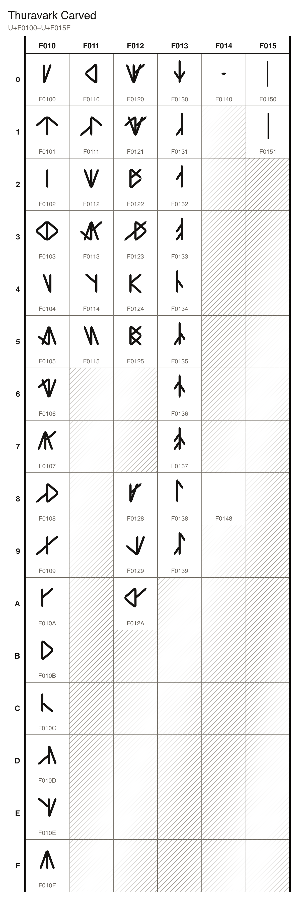

# Thuravark Carved

45 characters, U+F0100 to U+F0151, in the font `Thuravark Carved`.

## Code chart

## Characters

### Letters

| Character Name | Character | Code Point | Entity | Hex Entity |
| --- | --- | --- | --- | --- |
| THURAVARK LETTER A |  | U+F0100 | `&#983296;` | `&#xF0100;` |
| THURAVARK LETTER E |  | U+F0101 | `&#983297;` | `&#xF0101;` |
| THURAVARK LETTER I |  | U+F0102 | `&#983298;` | `&#xF0102;` |
| THURAVARK LETTER ODEL |  | U+F0103 | `&#983299;` | `&#xF0103;` |
| THURAVARK LETTER U |  | U+F0104 | `&#983300;` | `&#xF0104;` |
| THURAVARK LETTER BRELD |  | U+F0105 | `&#983301;` | `&#xF0105;` |
| THURAVARK LETTER DRESK |  | U+F0106 | `&#983302;` | `&#xF0106;` |
| THURAVARK LETTER FOSK |  | U+F0107 | `&#983303;` | `&#xF0107;` |
| THURAVARK LETTER GELDRA |  | U+F0108 | `&#983304;` | `&#xF0108;` |
| THURAVARK LETTER HVELM |  | U+F0109 | `&#983305;` | `&#xF0109;` |
| THURAVARK LETTER JA |  | U+F010A | `&#983306;` | `&#xF010A;` |
| THURAVARK LETTER KNERV |  | U+F010B | `&#983307;` | `&#xF010B;` |
| THURAVARK LETTER LA |  | U+F010C | `&#983308;` | `&#xF010C;` |
| THURAVARK LETTER MERV |  | U+F010D | `&#983309;` | `&#xF010D;` |
| THURAVARK LETTER NELTH |  | U+F010E | `&#983310;` | `&#xF010E;` |
| THURAVARK LETTER PA |  | U+F010F | `&#983311;` | `&#xF010F;` |
| THURAVARK LETTER RELTH |  | U+F0110 | `&#983312;` | `&#xF0110;` |
| THURAVARK LETTER SVELD |  | U+F0111 | `&#983313;` | `&#xF0111;` |
| THURAVARK LETTER TING |  | U+F0112 | `&#983314;` | `&#xF0112;` |
| THURAVARK LETTER VULD |  | U+F0113 | `&#983315;` | `&#xF0113;` |
| THURAVARK LETTER WA |  | U+F0114 | `&#983316;` | `&#xF0114;` |
| THURAVARK LETTER ZA |  | U+F0115 | `&#983317;` | `&#xF0115;` |

### Digraphs

| Character Name | Character | Code Point | Entity | Hex Entity |
| --- | --- | --- | --- | --- |
| THURAVARK LETTER THRESK |  | U+F0120 | `&#983328;` | `&#xF0120;` |
| THURAVARK LETTER DHA |  | U+F0121 | `&#983329;` | `&#xF0121;` |
| THURAVARK LETTER KHA |  | U+F0122 | `&#983330;` | `&#xF0122;` |
| THURAVARK LETTER GHA |  | U+F0123 | `&#983331;` | `&#xF0123;` |
| THURAVARK LETTER HLA |  | U+F0124 | `&#983332;` | `&#xF0124;` |
| THURAVARK LETTER NGA |  | U+F0125 | `&#983333;` | `&#xF0125;` |

### Diphthongs

| Character Name | Character | Code Point | Entity | Hex Entity |
| --- | --- | --- | --- | --- |
| THURAVARK LETTER AI |  | U+F0128 | `&#983336;` | `&#xF0128;` |
| THURAVARK LETTER AU |  | U+F0129 | `&#983337;` | `&#xF0129;` |
| THURAVARK LETTER OI |  | U+F012A | `&#983338;` | `&#xF012A;` |

### Digits

| Character Name | Character | Code Point | Entity | Hex Entity |
| --- | --- | --- | --- | --- |
| THURAVARK DIGIT ZERO |  | U+F0130 | `&#983344;` | `&#xF0130;` |
| THURAVARK DIGIT ONE |  | U+F0131 | `&#983345;` | `&#xF0131;` |
| THURAVARK DIGIT TWO |  | U+F0132 | `&#983346;` | `&#xF0132;` |
| THURAVARK DIGIT THREE |  | U+F0133 | `&#983347;` | `&#xF0133;` |
| THURAVARK DIGIT FOUR |  | U+F0134 | `&#983348;` | `&#xF0134;` |
| THURAVARK DIGIT FIVE |  | U+F0135 | `&#983349;` | `&#xF0135;` |
| THURAVARK DIGIT SIX |  | U+F0136 | `&#983350;` | `&#xF0136;` |
| THURAVARK DIGIT SEVEN |  | U+F0137 | `&#983351;` | `&#xF0137;` |
| THURAVARK DIGIT EIGHT |  | U+F0138 | `&#983352;` | `&#xF0138;` |
| THURAVARK DIGIT NINE |  | U+F0139 | `&#983353;` | `&#xF0139;` |

### Punctuation

| Character Name | Character | Code Point | Entity | Hex Entity |
| --- | --- | --- | --- | --- |
| THURAVARK FULL STOP |  | U+F0140 | `&#983360;` | `&#xF0140;` |

### Marks

| Character Name | Character | Code Point | Entity | Hex Entity |
| --- | --- | --- | --- | --- |
| THURAVARK ACUTE |  | U+F0148 | `&#983368;` | `&#xF0148;` |

### Controls

| Character Name | Character | Code Point | Entity | Hex Entity |
| --- | --- | --- | --- | --- |
| THURAVARK CROWN OPEN |  | U+F0150 | `&#983376;` | `&#xF0150;` |
| THURAVARK CROWN CLOSE |  | U+F0151 | `&#983377;` | `&#xF0151;` |
