# Vedyakshara Classical

49 characters, U+F0400 to U+F0451, in the font `Vedyakshara Classical`.

## Code chart

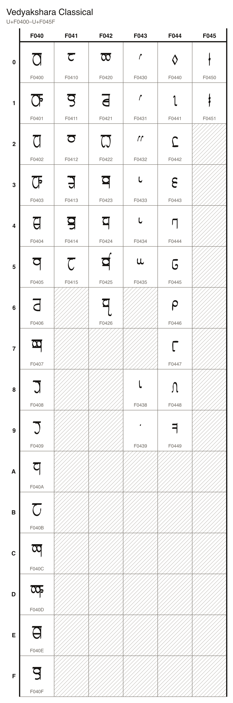

## Characters

### Letters

| Character Name | Character | Code Point | Entity | Hex Entity |
| --- | --- | --- | --- | --- |
| VEDYAKSHARA LETTER KA | 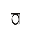 | U+F0400 | `&#984064;` | `&#xF0400;` |
| VEDYAKSHARA LETTER KHA | 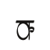 | U+F0401 | `&#984065;` | `&#xF0401;` |
| VEDYAKSHARA LETTER GA | 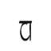 | U+F0402 | `&#984066;` | `&#xF0402;` |
| VEDYAKSHARA LETTER GHA | 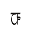 | U+F0403 | `&#984067;` | `&#xF0403;` |
| VEDYAKSHARA LETTER NGA | 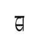 | U+F0404 | `&#984068;` | `&#xF0404;` |
| VEDYAKSHARA LETTER CHA | 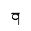 | U+F0405 | `&#984069;` | `&#xF0405;` |
| VEDYAKSHARA LETTER JA | 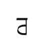 | U+F0406 | `&#984070;` | `&#xF0406;` |
| VEDYAKSHARA LETTER NYA | 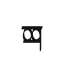 | U+F0407 | `&#984071;` | `&#xF0407;` |
| VEDYAKSHARA LETTER TA | 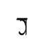 | U+F0408 | `&#984072;` | `&#xF0408;` |
| VEDYAKSHARA LETTER DA | 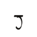 | U+F0409 | `&#984073;` | `&#xF0409;` |
| VEDYAKSHARA LETTER NA | 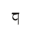 | U+F040A | `&#984074;` | `&#xF040A;` |
| VEDYAKSHARA LETTER PA | 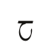 | U+F040B | `&#984075;` | `&#xF040B;` |
| VEDYAKSHARA LETTER BA | 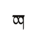 | U+F040C | `&#984076;` | `&#xF040C;` |
| VEDYAKSHARA LETTER BHA | 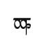 | U+F040D | `&#984077;` | `&#xF040D;` |
| VEDYAKSHARA LETTER MA | 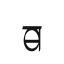 | U+F040E | `&#984078;` | `&#xF040E;` |
| VEDYAKSHARA LETTER YA | 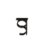 | U+F040F | `&#984079;` | `&#xF040F;` |
| VEDYAKSHARA LETTER RA | 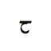 | U+F0410 | `&#984080;` | `&#xF0410;` |
| VEDYAKSHARA LETTER LA | 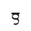 | U+F0411 | `&#984081;` | `&#xF0411;` |
| VEDYAKSHARA LETTER VA | 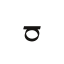 | U+F0412 | `&#984082;` | `&#xF0412;` |
| VEDYAKSHARA LETTER SHA | 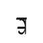 | U+F0413 | `&#984083;` | `&#xF0413;` |
| VEDYAKSHARA LETTER SA | 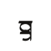 | U+F0414 | `&#984084;` | `&#xF0414;` |
| VEDYAKSHARA LETTER HA | 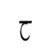 | U+F0415 | `&#984085;` | `&#xF0415;` |
| VEDYAKSHARA LETTER A | 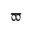 | U+F0420 | `&#984096;` | `&#xF0420;` |
| VEDYAKSHARA LETTER I | 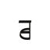 | U+F0421 | `&#984097;` | `&#xF0421;` |
| VEDYAKSHARA LETTER U | 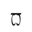 | U+F0422 | `&#984098;` | `&#xF0422;` |
| VEDYAKSHARA LETTER E | 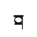 | U+F0423 | `&#984099;` | `&#xF0423;` |
| VEDYAKSHARA LETTER O | 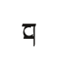 | U+F0424 | `&#984100;` | `&#xF0424;` |
| VEDYAKSHARA LETTER AI | 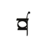 | U+F0425 | `&#984101;` | `&#xF0425;` |
| VEDYAKSHARA LETTER AU | 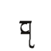 | U+F0426 | `&#984102;` | `&#xF0426;` |

### Marks

| Character Name | Character | Code Point | Entity | Hex Entity |
| --- | --- | --- | --- | --- |
| VEDYAKSHARA VOWEL SIGN I | 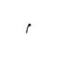 | U+F0430 | `&#984112;` | `&#xF0430;` |
| VEDYAKSHARA VOWEL SIGN E |  | U+F0431 | `&#984113;` | `&#xF0431;` |
| VEDYAKSHARA VOWEL SIGN AI | 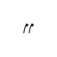 | U+F0432 | `&#984114;` | `&#xF0432;` |
| VEDYAKSHARA VOWEL SIGN U | 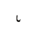 | U+F0433 | `&#984115;` | `&#xF0433;` |
| VEDYAKSHARA VOWEL SIGN O |  | U+F0434 | `&#984116;` | `&#xF0434;` |
| VEDYAKSHARA VOWEL SIGN AU | 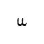 | U+F0435 | `&#984117;` | `&#xF0435;` |
| VEDYAKSHARA SIGN CUT | 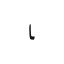 | U+F0438 | `&#984120;` | `&#xF0438;` |
| VEDYAKSHARA SIGN SOFT DOT |  | U+F0439 | `&#984121;` | `&#xF0439;` |

### Digits

| Character Name | Character | Code Point | Entity | Hex Entity |
| --- | --- | --- | --- | --- |
| VEDYAKSHARA DIGIT ZERO | 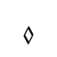 | U+F0440 | `&#984128;` | `&#xF0440;` |
| VEDYAKSHARA DIGIT ONE | 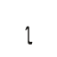 | U+F0441 | `&#984129;` | `&#xF0441;` |
| VEDYAKSHARA DIGIT TWO | 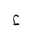 | U+F0442 | `&#984130;` | `&#xF0442;` |
| VEDYAKSHARA DIGIT THREE | 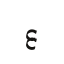 | U+F0443 | `&#984131;` | `&#xF0443;` |
| VEDYAKSHARA DIGIT FOUR | 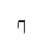 | U+F0444 | `&#984132;` | `&#xF0444;` |
| VEDYAKSHARA DIGIT FIVE | 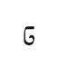 | U+F0445 | `&#984133;` | `&#xF0445;` |
| VEDYAKSHARA DIGIT SIX | 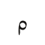 | U+F0446 | `&#984134;` | `&#xF0446;` |
| VEDYAKSHARA DIGIT SEVEN |  | U+F0447 | `&#984135;` | `&#xF0447;` |
| VEDYAKSHARA DIGIT EIGHT | 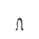 | U+F0448 | `&#984136;` | `&#xF0448;` |
| VEDYAKSHARA DIGIT NINE | 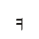 | U+F0449 | `&#984137;` | `&#xF0449;` |

### Punctuation

| Character Name | Character | Code Point | Entity | Hex Entity |
| --- | --- | --- | --- | --- |
| VEDYAKSHARA PAUSE |  | U+F0450 | `&#984144;` | `&#xF0450;` |
| VEDYAKSHARA FULL STOP | 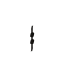 | U+F0451 | `&#984145;` | `&#xF0451;` |
