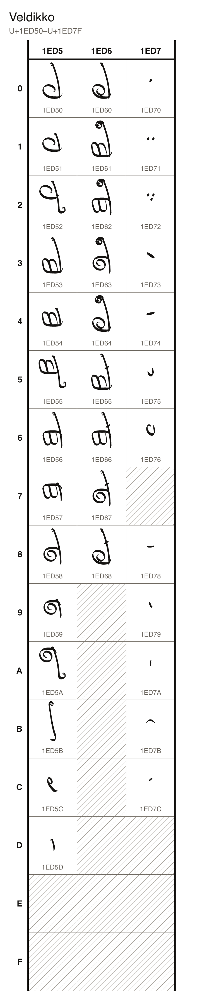
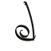
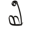
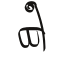
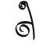
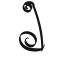
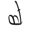
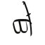
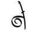
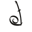

# Veldikko

35 characters, U+1ED50 to U+1ED7C, in the font `Veldikko`.

## Code chart

## Characters

### Letters

| Character Name | Character | Code Point | Entity | Hex Entity |
| --- | --- | --- | --- | --- |
| VELDIKKO LETTER P |  | U+1ED50 | `&#126288;` | `&#x1ED50;` |
| VELDIKKO LETTER V |  | U+1ED51 | `&#126289;` | `&#x1ED51;` |
| VELDIKKO LETTER M |  | U+1ED52 | `&#126290;` | `&#x1ED52;` |
| VELDIKKO LETTER T |  | U+1ED53 | `&#126291;` | `&#x1ED53;` |
| VELDIKKO LETTER S |  | U+1ED54 | `&#126292;` | `&#x1ED54;` |
| VELDIKKO LETTER N |  | U+1ED55 | `&#126293;` | `&#x1ED55;` |
| VELDIKKO LETTER D |  | U+1ED56 | `&#126294;` | `&#x1ED56;` |
| VELDIKKO LETTER DH |  | U+1ED57 | `&#126295;` | `&#x1ED57;` |
| VELDIKKO LETTER K |  | U+1ED58 | `&#126296;` | `&#x1ED58;` |
| VELDIKKO LETTER H |  | U+1ED59 | `&#126297;` | `&#x1ED59;` |
| VELDIKKO LETTER NG |  | U+1ED5A | `&#126298;` | `&#x1ED5A;` |
| VELDIKKO LETTER L |  | U+1ED5B | `&#126299;` | `&#x1ED5B;` |
| VELDIKKO LETTER R |  | U+1ED5C | `&#126300;` | `&#x1ED5C;` |
| VELDIKKO LETTER CARRIER |  | U+1ED5D | `&#126301;` | `&#x1ED5D;` |
| VELDIKKO LETTER G |  | U+1ED60 | `&#126304;` | `&#x1ED60;` |
| VELDIKKO LETTER TH |  | U+1ED61 | `&#126305;` | `&#x1ED61;` |
| VELDIKKO LETTER AELENDI DH |  | U+1ED62 | `&#126306;` | `&#x1ED62;` |
| VELDIKKO LETTER KH |  | U+1ED63 | `&#126307;` | `&#x1ED63;` |
| VELDIKKO LETTER GH |  | U+1ED64 | `&#126308;` | `&#x1ED64;` |
| VELDIKKO LETTER T EJECTIVE |  | U+1ED65 | `&#126309;` | `&#x1ED65;` |
| VELDIKKO LETTER D EJECTIVE |  | U+1ED66 | `&#126310;` | `&#x1ED66;` |
| VELDIKKO LETTER K EJECTIVE |  | U+1ED67 | `&#126311;` | `&#x1ED67;` |
| VELDIKKO LETTER G EJECTIVE |  | U+1ED68 | `&#126312;` | `&#x1ED68;` |

### Marks

| Character Name | Character | Code Point | Entity | Hex Entity |
| --- | --- | --- | --- | --- |
| VELDIKKO VOWEL SIGN A |  | U+1ED70 | `&#126320;` | `&#x1ED70;` |
| VELDIKKO VOWEL SIGN O |  | U+1ED71 | `&#126321;` | `&#x1ED71;` |
| VELDIKKO VOWEL SIGN U |  | U+1ED72 | `&#126322;` | `&#x1ED72;` |
| VELDIKKO VOWEL SIGN E |  | U+1ED73 | `&#126323;` | `&#x1ED73;` |
| VELDIKKO VOWEL SIGN I |  | U+1ED74 | `&#126324;` | `&#x1ED74;` |
| VELDIKKO VOWEL SIGN Y |  | U+1ED75 | `&#126325;` | `&#x1ED75;` |
| VELDIKKO VOWEL SIGN E WITH DIAERESIS |  | U+1ED76 | `&#126326;` | `&#x1ED76;` |
| VELDIKKO SIGN LONG |  | U+1ED78 | `&#126328;` | `&#x1ED78;` |
| VELDIKKO SIGN RISE |  | U+1ED79 | `&#126329;` | `&#x1ED79;` |
| VELDIKKO SIGN FALL |  | U+1ED7A | `&#126330;` | `&#x1ED7A;` |
| VELDIKKO SIGN EMPHASIS |  | U+1ED7B | `&#126331;` | `&#x1ED7B;` |
| VELDIKKO SIGN DOUBLING BAR |  | U+1ED7C | `&#126332;` | `&#x1ED7C;` |
