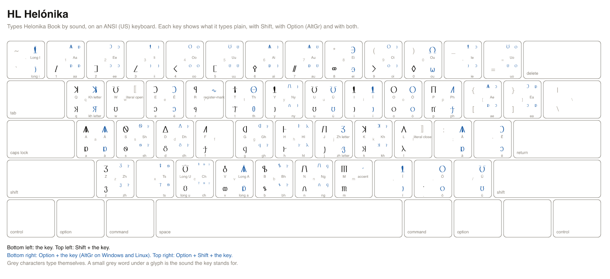

# HL Helónika cheatsheet

HL Helónika types Helonika Book by sound. It is a US keyboard that writes the Helónika script: the key for a sound types that sound's Helónika character, so `t` types the script's t and Option+T types its th, and Shift makes a capital. You type the sounds of a word one after another, as you would in English.

A printable copy is [helonika.svg](helonika.svg) and [helonika.png](helonika.png).

## Reading the keys

- `t` is the key alone. `shift+t` is Shift and the key.
- `option+t` is Option and the key on a Mac, and AltGr and the key on Windows and Linux. AltGr is the right Alt key (on a keyboard without one, hold Ctrl and Alt together). `option+shift+t` adds Shift.
- The Sound column is the roman spelling of the sound a key stands for. A key marked _nothing_ types nothing in this script.
- Character names and code points identify each character exactly, for a program or a character viewer.
- The Emacs column is what to type in the Emacs input method `heroiclands-helonika`, where Option is a backslash.

## Installing the layout

The layout is a file per platform, named below. [The README](../README.md#installing-a-keyboard-layout) walks through installing each.

- macOS: `keyboards/macos/HeroicLands.bundle`, input source **HL Helónika**.
- Windows: `keyboards/windows/helonika.klc`, the Microsoft Keyboard Layout Creator source of **HL Helónika**.
- Linux: `keyboards/linux/hl_helonika`, the XKB symbols of **HL Helónika**.
- Emacs: `keyboards/emacs/heroiclands-helonika.el`, the input method `heroiclands-helonika`.

## Signs

These keys type no sound. They type in HL Helónika alone.

| Key | Emacs | Sign | Layout | Glyph | Code point | Name |
| --- | --- | --- | --- | --- | --- | --- |
| `option+shift+r` | `\R` | register-mark | HL Helónika |  | U+F0371 | HELONIKA REGISTER MARK |
| `option+q` | `\q` | kh letter | HL Helónika |  | U+F0348 | HELONIKA SMALL LETTER KH |
| `option+shift+q` | `\Q` | Kh letter | HL Helónika |  | U+F0318 | HELONIKA CAPITAL LETTER KH |
| `option+j` | `\j` | zh letter | HL Helónika |  | U+F0349 | HELONIKA SMALL LETTER ZH |
| `option+shift+j` | `\J` | Zh letter | HL Helónika |  | U+F0319 | HELONIKA CAPITAL LETTER ZH |
| `option+v` | `\v` | long a | HL Helónika |  | U+F0350 | HELONIKA SMALL LETTER A WITH LENGTH BAR |
| `option+shift+v` | `\V` | Long A | HL Helónika |  | U+F0320 | HELONIKA CAPITAL LETTER A WITH LENGTH BAR |
| `` option+` `` | `` \` `` | long i | HL Helónika |  | U+F0351 | HELONIKA SMALL LETTER I WITH LENGTH BAR |
| `` option+shift+` `` | `\~` | Long I | HL Helónika |  | U+F0321 | HELONIKA CAPITAL LETTER I WITH LENGTH BAR |
| `c` | `c` | long u | HL Helónika |  | U+F0352 | HELONIKA SMALL LETTER U WITH LENGTH BAR |
| `shift+c` | `C` | Long U | HL Helónika |  | U+F0322 | HELONIKA CAPITAL LETTER U WITH LENGTH BAR |
| `option+shift+m` | `\M` | accent | HL Helónika |  | U+F0378 | HELONIKA COMBINING ACCENT |
| `option+shift+w` | `\W` | literal open | HL Helónika | ⟦ | U+27E6 | LEFT WHITE SQUARE BRACKET |
| `option+shift+l` | `\L` | literal close | HL Helónika | ⟧ | U+27E7 | RIGHT WHITE SQUARE BRACKET |

## Keys a platform cannot carry

A Windows key holds at most four UTF-16 code units and a Linux key one character, so a sound this script spells with more types nothing there. macOS and Emacs carry every key.

| Key | Sound | Script | Platform | Why |
| --- | --- | --- | --- | --- |
| `option+c` | `ch` | Helónika | Windows | 6 UTF-16 code units; an MSKLC ligature holds 4 |
| `option+c` | `ch` | Helónika | Linux | 3 code points; an XKB key types one |
| `option+shift+c` | `Ch` | Helónika | Windows | 6 UTF-16 code units; an MSKLC ligature holds 4 |
| `option+shift+c` | `Ch` | Helónika | Linux | 3 code points; an XKB key types one |
| `option+s` | `sh` | Helónika | Linux | 2 code points; an XKB key types one |
| `option+shift+s` | `Sh` | Helónika | Linux | 2 code points; an XKB key types one |
| `option+d` | `dh` | Helónika | Linux | 2 code points; an XKB key types one |
| `option+shift+d` | `Dh` | Helónika | Linux | 2 code points; an XKB key types one |
| `option+k` | `kh` | Helónika | Linux | 2 code points; an XKB key types one |
| `option+shift+k` | `Kh` | Helónika | Linux | 2 code points; an XKB key types one |
| `option+g` | `gh` | Helónika | Linux | 2 code points; an XKB key types one |
| `option+shift+g` | `Gh` | Helónika | Linux | 2 code points; an XKB key types one |
| `option+z` | `zh` | Helónika | Linux | 2 code points; an XKB key types one |
| `option+shift+z` | `Zh` | Helónika | Linux | 2 code points; an XKB key types one |
| `option+n` | `ng` | Helónika | Linux | 2 code points; an XKB key types one |
| `option+shift+n` | `Ng` | Helónika | Linux | 2 code points; an XKB key types one |
| `option+y` | `ny` | Helónika | Linux | 2 code points; an XKB key types one |
| `option+shift+y` | `Ny` | Helónika | Linux | 2 code points; an XKB key types one |
| `option+x` | `ts` | Helónika | Linux | 2 code points; an XKB key types one |
| `option+shift+x` | `Ts` | Helónika | Linux | 2 code points; an XKB key types one |
| `option+h` | `hl` | Helónika | Linux | 2 code points; an XKB key types one |
| `option+shift+h` | `Hl` | Helónika | Linux | 2 code points; an XKB key types one |
| `option+b` | `bh` | Helónika | Linux | 2 code points; an XKB key types one |
| `option+shift+b` | `Bh` | Helónika | Linux | 2 code points; an XKB key types one |
| `option+1` | `aa` | Helónika | Linux | 2 code points; an XKB key types one |
| `option+shift+1` | `Aa` | Helónika | Linux | 2 code points; an XKB key types one |
| `option+2` | `ee` | Helónika | Linux | 2 code points; an XKB key types one |
| `option+shift+2` | `Ee` | Helónika | Linux | 2 code points; an XKB key types one |
| `option+3` | `ii` | Helónika | Linux | 2 code points; an XKB key types one |
| `option+shift+3` | `Ii` | Helónika | Linux | 2 code points; an XKB key types one |
| `option+4` | `oo` | Helónika | Linux | 2 code points; an XKB key types one |
| `option+shift+4` | `Oo` | Helónika | Linux | 2 code points; an XKB key types one |
| `option+5` | `uu` | Helónika | Linux | 2 code points; an XKB key types one |
| `option+shift+5` | `Uu` | Helónika | Linux | 2 code points; an XKB key types one |
| `option+6` | `ai` | Helónika | Linux | 2 code points; an XKB key types one |
| `option+shift+6` | `Ai` | Helónika | Linux | 2 code points; an XKB key types one |
| `option+7` | `au` | Helónika | Linux | 2 code points; an XKB key types one |
| `option+shift+7` | `Au` | Helónika | Linux | 2 code points; an XKB key types one |
| `option+9` | `oi` | Helónika | Linux | 2 code points; an XKB key types one |
| `option+shift+9` | `Oi` | Helónika | Linux | 2 code points; an XKB key types one |
| `option+-` | `ie` | Helónika | Linux | 2 code points; an XKB key types one |
| `option+shift+-` | `Ie` | Helónika | Linux | 2 code points; an XKB key types one |
| `option+=` | `uo` | Helónika | Linux | 2 code points; an XKB key types one |
| `option+shift+=` | `Uo` | Helónika | Linux | 2 code points; an XKB key types one |
| `option+[` | `ae` | Helónika | Linux | 2 code points; an XKB key types one |
| `option+shift+[` | `Ae` | Helónika | Linux | 2 code points; an XKB key types one |
| `option+]` | `ea` | Helónika | Linux | 2 code points; an XKB key types one |
| `option+shift+]` | `Ea` | Helónika | Linux | 2 code points; an XKB key types one |

## Markup

These keys type themselves, as plain ASCII, in every layout, so Markdown and similar markup are written without switching layouts.

| Key | Types |
| --- | --- |
| `shift+8` | `*` |
| `shift+-` | `_` |
| `[` | `[` |
| `]` | `]` |
| `shift+[` | `{` |
| `shift+]` | `}` |
| `shift+9` | `(` |
| `shift+0` | `)` |
| `=` | `=` |
| `shift+;` | `:` |
| `shift+\` | `\|` |
| `\` | `\` |
| `` shift+` `` | `~` |
| `` ` `` | `` ` `` |

## Keys

Every sound key, in keyboard order. Example: `t` types the sound `t`.

| Key | Glyphs | Code points | Names | Sound | Emacs |
| --- | --- | --- | --- | --- | --- |
| `a` |  | U+F0330 | HELONIKA SMALL LETTER A | `a` | `a` |
| `shift+a` |  | U+F0300 | HELONIKA CAPITAL LETTER A | `A` | `A` |
| `b` |  | U+F0331 | HELONIKA SMALL LETTER B | `b` | `b` |
| `shift+b` |  | U+F0301 | HELONIKA CAPITAL LETTER B | `B` | `B` |
| `d` |  | U+F0332 | HELONIKA SMALL LETTER D | `d` | `d` |
| `shift+d` |  | U+F0302 | HELONIKA CAPITAL LETTER D | `D` | `D` |
| `e` |  | U+F0333 | HELONIKA SMALL LETTER E | `e` | `e` |
| `shift+e` |  | U+F0303 | HELONIKA CAPITAL LETTER E | `E` | `E` |
| `f` |  | U+F0335 | HELONIKA SMALL LETTER F | `f` | `f` |
| `shift+f` |  | U+F0305 | HELONIKA CAPITAL LETTER F | `F` | `F` |
| `g` |  | U+F0336 | HELONIKA SMALL LETTER G | `g` | `g` |
| `shift+g` |  | U+F0306 | HELONIKA CAPITAL LETTER G | `G` | `G` |
| `h` |  | U+F0337 | HELONIKA SMALL LETTER H | `h` | `h` |
| `shift+h` |  | U+F0307 | HELONIKA CAPITAL LETTER H | `H` | `H` |
| `i` |  | U+F0338 | HELONIKA SMALL LETTER I | `i` | `i` |
| `shift+i` |  | U+F0308 | HELONIKA CAPITAL LETTER I | `I` | `I` |
| `j` |  | U+F0339 | HELONIKA SMALL LETTER J | `j` | `j` |
| `shift+j` |  | U+F0309 | HELONIKA CAPITAL LETTER J | `J` | `J` |
| `k` |  | U+F033A | HELONIKA SMALL LETTER K | `k` | `k` |
| `shift+k` |  | U+F030A | HELONIKA CAPITAL LETTER K | `K` | `K` |
| `l` |  | U+F033B | HELONIKA SMALL LETTER L | `l` | `l` |
| `shift+l` |  | U+F030B | HELONIKA CAPITAL LETTER L | `L` | `L` |
| `m` |  | U+F033C | HELONIKA SMALL LETTER M | `m` | `m` |
| `shift+m` |  | U+F030C | HELONIKA CAPITAL LETTER M | `M` | `M` |
| `n` |  | U+F033D | HELONIKA SMALL LETTER N | `n` | `n` |
| `shift+n` |  | U+F030D | HELONIKA CAPITAL LETTER N | `N` | `N` |
| `o` |  | U+F033E | HELONIKA SMALL LETTER O | `o` | `o` |
| `shift+o` |  | U+F030E | HELONIKA CAPITAL LETTER O | `O` | `O` |
| `p` |  | U+F0340 | HELONIKA SMALL LETTER P | `p` | `p` |
| `shift+p` |  | U+F0310 | HELONIKA CAPITAL LETTER P | `P` | `P` |
| `q` |  | U+F033A | HELONIKA SMALL LETTER K | `q` | `q` |
| `shift+q` |  | U+F030A | HELONIKA CAPITAL LETTER K | `Q` | `Q` |
| `r` |  | U+F0341 | HELONIKA SMALL LETTER R | `r` | `r` |
| `shift+r` |  | U+F0311 | HELONIKA CAPITAL LETTER R | `R` | `R` |
| `s` |  | U+F0342 | HELONIKA SMALL LETTER S | `s` | `s` |
| `shift+s` |  | U+F0312 | HELONIKA CAPITAL LETTER S | `S` | `S` |
| `t` |  | U+F0343 | HELONIKA SMALL LETTER T | `t` | `t` |
| `shift+t` |  | U+F0313 | HELONIKA CAPITAL LETTER T | `T` | `T` |
| `u` |  | U+F0345 | HELONIKA SMALL LETTER U | `u` | `u` |
| `shift+u` |  | U+F0315 | HELONIKA CAPITAL LETTER U | `U` | `U` |
| `v` |  | U+F0346 | HELONIKA SMALL LETTER V | `v` | `v` |
| `shift+v` |  | U+F0316 | HELONIKA CAPITAL LETTER V | `V` | `V` |
| `w` |  | U+F0345 | HELONIKA SMALL LETTER U | `w` | `w` |
| `shift+w` |  | U+F0315 | HELONIKA CAPITAL LETTER U | `W` | `W` |
| `y` |  | U+F0338 | HELONIKA SMALL LETTER I | `y` | `y` |
| `shift+y` |  | U+F0308 | HELONIKA CAPITAL LETTER I | `Y` | `Y` |
| `z` |  | U+F0347 | HELONIKA SMALL LETTER Z | `z` | `z` |
| `shift+z` |  | U+F0317 | HELONIKA CAPITAL LETTER Z | `Z` | `Z` |
| `option+c` |    | U+F0343 U+F0342 U+F0337 | HELONIKA SMALL LETTER T; HELONIKA SMALL LETTER S; HELONIKA SMALL LETTER H | `ch` | `\c` |
| `option+shift+c` |    | U+F0313 U+F0342 U+F0337 | HELONIKA CAPITAL LETTER T; HELONIKA SMALL LETTER S; HELONIKA SMALL LETTER H | `Ch` | `\C` |
| `option+s` |   | U+F0342 U+F0337 | HELONIKA SMALL LETTER S; HELONIKA SMALL LETTER H | `sh` | `\s` |
| `option+shift+s` |   | U+F0312 U+F0337 | HELONIKA CAPITAL LETTER S; HELONIKA SMALL LETTER H | `Sh` | `\S` |
| `option+t` |  | U+F0344 | HELONIKA SMALL LETTER TH | `th` | `\t` |
| `option+shift+t` |  | U+F0314 | HELONIKA CAPITAL LETTER TH | `Th` | `\T` |
| `option+d` |   | U+F0332 U+F0337 | HELONIKA SMALL LETTER D; HELONIKA SMALL LETTER H | `dh` | `\d` |
| `option+shift+d` |   | U+F0302 U+F0337 | HELONIKA CAPITAL LETTER D; HELONIKA SMALL LETTER H | `Dh` | `\D` |
| `option+k` |   | U+F033A U+F0337 | HELONIKA SMALL LETTER K; HELONIKA SMALL LETTER H | `kh` | `\k` |
| `option+shift+k` |   | U+F030A U+F0337 | HELONIKA CAPITAL LETTER K; HELONIKA SMALL LETTER H | `Kh` | `\K` |
| `option+g` |   | U+F0336 U+F0337 | HELONIKA SMALL LETTER G; HELONIKA SMALL LETTER H | `gh` | `\g` |
| `option+shift+g` |   | U+F0306 U+F0337 | HELONIKA CAPITAL LETTER G; HELONIKA SMALL LETTER H | `Gh` | `\G` |
| `option+z` |   | U+F0347 U+F0337 | HELONIKA SMALL LETTER Z; HELONIKA SMALL LETTER H | `zh` | `\z` |
| `option+shift+z` |   | U+F0317 U+F0337 | HELONIKA CAPITAL LETTER Z; HELONIKA SMALL LETTER H | `Zh` | `\Z` |
| `option+p` |  | U+F0335 | HELONIKA SMALL LETTER F | `ph` | `\p` |
| `option+shift+p` |  | U+F0305 | HELONIKA CAPITAL LETTER F | `Ph` | `\P` |
| `option+n` |   | U+F033D U+F0336 | HELONIKA SMALL LETTER N; HELONIKA SMALL LETTER G | `ng` | `\n` |
| `option+shift+n` |   | U+F030D U+F0336 | HELONIKA CAPITAL LETTER N; HELONIKA SMALL LETTER G | `Ng` | `\N` |
| `option+y` |   | U+F033D U+F0338 | HELONIKA SMALL LETTER N; HELONIKA SMALL LETTER I | `ny` | `\y` |
| `option+shift+y` |   | U+F030D U+F0338 | HELONIKA CAPITAL LETTER N; HELONIKA SMALL LETTER I | `Ny` | `\Y` |
| `option+x` |   | U+F0343 U+F0342 | HELONIKA SMALL LETTER T; HELONIKA SMALL LETTER S | `ts` | `\x` |
| `option+shift+x` |   | U+F0313 U+F0342 | HELONIKA CAPITAL LETTER T; HELONIKA SMALL LETTER S | `Ts` | `\X` |
| `option+h` |   | U+F0337 U+F033B | HELONIKA SMALL LETTER H; HELONIKA SMALL LETTER L | `hl` | `\h` |
| `option+shift+h` |   | U+F0307 U+F033B | HELONIKA CAPITAL LETTER H; HELONIKA SMALL LETTER L | `Hl` | `\H` |
| `option+b` |   | U+F0331 U+F0337 | HELONIKA SMALL LETTER B; HELONIKA SMALL LETTER H | `bh` | `\b` |
| `option+shift+b` |   | U+F0301 U+F0337 | HELONIKA CAPITAL LETTER B; HELONIKA SMALL LETTER H | `Bh` | `\B` |
| `option+1` |   | U+F0330 U+F0330 | HELONIKA SMALL LETTER A; HELONIKA SMALL LETTER A | `aa` | `\1` |
| `option+shift+1` |   | U+F0300 U+F0330 | HELONIKA CAPITAL LETTER A; HELONIKA SMALL LETTER A | `Aa` | `\!` |
| `option+2` |   | U+F0333 U+F0333 | HELONIKA SMALL LETTER E; HELONIKA SMALL LETTER E | `ee` | `\2` |
| `option+shift+2` |   | U+F0303 U+F0333 | HELONIKA CAPITAL LETTER E; HELONIKA SMALL LETTER E | `Ee` | `\@` |
| `option+3` |   | U+F0338 U+F0338 | HELONIKA SMALL LETTER I; HELONIKA SMALL LETTER I | `ii` | `\3` |
| `option+shift+3` |   | U+F0308 U+F0338 | HELONIKA CAPITAL LETTER I; HELONIKA SMALL LETTER I | `Ii` | `\#` |
| `option+4` |   | U+F033E U+F033E | HELONIKA SMALL LETTER O; HELONIKA SMALL LETTER O | `oo` | `\4` |
| `option+shift+4` |   | U+F030E U+F033E | HELONIKA CAPITAL LETTER O; HELONIKA SMALL LETTER O | `Oo` | `\$` |
| `option+5` |   | U+F0345 U+F0345 | HELONIKA SMALL LETTER U; HELONIKA SMALL LETTER U | `uu` | `\5` |
| `option+shift+5` |   | U+F0315 U+F0345 | HELONIKA CAPITAL LETTER U; HELONIKA SMALL LETTER U | `Uu` | `\%` |
| `option+6` |   | U+F0330 U+F0338 | HELONIKA SMALL LETTER A; HELONIKA SMALL LETTER I | `ai` | `\6` |
| `option+shift+6` |   | U+F0300 U+F0338 | HELONIKA CAPITAL LETTER A; HELONIKA SMALL LETTER I | `Ai` | `\^` |
| `option+7` |   | U+F0330 U+F0345 | HELONIKA SMALL LETTER A; HELONIKA SMALL LETTER U | `au` | `\7` |
| `option+shift+7` |   | U+F0300 U+F0345 | HELONIKA CAPITAL LETTER A; HELONIKA SMALL LETTER U | `Au` | `\&` |
| `option+8` |  | U+F0334 | HELONIKA SMALL LETTER LONG E | `ei` | `\8` |
| `option+shift+8` |  | U+F0304 | HELONIKA CAPITAL LETTER LONG E | `Ei` | `\*` |
| `option+9` |   | U+F033E U+F0338 | HELONIKA SMALL LETTER O; HELONIKA SMALL LETTER I | `oi` | `\9` |
| `option+shift+9` |   | U+F030E U+F0338 | HELONIKA CAPITAL LETTER O; HELONIKA SMALL LETTER I | `Oi` | `\(` |
| `option+0` |  | U+F033F | HELONIKA SMALL LETTER LONG O | `ou` | `\0` |
| `option+shift+0` |  | U+F030F | HELONIKA CAPITAL LETTER LONG O | `Ou` | `\)` |
| `option+-` |   | U+F0338 U+F0333 | HELONIKA SMALL LETTER I; HELONIKA SMALL LETTER E | `ie` | `\-` |
| `option+shift+-` |   | U+F0308 U+F0333 | HELONIKA CAPITAL LETTER I; HELONIKA SMALL LETTER E | `Ie` | `\_` |
| `option+=` |   | U+F0345 U+F033E | HELONIKA SMALL LETTER U; HELONIKA SMALL LETTER O | `uo` | `\=` |
| `option+shift+=` |   | U+F0315 U+F033E | HELONIKA CAPITAL LETTER U; HELONIKA SMALL LETTER O | `Uo` | `\+` |
| `option+[` |   | U+F0330 U+F0333 | HELONIKA SMALL LETTER A; HELONIKA SMALL LETTER E | `ae` | `\[` |
| `option+shift+[` |   | U+F0300 U+F0333 | HELONIKA CAPITAL LETTER A; HELONIKA SMALL LETTER E | `Ae` | `\{` |
| `option+]` |   | U+F0333 U+F0330 | HELONIKA SMALL LETTER E; HELONIKA SMALL LETTER A | `ea` | `\]` |
| `option+shift+]` |   | U+F0303 U+F0330 | HELONIKA CAPITAL LETTER E; HELONIKA SMALL LETTER A | `Ea` | `\}` |
| `option+a` |  | U+F0330 | HELONIKA SMALL LETTER A | `á` | `\a` |
| `option+shift+a` |  | U+F0300 | HELONIKA CAPITAL LETTER A | `Á` | `\A` |
| `option+e` |  | U+F0333 | HELONIKA SMALL LETTER E | `é` | `\e` |
| `option+shift+e` |  | U+F0303 | HELONIKA CAPITAL LETTER E | `É` | `\E` |
| `option+i` |  | U+F0338 | HELONIKA SMALL LETTER I | `í` | `\i` |
| `option+shift+i` |  | U+F0308 | HELONIKA CAPITAL LETTER I | `Í` | `\I` |
| `option+o` |  | U+F033E | HELONIKA SMALL LETTER O | `ó` | `\o` |
| `option+shift+o` |  | U+F030E | HELONIKA CAPITAL LETTER O | `Ó` | `\O` |
| `option+u` |  | U+F0345 | HELONIKA SMALL LETTER U | `ú` | `\u` |
| `option+shift+u` |  | U+F0315 | HELONIKA CAPITAL LETTER U | `Ú` | `\U` |
| `option+;` |  | U+F0330 | HELONIKA SMALL LETTER A | `ä` | `\;` |
| `option+shift+;` |  | U+F0300 | HELONIKA CAPITAL LETTER A | `Ä` | `\:` |
| `option+'` |  | U+F0333 | HELONIKA SMALL LETTER E | `ë` | `\'` |
| `option+shift+'` |  | U+F0303 | HELONIKA CAPITAL LETTER E | `Ë` | `\"` |
| `option+,` |  | U+F0338 | HELONIKA SMALL LETTER I | `ï` | `\,` |
| `option+shift+,` |  | U+F0308 | HELONIKA CAPITAL LETTER I | `Ï` | `\<` |
| `option+.` |  | U+F033E | HELONIKA SMALL LETTER O | `ö` | `\.` |
| `option+shift+.` |  | U+F030E | HELONIKA CAPITAL LETTER O | `Ö` | `\>` |
| `option+/` |  | U+F0345 | HELONIKA SMALL LETTER U | `ü` | `\/` |
| `option+shift+/` |  | U+F0315 | HELONIKA CAPITAL LETTER U | `Ü` | `\?` |
| `'` |  | nothing: this script has no character for the sound |  | `catch` | `'` |
| `.` |  | U+F0370 | HELONIKA RAISED DOT | `stop` | `.` |
| `,` |  | nothing: this script has no character for the sound |  | `pause` | `,` |
| `shift+,` |  | nothing: this script has no character for the sound |  | `open quote` | `<` |
| `shift+.` |  | nothing: this script has no character for the sound |  | `close quote` | `>` |
| `0` |  | U+F0360 | HELONIKA DIGIT ZERO | `0` | `0` |
| `1` |  | U+F0361 | HELONIKA DIGIT ONE | `1` | `1` |
| `2` |  | U+F0362 | HELONIKA DIGIT TWO | `2` | `2` |
| `3` |  | U+F0363 | HELONIKA DIGIT THREE | `3` | `3` |
| `4` |  | U+F0364 | HELONIKA DIGIT FOUR | `4` | `4` |
| `5` |  | U+F0365 | HELONIKA DIGIT FIVE | `5` | `5` |
| `6` |  | U+F0366 | HELONIKA DIGIT SIX | `6` | `6` |
| `7` |  | U+F0367 | HELONIKA DIGIT SEVEN | `7` | `7` |
| `8` |  | U+F0368 | HELONIKA DIGIT EIGHT | `8` | `8` |
| `9` |  | U+F0369 | HELONIKA DIGIT NINE | `9` | `9` |
| `shift+2` |  | nothing: this script has no character for the sound |  | `ten` | `@` |
| `shift+3` |  | nothing: this script has no character for the sound |  | `eleven` | `#` |
| `shift+4` |  | nothing: this script has no character for the sound |  | `twelve` | `$` |
| `shift+5` |  | nothing: this script has no character for the sound |  | `thirteen` | `%` |
| `shift+6` |  | nothing: this script has no character for the sound |  | `fourteen` | `^` |
| `shift+7` |  | nothing: this script has no character for the sound |  | `fifteen` | `&` |
