# Sound keys

HL Semaron, HL Pirzath, HL Thuravark and HL Qalezu type by sound. Every sound of the spelling guide, _Pronouncing Thalorna_, sits on one key or chord, the same in every script, and the key types that script's own characters for the sound, as many as its mapping note spells it with. A key whose sound a script does not write types nothing in that script, and no key types a roman letter, apart from the keys of markup, which type themselves. The README's "Typing in the fonts" says how to install the layouts.

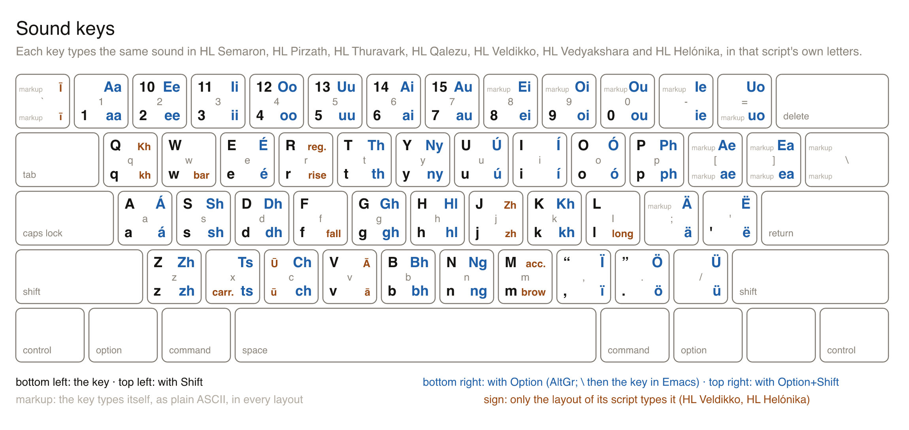

## The key map

- Each sound of the spelling guide, Pronouncing Thalorna, sits on one key or chord, the same in every script, and no key or chord carries two sounds. tools/sounds.mjs runs each sound's spelling through every script's mapping note into keyboards/sounds.json, and each layout types that output, or nothing where the mapping cannot spell the sound.
- A single letter sits on its own roman key. c and x are not letters of the guide, so their plain keys carry nothing.
- A capital sits on Shift and the key of its small sound: Shift+A is A, Option+Shift+T is Th. A pair's capital is written with its first letter capital (Ch, Ai), the form a word starts with.
- A consonant pair sits on Option and its first letter: Option+T th, Option+C ch. Where two pairs share a first letter, the second is a mnemonic: ny on Option+Y, its second letter, and ts on Option+X, the cluster letter the guide never writes.
- An acute vowel sits on Option and its vowel, as Option+E types the acute on a Mac and AltGr and a vowel types it on Windows' US-International layout.
- The long vowels sit on Option and the digits 1 to 5, in the order a e i o u: Option+1 aa, Option+5 uu. The other vowel pairs follow in the guide's order on Option and the keys after them: 6 ai, 7 au, 8 ei, 9 oi, 0 ou, - ie, = uo, [ ae, ] ea. A vowel key's Option holds its acute, so the pairs cannot sit on their first vowel.
- A diaeresis vowel sits on Option and the punctuation keys right of L and M, in the order a e i o u: ; ä, ' ë, , ï, . ö, / ü.
- The catch sits on ', the stop on ., the pause on , and the open and close quotes on Shift+, and Shift+., the keys of < and >. Only Pirzath writes quotation marks, so those two keys type nothing in the other scripts.
- Digits sit on the digit row. Pirzath counts in sixteens, and its numerals ten to fifteen sit on Shift+2 to Shift+7, the keys of @ # $ % ^ &, the characters its mapping spells them with.
- A vowel sound, and y, is spelled inside a word: a vowel between two t's, and y before an a, where it is the glide. That is how the sound itself is written, as against a vowel at the start of a word in Qalezu, which is the catch, or y as the vowel i, which the i key types.
- Markup types itself. The characters Markdown and a span's [text]{font=…} need sit at their U.S. positions and type plain ASCII in every layout, so a note's markup is written without switching layouts, and no script draws it. No sound shares a key with markup; # is not markup because Shift+3 is Pirzath's eleven.
- Control chords and function keys carry nothing: the four layers above hold every sound, and no platform types reliably from them.

## Markup

The characters of Markdown and of a span, `[text]{font=…}`, type themselves, as plain ASCII, in every layout on every platform, so a note's markup is written without switching layouts. In Emacs a backslash is typed twice, because a single backslash is the Option prefix.

| Key | Emacs | Types |
| --- | --- | --- |
| `shift+8` | `*` | `*` |
| `shift+-` | `_` | `_` |
| `[` | `[` | `[` |
| `]` | `]` | `]` |
| `shift+[` | `{` | `{` |
| `shift+]` | `}` | `}` |
| `shift+9` | `(` | `(` |
| `shift+0` | `)` | `)` |
| `=` | `=` | `=` |
| `shift+;` | `:` | `:` |
| `shift+\` | `\|` | `\|` |
| `\` | `\\` | `\` |
| `` shift+` `` | `~` | `~` |
| `` ` `` | `` ` `` | `` ` `` |

## Keys a platform cannot carry

Where a platform cannot type a sound's output from one key, the key types nothing on that platform alone.

| Key | Sound | Script | Platform | Why |
| --- | --- | --- | --- | --- |
| `option+c` | `ch` | Semaron | Windows | 6 UTF-16 code units; an MSKLC ligature holds 4 |
| `option+c` | `ch` | Semaron | Linux | 3 code points; an XKB key types one |
| `option+shift+c` | `Ch` | Semaron | Windows | 6 UTF-16 code units; an MSKLC ligature holds 4 |
| `option+shift+c` | `Ch` | Semaron | Linux | 3 code points; an XKB key types one |
| `option+s` | `sh` | Semaron | Linux | 2 code points; an XKB key types one |
| `option+shift+s` | `Sh` | Semaron | Linux | 2 code points; an XKB key types one |
| `option+d` | `dh` | Semaron | Linux | 2 code points; an XKB key types one |
| `option+shift+d` | `Dh` | Semaron | Linux | 2 code points; an XKB key types one |
| `option+k` | `kh` | Semaron | Linux | 2 code points; an XKB key types one |
| `option+shift+k` | `Kh` | Semaron | Linux | 2 code points; an XKB key types one |
| `option+g` | `gh` | Semaron | Linux | 2 code points; an XKB key types one |
| `option+shift+g` | `Gh` | Semaron | Linux | 2 code points; an XKB key types one |
| `option+z` | `zh` | Semaron | Linux | 2 code points; an XKB key types one |
| `option+shift+z` | `Zh` | Semaron | Linux | 2 code points; an XKB key types one |
| `option+p` | `ph` | Semaron | Linux | 2 code points; an XKB key types one |
| `option+shift+p` | `Ph` | Semaron | Linux | 2 code points; an XKB key types one |
| `option+n` | `ng` | Semaron | Linux | 2 code points; an XKB key types one |
| `option+shift+n` | `Ng` | Semaron | Linux | 2 code points; an XKB key types one |
| `option+y` | `ny` | Semaron | Linux | 2 code points; an XKB key types one |
| `option+shift+y` | `Ny` | Semaron | Linux | 2 code points; an XKB key types one |
| `option+x` | `ts` | Semaron | Linux | 2 code points; an XKB key types one |
| `option+shift+x` | `Ts` | Semaron | Linux | 2 code points; an XKB key types one |
| `option+h` | `hl` | Semaron | Linux | 2 code points; an XKB key types one |
| `option+shift+h` | `Hl` | Semaron | Linux | 2 code points; an XKB key types one |
| `option+b` | `bh` | Semaron | Linux | 2 code points; an XKB key types one |
| `option+shift+b` | `Bh` | Semaron | Linux | 2 code points; an XKB key types one |
| `option+2` | `ee` | Semaron | Linux | 2 code points; an XKB key types one |
| `option+shift+2` | `Ee` | Semaron | Linux | 2 code points; an XKB key types one |
| `option+4` | `oo` | Semaron | Linux | 2 code points; an XKB key types one |
| `option+shift+4` | `Oo` | Semaron | Linux | 2 code points; an XKB key types one |
| `option+6` | `ai` | Semaron | Linux | 2 code points; an XKB key types one |
| `option+shift+6` | `Ai` | Semaron | Linux | 2 code points; an XKB key types one |
| `option+7` | `au` | Semaron | Linux | 2 code points; an XKB key types one |
| `option+shift+7` | `Au` | Semaron | Linux | 2 code points; an XKB key types one |
| `option+8` | `ei` | Semaron | Linux | 2 code points; an XKB key types one |
| `option+shift+8` | `Ei` | Semaron | Linux | 2 code points; an XKB key types one |
| `option+9` | `oi` | Semaron | Linux | 2 code points; an XKB key types one |
| `option+shift+9` | `Oi` | Semaron | Linux | 2 code points; an XKB key types one |
| `option+0` | `ou` | Semaron | Linux | 2 code points; an XKB key types one |
| `option+shift+0` | `Ou` | Semaron | Linux | 2 code points; an XKB key types one |
| `option+-` | `ie` | Semaron | Linux | 2 code points; an XKB key types one |
| `option+shift+-` | `Ie` | Semaron | Linux | 2 code points; an XKB key types one |
| `option+=` | `uo` | Semaron | Linux | 2 code points; an XKB key types one |
| `option+shift+=` | `Uo` | Semaron | Linux | 2 code points; an XKB key types one |
| `option+[` | `ae` | Semaron | Linux | 2 code points; an XKB key types one |
| `option+shift+[` | `Ae` | Semaron | Linux | 2 code points; an XKB key types one |
| `option+]` | `ea` | Semaron | Linux | 2 code points; an XKB key types one |
| `option+shift+]` | `Ea` | Semaron | Linux | 2 code points; an XKB key types one |
| `option+p` | `ph` | Pirzath | Linux | 2 code points; an XKB key types one |
| `option+shift+p` | `Ph` | Pirzath | Linux | 2 code points; an XKB key types one |
| `option+b` | `bh` | Pirzath | Linux | 2 code points; an XKB key types one |
| `option+shift+b` | `Bh` | Pirzath | Linux | 2 code points; an XKB key types one |
| `option+1` | `aa` | Pirzath | Linux | 2 code points; an XKB key types one |
| `option+shift+1` | `Aa` | Pirzath | Linux | 2 code points; an XKB key types one |
| `option+2` | `ee` | Pirzath | Linux | 2 code points; an XKB key types one |
| `option+shift+2` | `Ee` | Pirzath | Linux | 2 code points; an XKB key types one |
| `option+3` | `ii` | Pirzath | Linux | 2 code points; an XKB key types one |
| `option+shift+3` | `Ii` | Pirzath | Linux | 2 code points; an XKB key types one |
| `option+4` | `oo` | Pirzath | Linux | 2 code points; an XKB key types one |
| `option+shift+4` | `Oo` | Pirzath | Linux | 2 code points; an XKB key types one |
| `option+5` | `uu` | Pirzath | Linux | 2 code points; an XKB key types one |
| `option+shift+5` | `Uu` | Pirzath | Linux | 2 code points; an XKB key types one |
| `option+-` | `ie` | Pirzath | Linux | 2 code points; an XKB key types one |
| `option+shift+-` | `Ie` | Pirzath | Linux | 2 code points; an XKB key types one |
| `option+=` | `uo` | Pirzath | Linux | 2 code points; an XKB key types one |
| `option+shift+=` | `Uo` | Pirzath | Linux | 2 code points; an XKB key types one |
| `option+[` | `ae` | Pirzath | Linux | 2 code points; an XKB key types one |
| `option+shift+[` | `Ae` | Pirzath | Linux | 2 code points; an XKB key types one |
| `option+]` | `ea` | Pirzath | Linux | 2 code points; an XKB key types one |
| `option+shift+]` | `Ea` | Pirzath | Linux | 2 code points; an XKB key types one |
| `option+a` | `á` | Pirzath | Linux | 2 code points; an XKB key types one |
| `option+shift+a` | `Á` | Pirzath | Linux | 2 code points; an XKB key types one |
| `option+e` | `é` | Pirzath | Linux | 2 code points; an XKB key types one |
| `option+shift+e` | `É` | Pirzath | Linux | 2 code points; an XKB key types one |
| `option+i` | `í` | Pirzath | Linux | 2 code points; an XKB key types one |
| `option+shift+i` | `Í` | Pirzath | Linux | 2 code points; an XKB key types one |
| `option+o` | `ó` | Pirzath | Linux | 2 code points; an XKB key types one |
| `option+shift+o` | `Ó` | Pirzath | Linux | 2 code points; an XKB key types one |
| `option+u` | `ú` | Pirzath | Linux | 2 code points; an XKB key types one |
| `option+shift+u` | `Ú` | Pirzath | Linux | 2 code points; an XKB key types one |
| `option+s` | `sh` | Thuravark | Linux | 2 code points; an XKB key types one |
| `option+shift+s` | `Sh` | Thuravark | Linux | 2 code points; an XKB key types one |
| `option+z` | `zh` | Thuravark | Linux | 2 code points; an XKB key types one |
| `option+shift+z` | `Zh` | Thuravark | Linux | 2 code points; an XKB key types one |
| `option+p` | `ph` | Thuravark | Linux | 2 code points; an XKB key types one |
| `option+shift+p` | `Ph` | Thuravark | Linux | 2 code points; an XKB key types one |
| `option+y` | `ny` | Thuravark | Linux | 2 code points; an XKB key types one |
| `option+shift+y` | `Ny` | Thuravark | Linux | 2 code points; an XKB key types one |
| `option+x` | `ts` | Thuravark | Linux | 2 code points; an XKB key types one |
| `option+shift+x` | `Ts` | Thuravark | Linux | 2 code points; an XKB key types one |
| `option+b` | `bh` | Thuravark | Linux | 2 code points; an XKB key types one |
| `option+shift+b` | `Bh` | Thuravark | Linux | 2 code points; an XKB key types one |
| `option+1` | `aa` | Thuravark | Linux | 2 code points; an XKB key types one |
| `option+shift+1` | `Aa` | Thuravark | Linux | 2 code points; an XKB key types one |
| `option+2` | `ee` | Thuravark | Linux | 2 code points; an XKB key types one |
| `option+shift+2` | `Ee` | Thuravark | Linux | 2 code points; an XKB key types one |
| `option+3` | `ii` | Thuravark | Linux | 2 code points; an XKB key types one |
| `option+shift+3` | `Ii` | Thuravark | Linux | 2 code points; an XKB key types one |
| `option+4` | `oo` | Thuravark | Linux | 2 code points; an XKB key types one |
| `option+shift+4` | `Oo` | Thuravark | Linux | 2 code points; an XKB key types one |
| `option+5` | `uu` | Thuravark | Linux | 2 code points; an XKB key types one |
| `option+shift+5` | `Uu` | Thuravark | Linux | 2 code points; an XKB key types one |
| `option+6` | `ai` | Thuravark | Linux | 2 code points; an XKB key types one |
| `option+shift+6` | `Ai` | Thuravark | Linux | 2 code points; an XKB key types one |
| `option+7` | `au` | Thuravark | Linux | 2 code points; an XKB key types one |
| `option+shift+7` | `Au` | Thuravark | Linux | 2 code points; an XKB key types one |
| `option+8` | `ei` | Thuravark | Linux | 2 code points; an XKB key types one |
| `option+shift+8` | `Ei` | Thuravark | Linux | 2 code points; an XKB key types one |
| `option+9` | `oi` | Thuravark | Linux | 2 code points; an XKB key types one |
| `option+shift+9` | `Oi` | Thuravark | Linux | 2 code points; an XKB key types one |
| `option+0` | `ou` | Thuravark | Linux | 2 code points; an XKB key types one |
| `option+shift+0` | `Ou` | Thuravark | Linux | 2 code points; an XKB key types one |
| `option+-` | `ie` | Thuravark | Linux | 2 code points; an XKB key types one |
| `option+shift+-` | `Ie` | Thuravark | Linux | 2 code points; an XKB key types one |
| `option+=` | `uo` | Thuravark | Linux | 2 code points; an XKB key types one |
| `option+shift+=` | `Uo` | Thuravark | Linux | 2 code points; an XKB key types one |
| `option+[` | `ae` | Thuravark | Linux | 2 code points; an XKB key types one |
| `option+shift+[` | `Ae` | Thuravark | Linux | 2 code points; an XKB key types one |
| `option+]` | `ea` | Thuravark | Linux | 2 code points; an XKB key types one |
| `option+shift+]` | `Ea` | Thuravark | Linux | 2 code points; an XKB key types one |
| `option+a` | `á` | Thuravark | Linux | 2 code points; an XKB key types one |
| `option+shift+a` | `Á` | Thuravark | Linux | 2 code points; an XKB key types one |
| `option+e` | `é` | Thuravark | Linux | 2 code points; an XKB key types one |
| `option+shift+e` | `É` | Thuravark | Linux | 2 code points; an XKB key types one |
| `option+i` | `í` | Thuravark | Linux | 2 code points; an XKB key types one |
| `option+shift+i` | `Í` | Thuravark | Linux | 2 code points; an XKB key types one |
| `option+o` | `ó` | Thuravark | Linux | 2 code points; an XKB key types one |
| `option+shift+o` | `Ó` | Thuravark | Linux | 2 code points; an XKB key types one |
| `option+u` | `ú` | Thuravark | Linux | 2 code points; an XKB key types one |
| `option+shift+u` | `Ú` | Thuravark | Linux | 2 code points; an XKB key types one |
| `option+d` | `dh` | Qalezu | Linux | 2 code points; an XKB key types one |
| `option+shift+d` | `Dh` | Qalezu | Linux | 2 code points; an XKB key types one |
| `option+z` | `zh` | Qalezu | Linux | 2 code points; an XKB key types one |
| `option+shift+z` | `Zh` | Qalezu | Linux | 2 code points; an XKB key types one |
| `option+p` | `ph` | Qalezu | Linux | 2 code points; an XKB key types one |
| `option+shift+p` | `Ph` | Qalezu | Linux | 2 code points; an XKB key types one |
| `option+n` | `ng` | Qalezu | Linux | 2 code points; an XKB key types one |
| `option+shift+n` | `Ng` | Qalezu | Linux | 2 code points; an XKB key types one |
| `option+y` | `ny` | Qalezu | Linux | 2 code points; an XKB key types one |
| `option+shift+y` | `Ny` | Qalezu | Linux | 2 code points; an XKB key types one |
| `option+x` | `ts` | Qalezu | Linux | 2 code points; an XKB key types one |
| `option+shift+x` | `Ts` | Qalezu | Linux | 2 code points; an XKB key types one |
| `option+h` | `hl` | Qalezu | Linux | 2 code points; an XKB key types one |
| `option+shift+h` | `Hl` | Qalezu | Linux | 2 code points; an XKB key types one |
| `option+b` | `bh` | Qalezu | Linux | 2 code points; an XKB key types one |
| `option+shift+b` | `Bh` | Qalezu | Linux | 2 code points; an XKB key types one |

## Keys

Emacs types Option+x as `\` and then the character x types. Glyphs and code points are in typing order. Character names come from `tools/names/`, and a script without a name table there has none yet.

| Key | Emacs | Sound | Semaron | Semaron code points | Semaron names | Pirzath | Pirzath code points | Pirzath names | Thuravark | Thuravark code points | Thuravark names | Qalezu | Qalezu code points | Qalezu names |
| --- | --- | --- | --- | --- | --- | --- | --- | --- | --- | --- | --- | --- | --- | --- |
| `a` | `a` | `a` | 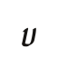 | U+F0230 | SEMARON SMALL LETTER ANKRON | 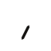 | U+F0000 | PIRZATH LETTER A |  | U+F0100 | THURAVARK LETTER A |  | none: the mapping writes it as nothing |  |
| `shift+a` | `A` | `A` |  | U+F0200 | SEMARON CAPITAL LETTER ANKRON |  | U+F0000 | PIRZATH LETTER A |  | U+F0100 | THURAVARK LETTER A |  | none: the mapping writes it as nothing |  |
| `b` | `b` | `b` | 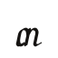 | U+F0231 | SEMARON SMALL LETTER BRUTHEKA |  | U+F0006 | PIRZATH LETTER BALG |  | U+F0105 | THURAVARK LETTER BRELD | 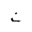 | U+1EA11 | QALEZU LETTER BA |
| `shift+b` | `B` | `B` |  | U+F0201 | SEMARON CAPITAL LETTER BRUTHEKA |  | U+F0006 | PIRZATH LETTER BALG |  | U+F0105 | THURAVARK LETTER BRELD |  | U+1EA11 | QALEZU LETTER BA |
| `d` | `d` | `d` | 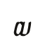 | U+F0232 | SEMARON SMALL LETTER DEKAZU |  | U+F000B | PIRZATH LETTER DALK |  | U+F0106 | THURAVARK LETTER DRESK | 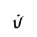 | U+1EA03 | QALEZU LETTER DURAS |
| `shift+d` | `D` | `D` |  | U+F0202 | SEMARON CAPITAL LETTER DEKAZU |  | U+F000B | PIRZATH LETTER DALK |  | U+F0106 | THURAVARK LETTER DRESK |  | U+1EA03 | QALEZU LETTER DURAS |
| `e` | `e` | `e` | 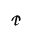 | U+F0233 | SEMARON SMALL LETTER ELZA |  | U+F0001 | PIRZATH LETTER E |  | U+F0101 | THURAVARK LETTER E |  | none: the mapping writes it as nothing |  |
| `shift+e` | `E` | `E` | 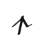 | U+F0203 | SEMARON CAPITAL LETTER ELZA |  | U+F0001 | PIRZATH LETTER E |  | U+F0101 | THURAVARK LETTER E |  | none: the mapping writes it as nothing |  |
| `f` | `f` | `f` | 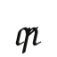 | U+F0234 | SEMARON SMALL LETTER FUNELA |  | U+F0007 | PIRZATH LETTER FARZ |  | U+F0107 | THURAVARK LETTER FOSK | 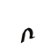 | U+1EA12 | QALEZU LETTER FA |
| `shift+f` | `F` | `F` |  | U+F0204 | SEMARON CAPITAL LETTER FUNELA |  | U+F0007 | PIRZATH LETTER FARZ |  | U+F0107 | THURAVARK LETTER FOSK |  | U+1EA12 | QALEZU LETTER FA |
| `g` | `g` | `g` | 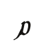 | U+F0235 | SEMARON SMALL LETTER GULMOS |  | U+F000E | PIRZATH LETTER GAMTH |  | U+F0108 | THURAVARK LETTER GELDRA | 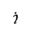 | U+1EA06 | QALEZU LETTER GITHAR |
| `shift+g` | `G` | `G` | 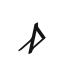 | U+F0205 | SEMARON CAPITAL LETTER GULMOS |  | U+F000E | PIRZATH LETTER GAMTH |  | U+F0108 | THURAVARK LETTER GELDRA |  | U+1EA06 | QALEZU LETTER GITHAR |
| `h` | `h` | `h` | 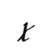 | U+F0236 | SEMARON SMALL LETTER HARLEN |  | U+F0011 | PIRZATH LETTER HALB |  | U+F0109 | THURAVARK LETTER HVELM | 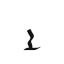 | U+1EA0E | QALEZU LETTER HALZI |
| `shift+h` | `H` | `H` | 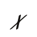 | U+F0206 | SEMARON CAPITAL LETTER HARLEN |  | U+F0011 | PIRZATH LETTER HALB |  | U+F0109 | THURAVARK LETTER HVELM |  | U+1EA0E | QALEZU LETTER HALZI |
| `i` | `i` | `i` | 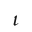 | U+F0237 | SEMARON SMALL LETTER ILTHERA |  | U+F0002 | PIRZATH LETTER I |  | U+F0102 | THURAVARK LETTER I |  | none: the mapping writes it as nothing |  |
| `shift+i` | `I` | `I` |  | U+F0207 | SEMARON CAPITAL LETTER ILTHERA |  | U+F0002 | PIRZATH LETTER I |  | U+F0102 | THURAVARK LETTER I |  | none: the mapping writes it as nothing |  |
| `j` | `j` | `j` |  | U+F0238 | SEMARON SMALL LETTER JA |  | U+F0014 | PIRZATH LETTER JA | 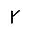 | U+F010A | THURAVARK LETTER JA | 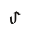 | U+1EA16 | QALEZU LETTER TJA |
| `shift+j` | `J` | `J` | 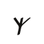 | U+F0208 | SEMARON CAPITAL LETTER JA |  | U+F0014 | PIRZATH LETTER JA |  | U+F010A | THURAVARK LETTER JA |  | U+1EA16 | QALEZU LETTER TJA |
| `k` | `k` | `k` | 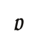 | U+F0239 | SEMARON SMALL LETTER KALPEZA |  | U+F000D | PIRZATH LETTER KAMV |  | U+F010B | THURAVARK LETTER KNERV | 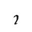 | U+1EA07 | QALEZU LETTER KA |
| `shift+k` | `K` | `K` | 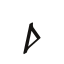 | U+F0209 | SEMARON CAPITAL LETTER KALPEZA |  | U+F000D | PIRZATH LETTER KAMV |  | U+F010B | THURAVARK LETTER KNERV |  | U+1EA07 | QALEZU LETTER KA |
| `l` | `l` | `l` |  | U+F023A | SEMARON SMALL LETTER LIZELA |  | U+F0012 | PIRZATH LETTER LADHAV | 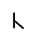 | U+F010C | THURAVARK LETTER LA | 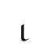 | U+1EA00 | QALEZU LETTER LAGUN |
| `shift+l` | `L` | `L` | 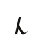 | U+F020A | SEMARON CAPITAL LETTER LIZELA |  | U+F0012 | PIRZATH LETTER LADHAV |  | U+F010C | THURAVARK LETTER LA |  | U+1EA00 | QALEZU LETTER LAGUN |
| `m` | `m` | `m` | 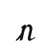 | U+F023B | SEMARON SMALL LETTER MEZARA |  | U+F0009 | PIRZATH LETTER MARP |  | U+F010D | THURAVARK LETTER MERV |  | U+1EA0A | QALEZU LETTER MELNU |
| `shift+m` | `M` | `M` | 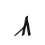 | U+F020B | SEMARON CAPITAL LETTER MEZARA |  | U+F0009 | PIRZATH LETTER MARP |  | U+F010D | THURAVARK LETTER MERV |  | U+1EA0A | QALEZU LETTER MELNU |
| `n` | `n` | `n` | 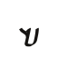 | U+F023C | SEMARON SMALL LETTER NELAMIS |  | U+F000C | PIRZATH LETTER NAZAF |  | U+F010E | THURAVARK LETTER NELTH | 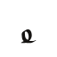 | U+1EA08 | QALEZU LETTER NELGIR |
| `shift+n` | `N` | `N` | 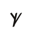 | U+F020C | SEMARON CAPITAL LETTER NELAMIS |  | U+F000C | PIRZATH LETTER NAZAF |  | U+F010E | THURAVARK LETTER NELTH |  | U+1EA08 | QALEZU LETTER NELGIR |
| `o` | `o` | `o` | 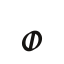 | U+F023D | SEMARON SMALL LETTER ORNETHE |  | U+F0003 | PIRZATH LETTER O |  | U+F0103 | THURAVARK LETTER ODEL |  | none: the mapping writes it as nothing |  |
| `shift+o` | `O` | `O` | 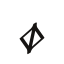 | U+F020D | SEMARON CAPITAL LETTER ORNETHE |  | U+F0003 | PIRZATH LETTER O |  | U+F0103 | THURAVARK LETTER ODEL |  | none: the mapping writes it as nothing |  |
| `p` | `p` | `p` | 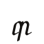 | U+F023E | SEMARON SMALL LETTER POZERA |  | U+F0005 | PIRZATH LETTER PARGH |  | U+F010F | THURAVARK LETTER PA | 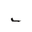 | U+1EA10 | QALEZU LETTER PA |
| `shift+p` | `P` | `P` |  | U+F020E | SEMARON CAPITAL LETTER POZERA |  | U+F0005 | PIRZATH LETTER PARGH |  | U+F010F | THURAVARK LETTER PA |  | U+1EA10 | QALEZU LETTER PA |
| `q` | `q` | `q` |  | U+F0239 | SEMARON SMALL LETTER KALPEZA |  | U+F0015 | PIRZATH LETTER QA |  | U+F010B | THURAVARK LETTER KNERV | 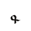 | U+1EA0B | QALEZU LETTER QENUWA |
| `shift+q` | `Q` | `Q` |  | U+F0209 | SEMARON CAPITAL LETTER KALPEZA |  | U+F0015 | PIRZATH LETTER QA |  | U+F010B | THURAVARK LETTER KNERV |  | U+1EA0B | QALEZU LETTER QENUWA |
| `r` | `r` | `r` | 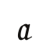 | U+F023F | SEMARON SMALL LETTER RONETHOS |  | U+F0013 | PIRZATH LETTER RAGHAV |  | U+F0110 | THURAVARK LETTER RELTH | 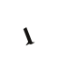 | U+1EA01 | QALEZU LETTER RETHU |
| `shift+r` | `R` | `R` |  | U+F020F | SEMARON CAPITAL LETTER RONETHOS |  | U+F0013 | PIRZATH LETTER RAGHAV |  | U+F0110 | THURAVARK LETTER RELTH |  | U+1EA01 | QALEZU LETTER RETHU |
| `s` | `s` | `s` | 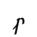 | U+F0240 | SEMARON SMALL LETTER SIRETHA |  | U+F000F | PIRZATH LETTER SAKAR |  | U+F0111 | THURAVARK LETTER SVELD | 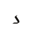 | U+1EA05 | QALEZU LETTER SELQUR |
| `shift+s` | `S` | `S` | 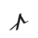 | U+F0210 | SEMARON CAPITAL LETTER SIRETHA |  | U+F000F | PIRZATH LETTER SAKAR |  | U+F0111 | THURAVARK LETTER SVELD |  | U+1EA05 | QALEZU LETTER SELQUR |
| `t` | `t` | `t` | 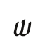 | U+F0241 | SEMARON SMALL LETTER TALOTHOS |  | U+F000A | PIRZATH LETTER TAMB |  | U+F0112 | THURAVARK LETTER TING | 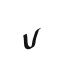 | U+1EA02 | QALEZU LETTER TULAZ |
| `shift+t` | `T` | `T` |  | U+F0211 | SEMARON CAPITAL LETTER TALOTHOS |  | U+F000A | PIRZATH LETTER TAMB |  | U+F0112 | THURAVARK LETTER TING |  | U+1EA02 | QALEZU LETTER TULAZ |
| `u` | `u` | `u` | 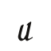 | U+F0242 | SEMARON SMALL LETTER ULMERA |  | U+F0004 | PIRZATH LETTER U |  | U+F0104 | THURAVARK LETTER U |  | none: the mapping writes it as nothing |  |
| `shift+u` | `U` | `U` |  | U+F0212 | SEMARON CAPITAL LETTER ULMERA |  | U+F0004 | PIRZATH LETTER U |  | U+F0104 | THURAVARK LETTER U |  | none: the mapping writes it as nothing |  |
| `v` | `v` | `v` | 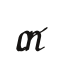 | U+F0243 | SEMARON SMALL LETTER VARTHOS |  | U+F0008 | PIRZATH LETTER VAZAL |  | U+F0113 | THURAVARK LETTER VULD |  | U+1EA12 | QALEZU LETTER FA |
| `shift+v` | `V` | `V` |  | U+F0213 | SEMARON CAPITAL LETTER VARTHOS |  | U+F0008 | PIRZATH LETTER VAZAL |  | U+F0113 | THURAVARK LETTER VULD |  | U+1EA12 | QALEZU LETTER FA |
| `w` | `w` | `w` | 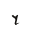 | U+F0244 | SEMARON SMALL LETTER WA |  | U+F0016 | PIRZATH LETTER WA | 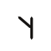 | U+F0114 | THURAVARK LETTER WA | 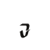 | U+1EA13 | QALEZU LETTER WALIR |
| `shift+w` | `W` | `W` |  | U+F0214 | SEMARON CAPITAL LETTER WA |  | U+F0016 | PIRZATH LETTER WA |  | U+F0114 | THURAVARK LETTER WA |  | U+1EA13 | QALEZU LETTER WALIR |
| `y` | `y` | `y` |  | U+F0245 | SEMARON SMALL LETTER YALZEMIS |  | U+F0017 | PIRZATH LETTER YA |  | U+F010A | THURAVARK LETTER JA | 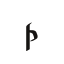 | U+1EA14 | QALEZU LETTER YA |
| `shift+y` | `Y` | `Y` |  | U+F0215 | SEMARON CAPITAL LETTER YALZEMIS |  | U+F0017 | PIRZATH LETTER YA |  | U+F010A | THURAVARK LETTER JA |  | U+1EA14 | QALEZU LETTER YA |
| `z` | `z` | `z` |  | U+F0246 | SEMARON SMALL LETTER ZARGON |  | U+F0010 | PIRZATH LETTER ZALD |  | U+F0115 | THURAVARK LETTER ZA |  | U+1EA04 | QALEZU LETTER ZAGUL |
| `shift+z` | `Z` | `Z` |  | U+F0216 | SEMARON CAPITAL LETTER ZARGON |  | U+F0010 | PIRZATH LETTER ZALD |  | U+F0115 | THURAVARK LETTER ZA |  | U+1EA04 | QALEZU LETTER ZAGUL |
| `option+c` | `\c` | `ch` |    | U+F0241 U+F0240 U+F0236 | SEMARON SMALL LETTER TALOTHOS; SEMARON SMALL LETTER SIRETHA; SEMARON SMALL LETTER HARLEN |  | U+F0027 | PIRZATH LETTER CHA |  | none: the mapping has no row for it |  |  | U+1EA16 | QALEZU LETTER TJA |
| `option+shift+c` | `\C` | `Ch` |    | U+F0211 U+F0240 U+F0236 | SEMARON CAPITAL LETTER TALOTHOS; SEMARON SMALL LETTER SIRETHA; SEMARON SMALL LETTER HARLEN |  | U+F0027 | PIRZATH LETTER CHA |  | none: the mapping has no row for it |  |  | U+1EA16 | QALEZU LETTER TJA |
| `option+s` | `\s` | `sh` |   | U+F0240 U+F0236 | SEMARON SMALL LETTER SIRETHA; SEMARON SMALL LETTER HARLEN |  | U+F0024 | PIRZATH LETTER SHA |   | U+F0111 U+F0109 | THURAVARK LETTER SVELD; THURAVARK LETTER HVELM |  | U+1EA0F | QALEZU LETTER SHENULET |
| `option+shift+s` | `\S` | `Sh` |   | U+F0210 U+F0236 | SEMARON CAPITAL LETTER SIRETHA; SEMARON SMALL LETTER HARLEN |  | U+F0024 | PIRZATH LETTER SHA |   | U+F0111 U+F0109 | THURAVARK LETTER SVELD; THURAVARK LETTER HVELM |  | U+1EA0F | QALEZU LETTER SHENULET |
| `option+t` | `\t` | `th` |  | U+F0250 | SEMARON SMALL LETTER THOLERA |  | U+F0020 | PIRZATH LETTER THARZ |  | U+F0120 | THURAVARK LETTER THRESK |  | U+1EA09 | QALEZU LETTER THELQEN |
| `option+shift+t` | `\T` | `Th` |  | U+F0251 | SEMARON CAPITAL LETTER THOLERA |  | U+F0020 | PIRZATH LETTER THARZ |  | U+F0120 | THURAVARK LETTER THRESK |  | U+1EA09 | QALEZU LETTER THELQEN |
| `option+d` | `\d` | `dh` |   | U+F0232 U+F0236 | SEMARON SMALL LETTER DEKAZU; SEMARON SMALL LETTER HARLEN |  | U+F0021 | PIRZATH LETTER DHALZ |  | U+F0121 | THURAVARK LETTER DHA |   | U+1EA03 U+1EA0E | QALEZU LETTER DURAS; QALEZU LETTER HALZI |
| `option+shift+d` | `\D` | `Dh` |   | U+F0202 U+F0236 | SEMARON CAPITAL LETTER DEKAZU; SEMARON SMALL LETTER HARLEN |  | U+F0021 | PIRZATH LETTER DHALZ |  | U+F0121 | THURAVARK LETTER DHA |   | U+1EA03 U+1EA0E | QALEZU LETTER DURAS; QALEZU LETTER HALZI |
| `option+k` | `\k` | `kh` |   | U+F0239 U+F0236 | SEMARON SMALL LETTER KALPEZA; SEMARON SMALL LETTER HARLEN |  | U+F0022 | PIRZATH LETTER KHABAR |  | U+F0122 | THURAVARK LETTER KHA |  | U+1EA0C | QALEZU LETTER KHA |
| `option+shift+k` | `\K` | `Kh` |   | U+F0209 U+F0236 | SEMARON CAPITAL LETTER KALPEZA; SEMARON SMALL LETTER HARLEN |  | U+F0022 | PIRZATH LETTER KHABAR |  | U+F0122 | THURAVARK LETTER KHA |  | U+1EA0C | QALEZU LETTER KHA |
| `option+g` | `\g` | `gh` |   | U+F0235 U+F0236 | SEMARON SMALL LETTER GULMOS; SEMARON SMALL LETTER HARLEN |  | U+F0023 | PIRZATH LETTER GHARM |  | U+F0123 | THURAVARK LETTER GHA |  | U+1EA0D | QALEZU LETTER GHA |
| `option+shift+g` | `\G` | `Gh` |   | U+F0205 U+F0236 | SEMARON CAPITAL LETTER GULMOS; SEMARON SMALL LETTER HARLEN |  | U+F0023 | PIRZATH LETTER GHARM |  | U+F0123 | THURAVARK LETTER GHA |  | U+1EA0D | QALEZU LETTER GHA |
| `option+z` | `\z` | `zh` |   | U+F0246 U+F0236 | SEMARON SMALL LETTER ZARGON; SEMARON SMALL LETTER HARLEN |  | U+F0025 | PIRZATH LETTER ZHA |   | U+F0115 U+F0109 | THURAVARK LETTER ZA; THURAVARK LETTER HVELM |   | U+1EA04 U+1EA0E | QALEZU LETTER ZAGUL; QALEZU LETTER HALZI |
| `option+shift+z` | `\Z` | `Zh` |   | U+F0216 U+F0236 | SEMARON CAPITAL LETTER ZARGON; SEMARON SMALL LETTER HARLEN |  | U+F0025 | PIRZATH LETTER ZHA |   | U+F0115 U+F0109 | THURAVARK LETTER ZA; THURAVARK LETTER HVELM |   | U+1EA04 U+1EA0E | QALEZU LETTER ZAGUL; QALEZU LETTER HALZI |
| `option+p` | `\p` | `ph` |   | U+F023E U+F0236 | SEMARON SMALL LETTER POZERA; SEMARON SMALL LETTER HARLEN |   | U+F0005 U+F0011 | PIRZATH LETTER PARGH; PIRZATH LETTER HALB |   | U+F010F U+F0109 | THURAVARK LETTER PA; THURAVARK LETTER HVELM |   | U+1EA10 U+1EA0E | QALEZU LETTER PA; QALEZU LETTER HALZI |
| `option+shift+p` | `\P` | `Ph` |   | U+F020E U+F0236 | SEMARON CAPITAL LETTER POZERA; SEMARON SMALL LETTER HARLEN |   | U+F0005 U+F0011 | PIRZATH LETTER PARGH; PIRZATH LETTER HALB |   | U+F010F U+F0109 | THURAVARK LETTER PA; THURAVARK LETTER HVELM |   | U+1EA10 U+1EA0E | QALEZU LETTER PA; QALEZU LETTER HALZI |
| `option+n` | `\n` | `ng` |   | U+F023C U+F0235 | SEMARON SMALL LETTER NELAMIS; SEMARON SMALL LETTER GULMOS |  | U+F0028 | PIRZATH LETTER NGA |  | U+F0125 | THURAVARK LETTER NGA |   | U+1EA08 U+1EA06 | QALEZU LETTER NELGIR; QALEZU LETTER GITHAR |
| `option+shift+n` | `\N` | `Ng` |   | U+F020C U+F0235 | SEMARON CAPITAL LETTER NELAMIS; SEMARON SMALL LETTER GULMOS |  | U+F0028 | PIRZATH LETTER NGA |  | U+F0125 | THURAVARK LETTER NGA |   | U+1EA08 U+1EA06 | QALEZU LETTER NELGIR; QALEZU LETTER GITHAR |
| `option+y` | `\y` | `ny` |   | U+F023C U+F0237 | SEMARON SMALL LETTER NELAMIS; SEMARON SMALL LETTER ILTHERA |  | U+F0029 | PIRZATH LETTER NYA |   | U+F010E U+F0102 | THURAVARK LETTER NELTH; THURAVARK LETTER I |   | U+1EA08 U+1EA14 | QALEZU LETTER NELGIR; QALEZU LETTER YA |
| `option+shift+y` | `\Y` | `Ny` |   | U+F020C U+F0237 | SEMARON CAPITAL LETTER NELAMIS; SEMARON SMALL LETTER ILTHERA |  | U+F0029 | PIRZATH LETTER NYA |   | U+F010E U+F0102 | THURAVARK LETTER NELTH; THURAVARK LETTER I |   | U+1EA08 U+1EA14 | QALEZU LETTER NELGIR; QALEZU LETTER YA |
| `option+x` | `\x` | `ts` |   | U+F0241 U+F0240 | SEMARON SMALL LETTER TALOTHOS; SEMARON SMALL LETTER SIRETHA |  | U+F0026 | PIRZATH LETTER TSA |   | U+F0112 U+F0111 | THURAVARK LETTER TING; THURAVARK LETTER SVELD |   | U+1EA02 U+1EA05 | QALEZU LETTER TULAZ; QALEZU LETTER SELQUR |
| `option+shift+x` | `\X` | `Ts` |   | U+F0211 U+F0240 | SEMARON CAPITAL LETTER TALOTHOS; SEMARON SMALL LETTER SIRETHA |  | U+F0026 | PIRZATH LETTER TSA |   | U+F0112 U+F0111 | THURAVARK LETTER TING; THURAVARK LETTER SVELD |   | U+1EA02 U+1EA05 | QALEZU LETTER TULAZ; QALEZU LETTER SELQUR |
| `option+h` | `\h` | `hl` |   | U+F0236 U+F023A | SEMARON SMALL LETTER HARLEN; SEMARON SMALL LETTER LIZELA |  | U+F002A | PIRZATH LETTER HLA |  | U+F0124 | THURAVARK LETTER HLA |   | U+1EA0E U+1EA00 | QALEZU LETTER HALZI; QALEZU LETTER LAGUN |
| `option+shift+h` | `\H` | `Hl` |   | U+F0206 U+F023A | SEMARON CAPITAL LETTER HARLEN; SEMARON SMALL LETTER LIZELA |  | U+F002A | PIRZATH LETTER HLA |  | U+F0124 | THURAVARK LETTER HLA |   | U+1EA0E U+1EA00 | QALEZU LETTER HALZI; QALEZU LETTER LAGUN |
| `option+b` | `\b` | `bh` |   | U+F0231 U+F0236 | SEMARON SMALL LETTER BRUTHEKA; SEMARON SMALL LETTER HARLEN |   | U+F0006 U+F0011 | PIRZATH LETTER BALG; PIRZATH LETTER HALB |   | U+F0105 U+F0109 | THURAVARK LETTER BRELD; THURAVARK LETTER HVELM |   | U+1EA11 U+1EA0E | QALEZU LETTER BA; QALEZU LETTER HALZI |
| `option+shift+b` | `\B` | `Bh` |   | U+F0201 U+F0236 | SEMARON CAPITAL LETTER BRUTHEKA; SEMARON SMALL LETTER HARLEN |   | U+F0006 U+F0011 | PIRZATH LETTER BALG; PIRZATH LETTER HALB |   | U+F0105 U+F0109 | THURAVARK LETTER BRELD; THURAVARK LETTER HVELM |   | U+1EA11 U+1EA0E | QALEZU LETTER BA; QALEZU LETTER HALZI |
| `option+1` | `\1` | `aa` |  | U+F0248 | SEMARON SMALL LETTER LONG ANKRON |   | U+F0000 U+F0000 | PIRZATH LETTER A; PIRZATH LETTER A |   | U+F0100 U+F0100 | THURAVARK LETTER A; THURAVARK LETTER A |  | none: the mapping writes it as nothing |  |
| `option+shift+1` | `\!` | `Aa` |  | U+F0220 | SEMARON CAPITAL LETTER LONG ANKRON |   | U+F0000 U+F0000 | PIRZATH LETTER A; PIRZATH LETTER A |   | U+F0100 U+F0100 | THURAVARK LETTER A; THURAVARK LETTER A |  | none: the mapping writes it as nothing |  |
| `option+2` | `\2` | `ee` |   | U+F0233 U+F0233 | SEMARON SMALL LETTER ELZA; SEMARON SMALL LETTER ELZA |   | U+F0001 U+F0001 | PIRZATH LETTER E; PIRZATH LETTER E |   | U+F0101 U+F0101 | THURAVARK LETTER E; THURAVARK LETTER E |  | none: the mapping writes it as nothing |  |
| `option+shift+2` | `\@` | `Ee` |   | U+F0203 U+F0233 | SEMARON CAPITAL LETTER ELZA; SEMARON SMALL LETTER ELZA |   | U+F0001 U+F0001 | PIRZATH LETTER E; PIRZATH LETTER E |   | U+F0101 U+F0101 | THURAVARK LETTER E; THURAVARK LETTER E |  | none: the mapping writes it as nothing |  |
| `option+3` | `\3` | `ii` |  | U+F024A | SEMARON SMALL LETTER LONG ILTHERA |   | U+F0002 U+F0002 | PIRZATH LETTER I; PIRZATH LETTER I |   | U+F0102 U+F0102 | THURAVARK LETTER I; THURAVARK LETTER I |  | none: the mapping writes it as nothing |  |
| `option+shift+3` | `\#` | `Ii` |  | U+F0222 | SEMARON CAPITAL LETTER LONG ILTHERA |   | U+F0002 U+F0002 | PIRZATH LETTER I; PIRZATH LETTER I |   | U+F0102 U+F0102 | THURAVARK LETTER I; THURAVARK LETTER I |  | none: the mapping writes it as nothing |  |
| `option+4` | `\4` | `oo` |   | U+F023D U+F023D | SEMARON SMALL LETTER ORNETHE; SEMARON SMALL LETTER ORNETHE |   | U+F0003 U+F0003 | PIRZATH LETTER O; PIRZATH LETTER O |   | U+F0103 U+F0103 | THURAVARK LETTER ODEL; THURAVARK LETTER ODEL |  | none: the mapping writes it as nothing |  |
| `option+shift+4` | `\$` | `Oo` |   | U+F020D U+F023D | SEMARON CAPITAL LETTER ORNETHE; SEMARON SMALL LETTER ORNETHE |   | U+F0003 U+F0003 | PIRZATH LETTER O; PIRZATH LETTER O |   | U+F0103 U+F0103 | THURAVARK LETTER ODEL; THURAVARK LETTER ODEL |  | none: the mapping writes it as nothing |  |
| `option+5` | `\5` | `uu` |  | U+F024C | SEMARON SMALL LETTER LONG ULMERA |   | U+F0004 U+F0004 | PIRZATH LETTER U; PIRZATH LETTER U |   | U+F0104 U+F0104 | THURAVARK LETTER U; THURAVARK LETTER U |  | none: the mapping writes it as nothing |  |
| `option+shift+5` | `\%` | `Uu` |  | U+F0224 | SEMARON CAPITAL LETTER LONG ULMERA |   | U+F0004 U+F0004 | PIRZATH LETTER U; PIRZATH LETTER U |   | U+F0104 U+F0104 | THURAVARK LETTER U; THURAVARK LETTER U |  | none: the mapping writes it as nothing |  |
| `option+6` | `\6` | `ai` |   | U+F0230 U+F0237 | SEMARON SMALL LETTER ANKRON; SEMARON SMALL LETTER ILTHERA |  | U+F0030 | PIRZATH LETTER AI |   | U+F0100 U+F0102 | THURAVARK LETTER A; THURAVARK LETTER I |  | none: the mapping writes it as nothing |  |
| `option+shift+6` | `\^` | `Ai` |   | U+F0200 U+F0237 | SEMARON CAPITAL LETTER ANKRON; SEMARON SMALL LETTER ILTHERA |  | U+F0030 | PIRZATH LETTER AI |   | U+F0100 U+F0102 | THURAVARK LETTER A; THURAVARK LETTER I |  | none: the mapping writes it as nothing |  |
| `option+7` | `\7` | `au` |   | U+F0230 U+F0242 | SEMARON SMALL LETTER ANKRON; SEMARON SMALL LETTER ULMERA |  | U+F0031 | PIRZATH LETTER AU |   | U+F0100 U+F0104 | THURAVARK LETTER A; THURAVARK LETTER U |  | none: the mapping writes it as nothing |  |
| `option+shift+7` | `\&` | `Au` |   | U+F0200 U+F0242 | SEMARON CAPITAL LETTER ANKRON; SEMARON SMALL LETTER ULMERA |  | U+F0031 | PIRZATH LETTER AU |   | U+F0100 U+F0104 | THURAVARK LETTER A; THURAVARK LETTER U |  | none: the mapping writes it as nothing |  |
| `option+8` | `\8` | `ei` |   | U+F0233 U+F0237 | SEMARON SMALL LETTER ELZA; SEMARON SMALL LETTER ILTHERA |  | U+F0032 | PIRZATH LETTER EI |   | U+F0101 U+F0102 | THURAVARK LETTER E; THURAVARK LETTER I |  | none: the mapping writes it as nothing |  |
| `option+shift+8` | `\*` | `Ei` |   | U+F0203 U+F0237 | SEMARON CAPITAL LETTER ELZA; SEMARON SMALL LETTER ILTHERA |  | U+F0032 | PIRZATH LETTER EI |   | U+F0101 U+F0102 | THURAVARK LETTER E; THURAVARK LETTER I |  | none: the mapping writes it as nothing |  |
| `option+9` | `\9` | `oi` |   | U+F023D U+F0237 | SEMARON SMALL LETTER ORNETHE; SEMARON SMALL LETTER ILTHERA |  | U+F0033 | PIRZATH LETTER OI |   | U+F0103 U+F0102 | THURAVARK LETTER ODEL; THURAVARK LETTER I |  | none: the mapping writes it as nothing |  |
| `option+shift+9` | `\(` | `Oi` |   | U+F020D U+F0237 | SEMARON CAPITAL LETTER ORNETHE; SEMARON SMALL LETTER ILTHERA |  | U+F0033 | PIRZATH LETTER OI |   | U+F0103 U+F0102 | THURAVARK LETTER ODEL; THURAVARK LETTER I |  | none: the mapping writes it as nothing |  |
| `option+0` | `\0` | `ou` |   | U+F023D U+F0242 | SEMARON SMALL LETTER ORNETHE; SEMARON SMALL LETTER ULMERA |  | U+F0034 | PIRZATH LETTER OU |   | U+F0103 U+F0104 | THURAVARK LETTER ODEL; THURAVARK LETTER U |  | none: the mapping writes it as nothing |  |
| `option+shift+0` | `\)` | `Ou` |   | U+F020D U+F0242 | SEMARON CAPITAL LETTER ORNETHE; SEMARON SMALL LETTER ULMERA |  | U+F0034 | PIRZATH LETTER OU |   | U+F0103 U+F0104 | THURAVARK LETTER ODEL; THURAVARK LETTER U |  | none: the mapping writes it as nothing |  |
| `option+-` | `\-` | `ie` |   | U+F0237 U+F0233 | SEMARON SMALL LETTER ILTHERA; SEMARON SMALL LETTER ELZA |   | U+F0002 U+F0001 | PIRZATH LETTER I; PIRZATH LETTER E |   | U+F0102 U+F0101 | THURAVARK LETTER I; THURAVARK LETTER E |  | none: the mapping writes it as nothing |  |
| `option+shift+-` | `\_` | `Ie` |   | U+F0207 U+F0233 | SEMARON CAPITAL LETTER ILTHERA; SEMARON SMALL LETTER ELZA |   | U+F0002 U+F0001 | PIRZATH LETTER I; PIRZATH LETTER E |   | U+F0102 U+F0101 | THURAVARK LETTER I; THURAVARK LETTER E |  | none: the mapping writes it as nothing |  |
| `option+=` | `\=` | `uo` |   | U+F0242 U+F023D | SEMARON SMALL LETTER ULMERA; SEMARON SMALL LETTER ORNETHE |   | U+F0004 U+F0003 | PIRZATH LETTER U; PIRZATH LETTER O |   | U+F0104 U+F0103 | THURAVARK LETTER U; THURAVARK LETTER ODEL |  | none: the mapping writes it as nothing |  |
| `option+shift+=` | `\+` | `Uo` |   | U+F0212 U+F023D | SEMARON CAPITAL LETTER ULMERA; SEMARON SMALL LETTER ORNETHE |   | U+F0004 U+F0003 | PIRZATH LETTER U; PIRZATH LETTER O |   | U+F0104 U+F0103 | THURAVARK LETTER U; THURAVARK LETTER ODEL |  | none: the mapping writes it as nothing |  |
| `option+[` | `\[` | `ae` |   | U+F0230 U+F0233 | SEMARON SMALL LETTER ANKRON; SEMARON SMALL LETTER ELZA |   | U+F0000 U+F0001 | PIRZATH LETTER A; PIRZATH LETTER E |   | U+F0100 U+F0101 | THURAVARK LETTER A; THURAVARK LETTER E |  | none: the mapping writes it as nothing |  |
| `option+shift+[` | `\{` | `Ae` |   | U+F0200 U+F0233 | SEMARON CAPITAL LETTER ANKRON; SEMARON SMALL LETTER ELZA |   | U+F0000 U+F0001 | PIRZATH LETTER A; PIRZATH LETTER E |   | U+F0100 U+F0101 | THURAVARK LETTER A; THURAVARK LETTER E |  | none: the mapping writes it as nothing |  |
| `option+]` | `\]` | `ea` |   | U+F0233 U+F0230 | SEMARON SMALL LETTER ELZA; SEMARON SMALL LETTER ANKRON |   | U+F0001 U+F0000 | PIRZATH LETTER E; PIRZATH LETTER A |   | U+F0101 U+F0100 | THURAVARK LETTER E; THURAVARK LETTER A |  | none: the mapping writes it as nothing |  |
| `option+shift+]` | `\}` | `Ea` |   | U+F0203 U+F0230 | SEMARON CAPITAL LETTER ELZA; SEMARON SMALL LETTER ANKRON |   | U+F0001 U+F0000 | PIRZATH LETTER E; PIRZATH LETTER A |   | U+F0101 U+F0100 | THURAVARK LETTER E; THURAVARK LETTER A |  | none: the mapping writes it as nothing |  |
| `option+a` | `\a` | `á` |  | U+F0230 | SEMARON SMALL LETTER ANKRON |   | U+F0000 U+F0060 | PIRZATH LETTER A; PIRZATH LENGTH MARK |   | U+F0100 U+F0148 | THURAVARK LETTER A; THURAVARK ACUTE |  | none: the mapping has no row for it |  |
| `option+shift+a` | `\A` | `Á` |  | U+F0200 | SEMARON CAPITAL LETTER ANKRON |   | U+F0000 U+F0060 | PIRZATH LETTER A; PIRZATH LENGTH MARK |   | U+F0100 U+F0148 | THURAVARK LETTER A; THURAVARK ACUTE |  | none: the mapping has no row for it |  |
| `option+e` | `\e` | `é` |  | U+F0233 | SEMARON SMALL LETTER ELZA |   | U+F0001 U+F0060 | PIRZATH LETTER E; PIRZATH LENGTH MARK |   | U+F0101 U+F0148 | THURAVARK LETTER E; THURAVARK ACUTE |  | none: the mapping has no row for it |  |
| `option+shift+e` | `\E` | `É` |  | U+F0203 | SEMARON CAPITAL LETTER ELZA |   | U+F0001 U+F0060 | PIRZATH LETTER E; PIRZATH LENGTH MARK |   | U+F0101 U+F0148 | THURAVARK LETTER E; THURAVARK ACUTE |  | none: the mapping has no row for it |  |
| `option+i` | `\i` | `í` |  | U+F0237 | SEMARON SMALL LETTER ILTHERA |   | U+F0002 U+F0060 | PIRZATH LETTER I; PIRZATH LENGTH MARK |   | U+F0102 U+F0148 | THURAVARK LETTER I; THURAVARK ACUTE |  | none: the mapping has no row for it |  |
| `option+shift+i` | `\I` | `Í` |  | U+F0207 | SEMARON CAPITAL LETTER ILTHERA |   | U+F0002 U+F0060 | PIRZATH LETTER I; PIRZATH LENGTH MARK |   | U+F0102 U+F0148 | THURAVARK LETTER I; THURAVARK ACUTE |  | none: the mapping has no row for it |  |
| `option+o` | `\o` | `ó` |  | U+F023D | SEMARON SMALL LETTER ORNETHE |   | U+F0003 U+F0060 | PIRZATH LETTER O; PIRZATH LENGTH MARK |   | U+F0103 U+F0148 | THURAVARK LETTER ODEL; THURAVARK ACUTE |  | none: the mapping has no row for it |  |
| `option+shift+o` | `\O` | `Ó` |  | U+F020D | SEMARON CAPITAL LETTER ORNETHE |   | U+F0003 U+F0060 | PIRZATH LETTER O; PIRZATH LENGTH MARK |   | U+F0103 U+F0148 | THURAVARK LETTER ODEL; THURAVARK ACUTE |  | none: the mapping has no row for it |  |
| `option+u` | `\u` | `ú` |  | U+F0242 | SEMARON SMALL LETTER ULMERA |   | U+F0004 U+F0060 | PIRZATH LETTER U; PIRZATH LENGTH MARK |   | U+F0104 U+F0148 | THURAVARK LETTER U; THURAVARK ACUTE |  | none: the mapping has no row for it |  |
| `option+shift+u` | `\U` | `Ú` |  | U+F0212 | SEMARON CAPITAL LETTER ULMERA |   | U+F0004 U+F0060 | PIRZATH LETTER U; PIRZATH LENGTH MARK |   | U+F0104 U+F0148 | THURAVARK LETTER U; THURAVARK ACUTE |  | none: the mapping has no row for it |  |
| `option+;` | `\;` | `ä` |  | none: the mapping has no row for it |  |  | none: the mapping has no row for it |  |  | none: the mapping has no row for it |  |  | none: the mapping has no row for it |  |
| `option+shift+;` | `\:` | `Ä` |  | none: the mapping has no row for it |  |  | none: the mapping has no row for it |  |  | none: the mapping has no row for it |  |  | none: the mapping has no row for it |  |
| `option+'` | `\'` | `ë` |  | U+F0233 | SEMARON SMALL LETTER ELZA |  | U+F0001 | PIRZATH LETTER E |  | U+F0101 | THURAVARK LETTER E |  | none: the mapping writes it as nothing |  |
| `option+shift+'` | `\"` | `Ë` |  | U+F0203 | SEMARON CAPITAL LETTER ELZA |  | U+F0001 | PIRZATH LETTER E |  | U+F0101 | THURAVARK LETTER E |  | none: the mapping writes it as nothing |  |
| `option+,` | `\,` | `ï` |  | none: the mapping has no row for it |  |  | none: the mapping has no row for it |  |  | none: the mapping has no row for it |  |  | none: the mapping has no row for it |  |
| `option+shift+,` | `\<` | `Ï` |  | none: the mapping has no row for it |  |  | none: the mapping has no row for it |  |  | none: the mapping has no row for it |  |  | none: the mapping has no row for it |  |
| `option+.` | `\.` | `ö` |  | none: the mapping has no row for it |  |  | none: the mapping has no row for it |  |  | none: the mapping has no row for it |  |  | none: the mapping has no row for it |  |
| `option+shift+.` | `\>` | `Ö` |  | none: the mapping has no row for it |  |  | none: the mapping has no row for it |  |  | none: the mapping has no row for it |  |  | none: the mapping has no row for it |  |
| `option+/` | `\/` | `ü` |  | none: the mapping has no row for it |  |  | none: the mapping has no row for it |  |  | none: the mapping has no row for it |  |  | none: the mapping has no row for it |  |
| `option+shift+/` | `\?` | `Ü` |  | none: the mapping has no row for it |  |  | none: the mapping has no row for it |  |  | none: the mapping has no row for it |  |  | none: the mapping has no row for it |  |
| `'` | `'` | `catch` |  | U+F0270 | SEMARON CATCH |  | U+F0018 | PIRZATH LETTER CATCH |  | none: the mapping has no row for it |  |  | U+1EA15 | QALEZU LETTER CATCH |
| `.` | `.` | `stop` |  | U+F0268 | SEMARON POINT |  | U+F0050 | PIRZATH SENTENCE END |  | U+F0140 | THURAVARK FULL STOP |  | U+1EA37 | QALEZU SENTENCE END |
| `,` | `,` | `pause` |  | U+F0268 | SEMARON POINT |  | U+F0051 | PIRZATH PAUSE |  | none: the mapping has no row for it |  |  | U+1EA38 | QALEZU PAUSE |
| `shift+,` | `<` | `open quote` |  | none: the mapping has no row for it |  |  | U+F0054 | PIRZATH OPENING QUOTATION MARK |  | none: the mapping has no row for it |  |  | none: the mapping has no row for it |  |
| `shift+.` | `>` | `close quote` |  | none: the mapping has no row for it |  |  | U+F0055 | PIRZATH CLOSING QUOTATION MARK |  | none: the mapping has no row for it |  |  | none: the mapping has no row for it |  |
| `0` | `0` | `0` |  | U+F0258 | SEMARON DIGIT ZERO |  | U+F0040 | PIRZATH DIGIT ZERO |  | U+F0130 | THURAVARK DIGIT ZERO |  | U+1EA2D | QALEZU DIGIT ZERO |
| `1` | `1` | `1` |  | U+F0259 | SEMARON DIGIT ONE |  | U+F0041 | PIRZATH DIGIT ONE |  | U+F0131 | THURAVARK DIGIT ONE |  | U+1EA2E | QALEZU DIGIT ONE |
| `2` | `2` | `2` |  | U+F025A | SEMARON DIGIT TWO |  | U+F0042 | PIRZATH DIGIT TWO |  | U+F0132 | THURAVARK DIGIT TWO |  | U+1EA2F | QALEZU DIGIT TWO |
| `3` | `3` | `3` |  | U+F025B | SEMARON DIGIT THREE |  | U+F0043 | PIRZATH DIGIT THREE |  | U+F0133 | THURAVARK DIGIT THREE |  | U+1EA30 | QALEZU DIGIT THREE |
| `4` | `4` | `4` |  | U+F025C | SEMARON DIGIT FOUR |  | U+F0044 | PIRZATH DIGIT FOUR |  | U+F0134 | THURAVARK DIGIT FOUR |  | U+1EA31 | QALEZU DIGIT FOUR |
| `5` | `5` | `5` |  | U+F025D | SEMARON DIGIT FIVE |  | U+F0045 | PIRZATH DIGIT FIVE |  | U+F0135 | THURAVARK DIGIT FIVE |  | U+1EA32 | QALEZU DIGIT FIVE |
| `6` | `6` | `6` |  | U+F025E | SEMARON DIGIT SIX |  | U+F0046 | PIRZATH DIGIT SIX |  | U+F0136 | THURAVARK DIGIT SIX |  | U+1EA33 | QALEZU DIGIT SIX |
| `7` | `7` | `7` |  | U+F025F | SEMARON DIGIT SEVEN |  | U+F0047 | PIRZATH DIGIT SEVEN |  | U+F0137 | THURAVARK DIGIT SEVEN |  | U+1EA34 | QALEZU DIGIT SEVEN |
| `8` | `8` | `8` |  | U+F0260 | SEMARON DIGIT EIGHT |  | U+F0048 | PIRZATH DIGIT EIGHT |  | U+F0138 | THURAVARK DIGIT EIGHT |  | U+1EA35 | QALEZU DIGIT EIGHT |
| `9` | `9` | `9` |  | U+F0261 | SEMARON DIGIT NINE |  | U+F0049 | PIRZATH DIGIT NINE |  | U+F0139 | THURAVARK DIGIT NINE |  | U+1EA36 | QALEZU DIGIT NINE |
| `shift+2` | `@` | `ten` |  | none: the mapping has no row for it |  |  | U+F004A | PIRZATH DIGIT TEN |  | none: the mapping has no row for it |  |  | none: the mapping has no row for it |  |
| `shift+3` | `#` | `eleven` |  | none: the mapping has no row for it |  |  | U+F004B | PIRZATH DIGIT ELEVEN |  | none: the mapping has no row for it |  |  | none: the mapping has no row for it |  |
| `shift+4` | `$` | `twelve` |  | none: the mapping has no row for it |  |  | U+F004C | PIRZATH DIGIT TWELVE |  | none: the mapping has no row for it |  |  | none: the mapping has no row for it |  |
| `shift+5` | `%` | `thirteen` |  | none: the mapping has no row for it |  |  | U+F004D | PIRZATH DIGIT THIRTEEN |  | none: the mapping has no row for it |  |  | none: the mapping has no row for it |  |
| `shift+6` | `^` | `fourteen` |  | none: the mapping has no row for it |  |  | U+F004E | PIRZATH DIGIT FOURTEEN |  | none: the mapping has no row for it |  |  | none: the mapping has no row for it |  |
| `shift+7` | `&` | `fifteen` |  | none: the mapping has no row for it |  |  | U+F004F | PIRZATH DIGIT FIFTEEN |  | none: the mapping has no row for it |  |  | none: the mapping has no row for it |  |
