# Sound keys

HL Semaron, HL Pirzath, HL Thuravark, HL Qalezu, HL Veldikko, HL Vedyakshara and HL Helónika type by sound. Each sound sits on one key or chord, the same in every script, and the key types that script's own characters for the sound, as many as the script spells it with. A key whose sound a script does not write types nothing in that script, and no key types a roman letter, apart from the keys of markup, which type themselves. Each script also has a sheet of its own, linked below, with a printable keyboard picture. [The README](../README.md#installing-a-keyboard-layout) says how to install the layouts.

- [Semaron](semaron.md): HL Semaron, for Semaron Kuriale.
- [Pirzath](pirzath.md): HL Pirzath, for Pirzath Carved, Pirzath Hand.
- [Thuravark](thuravark.md): HL Thuravark, for Thuravark Carved, Thuravark Carved Bound.
- [Qalezu](qalezu.md): HL Qalezu, for Qalezu Hand.
- [Veldikko](veldikko.md): HL Veldikko, for Veldikko.
- [Vedyakshara](vedyakshara.md): HL Vedyakshara, for Vedyakshara Classical.
- [Helónika](helonika.md): HL Helónika, for Helonika Book.

## The key map

- Each sound sits on one key or chord, the same in every script, and no key or chord carries two sounds. A layout types the sound in its script's own characters, or nothing where the script does not write the sound.
- A single letter sits on its own roman key. c and x are not sounds, so their plain keys carry no sound; x types the carrier in HL Veldikko.
- A capital sits on Shift and the key of its small sound: Shift+A is A, Option+Shift+T is Th. A pair's capital is written with its first letter capital (Ch, Ai), the form a word starts with. Only Semaron Kuriale and Helónika have case, so a capital types its majuscule in HL Semaron and HL Helónika and nothing in the caseless layouts.
- A consonant pair sits on Option and its first letter: Option+T th, Option+C ch. Where two pairs share a first letter, the second is a mnemonic: ny on Option+Y, its second letter, and ts on Option+X.
- An acute vowel sits on Option and its vowel, as Option+E types the acute on a Mac and AltGr and a vowel types it on Windows' US-International layout.
- The long vowels sit on Option and the digits 1 to 5, in the order a e i o u: Option+1 aa, Option+5 uu. The other vowel pairs follow in order on Option and the keys after them: 6 ai, 7 au, 8 ei, 9 oi, 0 ou, - ie, = uo, [ ae, ] ea. A vowel key's Option holds its acute, so the pairs cannot sit on their first vowel.
- A diaeresis vowel sits on Option and the punctuation keys right of L and M, in the order a e i o u: ; ä, ' ë, , ï, . ö, / ü.
- The catch sits on ', the stop on ., the pause on , and the open and close quotes on Shift+, and Shift+., the keys of < and >. Vedyari writes no catch, and its encoding writes an apostrophe as the cut, so in HL Vedyakshara ' types the cut. Only Pirzath writes quotation marks, so those two keys type nothing in the other scripts.
- Digits sit on the digit row. Pirzath counts in sixteens, and its numerals ten to fifteen sit on Shift+2 to Shift+7, the keys of @ # $ % ^ &, the characters on those keys.
- Qalezu writes consonants only, so its vowel keys type nothing; a vowel at the start of a word is written with the catch.
- Qalezu’s high verse-end dot is a sign typed by Option+Shift+F in HL Qalezu. In roman it is `/`, the standard verse line end.
- Vedyakshara's consonant carries the vowel a, so in HL Vedyakshara a consonant is spelled before an a and its key types the bare consonant; the a key types nothing, and another vowel key types its vowel sign.
- Markup types itself. The characters Markdown and similar markup need sit at their U.S. positions and type plain ASCII in every layout, so formatting is written without switching layouts, and no script draws them. No sound shares a key with markup; # is not markup because Shift+3 is Pirzath's eleven.
- A sign that is not a sound sits on a key of its own and types in the one layout whose script writes it, as the quote keys do outside Pirzath. HL Veldikko's six: the carrier on x, and on Option the long sign on L, the bar of a doubled consonant on W, the rise on R, the fall on F and the emphasis on M. No sound shares a key with a sign, and a sign types nothing in the other layouts. HL Helónika's eleven are the letters its sound keys cannot type, since a sound key types kh as k and h: the kh and zh letters on Option+Q and Option+J, the barred long vowels on Option+V, Option+` and C, each with its capital on Shift, and the accent on Option+Shift+M.
- The literal immutable markers ⟦ and ⟧ sit on Option+Shift+W and Option+Shift+L in every layout, as signs that no script draws; the keys are free in all seven, and the brackets' own Option keys carry the vowel pairs ae and ea.
- HL Vedyakshara types an independent vowel on Shift and its vowel key, a key of the keyboard alone: Vedyari roman is lowercase, so Shift+A carries no sound there, and the key types the independent vowel letter directly.
- Control chords and function keys carry nothing: the four layers above hold every sound, and no platform types reliably from them.

## Markup

The characters of Markdown and similar markup type themselves, as plain ASCII, in every layout on every platform, so formatting is written without switching layouts. In Emacs a backslash is typed twice, because a single backslash is the Option prefix.

| Key | Emacs | Types |
| --- | --- | --- |
| `shift+8` | `*` | `*` |
| `shift+-` | `_` | `_` |
| `[` | `[` | `[` |
| `]` | `]` | `]` |
| `shift+[` | `{` | `{` |
| `shift+]` | `}` | `}` |
| `shift+9` | `(` | `(` |
| `shift+0` | `)` | `)` |
| `=` | `=` | `=` |
| `shift+;` | `:` | `:` |
| `shift+\` | `\|` | `\|` |
| `\` | `\\` | `\` |
| `` shift+` `` | `~` | `~` |
| `` ` `` | `` ` `` | `` ` `` |

## Signs

A sign is not a sound. It sits on a key of its own, types in the one layout whose script writes it, and types nothing in the others, as the quote keys do outside Pirzath.

| Key | Emacs | Sign | Layout | Glyph | Code point | Name |
| --- | --- | --- | --- | --- | --- | --- |
| `x` | `x` | carrier | HL Veldikko |  | U+1ED5D | VELDIKKO LETTER CARRIER |
| `option+l` | `\l` | long sign | HL Veldikko |  | U+1ED78 | VELDIKKO SIGN LONG |
| `option+w` | `\w` | bar | HL Veldikko |  | U+1ED7C | VELDIKKO SIGN DOUBLING BAR |
| `option+r` | `\r` | rise | HL Veldikko |  | U+1ED79 | VELDIKKO SIGN RISE |
| `option+f` | `\f` | fall | HL Veldikko |  | U+1ED7A | VELDIKKO SIGN FALL |
| `option+m` | `\m` | emphasis | HL Veldikko |  | U+1ED7B | VELDIKKO SIGN EMPHASIS |
| `option+shift+r` | `\R` | register-mark | HL Helónika | 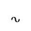 | U+F0371 | HELONIKA REGISTER MARK |
| `option+q` | `\q` | kh letter | HL Helónika | 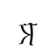 | U+F0348 | HELONIKA SMALL LETTER KH |
| `option+shift+q` | `\Q` | Kh letter | HL Helónika |  | U+F0318 | HELONIKA CAPITAL LETTER KH |
| `option+j` | `\j` | zh letter | HL Helónika | 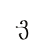 | U+F0349 | HELONIKA SMALL LETTER ZH |
| `option+shift+j` | `\J` | Zh letter | HL Helónika | 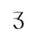 | U+F0319 | HELONIKA CAPITAL LETTER ZH |
| `option+v` | `\v` | long a | HL Helónika | 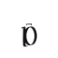 | U+F0350 | HELONIKA SMALL LETTER A WITH LENGTH BAR |
| `option+shift+v` | `\V` | Long A | HL Helónika |  | U+F0320 | HELONIKA CAPITAL LETTER A WITH LENGTH BAR |
| `` option+` `` | `` \` `` | long i | HL Helónika | 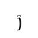 | U+F0351 | HELONIKA SMALL LETTER I WITH LENGTH BAR |
| `` option+shift+` `` | `\~` | Long I | HL Helónika |  | U+F0321 | HELONIKA CAPITAL LETTER I WITH LENGTH BAR |
| `c` | `c` | long u | HL Helónika | 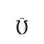 | U+F0352 | HELONIKA SMALL LETTER U WITH LENGTH BAR |
| `shift+c` | `C` | Long U | HL Helónika | 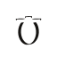 | U+F0322 | HELONIKA CAPITAL LETTER U WITH LENGTH BAR |
| `option+shift+m` | `\M` | accent | HL Helónika | 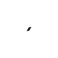 | U+F0378 | HELONIKA COMBINING ACCENT |
| `option+shift+f` | `\F` | verse end | HL Qalezu |  | U+1EA39 | QALEZU VERSE END |
| `shift+a` | `A` | independent a | HL Vedyakshara |  | U+F0420 | VEDYAKSHARA LETTER A |
| `shift+i` | `I` | independent i | HL Vedyakshara |  | U+F0421 | VEDYAKSHARA LETTER I |
| `shift+u` | `U` | independent u | HL Vedyakshara |  | U+F0422 | VEDYAKSHARA LETTER U |
| `shift+e` | `E` | independent e | HL Vedyakshara |  | U+F0423 | VEDYAKSHARA LETTER E |
| `shift+o` | `O` | independent o | HL Vedyakshara |  | U+F0424 | VEDYAKSHARA LETTER O |
| `option+shift+w` | `\W` | literal open | HL Semaron | ⟦ | U+27E6 | LEFT WHITE SQUARE BRACKET |
| `option+shift+l` | `\L` | literal close | HL Semaron | ⟧ | U+27E7 | RIGHT WHITE SQUARE BRACKET |
| `option+shift+w` | `\W` | literal open | HL Pirzath | ⟦ | U+27E6 | LEFT WHITE SQUARE BRACKET |
| `option+shift+l` | `\L` | literal close | HL Pirzath | ⟧ | U+27E7 | RIGHT WHITE SQUARE BRACKET |
| `option+shift+w` | `\W` | literal open | HL Thuravark | ⟦ | U+27E6 | LEFT WHITE SQUARE BRACKET |
| `option+shift+l` | `\L` | literal close | HL Thuravark | ⟧ | U+27E7 | RIGHT WHITE SQUARE BRACKET |
| `option+shift+w` | `\W` | literal open | HL Qalezu | ⟦ | U+27E6 | LEFT WHITE SQUARE BRACKET |
| `option+shift+l` | `\L` | literal close | HL Qalezu | ⟧ | U+27E7 | RIGHT WHITE SQUARE BRACKET |
| `option+shift+w` | `\W` | literal open | HL Veldikko | ⟦ | U+27E6 | LEFT WHITE SQUARE BRACKET |
| `option+shift+l` | `\L` | literal close | HL Veldikko | ⟧ | U+27E7 | RIGHT WHITE SQUARE BRACKET |
| `option+shift+w` | `\W` | literal open | HL Vedyakshara | ⟦ | U+27E6 | LEFT WHITE SQUARE BRACKET |
| `option+shift+l` | `\L` | literal close | HL Vedyakshara | ⟧ | U+27E7 | RIGHT WHITE SQUARE BRACKET |
| `option+shift+w` | `\W` | literal open | HL Helónika | ⟦ | U+27E6 | LEFT WHITE SQUARE BRACKET |
| `option+shift+l` | `\L` | literal close | HL Helónika | ⟧ | U+27E7 | RIGHT WHITE SQUARE BRACKET |

## Keys a platform cannot carry

Where a platform cannot type a sound's output from one key, the key types nothing on that platform alone.

| Key | Sound | Script | Platform | Why |
| --- | --- | --- | --- | --- |
| `option+p` | `ph` | Semaron | Linux | 2 code points; an XKB key types one |
| `option+shift+p` | `Ph` | Semaron | Linux | 2 code points; an XKB key types one |
| `option+h` | `hl` | Semaron | Linux | 2 code points; an XKB key types one |
| `option+shift+h` | `Hl` | Semaron | Linux | 2 code points; an XKB key types one |
| `option+b` | `bh` | Semaron | Linux | 2 code points; an XKB key types one |
| `option+shift+b` | `Bh` | Semaron | Linux | 2 code points; an XKB key types one |
| `option+2` | `ee` | Semaron | Linux | 2 code points; an XKB key types one |
| `option+shift+2` | `Ee` | Semaron | Linux | 2 code points; an XKB key types one |
| `option+4` | `oo` | Semaron | Linux | 2 code points; an XKB key types one |
| `option+shift+4` | `Oo` | Semaron | Linux | 2 code points; an XKB key types one |
| `option+6` | `ai` | Semaron | Linux | 2 code points; an XKB key types one |
| `option+shift+6` | `Ai` | Semaron | Linux | 2 code points; an XKB key types one |
| `option+7` | `au` | Semaron | Linux | 2 code points; an XKB key types one |
| `option+shift+7` | `Au` | Semaron | Linux | 2 code points; an XKB key types one |
| `option+8` | `ei` | Semaron | Linux | 2 code points; an XKB key types one |
| `option+shift+8` | `Ei` | Semaron | Linux | 2 code points; an XKB key types one |
| `option+9` | `oi` | Semaron | Linux | 2 code points; an XKB key types one |
| `option+shift+9` | `Oi` | Semaron | Linux | 2 code points; an XKB key types one |
| `option+0` | `ou` | Semaron | Linux | 2 code points; an XKB key types one |
| `option+shift+0` | `Ou` | Semaron | Linux | 2 code points; an XKB key types one |
| `option+-` | `ie` | Semaron | Linux | 2 code points; an XKB key types one |
| `option+shift+-` | `Ie` | Semaron | Linux | 2 code points; an XKB key types one |
| `option+=` | `uo` | Semaron | Linux | 2 code points; an XKB key types one |
| `option+shift+=` | `Uo` | Semaron | Linux | 2 code points; an XKB key types one |
| `option+[` | `ae` | Semaron | Linux | 2 code points; an XKB key types one |
| `option+shift+[` | `Ae` | Semaron | Linux | 2 code points; an XKB key types one |
| `option+]` | `ea` | Semaron | Linux | 2 code points; an XKB key types one |
| `option+shift+]` | `Ea` | Semaron | Linux | 2 code points; an XKB key types one |
| `option+p` | `ph` | Pirzath | Linux | 2 code points; an XKB key types one |
| `option+b` | `bh` | Pirzath | Linux | 2 code points; an XKB key types one |
| `option+1` | `aa` | Pirzath | Linux | 2 code points; an XKB key types one |
| `option+2` | `ee` | Pirzath | Linux | 2 code points; an XKB key types one |
| `option+3` | `ii` | Pirzath | Linux | 2 code points; an XKB key types one |
| `option+4` | `oo` | Pirzath | Linux | 2 code points; an XKB key types one |
| `option+5` | `uu` | Pirzath | Linux | 2 code points; an XKB key types one |
| `option+-` | `ie` | Pirzath | Linux | 2 code points; an XKB key types one |
| `option+=` | `uo` | Pirzath | Linux | 2 code points; an XKB key types one |
| `option+[` | `ae` | Pirzath | Linux | 2 code points; an XKB key types one |
| `option+]` | `ea` | Pirzath | Linux | 2 code points; an XKB key types one |
| `option+a` | `á` | Pirzath | Linux | 2 code points; an XKB key types one |
| `option+e` | `é` | Pirzath | Linux | 2 code points; an XKB key types one |
| `option+i` | `í` | Pirzath | Linux | 2 code points; an XKB key types one |
| `option+o` | `ó` | Pirzath | Linux | 2 code points; an XKB key types one |
| `option+u` | `ú` | Pirzath | Linux | 2 code points; an XKB key types one |
| `option+s` | `sh` | Thuravark | Linux | 2 code points; an XKB key types one |
| `option+z` | `zh` | Thuravark | Linux | 2 code points; an XKB key types one |
| `option+p` | `ph` | Thuravark | Linux | 2 code points; an XKB key types one |
| `option+y` | `ny` | Thuravark | Linux | 2 code points; an XKB key types one |
| `option+x` | `ts` | Thuravark | Linux | 2 code points; an XKB key types one |
| `option+b` | `bh` | Thuravark | Linux | 2 code points; an XKB key types one |
| `option+1` | `aa` | Thuravark | Linux | 2 code points; an XKB key types one |
| `option+2` | `ee` | Thuravark | Linux | 2 code points; an XKB key types one |
| `option+3` | `ii` | Thuravark | Linux | 2 code points; an XKB key types one |
| `option+4` | `oo` | Thuravark | Linux | 2 code points; an XKB key types one |
| `option+5` | `uu` | Thuravark | Linux | 2 code points; an XKB key types one |
| `option+6` | `ai` | Thuravark | Linux | 2 code points; an XKB key types one |
| `option+7` | `au` | Thuravark | Linux | 2 code points; an XKB key types one |
| `option+8` | `ei` | Thuravark | Linux | 2 code points; an XKB key types one |
| `option+9` | `oi` | Thuravark | Linux | 2 code points; an XKB key types one |
| `option+0` | `ou` | Thuravark | Linux | 2 code points; an XKB key types one |
| `option+-` | `ie` | Thuravark | Linux | 2 code points; an XKB key types one |
| `option+=` | `uo` | Thuravark | Linux | 2 code points; an XKB key types one |
| `option+[` | `ae` | Thuravark | Linux | 2 code points; an XKB key types one |
| `option+]` | `ea` | Thuravark | Linux | 2 code points; an XKB key types one |
| `option+a` | `á` | Thuravark | Linux | 2 code points; an XKB key types one |
| `option+e` | `é` | Thuravark | Linux | 2 code points; an XKB key types one |
| `option+i` | `í` | Thuravark | Linux | 2 code points; an XKB key types one |
| `option+o` | `ó` | Thuravark | Linux | 2 code points; an XKB key types one |
| `option+u` | `ú` | Thuravark | Linux | 2 code points; an XKB key types one |
| `option+d` | `dh` | Qalezu | Linux | 2 code points; an XKB key types one |
| `option+z` | `zh` | Qalezu | Linux | 2 code points; an XKB key types one |
| `option+p` | `ph` | Qalezu | Linux | 2 code points; an XKB key types one |
| `option+n` | `ng` | Qalezu | Linux | 2 code points; an XKB key types one |
| `option+y` | `ny` | Qalezu | Linux | 2 code points; an XKB key types one |
| `option+x` | `ts` | Qalezu | Linux | 2 code points; an XKB key types one |
| `option+h` | `hl` | Qalezu | Linux | 2 code points; an XKB key types one |
| `option+b` | `bh` | Qalezu | Linux | 2 code points; an XKB key types one |
| `option+s` | `sh` | Veldikko | Linux | 2 code points; an XKB key types one |
| `option+t` | `th` | Veldikko | Linux | 2 code points; an XKB key types one |
| `option+k` | `kh` | Veldikko | Linux | 2 code points; an XKB key types one |
| `option+g` | `gh` | Veldikko | Linux | 2 code points; an XKB key types one |
| `option+z` | `zh` | Veldikko | Linux | 2 code points; an XKB key types one |
| `option+p` | `ph` | Veldikko | Linux | 2 code points; an XKB key types one |
| `option+y` | `ny` | Veldikko | Linux | 2 code points; an XKB key types one |
| `option+x` | `ts` | Veldikko | Linux | 2 code points; an XKB key types one |
| `option+h` | `hl` | Veldikko | Linux | 2 code points; an XKB key types one |
| `option+b` | `bh` | Veldikko | Linux | 2 code points; an XKB key types one |
| `option+1` | `aa` | Veldikko | Linux | 2 code points; an XKB key types one |
| `option+2` | `ee` | Veldikko | Linux | 2 code points; an XKB key types one |
| `option+3` | `ii` | Veldikko | Linux | 2 code points; an XKB key types one |
| `option+4` | `oo` | Veldikko | Linux | 2 code points; an XKB key types one |
| `option+5` | `uu` | Veldikko | Linux | 2 code points; an XKB key types one |
| `option+6` | `ai` | Veldikko | Linux | 2 code points; an XKB key types one |
| `option+7` | `au` | Veldikko | Linux | 2 code points; an XKB key types one |
| `option+8` | `ei` | Veldikko | Linux | 2 code points; an XKB key types one |
| `option+9` | `oi` | Veldikko | Linux | 2 code points; an XKB key types one |
| `option+0` | `ou` | Veldikko | Linux | 2 code points; an XKB key types one |
| `option+-` | `ie` | Veldikko | Linux | 2 code points; an XKB key types one |
| `option+=` | `uo` | Veldikko | Linux | 2 code points; an XKB key types one |
| `option+[` | `ae` | Veldikko | Windows | 6 UTF-16 code units; an MSKLC ligature holds 4 |
| `option+[` | `ae` | Veldikko | Linux | 3 code points; an XKB key types one |
| `option+]` | `ea` | Veldikko | Windows | 6 UTF-16 code units; an MSKLC ligature holds 4 |
| `option+]` | `ea` | Veldikko | Linux | 3 code points; an XKB key types one |
| `option+a` | `á` | Veldikko | Linux | 2 code points; an XKB key types one |
| `option+e` | `é` | Veldikko | Linux | 2 code points; an XKB key types one |
| `option+i` | `í` | Veldikko | Linux | 2 code points; an XKB key types one |
| `option+o` | `ó` | Veldikko | Linux | 2 code points; an XKB key types one |
| `option+u` | `ú` | Veldikko | Linux | 2 code points; an XKB key types one |
| `f` | `f` | Vedyakshara | Linux | 2 code points; an XKB key types one |
| `option+t` | `th` | Vedyakshara | Windows | 6 UTF-16 code units; an MSKLC ligature holds 4 |
| `option+t` | `th` | Vedyakshara | Linux | 3 code points; an XKB key types one |
| `option+d` | `dh` | Vedyakshara | Windows | 6 UTF-16 code units; an MSKLC ligature holds 4 |
| `option+d` | `dh` | Vedyakshara | Linux | 3 code points; an XKB key types one |
| `option+p` | `ph` | Vedyakshara | Windows | 6 UTF-16 code units; an MSKLC ligature holds 4 |
| `option+p` | `ph` | Vedyakshara | Linux | 3 code points; an XKB key types one |
| `option+x` | `ts` | Vedyakshara | Windows | 6 UTF-16 code units; an MSKLC ligature holds 4 |
| `option+x` | `ts` | Vedyakshara | Linux | 3 code points; an XKB key types one |
| `option+h` | `hl` | Vedyakshara | Windows | 6 UTF-16 code units; an MSKLC ligature holds 4 |
| `option+h` | `hl` | Vedyakshara | Linux | 3 code points; an XKB key types one |
| `option+2` | `ee` | Vedyakshara | Linux | 2 code points; an XKB key types one |
| `option+3` | `ii` | Vedyakshara | Linux | 2 code points; an XKB key types one |
| `option+4` | `oo` | Vedyakshara | Linux | 2 code points; an XKB key types one |
| `option+5` | `uu` | Vedyakshara | Linux | 2 code points; an XKB key types one |
| `option+8` | `ei` | Vedyakshara | Linux | 2 code points; an XKB key types one |
| `option+9` | `oi` | Vedyakshara | Linux | 2 code points; an XKB key types one |
| `option+0` | `ou` | Vedyakshara | Linux | 2 code points; an XKB key types one |
| `option+-` | `ie` | Vedyakshara | Linux | 2 code points; an XKB key types one |
| `option+=` | `uo` | Vedyakshara | Linux | 2 code points; an XKB key types one |
| `option+c` | `ch` | Helónika | Windows | 6 UTF-16 code units; an MSKLC ligature holds 4 |
| `option+c` | `ch` | Helónika | Linux | 3 code points; an XKB key types one |
| `option+shift+c` | `Ch` | Helónika | Windows | 6 UTF-16 code units; an MSKLC ligature holds 4 |
| `option+shift+c` | `Ch` | Helónika | Linux | 3 code points; an XKB key types one |
| `option+s` | `sh` | Helónika | Linux | 2 code points; an XKB key types one |
| `option+shift+s` | `Sh` | Helónika | Linux | 2 code points; an XKB key types one |
| `option+d` | `dh` | Helónika | Linux | 2 code points; an XKB key types one |
| `option+shift+d` | `Dh` | Helónika | Linux | 2 code points; an XKB key types one |
| `option+k` | `kh` | Helónika | Linux | 2 code points; an XKB key types one |
| `option+shift+k` | `Kh` | Helónika | Linux | 2 code points; an XKB key types one |
| `option+g` | `gh` | Helónika | Linux | 2 code points; an XKB key types one |
| `option+shift+g` | `Gh` | Helónika | Linux | 2 code points; an XKB key types one |
| `option+z` | `zh` | Helónika | Linux | 2 code points; an XKB key types one |
| `option+shift+z` | `Zh` | Helónika | Linux | 2 code points; an XKB key types one |
| `option+n` | `ng` | Helónika | Linux | 2 code points; an XKB key types one |
| `option+shift+n` | `Ng` | Helónika | Linux | 2 code points; an XKB key types one |
| `option+y` | `ny` | Helónika | Linux | 2 code points; an XKB key types one |
| `option+shift+y` | `Ny` | Helónika | Linux | 2 code points; an XKB key types one |
| `option+x` | `ts` | Helónika | Linux | 2 code points; an XKB key types one |
| `option+shift+x` | `Ts` | Helónika | Linux | 2 code points; an XKB key types one |
| `option+h` | `hl` | Helónika | Linux | 2 code points; an XKB key types one |
| `option+shift+h` | `Hl` | Helónika | Linux | 2 code points; an XKB key types one |
| `option+b` | `bh` | Helónika | Linux | 2 code points; an XKB key types one |
| `option+shift+b` | `Bh` | Helónika | Linux | 2 code points; an XKB key types one |
| `option+1` | `aa` | Helónika | Linux | 2 code points; an XKB key types one |
| `option+shift+1` | `Aa` | Helónika | Linux | 2 code points; an XKB key types one |
| `option+2` | `ee` | Helónika | Linux | 2 code points; an XKB key types one |
| `option+shift+2` | `Ee` | Helónika | Linux | 2 code points; an XKB key types one |
| `option+3` | `ii` | Helónika | Linux | 2 code points; an XKB key types one |
| `option+shift+3` | `Ii` | Helónika | Linux | 2 code points; an XKB key types one |
| `option+4` | `oo` | Helónika | Linux | 2 code points; an XKB key types one |
| `option+shift+4` | `Oo` | Helónika | Linux | 2 code points; an XKB key types one |
| `option+5` | `uu` | Helónika | Linux | 2 code points; an XKB key types one |
| `option+shift+5` | `Uu` | Helónika | Linux | 2 code points; an XKB key types one |
| `option+6` | `ai` | Helónika | Linux | 2 code points; an XKB key types one |
| `option+shift+6` | `Ai` | Helónika | Linux | 2 code points; an XKB key types one |
| `option+7` | `au` | Helónika | Linux | 2 code points; an XKB key types one |
| `option+shift+7` | `Au` | Helónika | Linux | 2 code points; an XKB key types one |
| `option+9` | `oi` | Helónika | Linux | 2 code points; an XKB key types one |
| `option+shift+9` | `Oi` | Helónika | Linux | 2 code points; an XKB key types one |
| `option+-` | `ie` | Helónika | Linux | 2 code points; an XKB key types one |
| `option+shift+-` | `Ie` | Helónika | Linux | 2 code points; an XKB key types one |
| `option+=` | `uo` | Helónika | Linux | 2 code points; an XKB key types one |
| `option+shift+=` | `Uo` | Helónika | Linux | 2 code points; an XKB key types one |
| `option+[` | `ae` | Helónika | Linux | 2 code points; an XKB key types one |
| `option+shift+[` | `Ae` | Helónika | Linux | 2 code points; an XKB key types one |
| `option+]` | `ea` | Helónika | Linux | 2 code points; an XKB key types one |
| `option+shift+]` | `Ea` | Helónika | Linux | 2 code points; an XKB key types one |

## Keys

Emacs types Option+x as `\` and then the character x types. Glyphs and code points are in typing order. A script without character names shows none.

| Key | Emacs | Sound | Semaron | Semaron code points | Semaron names | Pirzath | Pirzath code points | Pirzath names | Thuravark | Thuravark code points | Thuravark names | Qalezu | Qalezu code points | Qalezu names | Veldikko | Veldikko code points | Veldikko names | Vedyakshara | Vedyakshara code points | Vedyakshara names | Helónika | Helónika code points | Helónika names |
| --- | --- | --- | --- | --- | --- | --- | --- | --- | --- | --- | --- | --- | --- | --- | --- | --- | --- | --- | --- | --- | --- | --- | --- |
| `a` | `a` | `a` |  | U+F0230 | SEMARON SMALL LETTER ANKRON |  | U+F0000 | PIRZATH LETTER A |  | U+F0100 | THURAVARK LETTER A |  | nothing: this script has no character for the sound |  |  | U+1ED70 | VELDIKKO VOWEL SIGN A |  | nothing: this script has no character for the sound |  | 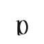 | U+F0330 | HELONIKA SMALL LETTER A |
| `shift+a` | `A` | `A` |  | U+F0200 | SEMARON CAPITAL LETTER ANKRON |  | nothing: this script has no character for the sound |  |  | nothing: this script has no character for the sound |  |  | nothing: this script has no character for the sound |  |  | nothing: this script has no character for the sound |  |  | nothing: this script has no character for the sound |  |  | U+F0300 | HELONIKA CAPITAL LETTER A |
| `b` | `b` | `b` |  | U+F0231 | SEMARON SMALL LETTER BRUTHEKA |  | U+F0006 | PIRZATH LETTER BALG |  | U+F0105 | THURAVARK LETTER BRELD |  | U+1EA11 | QALEZU LETTER BA |  | U+1ED50 | VELDIKKO LETTER P |  | U+F040C | VEDYAKSHARA LETTER BA | 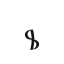 | U+F0331 | HELONIKA SMALL LETTER B |
| `shift+b` | `B` | `B` |  | U+F0201 | SEMARON CAPITAL LETTER BRUTHEKA |  | nothing: this script has no character for the sound |  |  | nothing: this script has no character for the sound |  |  | nothing: this script has no character for the sound |  |  | nothing: this script has no character for the sound |  |  | nothing: this script has no character for the sound |  | 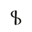 | U+F0301 | HELONIKA CAPITAL LETTER B |
| `d` | `d` | `d` |  | U+F0232 | SEMARON SMALL LETTER DEKAZU |  | U+F000B | PIRZATH LETTER DALK |  | U+F0106 | THURAVARK LETTER DRESK |  | U+1EA03 | QALEZU LETTER DURAS |  | U+1ED56 | VELDIKKO LETTER D |  | U+F0409 | VEDYAKSHARA LETTER DA | 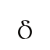 | U+F0332 | HELONIKA SMALL LETTER D |
| `shift+d` | `D` | `D` |  | U+F0202 | SEMARON CAPITAL LETTER DEKAZU |  | nothing: this script has no character for the sound |  |  | nothing: this script has no character for the sound |  |  | nothing: this script has no character for the sound |  |  | nothing: this script has no character for the sound |  |  | nothing: this script has no character for the sound |  | 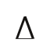 | U+F0302 | HELONIKA CAPITAL LETTER D |
| `e` | `e` | `e` |  | U+F0233 | SEMARON SMALL LETTER ELZA |  | U+F0001 | PIRZATH LETTER E |  | U+F0101 | THURAVARK LETTER E |  | nothing: this script has no character for the sound |  |  | U+1ED73 | VELDIKKO VOWEL SIGN E |  | U+F0431 | VEDYAKSHARA VOWEL SIGN E | 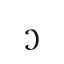 | U+F0333 | HELONIKA SMALL LETTER E |
| `shift+e` | `E` | `E` |  | U+F0203 | SEMARON CAPITAL LETTER ELZA |  | nothing: this script has no character for the sound |  |  | nothing: this script has no character for the sound |  |  | nothing: this script has no character for the sound |  |  | nothing: this script has no character for the sound |  |  | nothing: this script has no character for the sound |  | 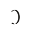 | U+F0303 | HELONIKA CAPITAL LETTER E |
| `f` | `f` | `f` |  | U+F0234 | SEMARON SMALL LETTER FUNELA |  | U+F0007 | PIRZATH LETTER FARZ |  | U+F0107 | THURAVARK LETTER FOSK |  | U+1EA12 | QALEZU LETTER FA |  | U+1ED51 | VELDIKKO LETTER V |   | U+F040B U+F0439 | VEDYAKSHARA LETTER PA; VEDYAKSHARA SIGN SOFT DOT | 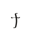 | U+F0335 | HELONIKA SMALL LETTER F |
| `shift+f` | `F` | `F` |  | U+F0204 | SEMARON CAPITAL LETTER FUNELA |  | nothing: this script has no character for the sound |  |  | nothing: this script has no character for the sound |  |  | nothing: this script has no character for the sound |  |  | nothing: this script has no character for the sound |  |  | nothing: this script has no character for the sound |  | 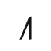 | U+F0305 | HELONIKA CAPITAL LETTER F |
| `g` | `g` | `g` |  | U+F0235 | SEMARON SMALL LETTER GULMOS |  | U+F000E | PIRZATH LETTER GAMTH |  | U+F0108 | THURAVARK LETTER GELDRA |  | U+1EA06 | QALEZU LETTER GITHAR |  | U+1ED58 | VELDIKKO LETTER K |  | U+F0402 | VEDYAKSHARA LETTER GA | 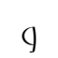 | U+F0336 | HELONIKA SMALL LETTER G |
| `shift+g` | `G` | `G` |  | U+F0205 | SEMARON CAPITAL LETTER GULMOS |  | nothing: this script has no character for the sound |  |  | nothing: this script has no character for the sound |  |  | nothing: this script has no character for the sound |  |  | nothing: this script has no character for the sound |  |  | nothing: this script has no character for the sound |  | 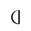 | U+F0306 | HELONIKA CAPITAL LETTER G |
| `h` | `h` | `h` |  | U+F0236 | SEMARON SMALL LETTER HARLEN |  | U+F0011 | PIRZATH LETTER HALB |  | U+F0109 | THURAVARK LETTER HVELM |  | U+1EA0E | QALEZU LETTER HALZI |  | U+1ED59 | VELDIKKO LETTER H |  | U+F0415 | VEDYAKSHARA LETTER HA | 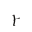 | U+F0337 | HELONIKA SMALL LETTER H |
| `shift+h` | `H` | `H` |  | U+F0206 | SEMARON CAPITAL LETTER HARLEN |  | nothing: this script has no character for the sound |  |  | nothing: this script has no character for the sound |  |  | nothing: this script has no character for the sound |  |  | nothing: this script has no character for the sound |  |  | nothing: this script has no character for the sound |  | 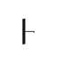 | U+F0307 | HELONIKA CAPITAL LETTER H |
| `i` | `i` | `i` |  | U+F0237 | SEMARON SMALL LETTER ILTHERA |  | U+F0002 | PIRZATH LETTER I |  | U+F0102 | THURAVARK LETTER I |  | nothing: this script has no character for the sound |  |  | U+1ED74 | VELDIKKO VOWEL SIGN I |  | U+F0430 | VEDYAKSHARA VOWEL SIGN I | 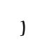 | U+F0338 | HELONIKA SMALL LETTER I |
| `shift+i` | `I` | `I` |  | U+F0207 | SEMARON CAPITAL LETTER ILTHERA |  | nothing: this script has no character for the sound |  |  | nothing: this script has no character for the sound |  |  | nothing: this script has no character for the sound |  |  | nothing: this script has no character for the sound |  |  | nothing: this script has no character for the sound |  |  | U+F0308 | HELONIKA CAPITAL LETTER I |
| `j` | `j` | `j` |  | U+F0238 | SEMARON SMALL LETTER JA |  | U+F0014 | PIRZATH LETTER JA |  | U+F010A | THURAVARK LETTER JA |  | U+1EA16 | QALEZU LETTER TJA |  | U+1ED75 | VELDIKKO VOWEL SIGN Y |  | U+F0406 | VEDYAKSHARA LETTER JA | 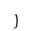 | U+F0339 | HELONIKA SMALL LETTER J |
| `shift+j` | `J` | `J` |  | U+F0208 | SEMARON CAPITAL LETTER JA |  | nothing: this script has no character for the sound |  |  | nothing: this script has no character for the sound |  |  | nothing: this script has no character for the sound |  |  | nothing: this script has no character for the sound |  |  | nothing: this script has no character for the sound |  | 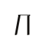 | U+F0309 | HELONIKA CAPITAL LETTER J |
| `k` | `k` | `k` |  | U+F0239 | SEMARON SMALL LETTER KALPEZA |  | U+F000D | PIRZATH LETTER KAMV |  | U+F010B | THURAVARK LETTER KNERV |  | U+1EA07 | QALEZU LETTER KA |  | U+1ED58 | VELDIKKO LETTER K |  | U+F0400 | VEDYAKSHARA LETTER KA | 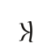 | U+F033A | HELONIKA SMALL LETTER K |
| `shift+k` | `K` | `K` |  | U+F0209 | SEMARON CAPITAL LETTER KALPEZA |  | nothing: this script has no character for the sound |  |  | nothing: this script has no character for the sound |  |  | nothing: this script has no character for the sound |  |  | nothing: this script has no character for the sound |  |  | nothing: this script has no character for the sound |  | 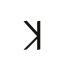 | U+F030A | HELONIKA CAPITAL LETTER K |
| `l` | `l` | `l` |  | U+F023A | SEMARON SMALL LETTER LIZELA |  | U+F0012 | PIRZATH LETTER LADHAV |  | U+F010C | THURAVARK LETTER LA |  | U+1EA00 | QALEZU LETTER LAGUN |  | U+1ED5B | VELDIKKO LETTER L |  | U+F0411 | VEDYAKSHARA LETTER LA | 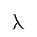 | U+F033B | HELONIKA SMALL LETTER L |
| `shift+l` | `L` | `L` |  | U+F020A | SEMARON CAPITAL LETTER LIZELA |  | nothing: this script has no character for the sound |  |  | nothing: this script has no character for the sound |  |  | nothing: this script has no character for the sound |  |  | nothing: this script has no character for the sound |  |  | nothing: this script has no character for the sound |  | 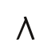 | U+F030B | HELONIKA CAPITAL LETTER L |
| `m` | `m` | `m` |  | U+F023B | SEMARON SMALL LETTER MEZARA |  | U+F0009 | PIRZATH LETTER MARP |  | U+F010D | THURAVARK LETTER MERV |  | U+1EA0A | QALEZU LETTER MELNU |  | U+1ED52 | VELDIKKO LETTER M |  | U+F040E | VEDYAKSHARA LETTER MA | 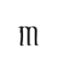 | U+F033C | HELONIKA SMALL LETTER M |
| `shift+m` | `M` | `M` |  | U+F020B | SEMARON CAPITAL LETTER MEZARA |  | nothing: this script has no character for the sound |  |  | nothing: this script has no character for the sound |  |  | nothing: this script has no character for the sound |  |  | nothing: this script has no character for the sound |  |  | nothing: this script has no character for the sound |  | 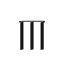 | U+F030C | HELONIKA CAPITAL LETTER M |
| `n` | `n` | `n` |  | U+F023C | SEMARON SMALL LETTER NELAMIS |  | U+F000C | PIRZATH LETTER NAZAF |  | U+F010E | THURAVARK LETTER NELTH |  | U+1EA08 | QALEZU LETTER NELGIR |  | U+1ED55 | VELDIKKO LETTER N |  | U+F040A | VEDYAKSHARA LETTER NA | 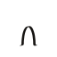 | U+F033D | HELONIKA SMALL LETTER N |
| `shift+n` | `N` | `N` |  | U+F020C | SEMARON CAPITAL LETTER NELAMIS |  | nothing: this script has no character for the sound |  |  | nothing: this script has no character for the sound |  |  | nothing: this script has no character for the sound |  |  | nothing: this script has no character for the sound |  |  | nothing: this script has no character for the sound |  | 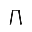 | U+F030D | HELONIKA CAPITAL LETTER N |
| `o` | `o` | `o` |  | U+F023D | SEMARON SMALL LETTER ORNETHE |  | U+F0003 | PIRZATH LETTER O |  | U+F0103 | THURAVARK LETTER ODEL |  | nothing: this script has no character for the sound |  |  | U+1ED71 | VELDIKKO VOWEL SIGN O |  | U+F0434 | VEDYAKSHARA VOWEL SIGN O | 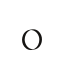 | U+F033E | HELONIKA SMALL LETTER O |
| `shift+o` | `O` | `O` |  | U+F020D | SEMARON CAPITAL LETTER ORNETHE |  | nothing: this script has no character for the sound |  |  | nothing: this script has no character for the sound |  |  | nothing: this script has no character for the sound |  |  | nothing: this script has no character for the sound |  |  | nothing: this script has no character for the sound |  | 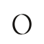 | U+F030E | HELONIKA CAPITAL LETTER O |
| `p` | `p` | `p` |  | U+F023E | SEMARON SMALL LETTER POZERA |  | U+F0005 | PIRZATH LETTER PARGH |  | U+F010F | THURAVARK LETTER PA |  | U+1EA10 | QALEZU LETTER PA |  | U+1ED50 | VELDIKKO LETTER P |  | U+F040B | VEDYAKSHARA LETTER PA | 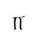 | U+F0340 | HELONIKA SMALL LETTER P |
| `shift+p` | `P` | `P` |  | U+F020E | SEMARON CAPITAL LETTER POZERA |  | nothing: this script has no character for the sound |  |  | nothing: this script has no character for the sound |  |  | nothing: this script has no character for the sound |  |  | nothing: this script has no character for the sound |  |  | nothing: this script has no character for the sound |  | 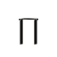 | U+F0310 | HELONIKA CAPITAL LETTER P |
| `q` | `q` | `q` | 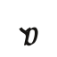 | U+F0247 | SEMARON SMALL LETTER QORETHA |  | U+F0015 | PIRZATH LETTER QA |  | U+F010B | THURAVARK LETTER KNERV |  | U+1EA0B | QALEZU LETTER QENUWA |  | U+1ED58 | VELDIKKO LETTER K |  | nothing: this script has no character for the sound |  |  | U+F033A | HELONIKA SMALL LETTER K |
| `shift+q` | `Q` | `Q` | 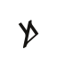 | U+F0217 | SEMARON CAPITAL LETTER QORETHA |  | nothing: this script has no character for the sound |  |  | nothing: this script has no character for the sound |  |  | nothing: this script has no character for the sound |  |  | nothing: this script has no character for the sound |  |  | nothing: this script has no character for the sound |  |  | U+F030A | HELONIKA CAPITAL LETTER K |
| `r` | `r` | `r` |  | U+F023F | SEMARON SMALL LETTER RONETHOS |  | U+F0013 | PIRZATH LETTER RAGHAV |  | U+F0110 | THURAVARK LETTER RELTH |  | U+1EA01 | QALEZU LETTER RETHU |  | U+1ED5C | VELDIKKO LETTER R |  | U+F0410 | VEDYAKSHARA LETTER RA | 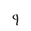 | U+F0341 | HELONIKA SMALL LETTER R |
| `shift+r` | `R` | `R` |  | U+F020F | SEMARON CAPITAL LETTER RONETHOS |  | nothing: this script has no character for the sound |  |  | nothing: this script has no character for the sound |  |  | nothing: this script has no character for the sound |  |  | nothing: this script has no character for the sound |  |  | nothing: this script has no character for the sound |  | 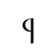 | U+F0311 | HELONIKA CAPITAL LETTER R |
| `s` | `s` | `s` |  | U+F0240 | SEMARON SMALL LETTER SIRETHA |  | U+F000F | PIRZATH LETTER SAKAR |  | U+F0111 | THURAVARK LETTER SVELD |  | U+1EA05 | QALEZU LETTER SELQUR |  | U+1ED54 | VELDIKKO LETTER S |  | U+F0414 | VEDYAKSHARA LETTER SA | 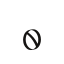 | U+F0342 | HELONIKA SMALL LETTER S |
| `shift+s` | `S` | `S` |  | U+F0210 | SEMARON CAPITAL LETTER SIRETHA |  | nothing: this script has no character for the sound |  |  | nothing: this script has no character for the sound |  |  | nothing: this script has no character for the sound |  |  | nothing: this script has no character for the sound |  |  | nothing: this script has no character for the sound |  | 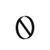 | U+F0312 | HELONIKA CAPITAL LETTER S |
| `t` | `t` | `t` |  | U+F0241 | SEMARON SMALL LETTER TALOTHOS |  | U+F000A | PIRZATH LETTER TAMB |  | U+F0112 | THURAVARK LETTER TING |  | U+1EA02 | QALEZU LETTER TULAZ |  | U+1ED53 | VELDIKKO LETTER T |  | U+F0408 | VEDYAKSHARA LETTER TA | 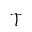 | U+F0343 | HELONIKA SMALL LETTER T |
| `shift+t` | `T` | `T` |  | U+F0211 | SEMARON CAPITAL LETTER TALOTHOS |  | nothing: this script has no character for the sound |  |  | nothing: this script has no character for the sound |  |  | nothing: this script has no character for the sound |  |  | nothing: this script has no character for the sound |  |  | nothing: this script has no character for the sound |  |  | U+F0313 | HELONIKA CAPITAL LETTER T |
| `u` | `u` | `u` |  | U+F0242 | SEMARON SMALL LETTER ULMERA |  | U+F0004 | PIRZATH LETTER U |  | U+F0104 | THURAVARK LETTER U |  | nothing: this script has no character for the sound |  |  | U+1ED72 | VELDIKKO VOWEL SIGN U |  | U+F0433 | VEDYAKSHARA VOWEL SIGN U |  | U+F0345 | HELONIKA SMALL LETTER U |
| `shift+u` | `U` | `U` |  | U+F0212 | SEMARON CAPITAL LETTER ULMERA |  | nothing: this script has no character for the sound |  |  | nothing: this script has no character for the sound |  |  | nothing: this script has no character for the sound |  |  | nothing: this script has no character for the sound |  |  | nothing: this script has no character for the sound |  | 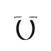 | U+F0315 | HELONIKA CAPITAL LETTER U |
| `v` | `v` | `v` |  | U+F0243 | SEMARON SMALL LETTER VARTHOS |  | U+F0008 | PIRZATH LETTER VAZAL |  | U+F0113 | THURAVARK LETTER VULD |  | U+1EA12 | QALEZU LETTER FA |  | U+1ED51 | VELDIKKO LETTER V |  | U+F0412 | VEDYAKSHARA LETTER VA | 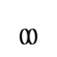 | U+F0346 | HELONIKA SMALL LETTER V |
| `shift+v` | `V` | `V` |  | U+F0213 | SEMARON CAPITAL LETTER VARTHOS |  | nothing: this script has no character for the sound |  |  | nothing: this script has no character for the sound |  |  | nothing: this script has no character for the sound |  |  | nothing: this script has no character for the sound |  |  | nothing: this script has no character for the sound |  | 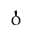 | U+F0316 | HELONIKA CAPITAL LETTER V |
| `w` | `w` | `w` |  | U+F0244 | SEMARON SMALL LETTER WA |  | U+F0016 | PIRZATH LETTER WA |  | U+F0114 | THURAVARK LETTER WA |  | U+1EA13 | QALEZU LETTER WALIR |  | U+1ED51 | VELDIKKO LETTER V |  | nothing: this script has no character for the sound |  |  | U+F0345 | HELONIKA SMALL LETTER U |
| `shift+w` | `W` | `W` |  | U+F0214 | SEMARON CAPITAL LETTER WA |  | nothing: this script has no character for the sound |  |  | nothing: this script has no character for the sound |  |  | nothing: this script has no character for the sound |  |  | nothing: this script has no character for the sound |  |  | nothing: this script has no character for the sound |  |  | U+F0315 | HELONIKA CAPITAL LETTER U |
| `y` | `y` | `y` |  | U+F0245 | SEMARON SMALL LETTER YALZEMIS |  | U+F0017 | PIRZATH LETTER YA |  | U+F010A | THURAVARK LETTER JA |  | U+1EA14 | QALEZU LETTER YA |  | U+1ED75 | VELDIKKO VOWEL SIGN Y |  | U+F040F | VEDYAKSHARA LETTER YA |  | U+F0338 | HELONIKA SMALL LETTER I |
| `shift+y` | `Y` | `Y` |  | U+F0215 | SEMARON CAPITAL LETTER YALZEMIS |  | nothing: this script has no character for the sound |  |  | nothing: this script has no character for the sound |  |  | nothing: this script has no character for the sound |  |  | nothing: this script has no character for the sound |  |  | nothing: this script has no character for the sound |  |  | U+F0308 | HELONIKA CAPITAL LETTER I |
| `z` | `z` | `z` |  | U+F0246 | SEMARON SMALL LETTER ZARGON |  | U+F0010 | PIRZATH LETTER ZALD |  | U+F0115 | THURAVARK LETTER ZA |  | U+1EA04 | QALEZU LETTER ZAGUL |  | U+1ED54 | VELDIKKO LETTER S |  | nothing: this script has no character for the sound |  | 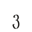 | U+F0347 | HELONIKA SMALL LETTER Z |
| `shift+z` | `Z` | `Z` |  | U+F0216 | SEMARON CAPITAL LETTER ZARGON |  | nothing: this script has no character for the sound |  |  | nothing: this script has no character for the sound |  |  | nothing: this script has no character for the sound |  |  | nothing: this script has no character for the sound |  |  | nothing: this script has no character for the sound |  | 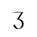 | U+F0317 | HELONIKA CAPITAL LETTER Z |
| `option+c` | `\c` | `ch` | 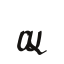 | U+F028C | SEMARON SMALL LETTER CHEROLA |  | U+F0027 | PIRZATH LETTER CHA |  | nothing: this script has no character for the sound |  |  | U+1EA16 | QALEZU LETTER TJA |  | U+1ED58 | VELDIKKO LETTER K |  | U+F0405 | VEDYAKSHARA LETTER CHA |    | U+F0343 U+F0342 U+F0337 | HELONIKA SMALL LETTER T; HELONIKA SMALL LETTER S; HELONIKA SMALL LETTER H |
| `option+shift+c` | `\C` | `Ch` |  | U+F028D | SEMARON CAPITAL LETTER CHEROLA |  | nothing: this script has no character for the sound |  |  | nothing: this script has no character for the sound |  |  | nothing: this script has no character for the sound |  |  | nothing: this script has no character for the sound |  |  | nothing: this script has no character for the sound |  |    | U+F0313 U+F0342 U+F0337 | HELONIKA CAPITAL LETTER T; HELONIKA SMALL LETTER S; HELONIKA SMALL LETTER H |
| `option+s` | `\s` | `sh` |  | U+F0286 | SEMARON SMALL LETTER SHELMORA |  | U+F0024 | PIRZATH LETTER SHA |   | U+F0111 U+F0109 | THURAVARK LETTER SVELD; THURAVARK LETTER HVELM |  | U+1EA0F | QALEZU LETTER SHENULET |   | U+1ED54 U+1ED59 | VELDIKKO LETTER S; VELDIKKO LETTER H |  | U+F0413 | VEDYAKSHARA LETTER SHA |   | U+F0342 U+F0337 | HELONIKA SMALL LETTER S; HELONIKA SMALL LETTER H |
| `option+shift+s` | `\S` | `Sh` |  | U+F0287 | SEMARON CAPITAL LETTER SHELMORA |  | nothing: this script has no character for the sound |  |  | nothing: this script has no character for the sound |  |  | nothing: this script has no character for the sound |  |  | nothing: this script has no character for the sound |  |  | nothing: this script has no character for the sound |  |   | U+F0312 U+F0337 | HELONIKA CAPITAL LETTER S; HELONIKA SMALL LETTER H |
| `option+t` | `\t` | `th` |  | U+F0250 | SEMARON SMALL LETTER THOLERA |  | U+F0020 | PIRZATH LETTER THARZ |  | U+F0120 | THURAVARK LETTER THRESK |  | U+1EA09 | QALEZU LETTER THELQEN |   | U+1ED53 U+1ED59 | VELDIKKO LETTER T; VELDIKKO LETTER H |    | U+F0408 U+F0438 U+F0415 | VEDYAKSHARA LETTER TA; VEDYAKSHARA SIGN CUT; VEDYAKSHARA LETTER HA |  | U+F0344 | HELONIKA SMALL LETTER TH |
| `option+shift+t` | `\T` | `Th` |  | U+F0251 | SEMARON CAPITAL LETTER THOLERA |  | nothing: this script has no character for the sound |  |  | nothing: this script has no character for the sound |  |  | nothing: this script has no character for the sound |  |  | nothing: this script has no character for the sound |  |  | nothing: this script has no character for the sound |  |  | U+F0314 | HELONIKA CAPITAL LETTER TH |
| `option+d` | `\d` | `dh` |  | U+F0280 | SEMARON SMALL LETTER DHANETHE |  | U+F0021 | PIRZATH LETTER DHALZ |  | U+F0121 | THURAVARK LETTER DHA |   | U+1EA03 U+1EA0E | QALEZU LETTER DURAS; QALEZU LETTER HALZI |  | U+1ED57 | VELDIKKO LETTER DH |    | U+F0409 U+F0438 U+F0415 | VEDYAKSHARA LETTER DA; VEDYAKSHARA SIGN CUT; VEDYAKSHARA LETTER HA |   | U+F0332 U+F0337 | HELONIKA SMALL LETTER D; HELONIKA SMALL LETTER H |
| `option+shift+d` | `\D` | `Dh` |  | U+F0281 | SEMARON CAPITAL LETTER DHANETHE |  | nothing: this script has no character for the sound |  |  | nothing: this script has no character for the sound |  |  | nothing: this script has no character for the sound |  |  | nothing: this script has no character for the sound |  |  | nothing: this script has no character for the sound |  |   | U+F0302 U+F0337 | HELONIKA CAPITAL LETTER D; HELONIKA SMALL LETTER H |
| `option+k` | `\k` | `kh` |  | U+F0282 | SEMARON SMALL LETTER KHORVENA |  | U+F0022 | PIRZATH LETTER KHABAR |  | U+F0122 | THURAVARK LETTER KHA |  | U+1EA0C | QALEZU LETTER KHA |   | U+1ED58 U+1ED59 | VELDIKKO LETTER K; VELDIKKO LETTER H |  | U+F0401 | VEDYAKSHARA LETTER KHA |   | U+F033A U+F0337 | HELONIKA SMALL LETTER K; HELONIKA SMALL LETTER H |
| `option+shift+k` | `\K` | `Kh` |  | U+F0283 | SEMARON CAPITAL LETTER KHORVENA |  | nothing: this script has no character for the sound |  |  | nothing: this script has no character for the sound |  |  | nothing: this script has no character for the sound |  |  | nothing: this script has no character for the sound |  |  | nothing: this script has no character for the sound |  |   | U+F030A U+F0337 | HELONIKA CAPITAL LETTER K; HELONIKA SMALL LETTER H |
| `option+g` | `\g` | `gh` |  | U+F0284 | SEMARON SMALL LETTER GHORMAS |  | U+F0023 | PIRZATH LETTER GHARM |  | U+F0123 | THURAVARK LETTER GHA |  | U+1EA0D | QALEZU LETTER GHA |   | U+1ED58 U+1ED59 | VELDIKKO LETTER K; VELDIKKO LETTER H |  | U+F0403 | VEDYAKSHARA LETTER GHA |   | U+F0336 U+F0337 | HELONIKA SMALL LETTER G; HELONIKA SMALL LETTER H |
| `option+shift+g` | `\G` | `Gh` |  | U+F0285 | SEMARON CAPITAL LETTER GHORMAS |  | nothing: this script has no character for the sound |  |  | nothing: this script has no character for the sound |  |  | nothing: this script has no character for the sound |  |  | nothing: this script has no character for the sound |  |  | nothing: this script has no character for the sound |  |   | U+F0306 U+F0337 | HELONIKA CAPITAL LETTER G; HELONIKA SMALL LETTER H |
| `option+z` | `\z` | `zh` |  | U+F0288 | SEMARON SMALL LETTER ZHAREVA |  | U+F0025 | PIRZATH LETTER ZHA |   | U+F0115 U+F0109 | THURAVARK LETTER ZA; THURAVARK LETTER HVELM |   | U+1EA04 U+1EA0E | QALEZU LETTER ZAGUL; QALEZU LETTER HALZI |   | U+1ED54 U+1ED59 | VELDIKKO LETTER S; VELDIKKO LETTER H |  | nothing: this script has no character for the sound |  |   | U+F0347 U+F0337 | HELONIKA SMALL LETTER Z; HELONIKA SMALL LETTER H |
| `option+shift+z` | `\Z` | `Zh` |  | U+F0289 | SEMARON CAPITAL LETTER ZHAREVA |  | nothing: this script has no character for the sound |  |  | nothing: this script has no character for the sound |  |  | nothing: this script has no character for the sound |  |  | nothing: this script has no character for the sound |  |  | nothing: this script has no character for the sound |  |   | U+F0317 U+F0337 | HELONIKA CAPITAL LETTER Z; HELONIKA SMALL LETTER H |
| `option+p` | `\p` | `ph` |   | U+F023E U+F0236 | SEMARON SMALL LETTER POZERA; SEMARON SMALL LETTER HARLEN |   | U+F0005 U+F0011 | PIRZATH LETTER PARGH; PIRZATH LETTER HALB |   | U+F010F U+F0109 | THURAVARK LETTER PA; THURAVARK LETTER HVELM |   | U+1EA10 U+1EA0E | QALEZU LETTER PA; QALEZU LETTER HALZI |   | U+1ED50 U+1ED59 | VELDIKKO LETTER P; VELDIKKO LETTER H |    | U+F040B U+F0438 U+F0415 | VEDYAKSHARA LETTER PA; VEDYAKSHARA SIGN CUT; VEDYAKSHARA LETTER HA |  | U+F0335 | HELONIKA SMALL LETTER F |
| `option+shift+p` | `\P` | `Ph` |   | U+F020E U+F0236 | SEMARON CAPITAL LETTER POZERA; SEMARON SMALL LETTER HARLEN |  | nothing: this script has no character for the sound |  |  | nothing: this script has no character for the sound |  |  | nothing: this script has no character for the sound |  |  | nothing: this script has no character for the sound |  |  | nothing: this script has no character for the sound |  |  | U+F0305 | HELONIKA CAPITAL LETTER F |
| `option+n` | `\n` | `ng` |  | U+F028E | SEMARON SMALL LETTER ENGARIS |  | U+F0028 | PIRZATH LETTER NGA |  | U+F0125 | THURAVARK LETTER NGA |   | U+1EA08 U+1EA06 | QALEZU LETTER NELGIR; QALEZU LETTER GITHAR |  | U+1ED5A | VELDIKKO LETTER NG |  | U+F0404 | VEDYAKSHARA LETTER NGA |   | U+F033D U+F0336 | HELONIKA SMALL LETTER N; HELONIKA SMALL LETTER G |
| `option+shift+n` | `\N` | `Ng` |  | U+F028F | SEMARON CAPITAL LETTER ENGARIS |  | nothing: this script has no character for the sound |  |  | nothing: this script has no character for the sound |  |  | nothing: this script has no character for the sound |  |  | nothing: this script has no character for the sound |  |  | nothing: this script has no character for the sound |  |   | U+F030D U+F0336 | HELONIKA CAPITAL LETTER N; HELONIKA SMALL LETTER G |
| `option+y` | `\y` | `ny` |  | U+F0290 | SEMARON SMALL LETTER NYELIS |  | U+F0029 | PIRZATH LETTER NYA |   | U+F010E U+F0102 | THURAVARK LETTER NELTH; THURAVARK LETTER I |   | U+1EA08 U+1EA14 | QALEZU LETTER NELGIR; QALEZU LETTER YA |   | U+1ED55 U+1ED75 | VELDIKKO LETTER N; VELDIKKO VOWEL SIGN Y |  | U+F0407 | VEDYAKSHARA LETTER NYA |   | U+F033D U+F0338 | HELONIKA SMALL LETTER N; HELONIKA SMALL LETTER I |
| `option+shift+y` | `\Y` | `Ny` |  | U+F0291 | SEMARON CAPITAL LETTER NYELIS |  | nothing: this script has no character for the sound |  |  | nothing: this script has no character for the sound |  |  | nothing: this script has no character for the sound |  |  | nothing: this script has no character for the sound |  |  | nothing: this script has no character for the sound |  |   | U+F030D U+F0338 | HELONIKA CAPITAL LETTER N; HELONIKA SMALL LETTER I |
| `option+x` | `\x` | `ts` |  | U+F028A | SEMARON SMALL LETTER TSALEMA |  | U+F0026 | PIRZATH LETTER TSA |   | U+F0112 U+F0111 | THURAVARK LETTER TING; THURAVARK LETTER SVELD |   | U+1EA02 U+1EA05 | QALEZU LETTER TULAZ; QALEZU LETTER SELQUR |   | U+1ED53 U+1ED54 | VELDIKKO LETTER T; VELDIKKO LETTER S |    | U+F0408 U+F0438 U+F0414 | VEDYAKSHARA LETTER TA; VEDYAKSHARA SIGN CUT; VEDYAKSHARA LETTER SA |   | U+F0343 U+F0342 | HELONIKA SMALL LETTER T; HELONIKA SMALL LETTER S |
| `option+shift+x` | `\X` | `Ts` |  | U+F028B | SEMARON CAPITAL LETTER TSALEMA |  | nothing: this script has no character for the sound |  |  | nothing: this script has no character for the sound |  |  | nothing: this script has no character for the sound |  |  | nothing: this script has no character for the sound |  |  | nothing: this script has no character for the sound |  |   | U+F0313 U+F0342 | HELONIKA CAPITAL LETTER T; HELONIKA SMALL LETTER S |
| `option+h` | `\h` | `hl` |   | U+F0236 U+F023A | SEMARON SMALL LETTER HARLEN; SEMARON SMALL LETTER LIZELA |  | U+F002A | PIRZATH LETTER HLA |  | U+F0124 | THURAVARK LETTER HLA |   | U+1EA0E U+1EA00 | QALEZU LETTER HALZI; QALEZU LETTER LAGUN |   | U+1ED59 U+1ED5B | VELDIKKO LETTER H; VELDIKKO LETTER L |    | U+F0415 U+F0438 U+F0411 | VEDYAKSHARA LETTER HA; VEDYAKSHARA SIGN CUT; VEDYAKSHARA LETTER LA |   | U+F0337 U+F033B | HELONIKA SMALL LETTER H; HELONIKA SMALL LETTER L |
| `option+shift+h` | `\H` | `Hl` |   | U+F0206 U+F023A | SEMARON CAPITAL LETTER HARLEN; SEMARON SMALL LETTER LIZELA |  | nothing: this script has no character for the sound |  |  | nothing: this script has no character for the sound |  |  | nothing: this script has no character for the sound |  |  | nothing: this script has no character for the sound |  |  | nothing: this script has no character for the sound |  |   | U+F0307 U+F033B | HELONIKA CAPITAL LETTER H; HELONIKA SMALL LETTER L |
| `option+b` | `\b` | `bh` |   | U+F0231 U+F0236 | SEMARON SMALL LETTER BRUTHEKA; SEMARON SMALL LETTER HARLEN |   | U+F0006 U+F0011 | PIRZATH LETTER BALG; PIRZATH LETTER HALB |   | U+F0105 U+F0109 | THURAVARK LETTER BRELD; THURAVARK LETTER HVELM |   | U+1EA11 U+1EA0E | QALEZU LETTER BA; QALEZU LETTER HALZI |   | U+1ED50 U+1ED59 | VELDIKKO LETTER P; VELDIKKO LETTER H |  | U+F040D | VEDYAKSHARA LETTER BHA |   | U+F0331 U+F0337 | HELONIKA SMALL LETTER B; HELONIKA SMALL LETTER H |
| `option+shift+b` | `\B` | `Bh` |   | U+F0201 U+F0236 | SEMARON CAPITAL LETTER BRUTHEKA; SEMARON SMALL LETTER HARLEN |  | nothing: this script has no character for the sound |  |  | nothing: this script has no character for the sound |  |  | nothing: this script has no character for the sound |  |  | nothing: this script has no character for the sound |  |  | nothing: this script has no character for the sound |  |   | U+F0301 U+F0337 | HELONIKA CAPITAL LETTER B; HELONIKA SMALL LETTER H |
| `option+1` | `\1` | `aa` |  | U+F0248 | SEMARON SMALL LETTER LONG ANKRON |   | U+F0000 U+F0000 | PIRZATH LETTER A; PIRZATH LETTER A |   | U+F0100 U+F0100 | THURAVARK LETTER A; THURAVARK LETTER A |  | nothing: this script has no character for the sound |  |   | U+1ED70 U+1ED78 | VELDIKKO VOWEL SIGN A; VELDIKKO SIGN LONG |  | nothing: this script has no character for the sound |  |   | U+F0330 U+F0330 | HELONIKA SMALL LETTER A; HELONIKA SMALL LETTER A |
| `option+shift+1` | `\!` | `Aa` |  | U+F0220 | SEMARON CAPITAL LETTER LONG ANKRON |  | nothing: this script has no character for the sound |  |  | nothing: this script has no character for the sound |  |  | nothing: this script has no character for the sound |  |  | nothing: this script has no character for the sound |  |  | nothing: this script has no character for the sound |  |   | U+F0300 U+F0330 | HELONIKA CAPITAL LETTER A; HELONIKA SMALL LETTER A |
| `option+2` | `\2` | `ee` |   | U+F0233 U+F0233 | SEMARON SMALL LETTER ELZA; SEMARON SMALL LETTER ELZA |   | U+F0001 U+F0001 | PIRZATH LETTER E; PIRZATH LETTER E |   | U+F0101 U+F0101 | THURAVARK LETTER E; THURAVARK LETTER E |  | nothing: this script has no character for the sound |  |   | U+1ED73 U+1ED78 | VELDIKKO VOWEL SIGN E; VELDIKKO SIGN LONG |   | U+F0431 U+F0431 | VEDYAKSHARA VOWEL SIGN E; VEDYAKSHARA VOWEL SIGN E |   | U+F0333 U+F0333 | HELONIKA SMALL LETTER E; HELONIKA SMALL LETTER E |
| `option+shift+2` | `\@` | `Ee` |   | U+F0203 U+F0233 | SEMARON CAPITAL LETTER ELZA; SEMARON SMALL LETTER ELZA |  | nothing: this script has no character for the sound |  |  | nothing: this script has no character for the sound |  |  | nothing: this script has no character for the sound |  |  | nothing: this script has no character for the sound |  |  | nothing: this script has no character for the sound |  |   | U+F0303 U+F0333 | HELONIKA CAPITAL LETTER E; HELONIKA SMALL LETTER E |
| `option+3` | `\3` | `ii` |  | U+F024A | SEMARON SMALL LETTER LONG ILTHERA |   | U+F0002 U+F0002 | PIRZATH LETTER I; PIRZATH LETTER I |   | U+F0102 U+F0102 | THURAVARK LETTER I; THURAVARK LETTER I |  | nothing: this script has no character for the sound |  |   | U+1ED74 U+1ED78 | VELDIKKO VOWEL SIGN I; VELDIKKO SIGN LONG |   | U+F0430 U+F0430 | VEDYAKSHARA VOWEL SIGN I; VEDYAKSHARA VOWEL SIGN I |   | U+F0338 U+F0338 | HELONIKA SMALL LETTER I; HELONIKA SMALL LETTER I |
| `option+shift+3` | `\#` | `Ii` |  | U+F0222 | SEMARON CAPITAL LETTER LONG ILTHERA |  | nothing: this script has no character for the sound |  |  | nothing: this script has no character for the sound |  |  | nothing: this script has no character for the sound |  |  | nothing: this script has no character for the sound |  |  | nothing: this script has no character for the sound |  |   | U+F0308 U+F0338 | HELONIKA CAPITAL LETTER I; HELONIKA SMALL LETTER I |
| `option+4` | `\4` | `oo` |   | U+F023D U+F023D | SEMARON SMALL LETTER ORNETHE; SEMARON SMALL LETTER ORNETHE |   | U+F0003 U+F0003 | PIRZATH LETTER O; PIRZATH LETTER O |   | U+F0103 U+F0103 | THURAVARK LETTER ODEL; THURAVARK LETTER ODEL |  | nothing: this script has no character for the sound |  |   | U+1ED71 U+1ED78 | VELDIKKO VOWEL SIGN O; VELDIKKO SIGN LONG |   | U+F0434 U+F0434 | VEDYAKSHARA VOWEL SIGN O; VEDYAKSHARA VOWEL SIGN O |   | U+F033E U+F033E | HELONIKA SMALL LETTER O; HELONIKA SMALL LETTER O |
| `option+shift+4` | `\$` | `Oo` |   | U+F020D U+F023D | SEMARON CAPITAL LETTER ORNETHE; SEMARON SMALL LETTER ORNETHE |  | nothing: this script has no character for the sound |  |  | nothing: this script has no character for the sound |  |  | nothing: this script has no character for the sound |  |  | nothing: this script has no character for the sound |  |  | nothing: this script has no character for the sound |  |   | U+F030E U+F033E | HELONIKA CAPITAL LETTER O; HELONIKA SMALL LETTER O |
| `option+5` | `\5` | `uu` |  | U+F024C | SEMARON SMALL LETTER LONG ULMERA |   | U+F0004 U+F0004 | PIRZATH LETTER U; PIRZATH LETTER U |   | U+F0104 U+F0104 | THURAVARK LETTER U; THURAVARK LETTER U |  | nothing: this script has no character for the sound |  |   | U+1ED72 U+1ED78 | VELDIKKO VOWEL SIGN U; VELDIKKO SIGN LONG |   | U+F0433 U+F0433 | VEDYAKSHARA VOWEL SIGN U; VEDYAKSHARA VOWEL SIGN U |   | U+F0345 U+F0345 | HELONIKA SMALL LETTER U; HELONIKA SMALL LETTER U |
| `option+shift+5` | `\%` | `Uu` |  | U+F0224 | SEMARON CAPITAL LETTER LONG ULMERA |  | nothing: this script has no character for the sound |  |  | nothing: this script has no character for the sound |  |  | nothing: this script has no character for the sound |  |  | nothing: this script has no character for the sound |  |  | nothing: this script has no character for the sound |  |   | U+F0315 U+F0345 | HELONIKA CAPITAL LETTER U; HELONIKA SMALL LETTER U |
| `option+6` | `\6` | `ai` |   | U+F0230 U+F0237 | SEMARON SMALL LETTER ANKRON; SEMARON SMALL LETTER ILTHERA |  | U+F0030 | PIRZATH LETTER AI |   | U+F0100 U+F0102 | THURAVARK LETTER A; THURAVARK LETTER I |  | nothing: this script has no character for the sound |  |   | U+1ED70 U+1ED74 | VELDIKKO VOWEL SIGN A; VELDIKKO VOWEL SIGN I |  | U+F0432 | VEDYAKSHARA VOWEL SIGN AI |   | U+F0330 U+F0338 | HELONIKA SMALL LETTER A; HELONIKA SMALL LETTER I |
| `option+shift+6` | `\^` | `Ai` |   | U+F0200 U+F0237 | SEMARON CAPITAL LETTER ANKRON; SEMARON SMALL LETTER ILTHERA |  | nothing: this script has no character for the sound |  |  | nothing: this script has no character for the sound |  |  | nothing: this script has no character for the sound |  |  | nothing: this script has no character for the sound |  |  | nothing: this script has no character for the sound |  |   | U+F0300 U+F0338 | HELONIKA CAPITAL LETTER A; HELONIKA SMALL LETTER I |
| `option+7` | `\7` | `au` |   | U+F0230 U+F0242 | SEMARON SMALL LETTER ANKRON; SEMARON SMALL LETTER ULMERA |  | U+F0031 | PIRZATH LETTER AU |   | U+F0100 U+F0104 | THURAVARK LETTER A; THURAVARK LETTER U |  | nothing: this script has no character for the sound |  |   | U+1ED70 U+1ED72 | VELDIKKO VOWEL SIGN A; VELDIKKO VOWEL SIGN U |  | U+F0435 | VEDYAKSHARA VOWEL SIGN AU |   | U+F0330 U+F0345 | HELONIKA SMALL LETTER A; HELONIKA SMALL LETTER U |
| `option+shift+7` | `\&` | `Au` |   | U+F0200 U+F0242 | SEMARON CAPITAL LETTER ANKRON; SEMARON SMALL LETTER ULMERA |  | nothing: this script has no character for the sound |  |  | nothing: this script has no character for the sound |  |  | nothing: this script has no character for the sound |  |  | nothing: this script has no character for the sound |  |  | nothing: this script has no character for the sound |  |   | U+F0300 U+F0345 | HELONIKA CAPITAL LETTER A; HELONIKA SMALL LETTER U |
| `option+8` | `\8` | `ei` |   | U+F0233 U+F0237 | SEMARON SMALL LETTER ELZA; SEMARON SMALL LETTER ILTHERA |  | U+F0032 | PIRZATH LETTER EI |   | U+F0101 U+F0102 | THURAVARK LETTER E; THURAVARK LETTER I |  | nothing: this script has no character for the sound |  |   | U+1ED73 U+1ED74 | VELDIKKO VOWEL SIGN E; VELDIKKO VOWEL SIGN I |   | U+F0431 U+F0430 | VEDYAKSHARA VOWEL SIGN E; VEDYAKSHARA VOWEL SIGN I |  | U+F0334 | HELONIKA SMALL LETTER LONG E |
| `option+shift+8` | `\*` | `Ei` |   | U+F0203 U+F0237 | SEMARON CAPITAL LETTER ELZA; SEMARON SMALL LETTER ILTHERA |  | nothing: this script has no character for the sound |  |  | nothing: this script has no character for the sound |  |  | nothing: this script has no character for the sound |  |  | nothing: this script has no character for the sound |  |  | nothing: this script has no character for the sound |  |  | U+F0304 | HELONIKA CAPITAL LETTER LONG E |
| `option+9` | `\9` | `oi` |   | U+F023D U+F0237 | SEMARON SMALL LETTER ORNETHE; SEMARON SMALL LETTER ILTHERA |  | U+F0033 | PIRZATH LETTER OI |   | U+F0103 U+F0102 | THURAVARK LETTER ODEL; THURAVARK LETTER I |  | nothing: this script has no character for the sound |  |   | U+1ED71 U+1ED74 | VELDIKKO VOWEL SIGN O; VELDIKKO VOWEL SIGN I |   | U+F0434 U+F0430 | VEDYAKSHARA VOWEL SIGN O; VEDYAKSHARA VOWEL SIGN I |   | U+F033E U+F0338 | HELONIKA SMALL LETTER O; HELONIKA SMALL LETTER I |
| `option+shift+9` | `\(` | `Oi` |   | U+F020D U+F0237 | SEMARON CAPITAL LETTER ORNETHE; SEMARON SMALL LETTER ILTHERA |  | nothing: this script has no character for the sound |  |  | nothing: this script has no character for the sound |  |  | nothing: this script has no character for the sound |  |  | nothing: this script has no character for the sound |  |  | nothing: this script has no character for the sound |  |   | U+F030E U+F0338 | HELONIKA CAPITAL LETTER O; HELONIKA SMALL LETTER I |
| `option+0` | `\0` | `ou` |   | U+F023D U+F0242 | SEMARON SMALL LETTER ORNETHE; SEMARON SMALL LETTER ULMERA |  | U+F0034 | PIRZATH LETTER OU |   | U+F0103 U+F0104 | THURAVARK LETTER ODEL; THURAVARK LETTER U |  | nothing: this script has no character for the sound |  |   | U+1ED71 U+1ED72 | VELDIKKO VOWEL SIGN O; VELDIKKO VOWEL SIGN U |   | U+F0434 U+F0433 | VEDYAKSHARA VOWEL SIGN O; VEDYAKSHARA VOWEL SIGN U |  | U+F033F | HELONIKA SMALL LETTER LONG O |
| `option+shift+0` | `\)` | `Ou` |   | U+F020D U+F0242 | SEMARON CAPITAL LETTER ORNETHE; SEMARON SMALL LETTER ULMERA |  | nothing: this script has no character for the sound |  |  | nothing: this script has no character for the sound |  |  | nothing: this script has no character for the sound |  |  | nothing: this script has no character for the sound |  |  | nothing: this script has no character for the sound |  |  | U+F030F | HELONIKA CAPITAL LETTER LONG O |
| `option+-` | `\-` | `ie` |   | U+F0237 U+F0233 | SEMARON SMALL LETTER ILTHERA; SEMARON SMALL LETTER ELZA |   | U+F0002 U+F0001 | PIRZATH LETTER I; PIRZATH LETTER E |   | U+F0102 U+F0101 | THURAVARK LETTER I; THURAVARK LETTER E |  | nothing: this script has no character for the sound |  |   | U+1ED74 U+1ED73 | VELDIKKO VOWEL SIGN I; VELDIKKO VOWEL SIGN E |   | U+F0430 U+F0431 | VEDYAKSHARA VOWEL SIGN I; VEDYAKSHARA VOWEL SIGN E |   | U+F0338 U+F0333 | HELONIKA SMALL LETTER I; HELONIKA SMALL LETTER E |
| `option+shift+-` | `\_` | `Ie` |   | U+F0207 U+F0233 | SEMARON CAPITAL LETTER ILTHERA; SEMARON SMALL LETTER ELZA |  | nothing: this script has no character for the sound |  |  | nothing: this script has no character for the sound |  |  | nothing: this script has no character for the sound |  |  | nothing: this script has no character for the sound |  |  | nothing: this script has no character for the sound |  |   | U+F0308 U+F0333 | HELONIKA CAPITAL LETTER I; HELONIKA SMALL LETTER E |
| `option+=` | `\=` | `uo` |   | U+F0242 U+F023D | SEMARON SMALL LETTER ULMERA; SEMARON SMALL LETTER ORNETHE |   | U+F0004 U+F0003 | PIRZATH LETTER U; PIRZATH LETTER O |   | U+F0104 U+F0103 | THURAVARK LETTER U; THURAVARK LETTER ODEL |  | nothing: this script has no character for the sound |  |   | U+1ED72 U+1ED71 | VELDIKKO VOWEL SIGN U; VELDIKKO VOWEL SIGN O |   | U+F0433 U+F0434 | VEDYAKSHARA VOWEL SIGN U; VEDYAKSHARA VOWEL SIGN O |   | U+F0345 U+F033E | HELONIKA SMALL LETTER U; HELONIKA SMALL LETTER O |
| `option+shift+=` | `\+` | `Uo` |   | U+F0212 U+F023D | SEMARON CAPITAL LETTER ULMERA; SEMARON SMALL LETTER ORNETHE |  | nothing: this script has no character for the sound |  |  | nothing: this script has no character for the sound |  |  | nothing: this script has no character for the sound |  |  | nothing: this script has no character for the sound |  |  | nothing: this script has no character for the sound |  |   | U+F0315 U+F033E | HELONIKA CAPITAL LETTER U; HELONIKA SMALL LETTER O |
| `option+[` | `\[` | `ae` |   | U+F0230 U+F0233 | SEMARON SMALL LETTER ANKRON; SEMARON SMALL LETTER ELZA |   | U+F0000 U+F0001 | PIRZATH LETTER A; PIRZATH LETTER E |   | U+F0100 U+F0101 | THURAVARK LETTER A; THURAVARK LETTER E |  | nothing: this script has no character for the sound |  |    | U+1ED70 U+1ED5D U+1ED73 | VELDIKKO VOWEL SIGN A; VELDIKKO LETTER CARRIER; VELDIKKO VOWEL SIGN E |  | U+F0431 | VEDYAKSHARA VOWEL SIGN E |   | U+F0330 U+F0333 | HELONIKA SMALL LETTER A; HELONIKA SMALL LETTER E |
| `option+shift+[` | `\{` | `Ae` |   | U+F0200 U+F0233 | SEMARON CAPITAL LETTER ANKRON; SEMARON SMALL LETTER ELZA |  | nothing: this script has no character for the sound |  |  | nothing: this script has no character for the sound |  |  | nothing: this script has no character for the sound |  |  | nothing: this script has no character for the sound |  |  | nothing: this script has no character for the sound |  |   | U+F0300 U+F0333 | HELONIKA CAPITAL LETTER A; HELONIKA SMALL LETTER E |
| `option+]` | `\]` | `ea` |   | U+F0233 U+F0230 | SEMARON SMALL LETTER ELZA; SEMARON SMALL LETTER ANKRON |   | U+F0001 U+F0000 | PIRZATH LETTER E; PIRZATH LETTER A |   | U+F0101 U+F0100 | THURAVARK LETTER E; THURAVARK LETTER A |  | nothing: this script has no character for the sound |  |    | U+1ED73 U+1ED5D U+1ED70 | VELDIKKO VOWEL SIGN E; VELDIKKO LETTER CARRIER; VELDIKKO VOWEL SIGN A |  | U+F0431 | VEDYAKSHARA VOWEL SIGN E |   | U+F0333 U+F0330 | HELONIKA SMALL LETTER E; HELONIKA SMALL LETTER A |
| `option+shift+]` | `\}` | `Ea` |   | U+F0203 U+F0230 | SEMARON CAPITAL LETTER ELZA; SEMARON SMALL LETTER ANKRON |  | nothing: this script has no character for the sound |  |  | nothing: this script has no character for the sound |  |  | nothing: this script has no character for the sound |  |  | nothing: this script has no character for the sound |  |  | nothing: this script has no character for the sound |  |   | U+F0303 U+F0330 | HELONIKA CAPITAL LETTER E; HELONIKA SMALL LETTER A |
| `option+a` | `\a` | `á` |  | U+F0230 | SEMARON SMALL LETTER ANKRON |   | U+F0000 U+F0060 | PIRZATH LETTER A; PIRZATH LENGTH MARK |   | U+F0100 U+F0148 | THURAVARK LETTER A; THURAVARK ACUTE |  | nothing: this script has no character for the sound |  |   | U+1ED70 U+1ED7B | VELDIKKO VOWEL SIGN A; VELDIKKO SIGN EMPHASIS |  | nothing: this script has no character for the sound |  |  | U+F0330 | HELONIKA SMALL LETTER A |
| `option+shift+a` | `\A` | `Á` |  | U+F0200 | SEMARON CAPITAL LETTER ANKRON |  | nothing: this script has no character for the sound |  |  | nothing: this script has no character for the sound |  |  | nothing: this script has no character for the sound |  |  | nothing: this script has no character for the sound |  |  | nothing: this script has no character for the sound |  |  | U+F0300 | HELONIKA CAPITAL LETTER A |
| `option+e` | `\e` | `é` |  | U+F0233 | SEMARON SMALL LETTER ELZA |   | U+F0001 U+F0060 | PIRZATH LETTER E; PIRZATH LENGTH MARK |   | U+F0101 U+F0148 | THURAVARK LETTER E; THURAVARK ACUTE |  | nothing: this script has no character for the sound |  |   | U+1ED73 U+1ED7B | VELDIKKO VOWEL SIGN E; VELDIKKO SIGN EMPHASIS |  | nothing: this script has no character for the sound |  |  | U+F0333 | HELONIKA SMALL LETTER E |
| `option+shift+e` | `\E` | `É` |  | U+F0203 | SEMARON CAPITAL LETTER ELZA |  | nothing: this script has no character for the sound |  |  | nothing: this script has no character for the sound |  |  | nothing: this script has no character for the sound |  |  | nothing: this script has no character for the sound |  |  | nothing: this script has no character for the sound |  |  | U+F0303 | HELONIKA CAPITAL LETTER E |
| `option+i` | `\i` | `í` |  | U+F0237 | SEMARON SMALL LETTER ILTHERA |   | U+F0002 U+F0060 | PIRZATH LETTER I; PIRZATH LENGTH MARK |   | U+F0102 U+F0148 | THURAVARK LETTER I; THURAVARK ACUTE |  | nothing: this script has no character for the sound |  |   | U+1ED74 U+1ED7B | VELDIKKO VOWEL SIGN I; VELDIKKO SIGN EMPHASIS |  | nothing: this script has no character for the sound |  |  | U+F0338 | HELONIKA SMALL LETTER I |
| `option+shift+i` | `\I` | `Í` |  | U+F0207 | SEMARON CAPITAL LETTER ILTHERA |  | nothing: this script has no character for the sound |  |  | nothing: this script has no character for the sound |  |  | nothing: this script has no character for the sound |  |  | nothing: this script has no character for the sound |  |  | nothing: this script has no character for the sound |  |  | U+F0308 | HELONIKA CAPITAL LETTER I |
| `option+o` | `\o` | `ó` |  | U+F023D | SEMARON SMALL LETTER ORNETHE |   | U+F0003 U+F0060 | PIRZATH LETTER O; PIRZATH LENGTH MARK |   | U+F0103 U+F0148 | THURAVARK LETTER ODEL; THURAVARK ACUTE |  | nothing: this script has no character for the sound |  |   | U+1ED71 U+1ED7B | VELDIKKO VOWEL SIGN O; VELDIKKO SIGN EMPHASIS |  | nothing: this script has no character for the sound |  |  | U+F033E | HELONIKA SMALL LETTER O |
| `option+shift+o` | `\O` | `Ó` |  | U+F020D | SEMARON CAPITAL LETTER ORNETHE |  | nothing: this script has no character for the sound |  |  | nothing: this script has no character for the sound |  |  | nothing: this script has no character for the sound |  |  | nothing: this script has no character for the sound |  |  | nothing: this script has no character for the sound |  |  | U+F030E | HELONIKA CAPITAL LETTER O |
| `option+u` | `\u` | `ú` |  | U+F0242 | SEMARON SMALL LETTER ULMERA |   | U+F0004 U+F0060 | PIRZATH LETTER U; PIRZATH LENGTH MARK |   | U+F0104 U+F0148 | THURAVARK LETTER U; THURAVARK ACUTE |  | nothing: this script has no character for the sound |  |   | U+1ED72 U+1ED7B | VELDIKKO VOWEL SIGN U; VELDIKKO SIGN EMPHASIS |  | nothing: this script has no character for the sound |  |  | U+F0345 | HELONIKA SMALL LETTER U |
| `option+shift+u` | `\U` | `Ú` |  | U+F0212 | SEMARON CAPITAL LETTER ULMERA |  | nothing: this script has no character for the sound |  |  | nothing: this script has no character for the sound |  |  | nothing: this script has no character for the sound |  |  | nothing: this script has no character for the sound |  |  | nothing: this script has no character for the sound |  |  | U+F0315 | HELONIKA CAPITAL LETTER U |
| `option+;` | `\;` | `ä` |  | nothing: this script has no character for the sound |  |  | nothing: this script has no character for the sound |  |  | nothing: this script has no character for the sound |  |  | nothing: this script has no character for the sound |  |  | nothing: this script has no character for the sound |  |  | nothing: this script has no character for the sound |  |  | U+F0330 | HELONIKA SMALL LETTER A |
| `option+shift+;` | `\:` | `Ä` |  | nothing: this script has no character for the sound |  |  | nothing: this script has no character for the sound |  |  | nothing: this script has no character for the sound |  |  | nothing: this script has no character for the sound |  |  | nothing: this script has no character for the sound |  |  | nothing: this script has no character for the sound |  |  | U+F0300 | HELONIKA CAPITAL LETTER A |
| `option+'` | `\'` | `ë` |  | U+F0233 | SEMARON SMALL LETTER ELZA |  | U+F0001 | PIRZATH LETTER E |  | U+F0101 | THURAVARK LETTER E |  | nothing: this script has no character for the sound |  |  | U+1ED76 | VELDIKKO VOWEL SIGN E WITH DIAERESIS |  | nothing: this script has no character for the sound |  |  | U+F0333 | HELONIKA SMALL LETTER E |
| `option+shift+'` | `\"` | `Ë` |  | U+F0203 | SEMARON CAPITAL LETTER ELZA |  | nothing: this script has no character for the sound |  |  | nothing: this script has no character for the sound |  |  | nothing: this script has no character for the sound |  |  | nothing: this script has no character for the sound |  |  | nothing: this script has no character for the sound |  |  | U+F0303 | HELONIKA CAPITAL LETTER E |
| `option+,` | `\,` | `ï` |  | nothing: this script has no character for the sound |  |  | nothing: this script has no character for the sound |  |  | nothing: this script has no character for the sound |  |  | nothing: this script has no character for the sound |  |  | nothing: this script has no character for the sound |  |  | nothing: this script has no character for the sound |  |  | U+F0338 | HELONIKA SMALL LETTER I |
| `option+shift+,` | `\<` | `Ï` |  | nothing: this script has no character for the sound |  |  | nothing: this script has no character for the sound |  |  | nothing: this script has no character for the sound |  |  | nothing: this script has no character for the sound |  |  | nothing: this script has no character for the sound |  |  | nothing: this script has no character for the sound |  |  | U+F0308 | HELONIKA CAPITAL LETTER I |
| `option+.` | `\.` | `ö` |  | nothing: this script has no character for the sound |  |  | nothing: this script has no character for the sound |  |  | nothing: this script has no character for the sound |  |  | nothing: this script has no character for the sound |  |  | nothing: this script has no character for the sound |  |  | nothing: this script has no character for the sound |  |  | U+F033E | HELONIKA SMALL LETTER O |
| `option+shift+.` | `\>` | `Ö` |  | nothing: this script has no character for the sound |  |  | nothing: this script has no character for the sound |  |  | nothing: this script has no character for the sound |  |  | nothing: this script has no character for the sound |  |  | nothing: this script has no character for the sound |  |  | nothing: this script has no character for the sound |  |  | U+F030E | HELONIKA CAPITAL LETTER O |
| `option+/` | `\/` | `ü` |  | nothing: this script has no character for the sound |  |  | nothing: this script has no character for the sound |  |  | nothing: this script has no character for the sound |  |  | nothing: this script has no character for the sound |  |  | nothing: this script has no character for the sound |  |  | nothing: this script has no character for the sound |  |  | U+F0345 | HELONIKA SMALL LETTER U |
| `option+shift+/` | `\?` | `Ü` |  | nothing: this script has no character for the sound |  |  | nothing: this script has no character for the sound |  |  | nothing: this script has no character for the sound |  |  | nothing: this script has no character for the sound |  |  | nothing: this script has no character for the sound |  |  | nothing: this script has no character for the sound |  |  | U+F0315 | HELONIKA CAPITAL LETTER U |
| `'` | `'` | `catch` |  | U+F0270 | SEMARON CATCH |  | U+F0018 | PIRZATH LETTER CATCH |  | nothing: this script has no character for the sound |  |  | U+1EA15 | QALEZU LETTER CATCH |  | nothing: this script has no character for the sound |  |  | U+F0438 | VEDYAKSHARA SIGN CUT |  | nothing: this script has no character for the sound |  |
| `.` | `.` | `stop` |  | U+F0268 | SEMARON POINT |  | U+F0050 | PIRZATH SENTENCE END |  | U+F0140 | THURAVARK FULL STOP |  | U+1EA37 | QALEZU SENTENCE END |  | nothing: this script has no character for the sound |  |  | U+F0451 | VEDYAKSHARA FULL STOP |  | U+F0370 | HELONIKA RAISED DOT |
| `,` | `,` | `pause` |  | U+F0268 | SEMARON POINT |  | U+F0051 | PIRZATH PAUSE |  | nothing: this script has no character for the sound |  |  | U+1EA38 | QALEZU PAUSE |  | nothing: this script has no character for the sound |  |  | U+F0450 | VEDYAKSHARA PAUSE |  | nothing: this script has no character for the sound |  |
| `shift+,` | `<` | `open quote` |  | nothing: this script has no character for the sound |  |  | U+F0054 | PIRZATH OPENING QUOTATION MARK |  | nothing: this script has no character for the sound |  |  | nothing: this script has no character for the sound |  |  | nothing: this script has no character for the sound |  |  | nothing: this script has no character for the sound |  |  | nothing: this script has no character for the sound |  |
| `shift+.` | `>` | `close quote` |  | nothing: this script has no character for the sound |  |  | U+F0055 | PIRZATH CLOSING QUOTATION MARK |  | nothing: this script has no character for the sound |  |  | nothing: this script has no character for the sound |  |  | nothing: this script has no character for the sound |  |  | nothing: this script has no character for the sound |  |  | nothing: this script has no character for the sound |  |
| `0` | `0` | `0` |  | U+F0258 | SEMARON DIGIT ZERO |  | U+F0040 | PIRZATH DIGIT ZERO |  | U+F0130 | THURAVARK DIGIT ZERO |  | U+1EA2D | QALEZU DIGIT ZERO |  | nothing: this script has no character for the sound |  |  | U+F0440 | VEDYAKSHARA DIGIT ZERO |  | U+F0360 | HELONIKA DIGIT ZERO |
| `1` | `1` | `1` |  | U+F0259 | SEMARON DIGIT ONE |  | U+F0041 | PIRZATH DIGIT ONE |  | U+F0131 | THURAVARK DIGIT ONE |  | U+1EA2E | QALEZU DIGIT ONE |  | nothing: this script has no character for the sound |  |  | U+F0441 | VEDYAKSHARA DIGIT ONE |  | U+F0361 | HELONIKA DIGIT ONE |
| `2` | `2` | `2` |  | U+F025A | SEMARON DIGIT TWO |  | U+F0042 | PIRZATH DIGIT TWO |  | U+F0132 | THURAVARK DIGIT TWO |  | U+1EA2F | QALEZU DIGIT TWO |  | nothing: this script has no character for the sound |  |  | U+F0442 | VEDYAKSHARA DIGIT TWO |  | U+F0362 | HELONIKA DIGIT TWO |
| `3` | `3` | `3` |  | U+F025B | SEMARON DIGIT THREE |  | U+F0043 | PIRZATH DIGIT THREE |  | U+F0133 | THURAVARK DIGIT THREE |  | U+1EA30 | QALEZU DIGIT THREE |  | nothing: this script has no character for the sound |  |  | U+F0443 | VEDYAKSHARA DIGIT THREE |  | U+F0363 | HELONIKA DIGIT THREE |
| `4` | `4` | `4` |  | U+F025C | SEMARON DIGIT FOUR |  | U+F0044 | PIRZATH DIGIT FOUR |  | U+F0134 | THURAVARK DIGIT FOUR |  | U+1EA31 | QALEZU DIGIT FOUR |  | nothing: this script has no character for the sound |  |  | U+F0444 | VEDYAKSHARA DIGIT FOUR |  | U+F0364 | HELONIKA DIGIT FOUR |
| `5` | `5` | `5` |  | U+F025D | SEMARON DIGIT FIVE |  | U+F0045 | PIRZATH DIGIT FIVE |  | U+F0135 | THURAVARK DIGIT FIVE |  | U+1EA32 | QALEZU DIGIT FIVE |  | nothing: this script has no character for the sound |  |  | U+F0445 | VEDYAKSHARA DIGIT FIVE |  | U+F0365 | HELONIKA DIGIT FIVE |
| `6` | `6` | `6` |  | U+F025E | SEMARON DIGIT SIX |  | U+F0046 | PIRZATH DIGIT SIX |  | U+F0136 | THURAVARK DIGIT SIX |  | U+1EA33 | QALEZU DIGIT SIX |  | nothing: this script has no character for the sound |  |  | U+F0446 | VEDYAKSHARA DIGIT SIX |  | U+F0366 | HELONIKA DIGIT SIX |
| `7` | `7` | `7` |  | U+F025F | SEMARON DIGIT SEVEN |  | U+F0047 | PIRZATH DIGIT SEVEN |  | U+F0137 | THURAVARK DIGIT SEVEN |  | U+1EA34 | QALEZU DIGIT SEVEN |  | nothing: this script has no character for the sound |  |  | U+F0447 | VEDYAKSHARA DIGIT SEVEN |  | U+F0367 | HELONIKA DIGIT SEVEN |
| `8` | `8` | `8` |  | U+F0260 | SEMARON DIGIT EIGHT |  | U+F0048 | PIRZATH DIGIT EIGHT |  | U+F0138 | THURAVARK DIGIT EIGHT |  | U+1EA35 | QALEZU DIGIT EIGHT |  | nothing: this script has no character for the sound |  |  | U+F0448 | VEDYAKSHARA DIGIT EIGHT |  | U+F0368 | HELONIKA DIGIT EIGHT |
| `9` | `9` | `9` |  | U+F0261 | SEMARON DIGIT NINE |  | U+F0049 | PIRZATH DIGIT NINE |  | U+F0139 | THURAVARK DIGIT NINE |  | U+1EA36 | QALEZU DIGIT NINE |  | nothing: this script has no character for the sound |  |  | U+F0449 | VEDYAKSHARA DIGIT NINE |  | U+F0369 | HELONIKA DIGIT NINE |
| `shift+2` | `@` | `ten` |  | nothing: this script has no character for the sound |  |  | U+F004A | PIRZATH DIGIT TEN |  | nothing: this script has no character for the sound |  |  | nothing: this script has no character for the sound |  |  | nothing: this script has no character for the sound |  |  | nothing: this script has no character for the sound |  |  | nothing: this script has no character for the sound |  |
| `shift+3` | `#` | `eleven` |  | nothing: this script has no character for the sound |  |  | U+F004B | PIRZATH DIGIT ELEVEN |  | nothing: this script has no character for the sound |  |  | nothing: this script has no character for the sound |  |  | nothing: this script has no character for the sound |  |  | nothing: this script has no character for the sound |  |  | nothing: this script has no character for the sound |  |
| `shift+4` | `$` | `twelve` |  | nothing: this script has no character for the sound |  |  | U+F004C | PIRZATH DIGIT TWELVE |  | nothing: this script has no character for the sound |  |  | nothing: this script has no character for the sound |  |  | nothing: this script has no character for the sound |  |  | nothing: this script has no character for the sound |  |  | nothing: this script has no character for the sound |  |
| `shift+5` | `%` | `thirteen` |  | nothing: this script has no character for the sound |  |  | U+F004D | PIRZATH DIGIT THIRTEEN |  | nothing: this script has no character for the sound |  |  | nothing: this script has no character for the sound |  |  | nothing: this script has no character for the sound |  |  | nothing: this script has no character for the sound |  |  | nothing: this script has no character for the sound |  |
| `shift+6` | `^` | `fourteen` |  | nothing: this script has no character for the sound |  |  | U+F004E | PIRZATH DIGIT FOURTEEN |  | nothing: this script has no character for the sound |  |  | nothing: this script has no character for the sound |  |  | nothing: this script has no character for the sound |  |  | nothing: this script has no character for the sound |  |  | nothing: this script has no character for the sound |  |
| `shift+7` | `&` | `fifteen` |  | nothing: this script has no character for the sound |  |  | U+F004F | PIRZATH DIGIT FIFTEEN |  | nothing: this script has no character for the sound |  |  | nothing: this script has no character for the sound |  |  | nothing: this script has no character for the sound |  |  | nothing: this script has no character for the sound |  |  | nothing: this script has no character for the sound |  |
