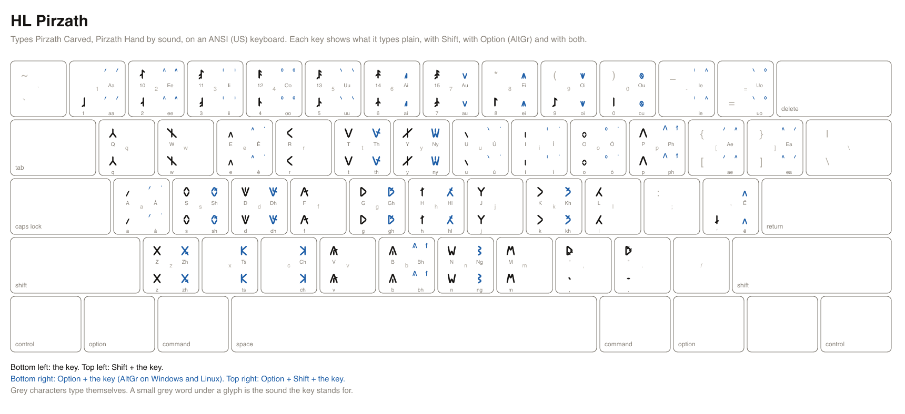

# HL Pirzath cheatsheet

HL Pirzath types Pirzath Carved and Pirzath Hand by sound. It is a US keyboard that writes the Pirzath script: the key for a sound types that sound's Pirzath character, so `t` types the script's t, Option+T types its th, and Shift makes a capital. You type the sounds of a word one after another, as you would in English.

A printable copy is [pirzath.svg](pirzath.svg) and [pirzath.png](pirzath.png).

## Reading the keys

- `t` is the key alone. `shift+t` is Shift and the key.
- `option+t` is Option and the key on a Mac, and AltGr and the key on Windows and Linux. AltGr is the right Alt key (on a keyboard without one, hold Ctrl and Alt together). `option+shift+t` adds Shift.
- The Sound column is the roman spelling of the sound a key stands for. A key marked _nothing_ types nothing in this script.
- Character names and code points identify each character exactly, for a program or a character viewer.
- The Emacs column is what to type in the Emacs input method `heroiclands-pirzath`, where Option is a backslash.

## Installing the layout

The layout is a file per platform, named below. [The README](../README.md#installing-a-keyboard-layout) walks through installing each.

- macOS: `keyboards/macos/HeroicLands.bundle`, input source **HL Pirzath**.
- Windows: `keyboards/windows/pirzath.klc`, the Microsoft Keyboard Layout Creator source of **HL Pirzath**.
- Linux: `keyboards/linux/hl_pirzath`, the XKB symbols of **HL Pirzath**.
- Emacs: `keyboards/emacs/heroiclands-pirzath.el`, the input method `heroiclands-pirzath`.

## Keys a platform cannot carry

A Windows key holds at most four UTF-16 code units and a Linux key one character, so a sound this script spells with more types nothing there. macOS and Emacs carry every key.

| Key | Sound | Script | Platform | Why |
| --- | --- | --- | --- | --- |
| `option+p` | `ph` | Pirzath | Linux | 2 code points; an XKB key types one |
| `option+shift+p` | `Ph` | Pirzath | Linux | 2 code points; an XKB key types one |
| `option+b` | `bh` | Pirzath | Linux | 2 code points; an XKB key types one |
| `option+shift+b` | `Bh` | Pirzath | Linux | 2 code points; an XKB key types one |
| `option+1` | `aa` | Pirzath | Linux | 2 code points; an XKB key types one |
| `option+shift+1` | `Aa` | Pirzath | Linux | 2 code points; an XKB key types one |
| `option+2` | `ee` | Pirzath | Linux | 2 code points; an XKB key types one |
| `option+shift+2` | `Ee` | Pirzath | Linux | 2 code points; an XKB key types one |
| `option+3` | `ii` | Pirzath | Linux | 2 code points; an XKB key types one |
| `option+shift+3` | `Ii` | Pirzath | Linux | 2 code points; an XKB key types one |
| `option+4` | `oo` | Pirzath | Linux | 2 code points; an XKB key types one |
| `option+shift+4` | `Oo` | Pirzath | Linux | 2 code points; an XKB key types one |
| `option+5` | `uu` | Pirzath | Linux | 2 code points; an XKB key types one |
| `option+shift+5` | `Uu` | Pirzath | Linux | 2 code points; an XKB key types one |
| `option+-` | `ie` | Pirzath | Linux | 2 code points; an XKB key types one |
| `option+shift+-` | `Ie` | Pirzath | Linux | 2 code points; an XKB key types one |
| `option+=` | `uo` | Pirzath | Linux | 2 code points; an XKB key types one |
| `option+shift+=` | `Uo` | Pirzath | Linux | 2 code points; an XKB key types one |
| `option+[` | `ae` | Pirzath | Linux | 2 code points; an XKB key types one |
| `option+shift+[` | `Ae` | Pirzath | Linux | 2 code points; an XKB key types one |
| `option+]` | `ea` | Pirzath | Linux | 2 code points; an XKB key types one |
| `option+shift+]` | `Ea` | Pirzath | Linux | 2 code points; an XKB key types one |
| `option+a` | `á` | Pirzath | Linux | 2 code points; an XKB key types one |
| `option+shift+a` | `Á` | Pirzath | Linux | 2 code points; an XKB key types one |
| `option+e` | `é` | Pirzath | Linux | 2 code points; an XKB key types one |
| `option+shift+e` | `É` | Pirzath | Linux | 2 code points; an XKB key types one |
| `option+i` | `í` | Pirzath | Linux | 2 code points; an XKB key types one |
| `option+shift+i` | `Í` | Pirzath | Linux | 2 code points; an XKB key types one |
| `option+o` | `ó` | Pirzath | Linux | 2 code points; an XKB key types one |
| `option+shift+o` | `Ó` | Pirzath | Linux | 2 code points; an XKB key types one |
| `option+u` | `ú` | Pirzath | Linux | 2 code points; an XKB key types one |
| `option+shift+u` | `Ú` | Pirzath | Linux | 2 code points; an XKB key types one |

## Markup

These keys type themselves, as plain ASCII, in every layout, so Markdown and similar markup are written without switching layouts.

| Key | Types |
| --- | --- |
| `shift+8` | `*` |
| `shift+-` | `_` |
| `[` | `[` |
| `]` | `]` |
| `shift+[` | `{` |
| `shift+]` | `}` |
| `shift+9` | `(` |
| `shift+0` | `)` |
| `=` | `=` |
| `shift+;` | `:` |
| `shift+\` | `\|` |
| `\` | `\` |
| `` shift+` `` | `~` |
| `` ` `` | `` ` `` |

## Keys

Every sound key, in keyboard order. Example: `t` types the sound `t`.

| Key | Glyphs | Code points | Names | Sound | Emacs |
| --- | --- | --- | --- | --- | --- |
| `a` |  | U+F0000 | PIRZATH LETTER A | `a` | `a` |
| `shift+a` |  | U+F0000 | PIRZATH LETTER A | `A` | `A` |
| `b` |  | U+F0006 | PIRZATH LETTER BALG | `b` | `b` |
| `shift+b` |  | U+F0006 | PIRZATH LETTER BALG | `B` | `B` |
| `d` |  | U+F000B | PIRZATH LETTER DALK | `d` | `d` |
| `shift+d` |  | U+F000B | PIRZATH LETTER DALK | `D` | `D` |
| `e` |  | U+F0001 | PIRZATH LETTER E | `e` | `e` |
| `shift+e` |  | U+F0001 | PIRZATH LETTER E | `E` | `E` |
| `f` |  | U+F0007 | PIRZATH LETTER FARZ | `f` | `f` |
| `shift+f` |  | U+F0007 | PIRZATH LETTER FARZ | `F` | `F` |
| `g` |  | U+F000E | PIRZATH LETTER GAMTH | `g` | `g` |
| `shift+g` |  | U+F000E | PIRZATH LETTER GAMTH | `G` | `G` |
| `h` |  | U+F0011 | PIRZATH LETTER HALB | `h` | `h` |
| `shift+h` |  | U+F0011 | PIRZATH LETTER HALB | `H` | `H` |
| `i` |  | U+F0002 | PIRZATH LETTER I | `i` | `i` |
| `shift+i` |  | U+F0002 | PIRZATH LETTER I | `I` | `I` |
| `j` |  | U+F0014 | PIRZATH LETTER JA | `j` | `j` |
| `shift+j` |  | U+F0014 | PIRZATH LETTER JA | `J` | `J` |
| `k` |  | U+F000D | PIRZATH LETTER KAMV | `k` | `k` |
| `shift+k` |  | U+F000D | PIRZATH LETTER KAMV | `K` | `K` |
| `l` |  | U+F0012 | PIRZATH LETTER LADHAV | `l` | `l` |
| `shift+l` |  | U+F0012 | PIRZATH LETTER LADHAV | `L` | `L` |
| `m` |  | U+F0009 | PIRZATH LETTER MARP | `m` | `m` |
| `shift+m` |  | U+F0009 | PIRZATH LETTER MARP | `M` | `M` |
| `n` |  | U+F000C | PIRZATH LETTER NAZAF | `n` | `n` |
| `shift+n` |  | U+F000C | PIRZATH LETTER NAZAF | `N` | `N` |
| `o` |  | U+F0003 | PIRZATH LETTER O | `o` | `o` |
| `shift+o` |  | U+F0003 | PIRZATH LETTER O | `O` | `O` |
| `p` |  | U+F0005 | PIRZATH LETTER PARGH | `p` | `p` |
| `shift+p` |  | U+F0005 | PIRZATH LETTER PARGH | `P` | `P` |
| `q` |  | U+F0015 | PIRZATH LETTER QA | `q` | `q` |
| `shift+q` |  | U+F0015 | PIRZATH LETTER QA | `Q` | `Q` |
| `r` |  | U+F0013 | PIRZATH LETTER RAGHAV | `r` | `r` |
| `shift+r` |  | U+F0013 | PIRZATH LETTER RAGHAV | `R` | `R` |
| `s` |  | U+F000F | PIRZATH LETTER SAKAR | `s` | `s` |
| `shift+s` |  | U+F000F | PIRZATH LETTER SAKAR | `S` | `S` |
| `t` |  | U+F000A | PIRZATH LETTER TAMB | `t` | `t` |
| `shift+t` |  | U+F000A | PIRZATH LETTER TAMB | `T` | `T` |
| `u` |  | U+F0004 | PIRZATH LETTER U | `u` | `u` |
| `shift+u` |  | U+F0004 | PIRZATH LETTER U | `U` | `U` |
| `v` |  | U+F0008 | PIRZATH LETTER VAZAL | `v` | `v` |
| `shift+v` |  | U+F0008 | PIRZATH LETTER VAZAL | `V` | `V` |
| `w` |  | U+F0016 | PIRZATH LETTER WA | `w` | `w` |
| `shift+w` |  | U+F0016 | PIRZATH LETTER WA | `W` | `W` |
| `y` |  | U+F0017 | PIRZATH LETTER YA | `y` | `y` |
| `shift+y` |  | U+F0017 | PIRZATH LETTER YA | `Y` | `Y` |
| `z` |  | U+F0010 | PIRZATH LETTER ZALD | `z` | `z` |
| `shift+z` |  | U+F0010 | PIRZATH LETTER ZALD | `Z` | `Z` |
| `option+c` |  | U+F0027 | PIRZATH LETTER CHA | `ch` | `\c` |
| `option+shift+c` |  | U+F0027 | PIRZATH LETTER CHA | `Ch` | `\C` |
| `option+s` |  | U+F0024 | PIRZATH LETTER SHA | `sh` | `\s` |
| `option+shift+s` |  | U+F0024 | PIRZATH LETTER SHA | `Sh` | `\S` |
| `option+t` |  | U+F0020 | PIRZATH LETTER THARZ | `th` | `\t` |
| `option+shift+t` |  | U+F0020 | PIRZATH LETTER THARZ | `Th` | `\T` |
| `option+d` |  | U+F0021 | PIRZATH LETTER DHALZ | `dh` | `\d` |
| `option+shift+d` |  | U+F0021 | PIRZATH LETTER DHALZ | `Dh` | `\D` |
| `option+k` |  | U+F0022 | PIRZATH LETTER KHABAR | `kh` | `\k` |
| `option+shift+k` |  | U+F0022 | PIRZATH LETTER KHABAR | `Kh` | `\K` |
| `option+g` |  | U+F0023 | PIRZATH LETTER GHARM | `gh` | `\g` |
| `option+shift+g` |  | U+F0023 | PIRZATH LETTER GHARM | `Gh` | `\G` |
| `option+z` |  | U+F0025 | PIRZATH LETTER ZHA | `zh` | `\z` |
| `option+shift+z` |  | U+F0025 | PIRZATH LETTER ZHA | `Zh` | `\Z` |
| `option+p` |   | U+F0005 U+F0011 | PIRZATH LETTER PARGH; PIRZATH LETTER HALB | `ph` | `\p` |
| `option+shift+p` |   | U+F0005 U+F0011 | PIRZATH LETTER PARGH; PIRZATH LETTER HALB | `Ph` | `\P` |
| `option+n` |  | U+F0028 | PIRZATH LETTER NGA | `ng` | `\n` |
| `option+shift+n` |  | U+F0028 | PIRZATH LETTER NGA | `Ng` | `\N` |
| `option+y` |  | U+F0029 | PIRZATH LETTER NYA | `ny` | `\y` |
| `option+shift+y` |  | U+F0029 | PIRZATH LETTER NYA | `Ny` | `\Y` |
| `option+x` |  | U+F0026 | PIRZATH LETTER TSA | `ts` | `\x` |
| `option+shift+x` |  | U+F0026 | PIRZATH LETTER TSA | `Ts` | `\X` |
| `option+h` |  | U+F002A | PIRZATH LETTER HLA | `hl` | `\h` |
| `option+shift+h` |  | U+F002A | PIRZATH LETTER HLA | `Hl` | `\H` |
| `option+b` |   | U+F0006 U+F0011 | PIRZATH LETTER BALG; PIRZATH LETTER HALB | `bh` | `\b` |
| `option+shift+b` |   | U+F0006 U+F0011 | PIRZATH LETTER BALG; PIRZATH LETTER HALB | `Bh` | `\B` |
| `option+1` |   | U+F0000 U+F0000 | PIRZATH LETTER A; PIRZATH LETTER A | `aa` | `\1` |
| `option+shift+1` |   | U+F0000 U+F0000 | PIRZATH LETTER A; PIRZATH LETTER A | `Aa` | `\!` |
| `option+2` |   | U+F0001 U+F0001 | PIRZATH LETTER E; PIRZATH LETTER E | `ee` | `\2` |
| `option+shift+2` |   | U+F0001 U+F0001 | PIRZATH LETTER E; PIRZATH LETTER E | `Ee` | `\@` |
| `option+3` |   | U+F0002 U+F0002 | PIRZATH LETTER I; PIRZATH LETTER I | `ii` | `\3` |
| `option+shift+3` |   | U+F0002 U+F0002 | PIRZATH LETTER I; PIRZATH LETTER I | `Ii` | `\#` |
| `option+4` |   | U+F0003 U+F0003 | PIRZATH LETTER O; PIRZATH LETTER O | `oo` | `\4` |
| `option+shift+4` |   | U+F0003 U+F0003 | PIRZATH LETTER O; PIRZATH LETTER O | `Oo` | `\$` |
| `option+5` |   | U+F0004 U+F0004 | PIRZATH LETTER U; PIRZATH LETTER U | `uu` | `\5` |
| `option+shift+5` |   | U+F0004 U+F0004 | PIRZATH LETTER U; PIRZATH LETTER U | `Uu` | `\%` |
| `option+6` |  | U+F0030 | PIRZATH LETTER AI | `ai` | `\6` |
| `option+shift+6` |  | U+F0030 | PIRZATH LETTER AI | `Ai` | `\^` |
| `option+7` |  | U+F0031 | PIRZATH LETTER AU | `au` | `\7` |
| `option+shift+7` |  | U+F0031 | PIRZATH LETTER AU | `Au` | `\&` |
| `option+8` |  | U+F0032 | PIRZATH LETTER EI | `ei` | `\8` |
| `option+shift+8` |  | U+F0032 | PIRZATH LETTER EI | `Ei` | `\*` |
| `option+9` |  | U+F0033 | PIRZATH LETTER OI | `oi` | `\9` |
| `option+shift+9` |  | U+F0033 | PIRZATH LETTER OI | `Oi` | `\(` |
| `option+0` |  | U+F0034 | PIRZATH LETTER OU | `ou` | `\0` |
| `option+shift+0` |  | U+F0034 | PIRZATH LETTER OU | `Ou` | `\)` |
| `option+-` |   | U+F0002 U+F0001 | PIRZATH LETTER I; PIRZATH LETTER E | `ie` | `\-` |
| `option+shift+-` |   | U+F0002 U+F0001 | PIRZATH LETTER I; PIRZATH LETTER E | `Ie` | `\_` |
| `option+=` |   | U+F0004 U+F0003 | PIRZATH LETTER U; PIRZATH LETTER O | `uo` | `\=` |
| `option+shift+=` |   | U+F0004 U+F0003 | PIRZATH LETTER U; PIRZATH LETTER O | `Uo` | `\+` |
| `option+[` |   | U+F0000 U+F0001 | PIRZATH LETTER A; PIRZATH LETTER E | `ae` | `\[` |
| `option+shift+[` |   | U+F0000 U+F0001 | PIRZATH LETTER A; PIRZATH LETTER E | `Ae` | `\{` |
| `option+]` |   | U+F0001 U+F0000 | PIRZATH LETTER E; PIRZATH LETTER A | `ea` | `\]` |
| `option+shift+]` |   | U+F0001 U+F0000 | PIRZATH LETTER E; PIRZATH LETTER A | `Ea` | `\}` |
| `option+a` |   | U+F0000 U+F0060 | PIRZATH LETTER A; PIRZATH LENGTH MARK | `á` | `\a` |
| `option+shift+a` |   | U+F0000 U+F0060 | PIRZATH LETTER A; PIRZATH LENGTH MARK | `Á` | `\A` |
| `option+e` |   | U+F0001 U+F0060 | PIRZATH LETTER E; PIRZATH LENGTH MARK | `é` | `\e` |
| `option+shift+e` |   | U+F0001 U+F0060 | PIRZATH LETTER E; PIRZATH LENGTH MARK | `É` | `\E` |
| `option+i` |   | U+F0002 U+F0060 | PIRZATH LETTER I; PIRZATH LENGTH MARK | `í` | `\i` |
| `option+shift+i` |   | U+F0002 U+F0060 | PIRZATH LETTER I; PIRZATH LENGTH MARK | `Í` | `\I` |
| `option+o` |   | U+F0003 U+F0060 | PIRZATH LETTER O; PIRZATH LENGTH MARK | `ó` | `\o` |
| `option+shift+o` |   | U+F0003 U+F0060 | PIRZATH LETTER O; PIRZATH LENGTH MARK | `Ó` | `\O` |
| `option+u` |   | U+F0004 U+F0060 | PIRZATH LETTER U; PIRZATH LENGTH MARK | `ú` | `\u` |
| `option+shift+u` |   | U+F0004 U+F0060 | PIRZATH LETTER U; PIRZATH LENGTH MARK | `Ú` | `\U` |
| `option+;` |  | nothing: this script has no character for the sound |  | `ä` | `\;` |
| `option+shift+;` |  | nothing: this script has no character for the sound |  | `Ä` | `\:` |
| `option+'` |  | U+F0001 | PIRZATH LETTER E | `ë` | `\'` |
| `option+shift+'` |  | U+F0001 | PIRZATH LETTER E | `Ë` | `\"` |
| `option+,` |  | nothing: this script has no character for the sound |  | `ï` | `\,` |
| `option+shift+,` |  | nothing: this script has no character for the sound |  | `Ï` | `\<` |
| `option+.` |  | nothing: this script has no character for the sound |  | `ö` | `\.` |
| `option+shift+.` |  | nothing: this script has no character for the sound |  | `Ö` | `\>` |
| `option+/` |  | nothing: this script has no character for the sound |  | `ü` | `\/` |
| `option+shift+/` |  | nothing: this script has no character for the sound |  | `Ü` | `\?` |
| `'` |  | U+F0018 | PIRZATH LETTER CATCH | `catch` | `'` |
| `.` |  | U+F0050 | PIRZATH SENTENCE END | `stop` | `.` |
| `,` |  | U+F0051 | PIRZATH PAUSE | `pause` | `,` |
| `shift+,` |  | U+F0054 | PIRZATH OPENING QUOTATION MARK | `open quote` | `<` |
| `shift+.` |  | U+F0055 | PIRZATH CLOSING QUOTATION MARK | `close quote` | `>` |
| `0` |  | U+F0040 | PIRZATH DIGIT ZERO | `0` | `0` |
| `1` |  | U+F0041 | PIRZATH DIGIT ONE | `1` | `1` |
| `2` |  | U+F0042 | PIRZATH DIGIT TWO | `2` | `2` |
| `3` |  | U+F0043 | PIRZATH DIGIT THREE | `3` | `3` |
| `4` |  | U+F0044 | PIRZATH DIGIT FOUR | `4` | `4` |
| `5` |  | U+F0045 | PIRZATH DIGIT FIVE | `5` | `5` |
| `6` |  | U+F0046 | PIRZATH DIGIT SIX | `6` | `6` |
| `7` |  | U+F0047 | PIRZATH DIGIT SEVEN | `7` | `7` |
| `8` |  | U+F0048 | PIRZATH DIGIT EIGHT | `8` | `8` |
| `9` |  | U+F0049 | PIRZATH DIGIT NINE | `9` | `9` |
| `shift+2` |  | U+F004A | PIRZATH DIGIT TEN | `ten` | `@` |
| `shift+3` |  | U+F004B | PIRZATH DIGIT ELEVEN | `eleven` | `#` |
| `shift+4` |  | U+F004C | PIRZATH DIGIT TWELVE | `twelve` | `$` |
| `shift+5` |  | U+F004D | PIRZATH DIGIT THIRTEEN | `thirteen` | `%` |
| `shift+6` |  | U+F004E | PIRZATH DIGIT FOURTEEN | `fourteen` | `^` |
| `shift+7` |  | U+F004F | PIRZATH DIGIT FIFTEEN | `fifteen` | `&` |
