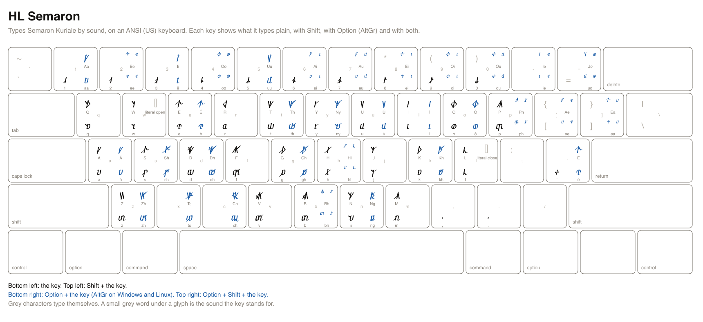

# HL Semaron cheatsheet

HL Semaron types Semaron Kuriale by sound. It is a US keyboard that writes the Semaron script: the key for a sound types that sound's Semaron character, so `t` types the script's t and Option+T types its th, and Shift makes a capital. You type the sounds of a word one after another, as you would in English.

A printable copy is [semaron.svg](semaron.svg) and [semaron.png](semaron.png).

## Reading the keys

- `t` is the key alone. `shift+t` is Shift and the key.
- `option+t` is Option and the key on a Mac, and AltGr and the key on Windows and Linux. AltGr is the right Alt key (on a keyboard without one, hold Ctrl and Alt together). `option+shift+t` adds Shift.
- The Sound column is the roman spelling of the sound a key stands for. A key marked _nothing_ types nothing in this script.
- Character names and code points identify each character exactly, for a program or a character viewer.
- The Emacs column is what to type in the Emacs input method `heroiclands-semaron`, where Option is a backslash.

## Installing the layout

The layout is a file per platform, named below. [The README](../README.md#installing-a-keyboard-layout) walks through installing each.

- macOS: `keyboards/macos/HeroicLands.bundle`, input source **HL Semaron**.
- Windows: `keyboards/windows/semaron.klc`, the Microsoft Keyboard Layout Creator source of **HL Semaron**.
- Linux: `keyboards/linux/hl_semaron`, the XKB symbols of **HL Semaron**.
- Emacs: `keyboards/emacs/heroiclands-semaron.el`, the input method `heroiclands-semaron`.

## Signs

These keys type no sound. They type in HL Semaron alone.

| Key | Emacs | Sign | Layout | Glyph | Code point | Name |
| --- | --- | --- | --- | --- | --- | --- |
| `option+shift+w` | `\W` | literal open | HL Semaron | ⟦ | U+27E6 | LEFT WHITE SQUARE BRACKET |
| `option+shift+l` | `\L` | literal close | HL Semaron | ⟧ | U+27E7 | RIGHT WHITE SQUARE BRACKET |

## Keys a platform cannot carry

A Windows key holds at most four UTF-16 code units and a Linux key one character, so a sound this script spells with more types nothing there. macOS and Emacs carry every key.

| Key | Sound | Script | Platform | Why |
| --- | --- | --- | --- | --- |
| `option+p` | `ph` | Semaron | Linux | 2 code points; an XKB key types one |
| `option+shift+p` | `Ph` | Semaron | Linux | 2 code points; an XKB key types one |
| `option+h` | `hl` | Semaron | Linux | 2 code points; an XKB key types one |
| `option+shift+h` | `Hl` | Semaron | Linux | 2 code points; an XKB key types one |
| `option+b` | `bh` | Semaron | Linux | 2 code points; an XKB key types one |
| `option+shift+b` | `Bh` | Semaron | Linux | 2 code points; an XKB key types one |
| `option+2` | `ee` | Semaron | Linux | 2 code points; an XKB key types one |
| `option+shift+2` | `Ee` | Semaron | Linux | 2 code points; an XKB key types one |
| `option+4` | `oo` | Semaron | Linux | 2 code points; an XKB key types one |
| `option+shift+4` | `Oo` | Semaron | Linux | 2 code points; an XKB key types one |
| `option+6` | `ai` | Semaron | Linux | 2 code points; an XKB key types one |
| `option+shift+6` | `Ai` | Semaron | Linux | 2 code points; an XKB key types one |
| `option+7` | `au` | Semaron | Linux | 2 code points; an XKB key types one |
| `option+shift+7` | `Au` | Semaron | Linux | 2 code points; an XKB key types one |
| `option+8` | `ei` | Semaron | Linux | 2 code points; an XKB key types one |
| `option+shift+8` | `Ei` | Semaron | Linux | 2 code points; an XKB key types one |
| `option+9` | `oi` | Semaron | Linux | 2 code points; an XKB key types one |
| `option+shift+9` | `Oi` | Semaron | Linux | 2 code points; an XKB key types one |
| `option+0` | `ou` | Semaron | Linux | 2 code points; an XKB key types one |
| `option+shift+0` | `Ou` | Semaron | Linux | 2 code points; an XKB key types one |
| `option+-` | `ie` | Semaron | Linux | 2 code points; an XKB key types one |
| `option+shift+-` | `Ie` | Semaron | Linux | 2 code points; an XKB key types one |
| `option+=` | `uo` | Semaron | Linux | 2 code points; an XKB key types one |
| `option+shift+=` | `Uo` | Semaron | Linux | 2 code points; an XKB key types one |
| `option+[` | `ae` | Semaron | Linux | 2 code points; an XKB key types one |
| `option+shift+[` | `Ae` | Semaron | Linux | 2 code points; an XKB key types one |
| `option+]` | `ea` | Semaron | Linux | 2 code points; an XKB key types one |
| `option+shift+]` | `Ea` | Semaron | Linux | 2 code points; an XKB key types one |

## Markup

These keys type themselves, as plain ASCII, in every layout, so Markdown and similar markup are written without switching layouts.

| Key | Types |
| --- | --- |
| `shift+8` | `*` |
| `shift+-` | `_` |
| `[` | `[` |
| `]` | `]` |
| `shift+[` | `{` |
| `shift+]` | `}` |
| `shift+9` | `(` |
| `shift+0` | `)` |
| `=` | `=` |
| `shift+;` | `:` |
| `shift+\` | `\|` |
| `\` | `\` |
| `` shift+` `` | `~` |
| `` ` `` | `` ` `` |

## Keys

Every sound key, in keyboard order. Example: `t` types the sound `t`.

| Key | Glyphs | Code points | Names | Sound | Emacs |
| --- | --- | --- | --- | --- | --- |
| `a` |  | U+F0230 | SEMARON SMALL LETTER ANKRON | `a` | `a` |
| `shift+a` |  | U+F0200 | SEMARON CAPITAL LETTER ANKRON | `A` | `A` |
| `b` |  | U+F0231 | SEMARON SMALL LETTER BRUTHEKA | `b` | `b` |
| `shift+b` |  | U+F0201 | SEMARON CAPITAL LETTER BRUTHEKA | `B` | `B` |
| `d` |  | U+F0232 | SEMARON SMALL LETTER DEKAZU | `d` | `d` |
| `shift+d` |  | U+F0202 | SEMARON CAPITAL LETTER DEKAZU | `D` | `D` |
| `e` |  | U+F0233 | SEMARON SMALL LETTER ELZA | `e` | `e` |
| `shift+e` |  | U+F0203 | SEMARON CAPITAL LETTER ELZA | `E` | `E` |
| `f` |  | U+F0234 | SEMARON SMALL LETTER FUNELA | `f` | `f` |
| `shift+f` |  | U+F0204 | SEMARON CAPITAL LETTER FUNELA | `F` | `F` |
| `g` |  | U+F0235 | SEMARON SMALL LETTER GULMOS | `g` | `g` |
| `shift+g` |  | U+F0205 | SEMARON CAPITAL LETTER GULMOS | `G` | `G` |
| `h` |  | U+F0236 | SEMARON SMALL LETTER HARLEN | `h` | `h` |
| `shift+h` |  | U+F0206 | SEMARON CAPITAL LETTER HARLEN | `H` | `H` |
| `i` |  | U+F0237 | SEMARON SMALL LETTER ILTHERA | `i` | `i` |
| `shift+i` |  | U+F0207 | SEMARON CAPITAL LETTER ILTHERA | `I` | `I` |
| `j` |  | U+F0238 | SEMARON SMALL LETTER JA | `j` | `j` |
| `shift+j` |  | U+F0208 | SEMARON CAPITAL LETTER JA | `J` | `J` |
| `k` |  | U+F0239 | SEMARON SMALL LETTER KALPEZA | `k` | `k` |
| `shift+k` |  | U+F0209 | SEMARON CAPITAL LETTER KALPEZA | `K` | `K` |
| `l` |  | U+F023A | SEMARON SMALL LETTER LIZELA | `l` | `l` |
| `shift+l` |  | U+F020A | SEMARON CAPITAL LETTER LIZELA | `L` | `L` |
| `m` |  | U+F023B | SEMARON SMALL LETTER MEZARA | `m` | `m` |
| `shift+m` |  | U+F020B | SEMARON CAPITAL LETTER MEZARA | `M` | `M` |
| `n` |  | U+F023C | SEMARON SMALL LETTER NELAMIS | `n` | `n` |
| `shift+n` |  | U+F020C | SEMARON CAPITAL LETTER NELAMIS | `N` | `N` |
| `o` |  | U+F023D | SEMARON SMALL LETTER ORNETHE | `o` | `o` |
| `shift+o` |  | U+F020D | SEMARON CAPITAL LETTER ORNETHE | `O` | `O` |
| `p` |  | U+F023E | SEMARON SMALL LETTER POZERA | `p` | `p` |
| `shift+p` |  | U+F020E | SEMARON CAPITAL LETTER POZERA | `P` | `P` |
| `q` |  | U+F0247 | SEMARON SMALL LETTER QORETHA | `q` | `q` |
| `shift+q` |  | U+F0217 | SEMARON CAPITAL LETTER QORETHA | `Q` | `Q` |
| `r` |  | U+F023F | SEMARON SMALL LETTER RONETHOS | `r` | `r` |
| `shift+r` |  | U+F020F | SEMARON CAPITAL LETTER RONETHOS | `R` | `R` |
| `s` |  | U+F0240 | SEMARON SMALL LETTER SIRETHA | `s` | `s` |
| `shift+s` |  | U+F0210 | SEMARON CAPITAL LETTER SIRETHA | `S` | `S` |
| `t` |  | U+F0241 | SEMARON SMALL LETTER TALOTHOS | `t` | `t` |
| `shift+t` |  | U+F0211 | SEMARON CAPITAL LETTER TALOTHOS | `T` | `T` |
| `u` |  | U+F0242 | SEMARON SMALL LETTER ULMERA | `u` | `u` |
| `shift+u` |  | U+F0212 | SEMARON CAPITAL LETTER ULMERA | `U` | `U` |
| `v` |  | U+F0243 | SEMARON SMALL LETTER VARTHOS | `v` | `v` |
| `shift+v` |  | U+F0213 | SEMARON CAPITAL LETTER VARTHOS | `V` | `V` |
| `w` |  | U+F0244 | SEMARON SMALL LETTER WA | `w` | `w` |
| `shift+w` |  | U+F0214 | SEMARON CAPITAL LETTER WA | `W` | `W` |
| `y` |  | U+F0245 | SEMARON SMALL LETTER YALZEMIS | `y` | `y` |
| `shift+y` |  | U+F0215 | SEMARON CAPITAL LETTER YALZEMIS | `Y` | `Y` |
| `z` |  | U+F0246 | SEMARON SMALL LETTER ZARGON | `z` | `z` |
| `shift+z` |  | U+F0216 | SEMARON CAPITAL LETTER ZARGON | `Z` | `Z` |
| `option+c` |  | U+F028C | SEMARON SMALL LETTER CHEROLA | `ch` | `\c` |
| `option+shift+c` |  | U+F028D | SEMARON CAPITAL LETTER CHEROLA | `Ch` | `\C` |
| `option+s` |  | U+F0286 | SEMARON SMALL LETTER SHELMORA | `sh` | `\s` |
| `option+shift+s` |  | U+F0287 | SEMARON CAPITAL LETTER SHELMORA | `Sh` | `\S` |
| `option+t` |  | U+F0250 | SEMARON SMALL LETTER THOLERA | `th` | `\t` |
| `option+shift+t` |  | U+F0251 | SEMARON CAPITAL LETTER THOLERA | `Th` | `\T` |
| `option+d` |  | U+F0280 | SEMARON SMALL LETTER DHANETHE | `dh` | `\d` |
| `option+shift+d` |  | U+F0281 | SEMARON CAPITAL LETTER DHANETHE | `Dh` | `\D` |
| `option+k` |  | U+F0282 | SEMARON SMALL LETTER KHORVENA | `kh` | `\k` |
| `option+shift+k` |  | U+F0283 | SEMARON CAPITAL LETTER KHORVENA | `Kh` | `\K` |
| `option+g` |  | U+F0284 | SEMARON SMALL LETTER GHORMAS | `gh` | `\g` |
| `option+shift+g` |  | U+F0285 | SEMARON CAPITAL LETTER GHORMAS | `Gh` | `\G` |
| `option+z` |  | U+F0288 | SEMARON SMALL LETTER ZHAREVA | `zh` | `\z` |
| `option+shift+z` |  | U+F0289 | SEMARON CAPITAL LETTER ZHAREVA | `Zh` | `\Z` |
| `option+p` |   | U+F023E U+F0236 | SEMARON SMALL LETTER POZERA; SEMARON SMALL LETTER HARLEN | `ph` | `\p` |
| `option+shift+p` |   | U+F020E U+F0236 | SEMARON CAPITAL LETTER POZERA; SEMARON SMALL LETTER HARLEN | `Ph` | `\P` |
| `option+n` |  | U+F028E | SEMARON SMALL LETTER ENGARIS | `ng` | `\n` |
| `option+shift+n` |  | U+F028F | SEMARON CAPITAL LETTER ENGARIS | `Ng` | `\N` |
| `option+y` |  | U+F0290 | SEMARON SMALL LETTER NYELIS | `ny` | `\y` |
| `option+shift+y` |  | U+F0291 | SEMARON CAPITAL LETTER NYELIS | `Ny` | `\Y` |
| `option+x` |  | U+F028A | SEMARON SMALL LETTER TSALEMA | `ts` | `\x` |
| `option+shift+x` |  | U+F028B | SEMARON CAPITAL LETTER TSALEMA | `Ts` | `\X` |
| `option+h` |   | U+F0236 U+F023A | SEMARON SMALL LETTER HARLEN; SEMARON SMALL LETTER LIZELA | `hl` | `\h` |
| `option+shift+h` |   | U+F0206 U+F023A | SEMARON CAPITAL LETTER HARLEN; SEMARON SMALL LETTER LIZELA | `Hl` | `\H` |
| `option+b` |   | U+F0231 U+F0236 | SEMARON SMALL LETTER BRUTHEKA; SEMARON SMALL LETTER HARLEN | `bh` | `\b` |
| `option+shift+b` |   | U+F0201 U+F0236 | SEMARON CAPITAL LETTER BRUTHEKA; SEMARON SMALL LETTER HARLEN | `Bh` | `\B` |
| `option+1` |  | U+F0248 | SEMARON SMALL LETTER LONG ANKRON | `aa` | `\1` |
| `option+shift+1` |  | U+F0220 | SEMARON CAPITAL LETTER LONG ANKRON | `Aa` | `\!` |
| `option+2` |   | U+F0233 U+F0233 | SEMARON SMALL LETTER ELZA; SEMARON SMALL LETTER ELZA | `ee` | `\2` |
| `option+shift+2` |   | U+F0203 U+F0233 | SEMARON CAPITAL LETTER ELZA; SEMARON SMALL LETTER ELZA | `Ee` | `\@` |
| `option+3` |  | U+F024A | SEMARON SMALL LETTER LONG ILTHERA | `ii` | `\3` |
| `option+shift+3` |  | U+F0222 | SEMARON CAPITAL LETTER LONG ILTHERA | `Ii` | `\#` |
| `option+4` |   | U+F023D U+F023D | SEMARON SMALL LETTER ORNETHE; SEMARON SMALL LETTER ORNETHE | `oo` | `\4` |
| `option+shift+4` |   | U+F020D U+F023D | SEMARON CAPITAL LETTER ORNETHE; SEMARON SMALL LETTER ORNETHE | `Oo` | `\$` |
| `option+5` |  | U+F024C | SEMARON SMALL LETTER LONG ULMERA | `uu` | `\5` |
| `option+shift+5` |  | U+F0224 | SEMARON CAPITAL LETTER LONG ULMERA | `Uu` | `\%` |
| `option+6` |   | U+F0230 U+F0237 | SEMARON SMALL LETTER ANKRON; SEMARON SMALL LETTER ILTHERA | `ai` | `\6` |
| `option+shift+6` |   | U+F0200 U+F0237 | SEMARON CAPITAL LETTER ANKRON; SEMARON SMALL LETTER ILTHERA | `Ai` | `\^` |
| `option+7` |   | U+F0230 U+F0242 | SEMARON SMALL LETTER ANKRON; SEMARON SMALL LETTER ULMERA | `au` | `\7` |
| `option+shift+7` |   | U+F0200 U+F0242 | SEMARON CAPITAL LETTER ANKRON; SEMARON SMALL LETTER ULMERA | `Au` | `\&` |
| `option+8` |   | U+F0233 U+F0237 | SEMARON SMALL LETTER ELZA; SEMARON SMALL LETTER ILTHERA | `ei` | `\8` |
| `option+shift+8` |   | U+F0203 U+F0237 | SEMARON CAPITAL LETTER ELZA; SEMARON SMALL LETTER ILTHERA | `Ei` | `\*` |
| `option+9` |   | U+F023D U+F0237 | SEMARON SMALL LETTER ORNETHE; SEMARON SMALL LETTER ILTHERA | `oi` | `\9` |
| `option+shift+9` |   | U+F020D U+F0237 | SEMARON CAPITAL LETTER ORNETHE; SEMARON SMALL LETTER ILTHERA | `Oi` | `\(` |
| `option+0` |   | U+F023D U+F0242 | SEMARON SMALL LETTER ORNETHE; SEMARON SMALL LETTER ULMERA | `ou` | `\0` |
| `option+shift+0` |   | U+F020D U+F0242 | SEMARON CAPITAL LETTER ORNETHE; SEMARON SMALL LETTER ULMERA | `Ou` | `\)` |
| `option+-` |   | U+F0237 U+F0233 | SEMARON SMALL LETTER ILTHERA; SEMARON SMALL LETTER ELZA | `ie` | `\-` |
| `option+shift+-` |   | U+F0207 U+F0233 | SEMARON CAPITAL LETTER ILTHERA; SEMARON SMALL LETTER ELZA | `Ie` | `\_` |
| `option+=` |   | U+F0242 U+F023D | SEMARON SMALL LETTER ULMERA; SEMARON SMALL LETTER ORNETHE | `uo` | `\=` |
| `option+shift+=` |   | U+F0212 U+F023D | SEMARON CAPITAL LETTER ULMERA; SEMARON SMALL LETTER ORNETHE | `Uo` | `\+` |
| `option+[` |   | U+F0230 U+F0233 | SEMARON SMALL LETTER ANKRON; SEMARON SMALL LETTER ELZA | `ae` | `\[` |
| `option+shift+[` |   | U+F0200 U+F0233 | SEMARON CAPITAL LETTER ANKRON; SEMARON SMALL LETTER ELZA | `Ae` | `\{` |
| `option+]` |   | U+F0233 U+F0230 | SEMARON SMALL LETTER ELZA; SEMARON SMALL LETTER ANKRON | `ea` | `\]` |
| `option+shift+]` |   | U+F0203 U+F0230 | SEMARON CAPITAL LETTER ELZA; SEMARON SMALL LETTER ANKRON | `Ea` | `\}` |
| `option+a` |  | U+F0230 | SEMARON SMALL LETTER ANKRON | `á` | `\a` |
| `option+shift+a` |  | U+F0200 | SEMARON CAPITAL LETTER ANKRON | `Á` | `\A` |
| `option+e` |  | U+F0233 | SEMARON SMALL LETTER ELZA | `é` | `\e` |
| `option+shift+e` |  | U+F0203 | SEMARON CAPITAL LETTER ELZA | `É` | `\E` |
| `option+i` |  | U+F0237 | SEMARON SMALL LETTER ILTHERA | `í` | `\i` |
| `option+shift+i` |  | U+F0207 | SEMARON CAPITAL LETTER ILTHERA | `Í` | `\I` |
| `option+o` |  | U+F023D | SEMARON SMALL LETTER ORNETHE | `ó` | `\o` |
| `option+shift+o` |  | U+F020D | SEMARON CAPITAL LETTER ORNETHE | `Ó` | `\O` |
| `option+u` |  | U+F0242 | SEMARON SMALL LETTER ULMERA | `ú` | `\u` |
| `option+shift+u` |  | U+F0212 | SEMARON CAPITAL LETTER ULMERA | `Ú` | `\U` |
| `option+;` |  | nothing: this script has no character for the sound |  | `ä` | `\;` |
| `option+shift+;` |  | nothing: this script has no character for the sound |  | `Ä` | `\:` |
| `option+'` |  | U+F0233 | SEMARON SMALL LETTER ELZA | `ë` | `\'` |
| `option+shift+'` |  | U+F0203 | SEMARON CAPITAL LETTER ELZA | `Ë` | `\"` |
| `option+,` |  | nothing: this script has no character for the sound |  | `ï` | `\,` |
| `option+shift+,` |  | nothing: this script has no character for the sound |  | `Ï` | `\<` |
| `option+.` |  | nothing: this script has no character for the sound |  | `ö` | `\.` |
| `option+shift+.` |  | nothing: this script has no character for the sound |  | `Ö` | `\>` |
| `option+/` |  | nothing: this script has no character for the sound |  | `ü` | `\/` |
| `option+shift+/` |  | nothing: this script has no character for the sound |  | `Ü` | `\?` |
| `'` |  | U+F0270 | SEMARON CATCH | `catch` | `'` |
| `.` |  | U+F0268 | SEMARON POINT | `stop` | `.` |
| `,` |  | U+F0268 | SEMARON POINT | `pause` | `,` |
| `shift+,` |  | nothing: this script has no character for the sound |  | `open quote` | `<` |
| `shift+.` |  | nothing: this script has no character for the sound |  | `close quote` | `>` |
| `0` |  | U+F0258 | SEMARON DIGIT ZERO | `0` | `0` |
| `1` |  | U+F0259 | SEMARON DIGIT ONE | `1` | `1` |
| `2` |  | U+F025A | SEMARON DIGIT TWO | `2` | `2` |
| `3` |  | U+F025B | SEMARON DIGIT THREE | `3` | `3` |
| `4` |  | U+F025C | SEMARON DIGIT FOUR | `4` | `4` |
| `5` |  | U+F025D | SEMARON DIGIT FIVE | `5` | `5` |
| `6` |  | U+F025E | SEMARON DIGIT SIX | `6` | `6` |
| `7` |  | U+F025F | SEMARON DIGIT SEVEN | `7` | `7` |
| `8` |  | U+F0260 | SEMARON DIGIT EIGHT | `8` | `8` |
| `9` |  | U+F0261 | SEMARON DIGIT NINE | `9` | `9` |
| `shift+2` |  | nothing: this script has no character for the sound |  | `ten` | `@` |
| `shift+3` |  | nothing: this script has no character for the sound |  | `eleven` | `#` |
| `shift+4` |  | nothing: this script has no character for the sound |  | `twelve` | `$` |
| `shift+5` |  | nothing: this script has no character for the sound |  | `thirteen` | `%` |
| `shift+6` |  | nothing: this script has no character for the sound |  | `fourteen` | `^` |
| `shift+7` |  | nothing: this script has no character for the sound |  | `fifteen` | `&` |
