# HL Veldikko cheatsheet

HL Veldikko types Veldikko by sound. It is a US keyboard that writes the Veldikko script: the key for a sound types that sound's Veldikko character, so `t` types the script's t and Option+T types its th. You type the sounds of a word one after another, as you would in English.

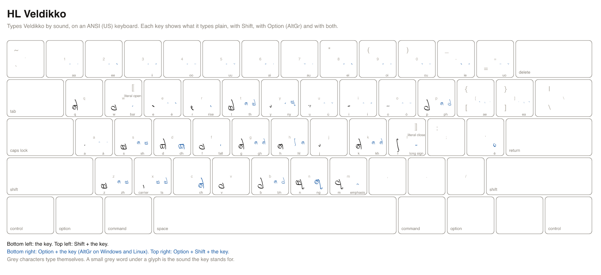

A printable copy is [veldikko.svg](veldikko.svg) and [veldikko.png](veldikko.png).

## Reading the keys

- `t` is the key alone. `shift+t` is Shift and the key.
- `option+t` is Option and the key on a Mac, and AltGr and the key on Windows and Linux. AltGr is the right Alt key (on a keyboard without one, hold Ctrl and Alt together). `option+shift+t` adds Shift.
- The Sound column is the roman spelling of the sound a key stands for. A key marked _nothing_ types nothing in this script.
- Character names and code points identify each character exactly, for a program or a character viewer.
- The Emacs column is what to type in the Emacs input method `heroiclands-veldikko`, where Option is a backslash.

## Installing the layout

The layout is a file per platform, named below. [The README](../README.md#installing-a-keyboard-layout) walks through installing each.

- macOS: `keyboards/macos/HeroicLands.bundle`, input source **HL Veldikko**.
- Windows: `keyboards/windows/veldikko.klc`, the Microsoft Keyboard Layout Creator source of **HL Veldikko**.
- Linux: `keyboards/linux/hl_veldikko`, the XKB symbols of **HL Veldikko**.
- Emacs: `keyboards/emacs/heroiclands-veldikko.el`, the input method `heroiclands-veldikko`.

## Signs

These keys type no sound. They type in HL Veldikko alone.

| Key | Emacs | Sign | Layout | Glyph | Code point | Name |
| --- | --- | --- | --- | --- | --- | --- |
| `x` | `x` | carrier | HL Veldikko | 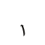 | U+1ED5D | VELDIKKO LETTER CARRIER |
| `option+l` | `\l` | long sign | HL Veldikko |  | U+1ED78 | VELDIKKO SIGN LONG |
| `option+w` | `\w` | bar | HL Veldikko |  | U+1ED7C | VELDIKKO SIGN DOUBLING BAR |
| `option+r` | `\r` | rise | HL Veldikko |  | U+1ED79 | VELDIKKO SIGN RISE |
| `option+f` | `\f` | fall | HL Veldikko |  | U+1ED7A | VELDIKKO SIGN FALL |
| `option+m` | `\m` | emphasis | HL Veldikko |  | U+1ED7B | VELDIKKO SIGN EMPHASIS |
| `option+shift+w` | `\W` | literal open | HL Veldikko | ⟦ | U+27E6 | LEFT WHITE SQUARE BRACKET |
| `option+shift+l` | `\L` | literal close | HL Veldikko | ⟧ | U+27E7 | RIGHT WHITE SQUARE BRACKET |

## Keys a platform cannot carry

A Windows key holds at most four UTF-16 code units and a Linux key one character, so a sound this script spells with more types nothing there. macOS and Emacs carry every key.

| Key | Sound | Script | Platform | Why |
| --- | --- | --- | --- | --- |
| `option+s` | `sh` | Veldikko | Linux | 2 code points; an XKB key types one |
| `option+t` | `th` | Veldikko | Linux | 2 code points; an XKB key types one |
| `option+k` | `kh` | Veldikko | Linux | 2 code points; an XKB key types one |
| `option+g` | `gh` | Veldikko | Linux | 2 code points; an XKB key types one |
| `option+z` | `zh` | Veldikko | Linux | 2 code points; an XKB key types one |
| `option+p` | `ph` | Veldikko | Linux | 2 code points; an XKB key types one |
| `option+y` | `ny` | Veldikko | Linux | 2 code points; an XKB key types one |
| `option+x` | `ts` | Veldikko | Linux | 2 code points; an XKB key types one |
| `option+h` | `hl` | Veldikko | Linux | 2 code points; an XKB key types one |
| `option+b` | `bh` | Veldikko | Linux | 2 code points; an XKB key types one |
| `option+1` | `aa` | Veldikko | Linux | 2 code points; an XKB key types one |
| `option+2` | `ee` | Veldikko | Linux | 2 code points; an XKB key types one |
| `option+3` | `ii` | Veldikko | Linux | 2 code points; an XKB key types one |
| `option+4` | `oo` | Veldikko | Linux | 2 code points; an XKB key types one |
| `option+5` | `uu` | Veldikko | Linux | 2 code points; an XKB key types one |
| `option+6` | `ai` | Veldikko | Linux | 2 code points; an XKB key types one |
| `option+7` | `au` | Veldikko | Linux | 2 code points; an XKB key types one |
| `option+8` | `ei` | Veldikko | Linux | 2 code points; an XKB key types one |
| `option+9` | `oi` | Veldikko | Linux | 2 code points; an XKB key types one |
| `option+0` | `ou` | Veldikko | Linux | 2 code points; an XKB key types one |
| `option+-` | `ie` | Veldikko | Linux | 2 code points; an XKB key types one |
| `option+=` | `uo` | Veldikko | Linux | 2 code points; an XKB key types one |
| `option+[` | `ae` | Veldikko | Windows | 6 UTF-16 code units; an MSKLC ligature holds 4 |
| `option+[` | `ae` | Veldikko | Linux | 3 code points; an XKB key types one |
| `option+]` | `ea` | Veldikko | Windows | 6 UTF-16 code units; an MSKLC ligature holds 4 |
| `option+]` | `ea` | Veldikko | Linux | 3 code points; an XKB key types one |
| `option+a` | `á` | Veldikko | Linux | 2 code points; an XKB key types one |
| `option+e` | `é` | Veldikko | Linux | 2 code points; an XKB key types one |
| `option+i` | `í` | Veldikko | Linux | 2 code points; an XKB key types one |
| `option+o` | `ó` | Veldikko | Linux | 2 code points; an XKB key types one |
| `option+u` | `ú` | Veldikko | Linux | 2 code points; an XKB key types one |

## Markup

These keys type themselves, as plain ASCII, in every layout, so Markdown and similar markup are written without switching layouts.

| Key | Types |
| --- | --- |
| `shift+8` | `*` |
| `shift+-` | `_` |
| `[` | `[` |
| `]` | `]` |
| `shift+[` | `{` |
| `shift+]` | `}` |
| `shift+9` | `(` |
| `shift+0` | `)` |
| `=` | `=` |
| `shift+;` | `:` |
| `shift+\` | `\|` |
| `\` | `\` |
| `` shift+` `` | `~` |
| `` ` `` | `` ` `` |

## Keys

Every sound key, in keyboard order. Example: `t` types the sound `t`.

| Key | Glyphs | Code points | Names | Sound | Emacs |
| --- | --- | --- | --- | --- | --- |
| `a` |  | U+1ED70 | VELDIKKO VOWEL SIGN A | `a` | `a` |
| `shift+a` |  | nothing: this script has no character for the sound |  | `A` | `A` |
| `b` | 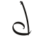 | U+1ED50 | VELDIKKO LETTER P | `b` | `b` |
| `shift+b` |  | nothing: this script has no character for the sound |  | `B` | `B` |
| `d` | 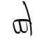 | U+1ED56 | VELDIKKO LETTER D | `d` | `d` |
| `shift+d` |  | nothing: this script has no character for the sound |  | `D` | `D` |
| `e` |  | U+1ED73 | VELDIKKO VOWEL SIGN E | `e` | `e` |
| `shift+e` |  | nothing: this script has no character for the sound |  | `E` | `E` |
| `f` | 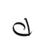 | U+1ED51 | VELDIKKO LETTER V | `f` | `f` |
| `shift+f` |  | nothing: this script has no character for the sound |  | `F` | `F` |
| `g` | 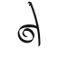 | U+1ED58 | VELDIKKO LETTER K | `g` | `g` |
| `shift+g` |  | nothing: this script has no character for the sound |  | `G` | `G` |
| `h` | 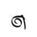 | U+1ED59 | VELDIKKO LETTER H | `h` | `h` |
| `shift+h` |  | nothing: this script has no character for the sound |  | `H` | `H` |
| `i` |  | U+1ED74 | VELDIKKO VOWEL SIGN I | `i` | `i` |
| `shift+i` |  | nothing: this script has no character for the sound |  | `I` | `I` |
| `j` | 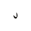 | U+1ED75 | VELDIKKO VOWEL SIGN Y | `j` | `j` |
| `shift+j` |  | nothing: this script has no character for the sound |  | `J` | `J` |
| `k` |  | U+1ED58 | VELDIKKO LETTER K | `k` | `k` |
| `shift+k` |  | nothing: this script has no character for the sound |  | `K` | `K` |
| `l` | 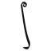 | U+1ED5B | VELDIKKO LETTER L | `l` | `l` |
| `shift+l` |  | nothing: this script has no character for the sound |  | `L` | `L` |
| `m` | 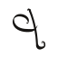 | U+1ED52 | VELDIKKO LETTER M | `m` | `m` |
| `shift+m` |  | nothing: this script has no character for the sound |  | `M` | `M` |
| `n` | 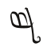 | U+1ED55 | VELDIKKO LETTER N | `n` | `n` |
| `shift+n` |  | nothing: this script has no character for the sound |  | `N` | `N` |
| `o` |  | U+1ED71 | VELDIKKO VOWEL SIGN O | `o` | `o` |
| `shift+o` |  | nothing: this script has no character for the sound |  | `O` | `O` |
| `p` |  | U+1ED50 | VELDIKKO LETTER P | `p` | `p` |
| `shift+p` |  | nothing: this script has no character for the sound |  | `P` | `P` |
| `q` |  | U+1ED58 | VELDIKKO LETTER K | `q` | `q` |
| `shift+q` |  | nothing: this script has no character for the sound |  | `Q` | `Q` |
| `r` | 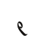 | U+1ED5C | VELDIKKO LETTER R | `r` | `r` |
| `shift+r` |  | nothing: this script has no character for the sound |  | `R` | `R` |
| `s` | 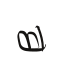 | U+1ED54 | VELDIKKO LETTER S | `s` | `s` |
| `shift+s` |  | nothing: this script has no character for the sound |  | `S` | `S` |
| `t` | 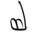 | U+1ED53 | VELDIKKO LETTER T | `t` | `t` |
| `shift+t` |  | nothing: this script has no character for the sound |  | `T` | `T` |
| `u` |  | U+1ED72 | VELDIKKO VOWEL SIGN U | `u` | `u` |
| `shift+u` |  | nothing: this script has no character for the sound |  | `U` | `U` |
| `v` |  | U+1ED51 | VELDIKKO LETTER V | `v` | `v` |
| `shift+v` |  | nothing: this script has no character for the sound |  | `V` | `V` |
| `w` |  | U+1ED51 | VELDIKKO LETTER V | `w` | `w` |
| `shift+w` |  | nothing: this script has no character for the sound |  | `W` | `W` |
| `y` |  | U+1ED75 | VELDIKKO VOWEL SIGN Y | `y` | `y` |
| `shift+y` |  | nothing: this script has no character for the sound |  | `Y` | `Y` |
| `z` |  | U+1ED54 | VELDIKKO LETTER S | `z` | `z` |
| `shift+z` |  | nothing: this script has no character for the sound |  | `Z` | `Z` |
| `option+c` |  | U+1ED58 | VELDIKKO LETTER K | `ch` | `\c` |
| `option+shift+c` |  | nothing: this script has no character for the sound |  | `Ch` | `\C` |
| `option+s` |   | U+1ED54 U+1ED59 | VELDIKKO LETTER S; VELDIKKO LETTER H | `sh` | `\s` |
| `option+shift+s` |  | nothing: this script has no character for the sound |  | `Sh` | `\S` |
| `option+t` |   | U+1ED53 U+1ED59 | VELDIKKO LETTER T; VELDIKKO LETTER H | `th` | `\t` |
| `option+shift+t` |  | nothing: this script has no character for the sound |  | `Th` | `\T` |
| `option+d` | 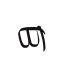 | U+1ED57 | VELDIKKO LETTER DH | `dh` | `\d` |
| `option+shift+d` |  | nothing: this script has no character for the sound |  | `Dh` | `\D` |
| `option+k` |   | U+1ED58 U+1ED59 | VELDIKKO LETTER K; VELDIKKO LETTER H | `kh` | `\k` |
| `option+shift+k` |  | nothing: this script has no character for the sound |  | `Kh` | `\K` |
| `option+g` |   | U+1ED58 U+1ED59 | VELDIKKO LETTER K; VELDIKKO LETTER H | `gh` | `\g` |
| `option+shift+g` |  | nothing: this script has no character for the sound |  | `Gh` | `\G` |
| `option+z` |   | U+1ED54 U+1ED59 | VELDIKKO LETTER S; VELDIKKO LETTER H | `zh` | `\z` |
| `option+shift+z` |  | nothing: this script has no character for the sound |  | `Zh` | `\Z` |
| `option+p` |   | U+1ED50 U+1ED59 | VELDIKKO LETTER P; VELDIKKO LETTER H | `ph` | `\p` |
| `option+shift+p` |  | nothing: this script has no character for the sound |  | `Ph` | `\P` |
| `option+n` | 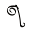 | U+1ED5A | VELDIKKO LETTER NG | `ng` | `\n` |
| `option+shift+n` |  | nothing: this script has no character for the sound |  | `Ng` | `\N` |
| `option+y` |   | U+1ED55 U+1ED75 | VELDIKKO LETTER N; VELDIKKO VOWEL SIGN Y | `ny` | `\y` |
| `option+shift+y` |  | nothing: this script has no character for the sound |  | `Ny` | `\Y` |
| `option+x` |   | U+1ED53 U+1ED54 | VELDIKKO LETTER T; VELDIKKO LETTER S | `ts` | `\x` |
| `option+shift+x` |  | nothing: this script has no character for the sound |  | `Ts` | `\X` |
| `option+h` |   | U+1ED59 U+1ED5B | VELDIKKO LETTER H; VELDIKKO LETTER L | `hl` | `\h` |
| `option+shift+h` |  | nothing: this script has no character for the sound |  | `Hl` | `\H` |
| `option+b` |   | U+1ED50 U+1ED59 | VELDIKKO LETTER P; VELDIKKO LETTER H | `bh` | `\b` |
| `option+shift+b` |  | nothing: this script has no character for the sound |  | `Bh` | `\B` |
| `option+1` |   | U+1ED70 U+1ED78 | VELDIKKO VOWEL SIGN A; VELDIKKO SIGN LONG | `aa` | `\1` |
| `option+shift+1` |  | nothing: this script has no character for the sound |  | `Aa` | `\!` |
| `option+2` |   | U+1ED73 U+1ED78 | VELDIKKO VOWEL SIGN E; VELDIKKO SIGN LONG | `ee` | `\2` |
| `option+shift+2` |  | nothing: this script has no character for the sound |  | `Ee` | `\@` |
| `option+3` |   | U+1ED74 U+1ED78 | VELDIKKO VOWEL SIGN I; VELDIKKO SIGN LONG | `ii` | `\3` |
| `option+shift+3` |  | nothing: this script has no character for the sound |  | `Ii` | `\#` |
| `option+4` |   | U+1ED71 U+1ED78 | VELDIKKO VOWEL SIGN O; VELDIKKO SIGN LONG | `oo` | `\4` |
| `option+shift+4` |  | nothing: this script has no character for the sound |  | `Oo` | `\$` |
| `option+5` |   | U+1ED72 U+1ED78 | VELDIKKO VOWEL SIGN U; VELDIKKO SIGN LONG | `uu` | `\5` |
| `option+shift+5` |  | nothing: this script has no character for the sound |  | `Uu` | `\%` |
| `option+6` |   | U+1ED70 U+1ED74 | VELDIKKO VOWEL SIGN A; VELDIKKO VOWEL SIGN I | `ai` | `\6` |
| `option+shift+6` |  | nothing: this script has no character for the sound |  | `Ai` | `\^` |
| `option+7` |   | U+1ED70 U+1ED72 | VELDIKKO VOWEL SIGN A; VELDIKKO VOWEL SIGN U | `au` | `\7` |
| `option+shift+7` |  | nothing: this script has no character for the sound |  | `Au` | `\&` |
| `option+8` |   | U+1ED73 U+1ED74 | VELDIKKO VOWEL SIGN E; VELDIKKO VOWEL SIGN I | `ei` | `\8` |
| `option+shift+8` |  | nothing: this script has no character for the sound |  | `Ei` | `\*` |
| `option+9` |   | U+1ED71 U+1ED74 | VELDIKKO VOWEL SIGN O; VELDIKKO VOWEL SIGN I | `oi` | `\9` |
| `option+shift+9` |  | nothing: this script has no character for the sound |  | `Oi` | `\(` |
| `option+0` |   | U+1ED71 U+1ED72 | VELDIKKO VOWEL SIGN O; VELDIKKO VOWEL SIGN U | `ou` | `\0` |
| `option+shift+0` |  | nothing: this script has no character for the sound |  | `Ou` | `\)` |
| `option+-` |   | U+1ED74 U+1ED73 | VELDIKKO VOWEL SIGN I; VELDIKKO VOWEL SIGN E | `ie` | `\-` |
| `option+shift+-` |  | nothing: this script has no character for the sound |  | `Ie` | `\_` |
| `option+=` |   | U+1ED72 U+1ED71 | VELDIKKO VOWEL SIGN U; VELDIKKO VOWEL SIGN O | `uo` | `\=` |
| `option+shift+=` |  | nothing: this script has no character for the sound |  | `Uo` | `\+` |
| `option+[` |    | U+1ED70 U+1ED5D U+1ED73 | VELDIKKO VOWEL SIGN A; VELDIKKO LETTER CARRIER; VELDIKKO VOWEL SIGN E | `ae` | `\[` |
| `option+shift+[` |  | nothing: this script has no character for the sound |  | `Ae` | `\{` |
| `option+]` |    | U+1ED73 U+1ED5D U+1ED70 | VELDIKKO VOWEL SIGN E; VELDIKKO LETTER CARRIER; VELDIKKO VOWEL SIGN A | `ea` | `\]` |
| `option+shift+]` |  | nothing: this script has no character for the sound |  | `Ea` | `\}` |
| `option+a` |   | U+1ED70 U+1ED7B | VELDIKKO VOWEL SIGN A; VELDIKKO SIGN EMPHASIS | `á` | `\a` |
| `option+shift+a` |  | nothing: this script has no character for the sound |  | `Á` | `\A` |
| `option+e` |   | U+1ED73 U+1ED7B | VELDIKKO VOWEL SIGN E; VELDIKKO SIGN EMPHASIS | `é` | `\e` |
| `option+shift+e` |  | nothing: this script has no character for the sound |  | `É` | `\E` |
| `option+i` |   | U+1ED74 U+1ED7B | VELDIKKO VOWEL SIGN I; VELDIKKO SIGN EMPHASIS | `í` | `\i` |
| `option+shift+i` |  | nothing: this script has no character for the sound |  | `Í` | `\I` |
| `option+o` |   | U+1ED71 U+1ED7B | VELDIKKO VOWEL SIGN O; VELDIKKO SIGN EMPHASIS | `ó` | `\o` |
| `option+shift+o` |  | nothing: this script has no character for the sound |  | `Ó` | `\O` |
| `option+u` |   | U+1ED72 U+1ED7B | VELDIKKO VOWEL SIGN U; VELDIKKO SIGN EMPHASIS | `ú` | `\u` |
| `option+shift+u` |  | nothing: this script has no character for the sound |  | `Ú` | `\U` |
| `option+;` |  | nothing: this script has no character for the sound |  | `ä` | `\;` |
| `option+shift+;` |  | nothing: this script has no character for the sound |  | `Ä` | `\:` |
| `option+'` | 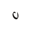 | U+1ED76 | VELDIKKO VOWEL SIGN E WITH DIAERESIS | `ë` | `\'` |
| `option+shift+'` |  | nothing: this script has no character for the sound |  | `Ë` | `\"` |
| `option+,` |  | nothing: this script has no character for the sound |  | `ï` | `\,` |
| `option+shift+,` |  | nothing: this script has no character for the sound |  | `Ï` | `\<` |
| `option+.` |  | nothing: this script has no character for the sound |  | `ö` | `\.` |
| `option+shift+.` |  | nothing: this script has no character for the sound |  | `Ö` | `\>` |
| `option+/` |  | nothing: this script has no character for the sound |  | `ü` | `\/` |
| `option+shift+/` |  | nothing: this script has no character for the sound |  | `Ü` | `\?` |
| `'` |  | nothing: this script has no character for the sound |  | `catch` | `'` |
| `.` |  | nothing: this script has no character for the sound |  | `stop` | `.` |
| `,` |  | nothing: this script has no character for the sound |  | `pause` | `,` |
| `shift+,` |  | nothing: this script has no character for the sound |  | `open quote` | `<` |
| `shift+.` |  | nothing: this script has no character for the sound |  | `close quote` | `>` |
| `0` |  | nothing: this script has no character for the sound |  | `0` | `0` |
| `1` |  | nothing: this script has no character for the sound |  | `1` | `1` |
| `2` |  | nothing: this script has no character for the sound |  | `2` | `2` |
| `3` |  | nothing: this script has no character for the sound |  | `3` | `3` |
| `4` |  | nothing: this script has no character for the sound |  | `4` | `4` |
| `5` |  | nothing: this script has no character for the sound |  | `5` | `5` |
| `6` |  | nothing: this script has no character for the sound |  | `6` | `6` |
| `7` |  | nothing: this script has no character for the sound |  | `7` | `7` |
| `8` |  | nothing: this script has no character for the sound |  | `8` | `8` |
| `9` |  | nothing: this script has no character for the sound |  | `9` | `9` |
| `shift+2` |  | nothing: this script has no character for the sound |  | `ten` | `@` |
| `shift+3` |  | nothing: this script has no character for the sound |  | `eleven` | `#` |
| `shift+4` |  | nothing: this script has no character for the sound |  | `twelve` | `$` |
| `shift+5` |  | nothing: this script has no character for the sound |  | `thirteen` | `%` |
| `shift+6` |  | nothing: this script has no character for the sound |  | `fourteen` | `^` |
| `shift+7` |  | nothing: this script has no character for the sound |  | `fifteen` | `&` |
