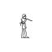
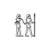
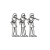
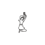
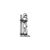
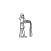
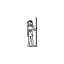
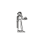
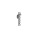

# Khelathi Zethu Glyphs cheatsheet

Khelathi Zethu Glyphs writes with pictorial signs, far more of them than a keyboard has keys, so it has no keyboard layout for macOS, Windows or Linux. Insert a sign by its code point, or pick it from the [glyph charts](../charts/khelathi-zethu-glyphs.md):

- **Word on Windows:** type the code point's hex digits, such as `1EA41`, and press Alt+X.
- **macOS:** open the Character Viewer (Edit, Emoji & Symbols), search the code point and double-click the sign.
- **Linux:** press Ctrl+Shift+U, type the hex digits and press Enter.
- **Emacs:** the input method `heroiclands-zethu` (`keyboards/emacs/heroiclands-zethu.el`) inserts a sign when you type its sign id, such as `08-001`.

## Signs

| Sign id | Glyph | Code point | Name |
| --- | --- | --- | --- |
| `01-002` |  | U+1EA41 | ZETHU CHARACTER 002 |
| `01-003` |  | U+1EA42 | ZETHU CHARACTER 003 |
| `01-005` |  | U+1EA44 | ZETHU CHARACTER 005 |
| `01-006` |  | U+1EA45 | ZETHU CHARACTER 006 |
| `01-007` |  | U+1EA46 | ZETHU CHARACTER 007 |
| `01-008` |  | U+1EA47 | ZETHU CHARACTER 008 |
| `01-009` |  | U+1EA48 | ZETHU CHARACTER 009 |
| `01-010` |  | U+1EA49 | ZETHU CHARACTER 010 |
| `01-011` |  | U+1EA4A | ZETHU CHARACTER 011 |
| `01-012` |  | U+1EA4B | ZETHU CHARACTER 012 |
| `01-013` |  | U+1EA4C | ZETHU CHARACTER 013 |
| `01-014` |  | U+1EA4D | ZETHU CHARACTER 014 |
| `01-015` |  | U+1EA4E | ZETHU CHARACTER 015 |
| `01-016` |  | U+1EA4F | ZETHU CHARACTER 016 |
| `01-017` |  | U+1EA50 | ZETHU CHARACTER 017 |
| `01-018` |  | U+1EA51 | ZETHU CHARACTER 018 |
| `01-020` |  | U+1EA53 | ZETHU CHARACTER 020 |
| `01-021` |  | U+1EA54 | ZETHU CHARACTER 021 |
| `01-023` |  | U+1EA56 | ZETHU CHARACTER 023 |
| `01-024` |  | U+1EA57 | ZETHU CHARACTER 024 |
| `01-025` |  | U+1EA58 | ZETHU CHARACTER 025 |
| `01-026` |  | U+1EA59 | ZETHU CHARACTER 026 |
| `01-028` |  | U+1EA5B | ZETHU CHARACTER 028 |
| `01-029` |  | U+1EA5C | ZETHU CHARACTER 029 |
| `01-030` |  | U+1EA5D | ZETHU CHARACTER 030 |
| `01-032` |  | U+1EA5F | ZETHU CHARACTER 032 |
| `01-033` |  | U+1EA60 | ZETHU CHARACTER 033 |
| `01-034` |  | U+1EA61 | ZETHU CHARACTER 034 |
| `01-035` |  | U+1EA62 | ZETHU CHARACTER 035 |
| `01-038` |  | U+1EA65 | ZETHU CHARACTER 038 |
| `01-039` |  | U+1EA66 | ZETHU CHARACTER 039 |
| `01-040` |  | U+1EA67 | ZETHU CHARACTER 040 |
| `01-041` |  | U+1EA68 | ZETHU CHARACTER 041 |
| `01-042` |  | U+1EA69 | ZETHU CHARACTER 042 |
| `01-043` |  | U+1EA6A | ZETHU CHARACTER 043 |
| `01-044` |  | U+1EA6B | ZETHU CHARACTER 044 |
| `01-045` |  | U+1EA6C | ZETHU CHARACTER 045 |
| `01-046` |  | U+1EA6D | ZETHU CHARACTER 046 |
| `01-047` |  | U+1EA6E | ZETHU CHARACTER 047 |
| `01-049` |  | U+1EA70 | ZETHU CHARACTER 049 |
| `01-050` |  | U+1EA71 | ZETHU CHARACTER 050 |
| `01-051` |  | U+1EA72 | ZETHU CHARACTER 051 |
| `01-052` |  | U+1EA73 | ZETHU CHARACTER 052 |
| `01-053` |  | U+1EA74 | ZETHU CHARACTER 053 |
| `01-054` |  | U+1EA75 | ZETHU CHARACTER 054 |
| `01-056` |  | U+1EA77 | ZETHU CHARACTER 056 |
| `01-057` |  | U+1EA78 | ZETHU CHARACTER 057 |
| `01-058` |  | U+1EA79 | ZETHU CHARACTER 058 |
| `01-059` |  | U+1EA7A | ZETHU CHARACTER 059 |
| `01-060` |  | U+1EA7B | ZETHU CHARACTER 060 |
| `01-061` |  | U+1EA7C | ZETHU CHARACTER 061 |
| `01-062` |  | U+1EA7D | ZETHU CHARACTER 062 |
| `02-002` |  | U+1EA7F | ZETHU CHARACTER 064 |
| `02-003` |  | U+1EA80 | ZETHU CHARACTER 065 |
| `02-006` |  | U+1EA83 | ZETHU CHARACTER 068 |
| `02-007` |  | U+1EA84 | ZETHU CHARACTER 069 |
| `02-008` |  | U+1EA85 | ZETHU CHARACTER 070 |
| `02-009` |  | U+1EA86 | ZETHU CHARACTER 071 |
| `02-010` |  | U+1EA87 | ZETHU CHARACTER 072 |
| `02-011` |  | U+1EA88 | ZETHU CHARACTER 073 |
| `02-015` |  | U+1EA8C | ZETHU CHARACTER 077 |
| `02-017` |  | U+1EA8E | ZETHU CHARACTER 079 |
| `02-019` |  | U+1EA90 | ZETHU CHARACTER 081 |
| `03-001` |  | U+1EA91 | ZETHU CHARACTER 082 |
| `03-003` |  | U+1EA93 | ZETHU CHARACTER 084 |
| `03-004` |  | U+1EA94 | ZETHU CHARACTER 085 |
| `03-005` |  | U+1EA95 | ZETHU CHARACTER 086 |
| `03-006` |  | U+1EA96 | ZETHU CHARACTER 087 |
| `03-007` |  | U+1EA97 | ZETHU CHARACTER 088 |
| `03-008` |  | U+1EA98 | ZETHU CHARACTER 089 |
| `03-009` |  | U+1EA99 | ZETHU CHARACTER 090 |
| `03-010` |  | U+1EA9A | ZETHU CHARACTER 091 |
| `03-011` |  | U+1EA9B | ZETHU CHARACTER 092 |
| `03-012` |  | U+1EA9C | ZETHU CHARACTER 093 |
| `03-013` |  | U+1EA9D | ZETHU CHARACTER 094 |
| `03-014` |  | U+1EA9E | ZETHU CHARACTER 095 |
| `03-015` |  | U+1EA9F | ZETHU CHARACTER 096 |
| `03-016` |  | U+1EAA0 | ZETHU CHARACTER 097 |
| `03-017` |  | U+1EAA1 | ZETHU CHARACTER 098 |
| `03-018` |  | U+1EAA2 | ZETHU CHARACTER 099 |
| `03-019` |  | U+1EAA3 | ZETHU CHARACTER 100 |
| `03-020` |  | U+1EAA4 | ZETHU CHARACTER 101 |
| `03-021` |  | U+1EAA5 | ZETHU CHARACTER 102 |
| `03-022` |  | U+1EAA6 | ZETHU CHARACTER 103 |
| `03-023` |  | U+1EAA7 | ZETHU CHARACTER 104 |
| `03-024` |  | U+1EAA8 | ZETHU CHARACTER 105 |
| `03-025` |  | U+1EAA9 | ZETHU CHARACTER 106 |
| `04-003` |  | U+1EAAC | ZETHU CHARACTER 109 |
| `04-006` |  | U+1EAAF | ZETHU CHARACTER 112 |
| `04-009` |  | U+1EAB2 | ZETHU CHARACTER 115 |
| `04-011` |  | U+1EAB4 | ZETHU CHARACTER 117 |
| `04-015` |  | U+1EAB8 | ZETHU CHARACTER 121 |
| `04-017` |  | U+1EABA | ZETHU CHARACTER 123 |
| `04-018` |  | U+1EABB | ZETHU CHARACTER 124 |
| `04-020` |  | U+1EABD | ZETHU CHARACTER 126 |
| `04-021` |  | U+1EABE | ZETHU CHARACTER 127 |
| `05-001` |  | U+1EAC0 | ZETHU CHARACTER 129 |
| `05-004` |  | U+1EAC3 | ZETHU CHARACTER 132 |
| `05-005` |  | U+1EAC4 | ZETHU CHARACTER 133 |
| `05-006` |  | U+1EAC5 | ZETHU CHARACTER 134 |
| `05-014` |  | U+1EACD | ZETHU CHARACTER 142 |
| `05-015` |  | U+1EACE | ZETHU CHARACTER 143 |
| `05-017` |  | U+1EAD0 | ZETHU CHARACTER 145 |
| `05-018` |  | U+1EAD1 | ZETHU CHARACTER 146 |
| `05-024` |  | U+1EAD7 | ZETHU CHARACTER 152 |
| `05-029` |  | U+1EADC | ZETHU CHARACTER 157 |
| `05-035` |  | U+1EAE2 | ZETHU CHARACTER 163 |
| `06-003` |  | U+1EAE9 | ZETHU CHARACTER 170 |
| `06-005` |  | U+1EAEB | ZETHU CHARACTER 172 |
| `06-010` |  | U+1EAF0 | ZETHU CHARACTER 177 |
| `06-014` |  | U+1EAF4 | ZETHU CHARACTER 181 |
| `06-020` |  | U+1EAFA | ZETHU CHARACTER 187 |
| `06-022` |  | U+1EAFC | ZETHU CHARACTER 189 |
| `06-027` |  | U+1EB01 | ZETHU CHARACTER 194 |
| `06-029` |  | U+1EB03 | ZETHU CHARACTER 196 |
| `06-031` |  | U+1EB05 | ZETHU CHARACTER 198 |
| `07-001` |  | U+1EB09 | ZETHU CHARACTER 202 |
| `07-002` |  | U+1EB0A | ZETHU CHARACTER 203 |
| `07-009` |  | U+1EB11 | ZETHU CHARACTER 210 |
| `08-001` |  | U+1EB1D | ZETHU CHARACTER 222 |
| `08-005` |  | U+1EB21 | ZETHU CHARACTER 226 |
| `08-006` |  | U+1EB22 | ZETHU CHARACTER 227 |
| `08-007` |  | U+1EB23 | ZETHU CHARACTER 228 |
| `08-008` |  | U+1EB24 | ZETHU CHARACTER 229 |
| `08-014` |  | U+1EB2A | ZETHU CHARACTER 235 |
| `08-016` |  | U+1EB2C | ZETHU CHARACTER 237 |
| `09-001` |  | U+1EB31 | ZETHU CHARACTER 242 |
| `09-002` |  | U+1EB32 | ZETHU CHARACTER 243 |
| `09-003` |  | U+1EB33 | ZETHU CHARACTER 244 |
| `09-005` |  | U+1EB35 | ZETHU CHARACTER 246 |
| `09-006` |  | U+1EB36 | ZETHU CHARACTER 247 |
| `09-007` |  | U+1EB37 | ZETHU CHARACTER 248 |
| `09-008` |  | U+1EB38 | ZETHU CHARACTER 249 |
| `09-009` |  | U+1EB39 | ZETHU CHARACTER 250 |
| `09-010` |  | U+1EB3A | ZETHU CHARACTER 251 |
| `09-011` |  | U+1EB3B | ZETHU CHARACTER 252 |
| `09-014` |  | U+1EB3E | ZETHU CHARACTER 255 |
| `09-015` |  | U+1EB3F | ZETHU CHARACTER 256 |
| `09-016` |  | U+1EB40 | ZETHU CHARACTER 257 |
| `09-017` |  | U+1EB41 | ZETHU CHARACTER 258 |
| `09-018` |  | U+1EB42 | ZETHU CHARACTER 259 |
| `09-019` |  | U+1EB43 | ZETHU CHARACTER 260 |
| `09-020` |  | U+1EB44 | ZETHU CHARACTER 261 |
| `09-021` |  | U+1EB45 | ZETHU CHARACTER 262 |
| `09-022` |  | U+1EB46 | ZETHU CHARACTER 263 |
| `10-001` |  | U+1EB48 | ZETHU CHARACTER 265 |
| `10-002` |  | U+1EB49 | ZETHU CHARACTER 266 |
| `10-007` |  | U+1EB4E | ZETHU CHARACTER 271 |
| `10-008` |  | U+1EB4F | ZETHU CHARACTER 272 |
| `10-009` |  | U+1EB50 | ZETHU CHARACTER 273 |
| `10-010` |  | U+1EB51 | ZETHU CHARACTER 274 |
| `10-011` |  | U+1EB52 | ZETHU CHARACTER 275 |
| `10-012` |  | U+1EB53 | ZETHU CHARACTER 276 |
| `10-013` |  | U+1EB54 | ZETHU CHARACTER 277 |
| `10-014` |  | U+1EB55 | ZETHU CHARACTER 278 |
| `10-015` |  | U+1EB56 | ZETHU CHARACTER 279 |
| `10-016` |  | U+1EB57 | ZETHU CHARACTER 280 |
| `10-017` |  | U+1EB58 | ZETHU CHARACTER 281 |
| `10-018` |  | U+1EB59 | ZETHU CHARACTER 282 |
| `10-019` |  | U+1EB5A | ZETHU CHARACTER 283 |
| `10-020` |  | U+1EB5B | ZETHU CHARACTER 284 |
| `10-022` |  | U+1EB5D | ZETHU CHARACTER 286 |
| `10-023` |  | U+1EB5E | ZETHU CHARACTER 287 |
| `10-024` |  | U+1EB5F | ZETHU CHARACTER 288 |
| `10-025` |  | U+1EB60 | ZETHU CHARACTER 289 |
| `10-026` |  | U+1EB61 | ZETHU CHARACTER 290 |
| `10-027` |  | U+1EB62 | ZETHU CHARACTER 291 |
| `10-028` |  | U+1EB63 | ZETHU CHARACTER 292 |
| `11-001` |  | U+1EB64 | ZETHU CHARACTER 293 |
| `11-002` |  | U+1EB65 | ZETHU CHARACTER 294 |
| `11-003` |  | U+1EB66 | ZETHU CHARACTER 295 |
| `11-004` |  | U+1EB67 | ZETHU CHARACTER 296 |
| `11-005` |  | U+1EB68 | ZETHU CHARACTER 297 |
| `11-006` |  | U+1EB69 | ZETHU CHARACTER 298 |
| `11-007` |  | U+1EB6A | ZETHU CHARACTER 299 |
| `11-008` |  | U+1EB6B | ZETHU CHARACTER 300 |
| `11-009` |  | U+1EB6C | ZETHU CHARACTER 301 |
| `11-010` |  | U+1EB6D | ZETHU CHARACTER 302 |
| `11-011` |  | U+1EB6E | ZETHU CHARACTER 303 |
| `11-012` |  | U+1EB6F | ZETHU CHARACTER 304 |
| `11-013` |  | U+1EB70 | ZETHU CHARACTER 305 |
| `11-014` |  | U+1EB71 | ZETHU CHARACTER 306 |
| `11-015` |  | U+1EB72 | ZETHU CHARACTER 307 |
| `11-016` |  | U+1EB73 | ZETHU CHARACTER 308 |
| `11-017` |  | U+1EB74 | ZETHU CHARACTER 309 |
| `11-018` |  | U+1EB75 | ZETHU CHARACTER 310 |
| `11-019` |  | U+1EB76 | ZETHU CHARACTER 311 |
| `11-020` |  | U+1EB77 | ZETHU CHARACTER 312 |
| `11-021` |  | U+1EB78 | ZETHU CHARACTER 313 |
| `11-022` |  | U+1EB79 | ZETHU CHARACTER 314 |
| `11-024` |  | U+1EB7B | ZETHU CHARACTER 316 |
| `11-025` |  | U+1EB7C | ZETHU CHARACTER 317 |
| `12-001` |  | U+1EB7D | ZETHU CHARACTER 318 |
| `12-002` |  | U+1EB7E | ZETHU CHARACTER 319 |
| `12-003` |  | U+1EB7F | ZETHU CHARACTER 320 |
| `12-004` |  | U+1EB80 | ZETHU CHARACTER 321 |
| `12-005` |  | U+1EB81 | ZETHU CHARACTER 322 |
| `12-006` |  | U+1EB82 | ZETHU CHARACTER 323 |
| `12-007` |  | U+1EB83 | ZETHU CHARACTER 324 |
| `12-009` |  | U+1EB85 | ZETHU CHARACTER 326 |
| `12-011` |  | U+1EB87 | ZETHU CHARACTER 328 |
| `12-012` |  | U+1EB88 | ZETHU CHARACTER 329 |
| `12-014` |  | U+1EB8A | ZETHU CHARACTER 331 |
| `13-001` |  | U+1EB8B | ZETHU CHARACTER 332 |
| `13-002` |  | U+1EB8C | ZETHU CHARACTER 333 |
| `13-003` |  | U+1EB8D | ZETHU CHARACTER 334 |
| `13-004` |  | U+1EB8E | ZETHU CHARACTER 335 |
| `13-005` |  | U+1EB8F | ZETHU CHARACTER 336 |
| `13-006` |  | U+1EB90 | ZETHU CHARACTER 337 |
| `13-007` |  | U+1EB91 | ZETHU CHARACTER 338 |
| `13-008` |  | U+1EB92 | ZETHU CHARACTER 339 |
| `13-009` |  | U+1EB93 | ZETHU CHARACTER 340 |
| `13-010` |  | U+1EB94 | ZETHU CHARACTER 341 |
| `13-011` |  | U+1EB95 | ZETHU CHARACTER 342 |
| `13-012` |  | U+1EB96 | ZETHU CHARACTER 343 |
| `13-013` |  | U+1EB97 | ZETHU CHARACTER 344 |
| `13-014` |  | U+1EB98 | ZETHU CHARACTER 345 |
| `13-015` |  | U+1EB99 | ZETHU CHARACTER 346 |
| `13-016` |  | U+1EB9A | ZETHU CHARACTER 347 |
| `13-017` |  | U+1EB9B | ZETHU CHARACTER 348 |
| `13-018` |  | U+1EB9C | ZETHU CHARACTER 349 |
| `13-021` |  | U+1EB9F | ZETHU CHARACTER 352 |
| `13-022` |  | U+1EBA0 | ZETHU CHARACTER 353 |
| `13-024` |  | U+1EBA2 | ZETHU CHARACTER 355 |
| `13-025` |  | U+1EBA3 | ZETHU CHARACTER 356 |
| `13-026` |  | U+1EBA4 | ZETHU CHARACTER 357 |
| `13-027` |  | U+1EBA5 | ZETHU CHARACTER 358 |
| `13-029` |  | U+1EBA7 | ZETHU CHARACTER 360 |
| `13-030` |  | U+1EBA8 | ZETHU CHARACTER 361 |
| `13-032` |  | U+1EBAA | ZETHU CHARACTER 363 |
| `13-033` |  | U+1EBAB | ZETHU CHARACTER 364 |
| `13-034` |  | U+1EBAC | ZETHU CHARACTER 365 |
| `13-035` |  | U+1EBAD | ZETHU CHARACTER 366 |
| `13-036` |  | U+1EBAE | ZETHU CHARACTER 367 |
| `13-037` |  | U+1EBAF | ZETHU CHARACTER 368 |
| `13-038` |  | U+1EBB0 | ZETHU CHARACTER 369 |
| `13-039` |  | U+1EBB1 | ZETHU CHARACTER 370 |
| `13-040` |  | U+1EBB2 | ZETHU CHARACTER 371 |
| `14-001` |  | U+1EBB4 | ZETHU CHARACTER 373 |
| `14-003` |  | U+1EBB6 | ZETHU CHARACTER 375 |
| `14-004` |  | U+1EBB7 | ZETHU CHARACTER 376 |
| `14-005` |  | U+1EBB8 | ZETHU CHARACTER 377 |
| `14-006` |  | U+1EBB9 | ZETHU CHARACTER 378 |
| `14-007` |  | U+1EBBA | ZETHU CHARACTER 379 |
| `14-008` |  | U+1EBBB | ZETHU CHARACTER 380 |
| `14-009` |  | U+1EBBC | ZETHU CHARACTER 381 |
| `14-011` |  | U+1EBBE | ZETHU CHARACTER 383 |
| `14-012` |  | U+1EBBF | ZETHU CHARACTER 384 |
| `14-015` |  | U+1EBC2 | ZETHU CHARACTER 387 |
| `14-016` |  | U+1EBC3 | ZETHU CHARACTER 388 |
| `14-017` |  | U+1EBC4 | ZETHU CHARACTER 389 |
| `14-018` |  | U+1EBC5 | ZETHU CHARACTER 390 |
| `14-019` |  | U+1EBC6 | ZETHU CHARACTER 391 |
| `14-020` |  | U+1EBC7 | ZETHU CHARACTER 392 |
| `14-021` |  | U+1EBC8 | ZETHU CHARACTER 393 |
| `14-022` |  | U+1EBC9 | ZETHU CHARACTER 394 |
| `15-001` |  | U+1EBCB | ZETHU CHARACTER 396 |
| `15-004` |  | U+1EBCE | ZETHU CHARACTER 399 |
| `15-007` |  | U+1EBD1 | ZETHU CHARACTER 402 |
| `15-009` |  | U+1EBD3 | ZETHU CHARACTER 404 |
| `15-010` |  | U+1EBD4 | ZETHU CHARACTER 405 |
| `15-014` |  | U+1EBD8 | ZETHU CHARACTER 409 |
| `15-015` |  | U+1EBD9 | ZETHU CHARACTER 410 |
| `15-016` |  | U+1EBDA | ZETHU CHARACTER 411 |
| `15-017` |  | U+1EBDB | ZETHU CHARACTER 412 |
| `16-001` |  | U+1EBDC | ZETHU CHARACTER 413 |
| `16-003` |  | U+1EBDE | ZETHU CHARACTER 415 |
| `16-004` |  | U+1EBDF | ZETHU CHARACTER 416 |
| `16-005` |  | U+1EBE0 | ZETHU CHARACTER 417 |
| `16-006` |  | U+1EBE1 | ZETHU CHARACTER 418 |
| `16-007` |  | U+1EBE2 | ZETHU CHARACTER 419 |
| `16-008` |  | U+1EBE3 | ZETHU CHARACTER 420 |
| `16-009` |  | U+1EBE4 | ZETHU CHARACTER 421 |
| `16-011` |  | U+1EBE6 | ZETHU CHARACTER 423 |
| `16-012` |  | U+1EBE7 | ZETHU CHARACTER 424 |
| `16-013` |  | U+1EBE8 | ZETHU CHARACTER 425 |
| `16-014` |  | U+1EBE9 | ZETHU CHARACTER 426 |
| `16-015` |  | U+1EBEA | ZETHU CHARACTER 427 |
| `16-016` |  | U+1EBEB | ZETHU CHARACTER 428 |
| `16-018` |  | U+1EBED | ZETHU CHARACTER 430 |
| `16-019` |  | U+1EBEE | ZETHU CHARACTER 431 |
| `01-063` |  | U+1EBF0 | ZETHU CHARACTER 433 |
| `01-064` |  | U+1EBF1 | ZETHU CHARACTER 434 |
| `01-065` |  | U+1EBF2 | ZETHU CHARACTER 435 |
| `05-040` |  | U+1EBF3 | ZETHU CHARACTER 436 |
| `07-021` |  | U+1EBF4 | ZETHU CHARACTER 437 |
| `03-026` |  | U+1EBF5 | ZETHU CHARACTER 438 |
| `03-027` |  | U+1EBF6 | ZETHU CHARACTER 439 |
| `03-028` |  | U+1EBF7 | ZETHU CHARACTER 440 |
| `14-024` |  | U+1EBF8 | ZETHU CHARACTER 441 |
| `14-025` |  | U+1EBF9 | ZETHU CHARACTER 442 |
| `14-026` |  | U+1EBFA | ZETHU CHARACTER 443 |
| `14-027` |  | U+1EBFB | ZETHU CHARACTER 444 |
| `14-028` |  | U+1EBFC | ZETHU CHARACTER 445 |
| `14-029` |  | U+1EBFD | ZETHU CHARACTER 446 |
| `09-024` |  | U+1EBFE | ZETHU CHARACTER 447 |
| `01-066` |  | U+1EBFF | ZETHU CHARACTER 448 |
| `10-029` |  | U+1EC00 | ZETHU CHARACTER 449 |
| `12-015` |  | U+1EC01 | ZETHU CHARACTER 450 |
| `04-023` |  | U+1EC02 | ZETHU CHARACTER 451 |
| `16-021` |  | U+1EC03 | ZETHU CHARACTER 452 |
| `14-030` |  | U+1EC04 | ZETHU CHARACTER 453 |
| `13-042` |  | U+1EC05 | ZETHU CHARACTER 454 |
| `12-016` |  | U+1EC06 | ZETHU CHARACTER 455 |
| `01-067` |  | U+1EC07 | ZETHU CHARACTER 456 |
| `01-068` |  | U+1EC08 | ZETHU CHARACTER 457 |
| `01-069` |  | U+1EC09 | ZETHU CHARACTER 458 |
| `10-030` |  | U+1EC0A | ZETHU CHARACTER 459 |
| `01-070` |  | U+1EC0B | ZETHU CHARACTER 460 |
| `04-024` |  | U+1EC0C | ZETHU CHARACTER 461 |
| `03-029` |  | U+1EC0D | ZETHU CHARACTER 462 |
| `16-022` |  | U+1EC0F | ZETHU CHARACTER 464 |
| `01-072` |  | U+1EC11 | ZETHU CHARACTER 466 |
| `16-024` |  | U+1EC14 | ZETHU CHARACTER 469 |
| `16-025` |  | U+1EC15 | ZETHU CHARACTER 470 |
| `16-026` |  | U+1EC16 | ZETHU CHARACTER 471 |
| `16-027` |  | U+1EC17 | ZETHU CHARACTER 472 |
| `16-028` |  | U+1EC18 | ZETHU CHARACTER 473 |
| `16-029` |  | U+1EC19 | ZETHU CHARACTER 474 |
| `16-030` |  | U+1EC1A | ZETHU CHARACTER 475 |
| `03-030` |  | U+1EC1B | ZETHU CHARACTER 476 |
| `01-073` |  | U+1EC1C | ZETHU CHARACTER 477 |
| `01-074` |  | U+1EC1D | ZETHU CHARACTER 478 |
| `01-075` |  | U+1EC1E | ZETHU CHARACTER 479 |
| `01-076` |  | U+1EC1F | ZETHU CHARACTER 480 |
| `01-077` |  | U+1EC20 | ZETHU CHARACTER 481 |
| `14-031` |  | U+1EC21 | ZETHU CHARACTER 482 |
| `14-032` |  | U+1EC22 | ZETHU CHARACTER 483 |
| `14-033` |  | U+1EC23 | ZETHU CHARACTER 484 |
| `14-034` |  | U+1EC24 | ZETHU CHARACTER 485 |
| `14-035` |  | U+1EC25 | ZETHU CHARACTER 486 |
| `14-036` |  | U+1EC26 | ZETHU CHARACTER 487 |
| `13-043` |  | U+1EC27 | ZETHU CHARACTER 488 |
| `04-026` |  | U+1EC28 | ZETHU CHARACTER 489 |
| `04-027` |  | U+1EC29 | ZETHU CHARACTER 490 |
| `01-078` |  | U+1EC2A | ZETHU CHARACTER 491 |
| `01-079` |  | U+1EC2B | ZETHU CHARACTER 492 |
| `04-028` |  | U+1EC2C | ZETHU CHARACTER 493 |
| `10-032` |  | U+1EC2D | ZETHU CHARACTER 494 |
| `10-034` |  | U+1EC2E | ZETHU CHARACTER 495 |
| `10-035` |  | U+1EC2F | ZETHU CHARACTER 496 |
| `01-080` |  | U+1EC30 | ZETHU CHARACTER 497 |
| `16-031` |  | U+1EC31 | ZETHU CHARACTER 498 |
| `01-081` |  | U+1EC32 | ZETHU CHARACTER 499 |
