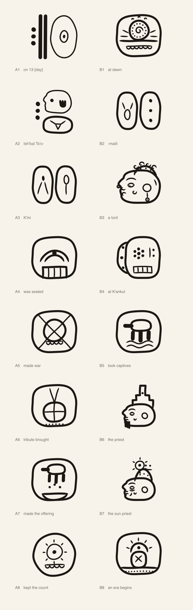

# Chalish Pilam Ceremonial

Ki'ich'chik carved logographic hand, glyphs and syllable signs composed into blocks, written left to right, read in paired columns.

[Back to the README](../README.md) · [Character chart](../charts/chalish-pilam-ceremonial.md)

## The glyphs

Each glyph is carved whole, and glyphs are composed into blocks: a main sign with a number, syllable signs or both set beside it, over it or under it. A block is written as its codes joined by `*`, which sets two items side by side, and `:`, which stacks the first over the second, and the font lays the block out from those joiners. The [chart](../charts/chalish-pilam-ceremonial.md) lists every glyph with its code point.

## A lord's seating

Sixteen blocks in paired columns, read across each pair and down: A1, B1, A2, B2. Each block is written in the Chalish Ceremonial Codage and set through the font.

1. on 13 [day]  
   `n13*TQAN`
2. at dawn  
   `DAWN`
3. Ish'bal Ts'o-  
   `n3*JAGUAR:tso1`
4. -malil  
   `ma1*li1`
5. K'ini  
   `ki1*ni1`
6. a lord  
   `LORD`
7. was seated  
   `SEATING`
8. at K'ankul  
   `KANKUL`
9. made war  
   `WAR`
10. took captives  
    `CAPTURE`
11. tribute brought  
    `TRIBUTE`
12. the priest  
    `PRIEST`
13. made the offering  
    `OFFERING`
14. the sun priest  
    `SUN_PRIEST`
15. kept the count  
    `SOLAR_COUNT`
16. an era begins  
    `ERA_BEGINS`

On 13 [day], at dawn, Ish'bal Ts'omalil K'ini, the third of the name, a lord, was seated at K'ankul. He made war, he took captives, tribute was brought. The priest made the offering, and the sun priest kept the count. An era begins.
