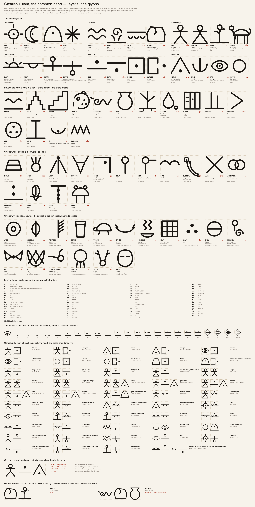
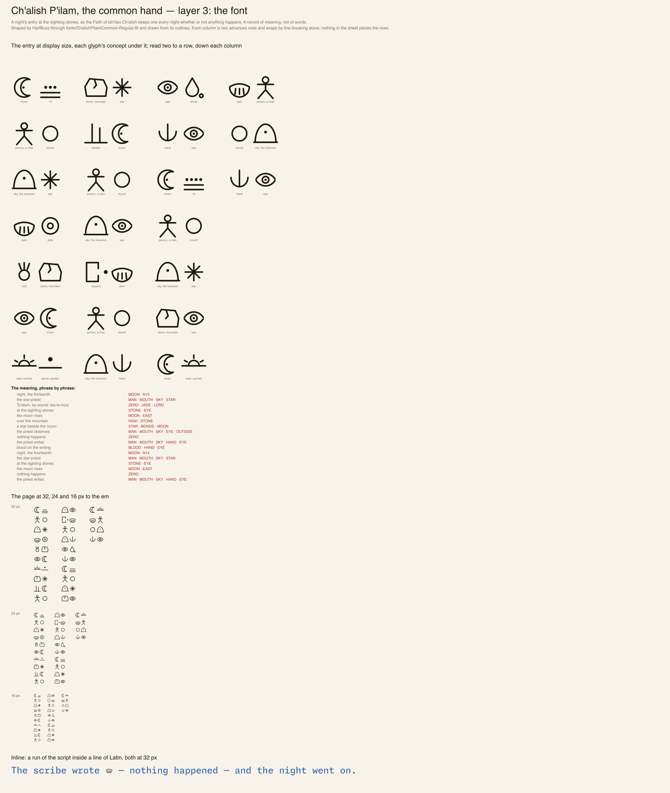

# Chalish Pilam Common

Ki'ich'chik everyday logographic hand, written left to right, read two to a row down a column.

[Back to the README](../README.md) · [Character chart](../charts/chalish-pilam.md)

## The glyphs

Each glyph is a concept, built from strokes in one even line. The sheet groups them by who knows them: the core glyphs everyone reads, then those of a trade, the scribes and the priests, then the numbers, the compounds and names written in sounds. The [chart](../charts/chalish-pilam.md) lists every glyph with its code point.

## A night's entry

The Faith of Ish'ilan Ch'alish keeps a record of every night at the sighting stones, whether or not anything happens. The entry is a record of meaning, not of words: it is set here as text, and the page wraps it two glyphs to a row, read down each column.

1. night, the thirteenth
2. the star-priest
3. Ts'alam, by sound: tsa-la-m(a)
4. at the sighting stones
5. the moon rises
6. over the mountain
7. a star beside the moon
8. the priest observes
9. nothing happens
10. the priest writes
11. blood on the writing
12. night, the fourteenth
13. the star-priest
14. at the sighting stones
15. the moon rises
16. nothing happens
17. the priest writes
