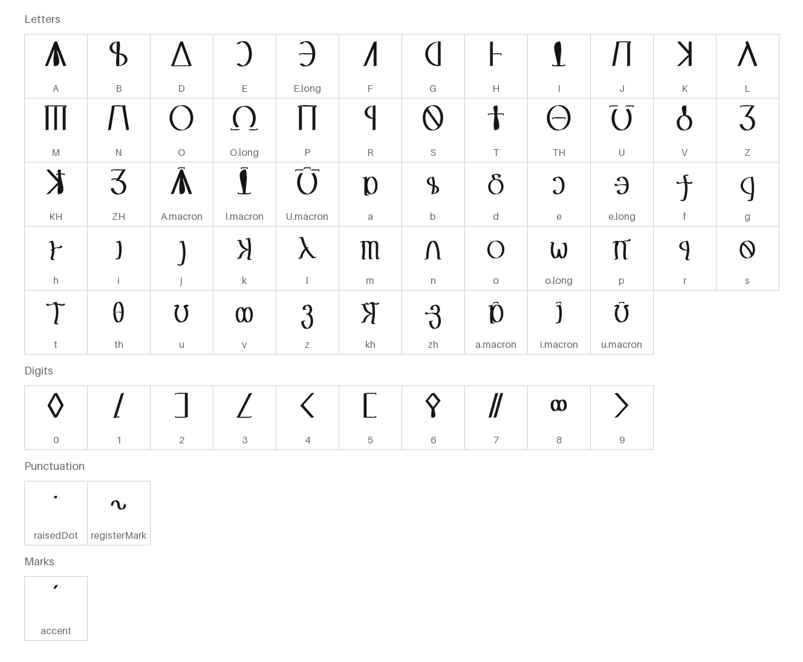
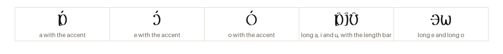
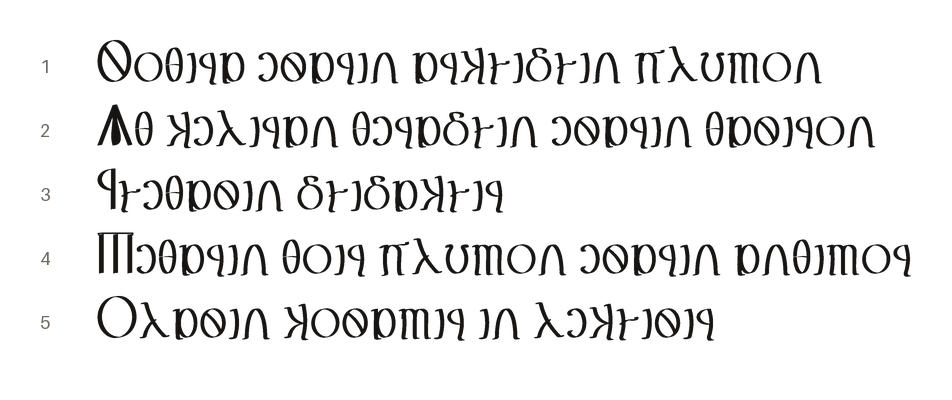

# Helonika Book

Helonic (human) book hand, geometric capitals over a round minuscule, written left to right.

[Back to the README](../README.md) · [Character chart](../charts/helonika-book.md)

## The letters

Every character the font draws on its own, each under its glyph name.

## The marks

The accent stands over the vowel before it; the long vowels carry their length bar as letters of their own.

## A passage

From the Sample Phrases of _Helonic Language_, in thalorna.

1. Wisdom is the beginning of all things  
   _Sothira ésarin arkhidhin plumon_
2. To behold beauty is divine  
   _Ath kéliran théradhin ésarin thásiron_
3. Speak, teach!  
   _Rhéthasin, dhidakhir!_
4. Man is the measure of all things  
   _Métharin thoir plumon ésarin ánthimor_
5. The entire cosmos in a single word  
   _Olasin kosamir in lékhisir_
