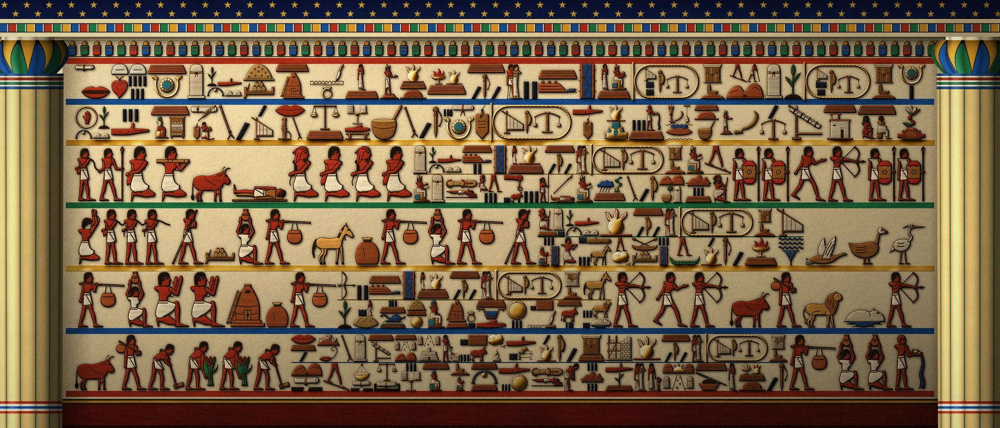
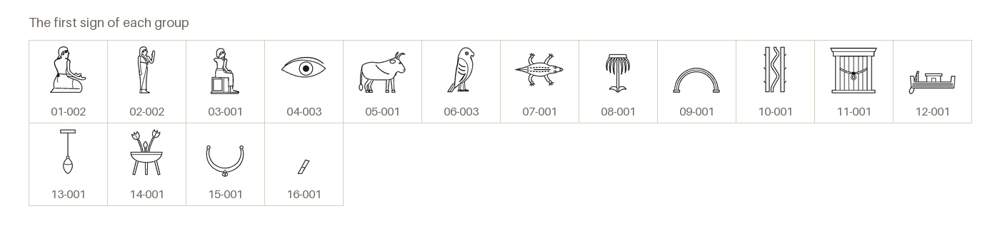

# Khelathi Zethu Glyphs

Au'Khelathu temple hieroglyphs, written right to left.

[Back to the README](../README.md) · [Character chart](../charts/khelathi-zethu-glyphs.md)

## The banner

The Khelathu banner, the memorial of Meqes VI in ten registers, drawn from this font's signs and painted. It is thalorna's `assets/images/banners/khelathubnr.webp`, and its English text, below, is from `utils/banner-meqes/sign-sequence.md` there. Square brackets mark text restored from the approved inscription; braces mark formulas added from other texts.

1. **The heading** (register 1). Year 1 of the Gar-Au ⟨Meqes, the seventh of the name⟩, {living, enduring, strong}. Went to the West the Gar-Au ⟨Meqes, the sixth of the name⟩, [Lord of the River and of the Two Banks], beloved of Uqa'a, {fire of Uqa'a upon the mound, who stood, who was crowned, lord of the count, whose seal is on the granary, whose grain the barges carry}, [given life like the sun forever], in his twenty-seventh year. His account is read.
2. **Birth and crowning** (register 2). Shaped him Uzn'era [in the womb], a child of the house of Zu'Meku. Stood he upon the mound [at Yath-Telgu]; {set the priesthood of Uqa'a the crown on him, and gave him his name, ⟨Meqes⟩; by this name every contract of the year is dated.} Qe'aret set truth in his mouth, and Reth'Sa'ar wrote his name [in the house of books]. The gods gave him life and dominion, like the sun.
3. **The war of the west** (registers 3, 4). Came down His Majesty, {the Gar-Au ⟨Meqes⟩, beloved of Uqa'a, Lord of the River and of the Two Banks, given life like the sun forever,} upon the hill-men of the western margins, and Chaq'ur raged before him like the storm. Smote he their chieftains, [took he their herds,] and brought back their princes bound [beneath his sandals]. {The margins were the Gar-Au's.}
4. **The war of the north and the tribute** (registers 5, 6). Sailed he, {the Gar-Au ⟨Meqes⟩, beloved of Uqa'a, given life like the sun forever,} against the raiders of the northern sea, and the fire of Uqa'a went out against their ships. The river was at peace, and the barges came up laden: gold, cedar, horses [and slaves]. {The river was the Gar-Au's.}
5. **The great hunt and the lean years** (registers 7, 8). Rode he out, {the Gar-Au ⟨Meqes⟩, beloved of Uqa'a, Lord of the River and of the Two Banks,} against the lions and the river-horses that ravaged the herds and the fields, and the beasts taken were counted. In the years of the low river he opened the god's granaries under his seal, which he had filled in the years of the flood, and none of his people hungered.
6. **His works, the god's answer, and the weighing** (registers 9, 10). {The Gar-Au ⟨Meqes⟩, beloved of Uqa'a,} built anew the house of Uqa'a, gave it altars of gold, and endowed it with fields and herds. [He raised his Way at the head of the death-road at Zu-Gezer.] [Words spoken by Uqa'a, {fire on the first ground, lord of the dry ink, who comes up the road}: “My beloved son, I give you every land, every foreign country bowed beneath your sandals; I give you the years of the sun upon the throne of the mound.”] Before the gods the tablets lay level on the beam: what he owed was closed, and nothing remained; what was owed to him stood open. He went down owed.

## The signs

The font has 344 signs. This is the first of each group, under its sign id; the [chart](../charts/khelathi-zethu-glyphs.md) has them all.

