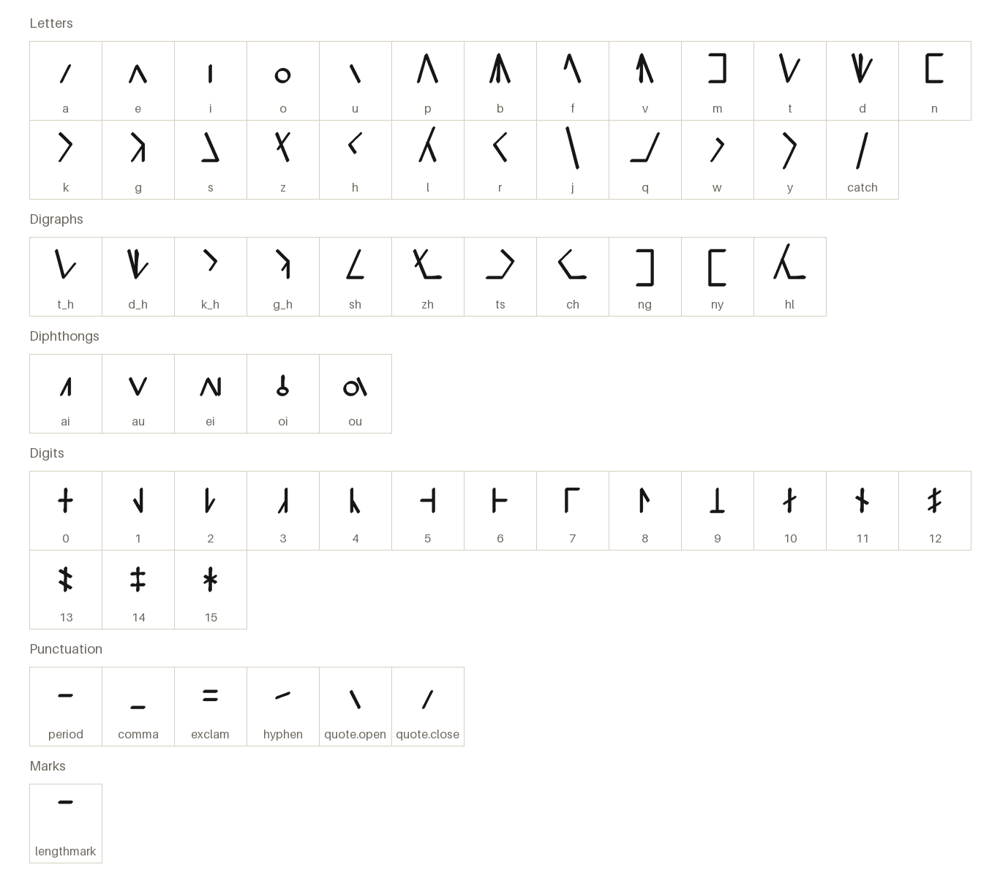
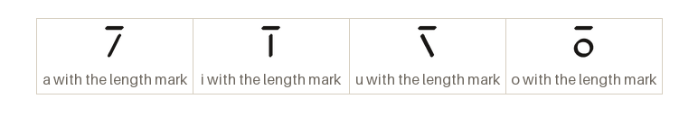
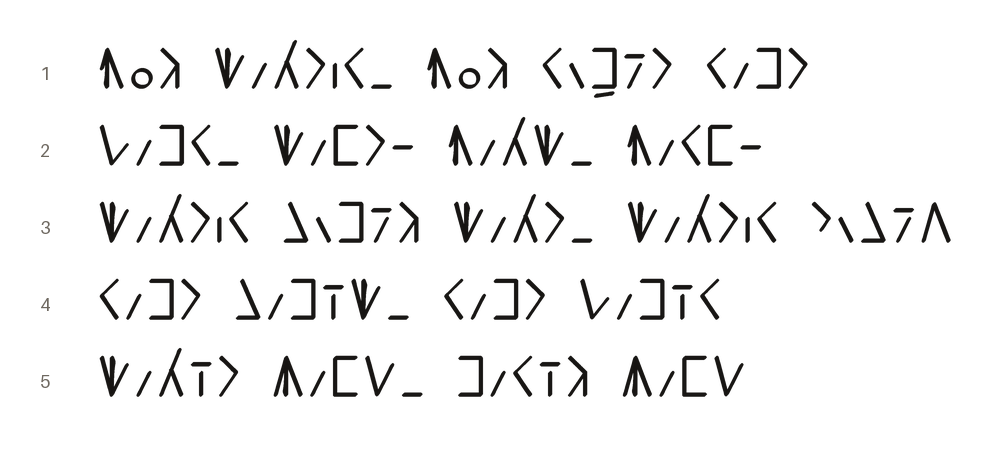

# Pirzath Hand

Khazari (dwarven) common hand, the modern script, written left to right.

[Back to the README](../README.md) · [Character chart](../charts/pirzath-hand.md)

## The letters

Every character the font draws on its own, each under its glyph name.

## The marks

The length mark is typed after its vowel and stands over it.

## A passage

From the Sample Phrases of _Khazari Language_, in thalorna.

1. He is a mason; he lays the course as a master does  
   _Vog dalkir, vog rummák ramk_
2. The blow, the hammer-fall; the binding, the true line  
   _Thamr, dank. Vald, varn._
3. The mason listens to the stone; the mason cuts little  
   _Dalkir sumág dalk, dalkir khusáp_
4. The course is raised; the course is struck  
   _Ramk samíd, ramk thamír_
5. Oath of stone, oath of bone  
   _Dalík bant, maríg bant_
