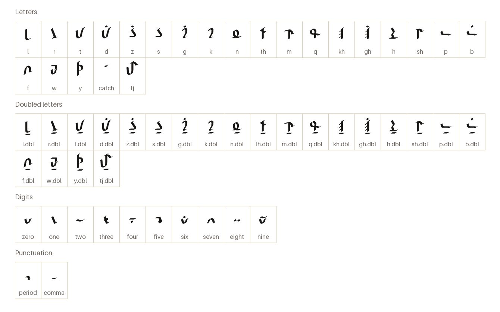
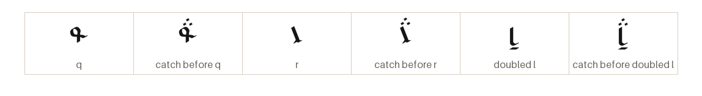
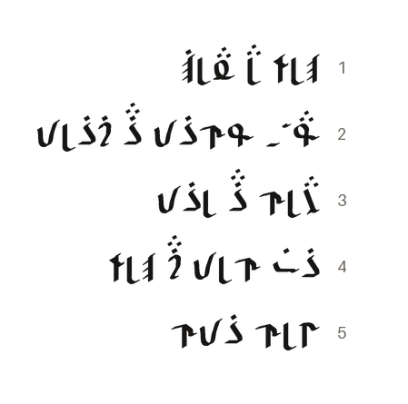

# Qalezu Hand

Au'Khelathu merchants' script, written right to left.

[Back to the README](../README.md) · [Character chart](../charts/qalezu-hand.md) · Keyboard cheatsheet: [HL Qalezu](../keyboards/qalezu.md)

## The letters

Every character the font draws on its own, each under its glyph name.

## The marks

A catch before a consonant is drawn as three reed dabs over it; a doubled consonant carries a bar beneath.

## A passage

From the Sample Phrases of _Khelathi Language_, in thalorna.

Each line reads from the right.

1. the Khelathi way upon life  
   _Khelathu elu anlagh_
2. Sun-lord, hidden in the sanctuary  
   _Uqa'a, qamzet ezu gazlet_
3. I am bound to the throne  
   _Erlem ez luzet_
4. The lord's goods shall prosper  
   _Zab melet agu khelath_
5. Let the followers hear  
   _Shelmu zetem_
