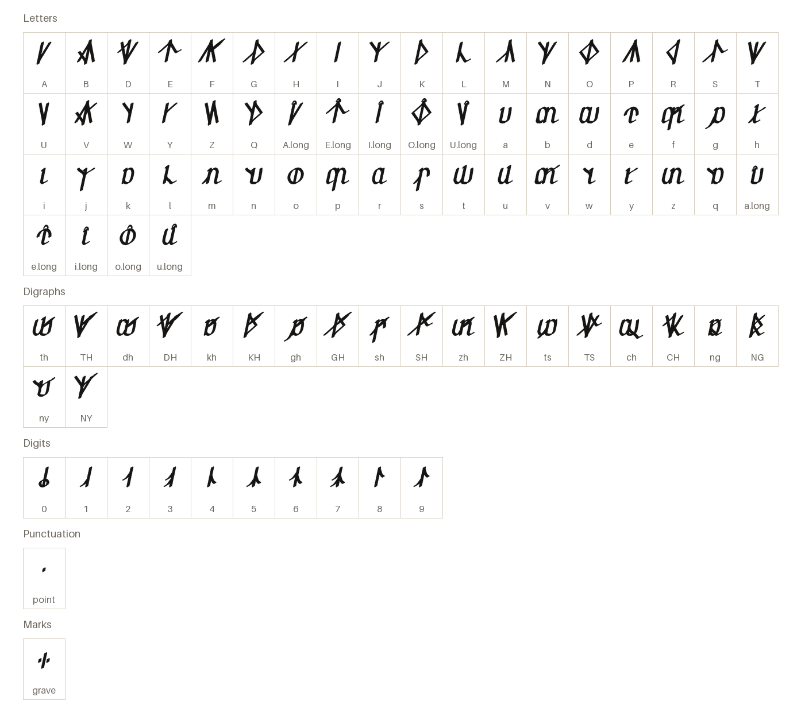
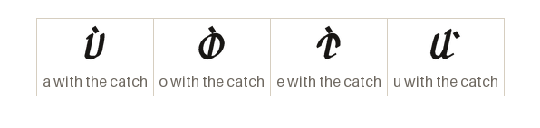
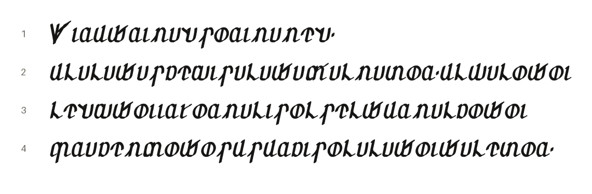

# Semaron Kuriale

Vylarian (human) chancery hand, written left to right.

[Back to the README](../README.md) · [Character chart](../charts/semaron-kuriale.md)

## The letters

Every character the font draws on its own, each under its glyph name.

## The marks

The catch, a glottal stop, is a grave stroke over the letter it follows.

## A passage

From _The Walking of the Line_, lines 1–4, in thalorna.

1. The hallowed boundary I sing,  
   _Thiruthriman sorimamen,_
2. and the one who walked it, and the stones  
   _ul alathas kedis alatha valmazor, ul talothoi_
3. set down in the grass of the six hills  
   _lendthoi ir yormalis ol selthur malkothoi_
4. before a wall stood on any of them.  
   _pra kembothos us urkis ol alathoi thalezor._
