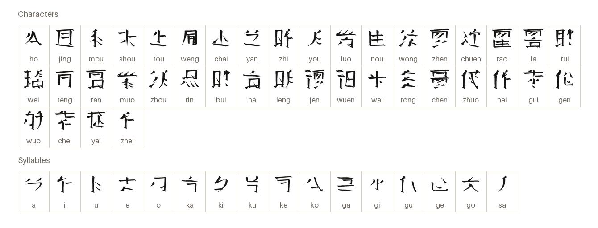
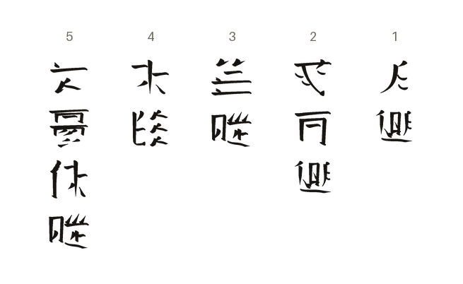

# Teng Chou

Tantsou (human) logographic script, written in columns, top to bottom.

[Back to the README](../README.md) · [Character chart](../charts/teng-chou.md)

## The letters

A sample: the first 40 of the font's 218 characters and the first 16 of its 87 syllables, each under its reading; the [chart](../charts/teng-chou.md) has them all.

## A passage

From the Grammar Notes of _Tantsou Language_, in thalorna.

Each sentence is a column, read top to bottom, the columns from the right.

1. The moon rises.  
   _You cheng._
2. The dragon ascends the sky.  
   _Zho teng cheng._
3. The spirit answers.  
   _Lei wa._
4. The water falls.  
   _Shou jong._
5. The people answer the great emperor.  
   _Dao chen tsou wa._
