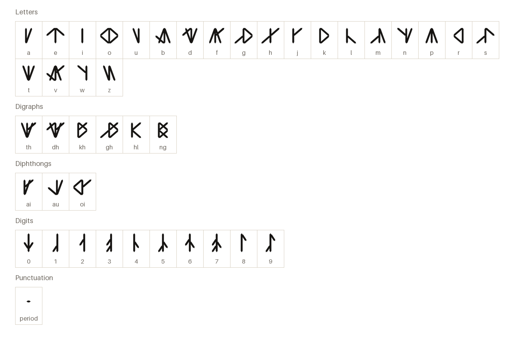
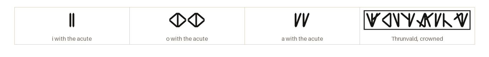
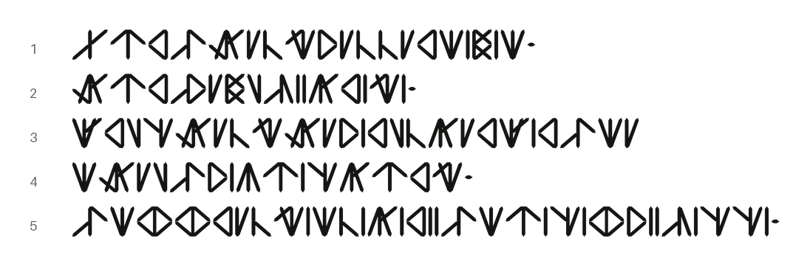

# Thuravark Carved

Proto-Pelwar (human) runic lapidary, derived from Pirzath, with the Tharavarkon recension, written left to right.

[Back to the README](../README.md) · [Character chart](../charts/thuravark-carved.md)

## The letters

Every character the font draws on its own, each under its glyph name.

## The marks

A vowel with the acute is cut as its stave twice. The crown open and crown close frame the name of a god between them.

## A passage

From the Sample Phrases of _Nordmal Language_, in thalorna.

1. The host-wielder calls the assembly.  
   _Hersvald kallar tingit._
2. We come in peace.  
   _Ver gangum í fridi._
3. The Thunder-Wielder wakes, the wolves thirst!  
   _Thrunvald vakir, ulfar thyrsta!_
4. Two ships, one voyage.  
   _Tvau skip, ein ferd._
5. The saga lives in stone and in memory.  
   _Stóraldit lifir í steini ok í minni._
