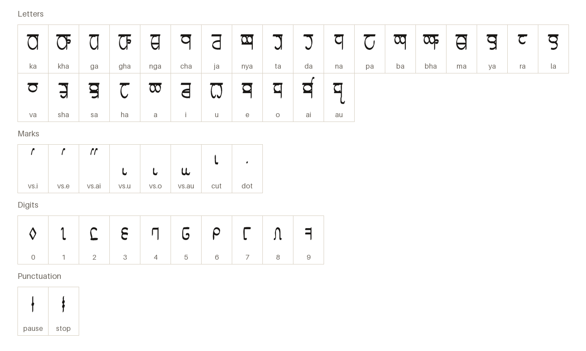
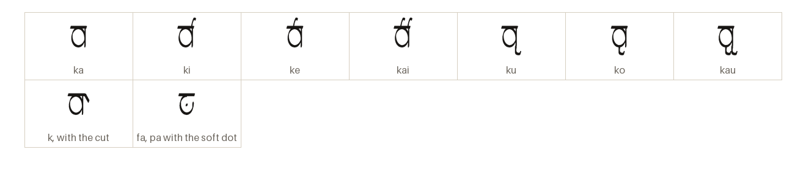
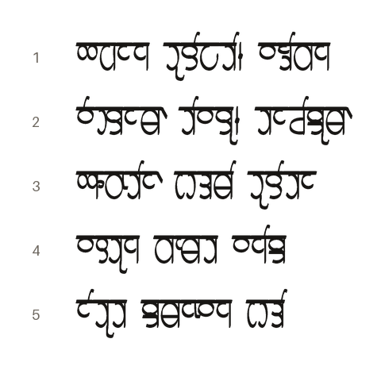

# Vedyakshara Classical

Vedyari (human) temple syllabary, hung from a headline, written left to right.

[Back to the README](../README.md) · [Character chart](../charts/vedyakshara-classical.md) · Keyboard cheatsheet: [HL Vedyakshara](../keyboards/vedyakshara.md)

## The letters

Every character the font draws on its own, each under its glyph name.

## The marks

A consonant carries the vowel a; a vowel sign gives it another vowel, and the cut takes the vowel away.

## A passage

From the Sample Phrases of _Vedyari Language_, in thalorna.

1. Honored elder, I show respect  
   _Agarana dulipati, vandikana_
2. I dwell in Vedyaram, by birthright  
   _Vedyaram tivayu, tarajisum_
3. I hold devotion as my highest path  
   _Bhaktir ushtami dulitara_
4. May the transaction bring prosperity?  
   _Vastuna karmata vanisa?_
5. The observance is offered to the sacred order  
   _Rituta samarvana ushti_
