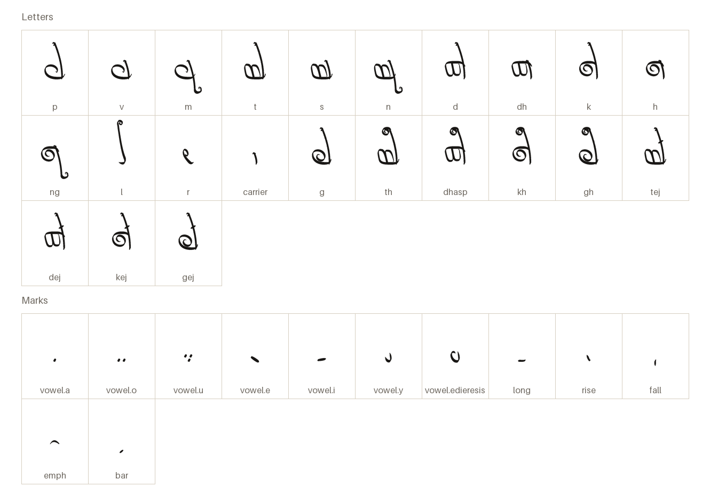
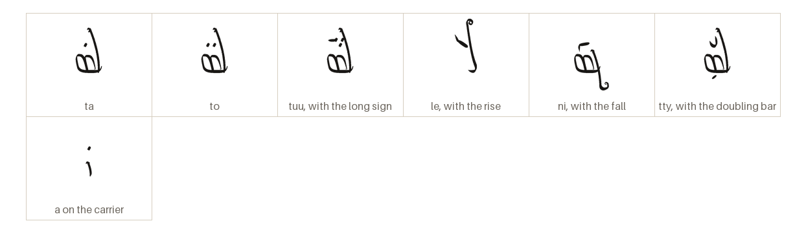
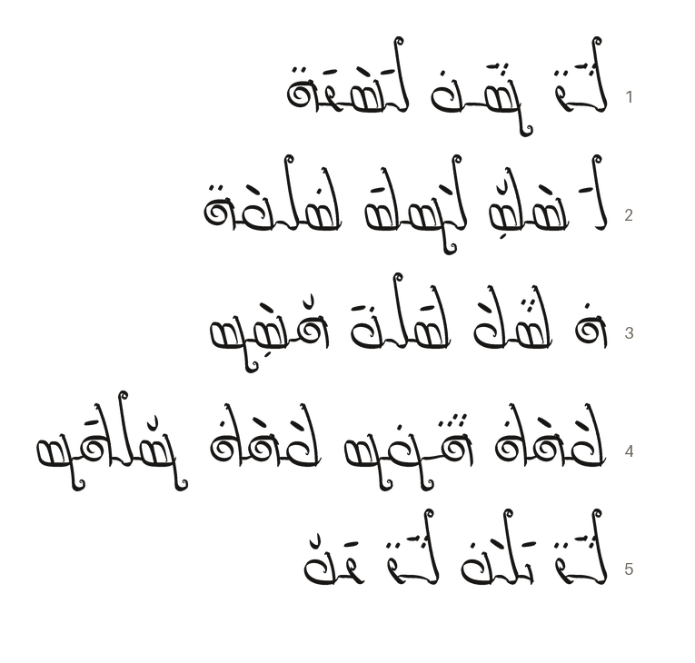

# Veldikko

Sinale (elvish) joined calligraphic hand, written right to left.

[Back to the README](../README.md) · [Character chart](../charts/veldikko.md)

## The letters

Every character the font draws on its own, each under its glyph name.

## The marks

Each vowel is a mark floating over its letter, with its signs of length, pitch and emphasis folded into it.

## A passage

From the Sample Phrases of _Sinale Language_, in thalorna.

Each line reads from the right.

1. Starlight sings on still water  
   _Luuro nuuva liseriho_
2. The tall grass stands in the low fog, as it always does  
   _Li-setty lenti talveho_
3. The seam of light has held the breath  
   _Ha-tupe tilvai hyssen_
4. Give warmth, give root  
   _Peheka huoman, peheka nylkin_
5. The clear place sings, the turning leaf sings  
   _Luuro ileva, luuro rivy_
